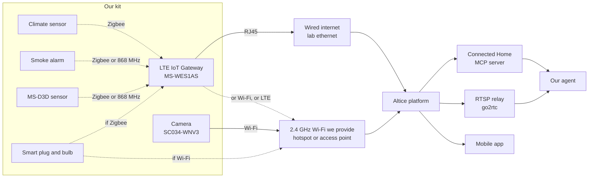

# Hardware kit and access

Sources: photos of the kit taken on 16 Nov ([`sources/kit/`](../sources/kit/)), challenge-room Q&A in the kick-off transcript (lines 164–293), Slack DM with Rui Mendes, team Slack.

## The kit

- Collected from Altice Labs in Aveiro. The pick-up was arranged for Fri 13 Nov.
- Every device is already provisioned on Altice's platform and linked to our team account. No pairing is needed.
- The table says what the hardware is. What the platform exposes for each device is **not confirmed yet**: fill in the last column once the kit is online, from the app or from `GET_HOME_DEVICES`.

| Device | Markings | Power and radio | What it should give us | Seen in the MCP as |
|---|---|---|---|---|
| **Gateway** | "LTE IoT Gateway", model **MS-WES1AS**. Altice label 424, hand-marked "R10 A" | 12 V / 1 A. Uplink by RJ45, Wi-Fi 2.4 GHz (b/g/n) or LTE (4G). Talks to devices over Zigbee 2.4 GHz and RF 433 / 868 MHz | The hub the sensors report to. Probably the "Security Hub" with a cellular link that the MCP guide's example mentions. **It is not a Wi-Fi access point** | |
| **Camera** | Tuya smart camera, model **SC034-WNV3**. Box hand-marked "Tuya Go samples". Altice label 346 | 12 V / 2 A. **Wi-Fi, 2.4 GHz only**. IP65 | The RTSP video feed. The box also lists HD video, motion detection, two-way audio, SD-card and cloud storage | |
| **Climate sensor** | Nedis Zigbee Climate Sensor, model **ZBSC10WT**. Altice label 689 | CR2450 battery. Zigbee 3.0 | Temperature (0–40 °C) and humidity (0–95 %). **Reports only every 5 to 30 minutes** | |
| **Smoke alarm** | Photoelectric smoke alarm, EN 14604. Box hand-marked "V2 NEW 2". Altice label 349. Maker not identified | Battery. Radio not stated | Smoke alarm events. 85 dB siren, test/hush button, low-battery warning | |
| **Small oval sensor** | Model **MS-D3D**. No public listing found | CR2450 battery. Radio not stated | **Not confirmed.** It shares the "MS-" prefix with the gateway, so it is likely that hub's door or window contact | |
| **Smart plug** | EU (Schuko) plug with a power button on the side. No brand visible | Mains. Wi-Fi or Zigbee, not known | Switches whatever is plugged into it. Altice's app screenshots show a power reading next to a plug | |
| **Smart bulb** | E27 LED bulb. No brand visible | Mains. Wi-Fi or Zigbee, not known | Light on and off. Altice's app screenshots show white and colour modes for a bulb | |

What the kit does not have: a thermostat, any valve or pump, a soil-moisture sensor, a motion sensor, a siren other than the smoke alarm's own. The single smart plug is the only general-purpose actuator.

Clean images of each device, for diagrams and slides, are in [`assets/devices/`](../assets/devices/).

## How it connects

Solid lines are known. Dotted lines are inferred and still to confirm.

The point that tripped us up on 16 Nov: **the gateway does not create a Wi-Fi network.** Plugging it into ethernet gives the gateway its own uplink and nothing else. The camera still needs a Wi-Fi network that we provide.

## Bringing it online

### 1. Gateway

Power it and give it an uplink. The simplest is a cable into a port with internet access.

Its front panel has four lights: power, Wi-Fi, a padlock and a link symbol. On 16 Nov, cabled to the lab's ethernet, power was green, link was blue, and Wi-Fi and the padlock were off. We have no manual, so the reading is ours: link shows the wired uplink, and the padlock probably shows whether the security system is armed.

A managed lab network may refuse an unregistered device even though the cable is in and a light is on. **The test is the app:** if the gateway shows offline there, either get the device allowed on the lab network or unplug the cable so it falls back to Wi-Fi.

### 2. Wi-Fi for the camera

Create a network with exactly the name and password in `.env` (`KIT_WIFI_SSID`, `KIT_WIFI_PASSWORD`). All kits were provisioned on one access point at Altice Labs, so they all look for that network.

- It has to be on **2.4 GHz**. The camera's box says "Connect with 2.4G Wi-Fi".
- Name and password are case-sensitive.
- Use WPA2 security.

Ways to create it:

| Option | How |
|---|---|
| Android hotspot | Settings → hotspot and tethering → Wi-Fi hotspot. Set the name and password, and set the band to 2.4 GHz. Menu names vary by brand |
| iPhone hotspot | The hotspot name is the phone's name: Settings → General → About → Name. Set the password under Personal Hotspot and turn on Maximise Compatibility, which forces 2.4 GHz |
| Spare router or access point | Set the SSID and password, enable 2.4 GHz, and plug it into a port with internet access |
| Mac | Only if the Mac itself is on wired ethernet: System Settings → General → Sharing → Internet Sharing, from Ethernet to Wi-Fi, with the same name and password |

The phone that hosts the hotspot can still run the app. Whatever the camera streams travels over that phone's mobile data, so a router on wired internet is the better choice for long sessions.

### 3. Check every device in the app

Each one should show as online. Note what the app calls each device and its room, and fill in the table above.

### 4. Camera

In VLC, open a network stream and paste `CAMERA_RTSP_URL`.

### 5. MCP

Connect an MCP client and log in with the team account. See [03-mcp-connected-home.md](03-mcp-connected-home.md).

## Things to know

- **The climate sensor is slow by design.** Its box gives an update interval of 5 to 30 minutes, so a temperature change will not show up live in a demo.
- **If every device is online in the app and something fails through the MCP, the devices are not the problem.** This is the mentors' rule of thumb.
- **Do not reset the gateway.** It happened to another team: the devices then have to be added again through the app. If it happens, ask the mentors. Someone called Marta on the Altice side knows this process well.
- The camera's serial number and MAC address are on its label and on the back of its box (`sources/kit/camera-box-back.jpg`).

## Mobile app

- Distributed through Firebase App Distribution. The invite was emailed to the team representative (Filipe). The link is in `.env` as `APP_INVITE_URL`. It is unclear whether one invite works on several phones.
- **More invites:** message Hugo Dias on Slack. He offered to send invites to other team members.
- **iPhone:** the app is blocked at first as an untrusted enterprise developer. The mentors said to mark the developer (Altice Labs) as trusted and to look up a guide online. The usual place, from general iOS knowledge rather than from them, is Settings → General → VPN & Device Management. The mentors thought the build had only gone out for Android, so iOS may need extra help.
- Name: the transcript calls it the "Connectathon" app, which is probably a transcription error. The login page in the MCP guide is titled `SMARTHOME-PRO-BETA-APP`.
- Screenshots of Altice's own Connected Home app, from their public product page, are in [`assets/altice-app/`](../assets/altice-app/). The build we were given may look different.

## Camera

- Protocol: RTSP, served from `go2rtc.futurelabsinnovations.com:8554`. Each team has its own URL.
- **There is no authentication.** The URL is the only protection, so do not paste it anywhere shared.
- Once the feed shows in VLC it can be connected to any system we use to process images.

## Event day (Fri 20 Nov)

- Altice Labs will bring an access point with a 4G router broadcasting the same SSID. They are not sure it can serve all seven teams.
- **Bring our own access point or hotspot** configured with the kit's SSID and password, and an ethernet cable for the gateway.
- Parts of the venue have no mobile signal, which rules out relying on a phone hotspot there. The organisers said they may seat the Altice teams near the entrance for that reason.

## Credentials

Values are in `.env`, which is gitignored. All of them reached us on 16 Nov.

| What | `.env` variable | What you do with it | Came from |
|---|---|---|---|
| Kit Wi-Fi | `KIT_WIFI_SSID`, `KIT_WIFI_PASSWORD` | **You do not look for this network, you create it.** Give a hotspot or router this name and password and the kit devices join by themselves. Same values for every team | Rui Mendes, Slack DM |
| Team account | `CONNECTED_HOME_USERNAME`, `CONNECTED_HOME_PASSWORD` | Type it into the login page that opens when an MCP client connects. Try it for the app login too. It was sent as one line, "A - B"; reading that as username and password is our interpretation | Rui Mendes, Slack DM |
| Camera feed | `CAMERA_RTSP_URL` | Paste it into VLC to watch the camera, or hand it to our own vision code. No authentication | Rui Mendes, Slack DM |
| MCP API key | `CONNECTED_HOME_API_KEY` | Paste it into the MCP client config in place of `<API_KEY>` | **Not received yet** |
| App invite | `APP_INVITE_URL` | Open it on the phone to install the app | Email to Filipe |

None of these is typed into the gateway. The gateway has nothing for us to configure.
