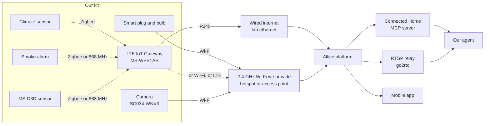

# Hardware kit and access

Sources: photos of the kit taken on 16 Nov (`sources/kit/`), challenge-room Q&A in the kick-off transcript (lines 164–293), organiser Q&A on Slack.

## The kit

- Collected from Altice Labs in Aveiro. The pick-up was arranged for Fri 13 Nov.
- Every device is already provisioned on Altice's platform and linked to our team account. No pairing is needed.
- The table says what the hardware is. The last column is what the platform exposes for each device, read from the app and from `get_home_devices` ([10-mcp-in-practice.md](10-mcp-in-practice.md)).

The home is named **"Hack 3"** in the app, with all seven devices "Without room". The states below were read from the app on 16 Nov, with the gateway cabled to ethernet but no Wi-Fi network up yet.

| Device (app name) | State, 16 Nov | Hardware | Radio / link | Capabilities |
|---|---|---|---|---|
| **Security hub** | On | LTE IoT Gateway **MS-WES1AS** (label 424) | RJ45 / Wi-Fi 2.4 / LTE uplink; **Zigbee + 433/868 MHz** down to the devices | The hub the sensors run through, and the security system itself. Not a Wi-Fi access point |
| **Temperature sensor** | On — **20.8 °C, 48.3 %** | Nedis **ZBSC10WT** (label 689) | Zigbee, via the hub | Temperature + humidity, live. Only **one** unit is paired (the app lists one), even though two round discs were in the kit |
| **Smoke sensor** | On | Photoelectric, EN 14604 (label 349) | via the hub | Smoke events; 85 dB siren, test/hush, low-battery warning |
| **Contact sensor** | **Open** | **MS-D3D** oval (label 685) | RF, via the hub | Open / closed state of a door or window. **Confirmed a contact sensor** |
| **Camera** | Disconnected | Tuya **SC034-WNV3** (label 346) | **Wi-Fi 2.4 GHz only**, IP65 | RTSP feed; motion detection with sensitivity and pet filter, **built-in siren**, night vision, SD recording, two-way audio. Needs the Wi-Fi network **and its 12 V adapter (missing from the kit on 16 Nov)**. Last contact 09 Nov |
| **Plug** | Disconnected → **Online** once the hotspot was up, reporting **0,0 W** | Unbranded Schuko plug | **Wi-Fi** | On/off **and live energy metering** (confirmed: watts shown in the device list) |
| **Light** | Disconnected — **last contact 04 Nov** (provisioning) | Unbranded E27 bulb | **Wi-Fi** | On/off, brightness, white tone, and **colour (confirmed via MCP: `workMode` colour/white/music/scene)**. Needs the Wi-Fi network and a powered socket |

**The connected/disconnected split proves the two radio paths.** The four devices that were *On* (hub, temperature, smoke, contact) talk to the Security hub over Zigbee/RF, and the hub is online via its ethernet cable — so they work with no Wi-Fi. The three that were *Disconnected* (camera, plug, light) are **Wi-Fi** devices and stay offline until we create the 2.4 GHz network.

What the kit does not have: a thermostat, any valve or pump, a soil-moisture sensor, a motion sensor, a siren other than the smoke alarm's own. The single smart plug is the only general-purpose actuator.

Clean images of each device, for diagrams and slides, are in [`assets/devices/`](../assets/devices/).

## How it connects

Solid lines are confirmed. Dotted lines are inferred from the hardware labels: the platform does not report which radio a sensor uses, or the gateway's fallback uplinks.

The point that tripped us up on 16 Nov: **the gateway does not create a Wi-Fi network.** Plugging it into ethernet gives the gateway its own uplink and nothing else. The camera still needs a Wi-Fi network that we provide.

## Bringing it online

### 1. Gateway

Power it and give it an uplink. The simplest is a cable into a port with internet access.

Its front panel has four lights: power, Wi-Fi, a padlock and a link symbol. On 16 Nov, cabled to the lab's ethernet, power was green, link was blue, and Wi-Fi and the padlock were off. No manual came with the kit, so this reading is an assumption: link shows the wired uplink, and the padlock shows whether the security system is armed.

The back panel has, from left to right: a speaker grille, the RJ45 port, a SIM-card slot, two recessed buttons marked with a link symbol and a power symbol, and the DC power input (`sources/kit/gateway-back.jpg`). Cable in the RJ45 port and power in DC is all it needs. Leave the SIM slot empty and **do not press the recessed buttons**: another team's gateway was reset, and its devices had to be added again.

A managed lab network may refuse an unregistered device even though the cable is in and a light is on. **The test is the app:** if the gateway shows offline there, either get the device allowed on the lab network or unplug the cable so it falls back to Wi-Fi.

### 2. Wi-Fi for the camera

Create a network with exactly the name and password in `.env` (`KIT_WIFI_SSID`, `KIT_WIFI_PASSWORD`). All kits were provisioned on one access point at Altice Labs, so they all look for that network.

- It has to be on **2.4 GHz**. The camera's box says "Connect with 2.4G Wi-Fi".
- Name and password are case-sensitive.
- Use WPA2 security.

Ways to create it:

| Option | How |
|---|---|
| Android hotspot | Settings → hotspot and tethering → Wi-Fi hotspot. Set the name and password, and set the band to 2.4 GHz. Menu names vary by brand |
| iPhone hotspot | The hotspot name is the phone's name: Settings → General → About → Name. Set the password under Personal Hotspot and turn on Maximise Compatibility, which forces 2.4 GHz |
| Spare router or access point | Set the SSID and password, enable 2.4 GHz, and plug it into a port with internet access. A Ubiquiti UniFi access point showing a steady white light is in factory-default state: it broadcasts nothing until it is adopted and given a Wi-Fi network in the UniFi Network app or controller |
| Mac | Only if the Mac itself is on wired ethernet: System Settings → General → Sharing → Internet Sharing, from Ethernet to Wi-Fi, with the same name and password |

The phone that hosts the hotspot can still run the app. Whatever the camera streams travels over that phone's mobile data, so a router on wired internet is the better choice for long sessions.

**What the team used from 16 Nov:** the team phone's (Redmi 17) hotspot, reconfigured over ADB to the kit's SSID and password from `.env`, **WPA2-Personal, 2.4 GHz**, SSID visible, auto-off disabled. It shares the phone's mobile data. Within a minute of switching it on the **Plug came online** and started reporting live power.

If a Wi-Fi device stays offline after the network appears, **power-cycle it**: devices that failed to find the network for hours can back off, and a restart makes them retry at once. The bulb also needs to be in a socket that is switched on.

### 3. Check every device in the app

Each one should show as online. The table above gives each device's app name; all seven are "Without room".

### 4. Camera

In VLC, open a network stream and paste `CAMERA_RTSP_URL`.

### 5. MCP

Connect an MCP client and log in with the team account. See [03-mcp-connected-home.md](03-mcp-connected-home.md).

## Things to know

- **The climate sensor is slow by design.** Its box gives an update interval of 5 to 30 minutes, so a temperature change will not show up live in a demo.
- **If every device is online in the app and something fails through the MCP, the devices are not the problem.** This is the mentors' rule of thumb.
- **Do not reset the gateway.** It happened to another team: the devices then have to be added again through the app. If it happens, ask the mentors.
- The camera's serial number and MAC address are on its label and on the back of its box (`sources/kit/camera-box-back.jpg`).

## Mobile app

- Distributed through Firebase App Distribution. The invite was emailed to the team representative. The link is in `.env` as `APP_INVITE_URL`.
- **More invites:** Hugo Dias (Altice Labs) offered on Slack to send invites to other team members.
- **iPhone:** the app is blocked at first as an untrusted enterprise developer. The mentors said to mark the developer (Altice Labs) as trusted and to look up a guide online. The usual place, from general iOS knowledge rather than from them, is Settings → General → VPN & Device Management. The mentors said the build had gone out for Android; the team runs it on an Android phone ([08-app-and-apk.md](08-app-and-apk.md)).
- Name: the transcript calls it the "Connectathon" app. The login page is titled `SMARTHOME-PRO-BETA-APP` and the installed package is `pt.altice.smarthome.beta` ([08-app-and-apk.md](08-app-and-apk.md)).
- Screenshots of Altice's own Connected Home app, from their public product page, are in [`assets/altice-app/`](../assets/altice-app/). The build we were given may look different.

## Camera

- Protocol: RTSP, served from `go2rtc.futurelabsinnovations.com:8554`. Each team has its own URL.
- **There is no authentication.** The URL is the only protection, so do not paste it anywhere shared.
- Once the feed shows in VLC it can be connected to any system we use to process images.

## Event day (Fri 20 Nov)

- Altice Labs will bring an access point with a 4G router broadcasting the same SSID. They are not sure it can serve all seven teams.
- **Bring our own access point or hotspot** configured with the kit's SSID and password, and an ethernet cable for the gateway.
- Parts of the venue have no mobile signal, which rules out relying on a phone hotspot there. The organisers said they may seat the Altice teams near the entrance for that reason.

## Credentials

Values are in `.env`, which is gitignored. All of them reached us on 16 Nov.

| What | `.env` variable | What you do with it | Came from |
|---|---|---|---|
| Kit Wi-Fi | `KIT_WIFI_SSID`, `KIT_WIFI_PASSWORD` | **You do not look for this network, you create it.** Give a hotspot or router this name and password and the kit devices join by themselves. Same values for every team | Rui Mendes, Slack DM |
| Team account | `CONNECTED_HOME_USERNAME`, `CONNECTED_HOME_PASSWORD` | Type it into the login page that opens when an MCP client connects. It was sent as one line, "A - B": username and password, which log in to the MCP ([10-mcp-in-practice.md](10-mcp-in-practice.md)) | Rui Mendes, Slack DM |
| Camera feed | `CAMERA_RTSP_URL` | Paste it into VLC to watch the camera, or hand it to our own vision code. No authentication | Rui Mendes, Slack DM |
| MCP API key | `CONNECTED_HOME_API_KEY` | Paste it into the MCP client config in place of `<API_KEY>` | Rui Mendes, Slack, 16 Nov |
| App invite | `APP_INVITE_URL` | Open it on the phone to install the app | Email to the team representative |

None of these is typed into the gateway. The gateway has nothing for us to configure.
