# ThingTracker · architecture

Version 3, Fri 20 Nov 2026. Audience: the Altice Labs jury and engineers, and our team. The **final design**, decided on 20 Nov, is fully local: it is stated in the next section, and the figures show it. Sections 1 to 18 keep the detailed design of 19 Nov (what runs where, which component decides what, with which signal and which threshold); where one of them places vision, a language model, fingerprints or pictures at Altice, it describes the alternative evaluated, not chosen, because images would leave the home. Section 16 says, item by item, what the prototype does today.

The views follow three standards: the C4 model for context, containers and components ([c4model.com](https://c4model.com)); arc42 for the runtime view (the sequences, section 6 of arc42) and the deployment view (section 7) ([arc42.org](https://arc42.org)); and the data-flow diagram with trust boundaries used in threat modelling by the Microsoft Security Development Lifecycle ([Threat Modeling Tool](https://learn.microsoft.com/en-us/azure/security/develop/threat-modeling-tool)) and by OWASP ([Threat Modeling Cheat Sheet](https://cheatsheetseries.owasp.org/cheatsheets/Threat_Modeling_Cheat_Sheet.html)). Every figure is built by `docs/architecture/build_views.py --lang en`, which measures each text against its box and stops if one does not fit.

## Final design (20 Nov): fully local

Privacy first: everything that looks at the home runs in the home.

- **The home device does all the perception and inference.** It is the router, if it has an NPU, or a dedicated box such as a Raspberry Pi 5 with an AI accelerator or a Jetson Orin Nano Super. It handles:
  - camera ingest on the local network;
  - motion gating;
  - vision: detection plus re-identification against the visual fingerprint (OWLv2 + DINOv2 in the prototype; lighter detectors such as YOLOv8n on small devices);
  - optional face recognition (YuNet + SFace), with the templates kept on the device;
  - the local memory (where and when each thing was seen);
  - the rules engine;
  - the language model (Qwen3-1.7B in the prototype), for sentence → rule and question → answer. It never decides.
- **Images, video, visual fingerprints and face templates never leave the home.**
- **Registration photos** go from the phone to the home device: directly on the home Wi-Fi, or through an end-to-end-encrypted relay that Altice cannot read. The device builds the fingerprint.
- **The Altice platform is the control and data plane, text only.** It provides:
  - accounts, identity and family permissions;
  - the system of record for metadata: things, people (names only), ownership links, scenarios. This gives backup, sync across family phones, and restore if the box is replaced;
  - the event log as structured text (for example "book, desk, 18:02");
  - push notifications to the app;
  - a relay so that the app reaches the home when the family is away;
  - device actions through the Connected Home MCP.
- **Why the cloud is still needed:** the phone is not always on the home network; notifications and device control are Altice platform services; and metadata needs backup and multi-user sync.
- **External language models** (for example the user's own ChatGPT or Claude) are a possible future opt-in, text only. Not now.
- **Cost:** the equipment is bought once: an indoor camera, about €45; a Raspberry Pi 5, about €200, or a Jetson Orin Nano Super, about €345; or a router with an NPU, about €15 more (an estimate). Over 5 years, that is €3.33 or €5.75 a month for the device. The models' energy costs cents a month: YOLOv8n below €0.01, OWLv2 up to €0.72 at 12 h of motion a day (a team estimate on a Jetson Orin Nano). Team price research of 20 Nov; the sources are in document 17. A box paid for by Altice does not pay back at €3.99 a month: it leaves −€4.81 to −€6.90 per home a month (document 17, section 9). The model works with the AI on the router, or with equipment the customer buys.
- **Alternative evaluated, not chosen: vision on Altice's L4 GPUs** (the hybrid design of 19 Nov, about €0.49 per home a month, document 17). Images would leave the home: the region that changed, about once a second during motion.
- **Open point.** How the app shows a picture in an alert or an answer (the unknown person, the last sighting) while images stay in the home, for example over the end-to-end-encrypted relay, is still to be designed.

## In short

- **Fully local.** At home, on the home device: camera ingest, the motion gate, privacy masks, vision (detection and re-identification), opt-in face recognition, the memory, the rules engine and the language model. At Altice, text only: accounts, the metadata record, the event log, notifications, the relay and device actions through the MCP.
- **Images never leave the home.** Video, pictures, visual fingerprints and face templates stay on the home device. What crosses to Altice is text: events, labels (a thing's name, a family member's name, "unknown face"), rules and commands.
- **Three kinds of evidence, one decision maker.** Fast eyes at every motion (motion gate, OWLv2, DINOv2, faces); a vision-language judge called rarely, for an ambiguous moment; facts beyond the camera (the door sensor and the family's phones on the Wi-Fi) for "did someone leave?". The rules engine decides, with plain code.
- **Cost:** the home device is bought once (€3.33 or €5.75 a month over 5 years) and its energy costs cents a month. The earlier estimates, about €0.49 per home a month for vision on Altice's own L4 servers (document 17) and about €0.43 for a cloud language model (document 16), belong to the alternative evaluated, not chosen.
- **The home device:** the router, if it has an NPU that can run a detector (about €15 more per router, an estimate; document 17, option A1); otherwise a dedicated box.

## 1. The idea in one paragraph

A home camera is the richest sensor in the house, but today it only reports "motion detected". ThingTracker makes it a source of information. Open-source vision models find the things a family registered (a book, keys, a wallet) and the people in the picture; a cheap motion gate in the home decides when they run. A language model turns one sentence into a precise rule ("tell me if I leave home without my book") and answers questions from the memory ("where is my book?"). The rules run as plain code on the home device, which combines what the cameras saw with what no camera can see: the door opening and closing, and the family's phones leaving or joining the home Wi-Fi. Actions reach the existing Altice devices (light, plug, siren) through Altice's MCP server, after a "Yes" in the app.

Three principles shape everything below:

1. **Cheap eyes always, an expensive judge rarely.** Motion, detection, fingerprints and faces run at every motion; a vision-language model looks only at an ambiguous moment, and its "unsure" makes the system ask the family, never act.
2. **The language model writes the rule; the rules engine decides.** The model is used when a sentence becomes a rule, not on every frame; alarms rest on rules that can be read and tested.
3. **What stays home stays home.** Images, video, visual fingerprints and face templates never leave the house; only text does (events, labels, rules, commands).

## 2. Requirements and constraints

| # | Requirement | Target | How it is met |
|---|---|---|---|
| F1 | Track the things the user names, and tell them apart from similar things | "Your keys", not "any keys" | OWLv2 finds candidates; DINOv2 vectors are matched against the thing's 8 photos (§6, §9) |
| F2 | Answer "where is X?" with place, time and a picture | Answer in ≤ 3 s | Last sighting in PostgreSQL; the language model only words the answer |
| F3 | Create a sensor from one sentence | No settings screens | The language model compiles the sentence into a rule (§10) |
| F4 | Know who is home | Correct for the empty-home rules | Presence engine over phones, door and cameras (§7) |
| F5 | Act on the home's devices | Same path as the app | MCP tools, after a "Yes" (§8.7) |
| N1 | Privacy | No image, video, fingerprint or face template leaves the home | All perception on the home device; only text crosses to Altice; DFD and data rules (§12) |
| N2 | Cost at 500,000 homes | Vision under the €1.73 a month that the add-on can carry (document 17) | No vision cost at Altice: the home device is bought once, on the router or by the customer. The alternative not chosen, vision at Altice: about €0.49 |
| N3 | Latency, event to alert | A few seconds | Door event, urgent queue, rule; measured parts in §14 |
| N4 | Adoption by Altice | No new app, no new device path | A tab in the existing app; MCP tools; platform scenarios |

**Constraints today.**
- **The camera.** One Wi-Fi camera (Tuya SC034-WNV3), reachable as RTSP through the organisers' go2rtc relay: H.265, 2304 × 1296, 20 fps (checked with ffprobe, 18 Nov). Opening the stream costs about 5 s, because the decoder waits for a keyframe, so one connection is kept open and the latest frame is read from memory.
- **The MCP server** has 18 tools, with no push notifications and no general event feed (only the alarm history, `get_home_security_alarm_history`). Its login token lasts about 24 h. The door state is read by polling `get_home_devices`.
- **The kit's hub cannot run vision models.** It is an LTE gateway, not a compute device.
- **No tool exposes the router's Wi-Fi clients** today, so phone presence is a proposal (§7).

## 3. Context (C4 level 1)

Figure 1 shows ThingTracker among the people and systems around it. The family uses the Altice app it already has; ThingTracker reads the kit cameras, receives door and Wi-Fi events from the Connected Home platform, sends MCP calls back to it and calls the language models.

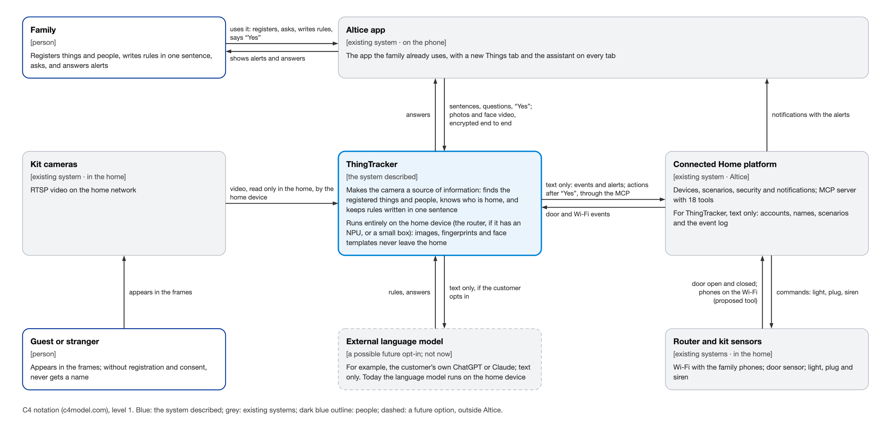

**Figure 1** – C4 level 1: ThingTracker, the family, a guest or stranger, and the existing Altice systems.

A guest or stranger appears in the frames but, without registration and consent, never gets a name: an unrecognised face is labelled "unknown face" and nothing about it is stored.

## 4. Containers (C4 level 2)

Figure 2 shows the containers, the technology of each and what every arrow carries, one arrow per direction.

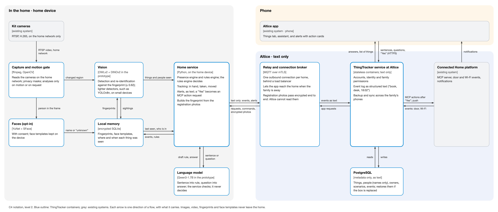

**Figure 2** – C4 level 2: ThingTracker's containers in the home and at Altice, and the existing systems they use.

The table describes the hybrid design of 19 Nov. In the final design, the vision workers, the matching against fingerprints, the rules engine, the memory of sightings, the thumbnails and the language models run on the home device; at Altice stay the connection broker (now the relay), the app API, the metadata record, the event log and the MCP host, all text only.

| Container | Where | Technology | Job | Scales by |
|---|---|---|---|---|
| Home agent | Router CPU | Python, OpenCV | Masks, motion gate, changed region, faces; reads on request; keeps the last 3 s in memory for the judge | One per home |
| Face templates | Router | Encrypted SQLite | Up to 8 SFace templates per person who consented | One per home |
| Connection broker | Altice | MQTT over mTLS, behind a load balancer | One outbound connection per home; a topic per home for regions and requests | Broker nodes |
| Queues and event stream | Altice | Message broker | Urgent and batch vision queues; each home's events in order (partitioned by home); model requests | Partitions |
| Vision workers | Altice | PyTorch on NVIDIA L4 | OWLv2 boxes, DINOv2 vectors; stateless | GPU cards |
| ThingTracker service | Altice | Stateless containers behind a load balancer | App API, MCP host, matching, tracking, presence engine, rules engine, alerts | Instances |
| Cache | Altice | Redis | Each home's live state: presence, tracks, counters, timers | Memory |
| PostgreSQL | Altice | PostgreSQL with pgvector | Per customer: things, fingerprints, rules, alerts, sightings, presence | Primary and replica |
| Object storage | Altice | S3-compatible | Sighting thumbnails, 30 days (proposal) | Capacity |
| Language and vision-language models | Altice (the text model may be a provider under contract) | GPU servers behind a queue | Text: sentences into rules, answers. Judge: rare short clips | GPU servers |

The service is stateless so that any instance can serve any home: each home's events arrive in order on one partition, its live state is in the cache, and everything durable is in PostgreSQL. Document 15's message flow assumed the rules engine in the home; in this design it runs in the service, and the MCP tools and the scenario format of document 15 are unchanged.

## 5. Deployment (arc42 section 7)

Figure 3 shows where each part runs, the hardware, the numbers at 500,000 homes, the upgrade path and the two options that were rejected.

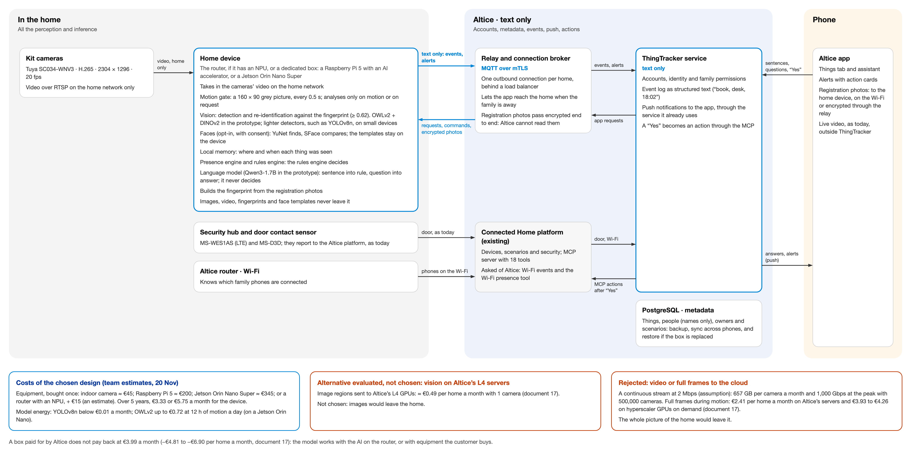

**Figure 3** – Deployment: the home device with all the perception and inference, the Altice platform with text only, the phone, the costs, and the options considered.

### 5.1 Alternative evaluated, not chosen: hybrid on Altice's own L4 servers

Not chosen on 20 Nov: images would leave the home (the region that changed, about once a second during motion). It is kept here because it was costed in detail (document 17).

**In the home**, on the equipment already there: the Altice router (CPU, no AI accelerator) runs the home agent; the kit cameras send RTSP on the home network only; the security hub and the door contact sensor report to the Altice platform, as today; the router knows which family phones are connected. One outbound, mutually authenticated connection (mTLS) carries everything ThingTracker sends from the home.

**At Altice:** two load balancers (one for the homes' connections, one for the app), the connection broker, the queues, the ThingTracker service instances, the vision workers on L4 GPUs, PostgreSQL with pgvector (primary and replica), the cache, object storage, and the GPU servers of the language and vision-language models. The existing Connected Home platform (MCP server, devices, events) and the app's notification service are used as they are.

**Why the load balancers are at Altice and not in the home.** A home has one agent on one router: there is nothing to spread. The 500,000 homes meet at Altice, where their connections and the app's requests have to be shared among many service instances, and where an instance that fails must be taken out without anyone noticing. The GPU work goes through queues rather than load balancers, because it can wait and be batched: the urgent queue is served at once, the batch queue in quiet hours, so the GPUs are sized for the average plus the urgent share (66,376 frames a second at 500,000 homes) instead of the evening peak (124,031), as document 17 computes.

**Sizing at 500,000 homes (estimates, document 17).** About 1,427 L4 cards and €6.4 M of hardware, for about €0.49 per home a month with one camera (€0.98 with two), assuming 2 h of motion per camera a day, analysed at 1 frame per second, with GPUs at 25 % of their peak speed. An error of two times in any of these three assumptions doubles or halves the cost; the first item in document 17's list of checks is to measure the real throughput.

### 5.2 The final design: vision in the home (A1, or a dedicated box)

If Altice's routers or cameras have an NPU that can run a detector, OWLv2 and DINOv2 (or a lighter detector) run in the home agent, and only text leaves the home: events, labels, rules and commands. Document 17 estimates about €0.36 per home a month, from an assumed €15 router premium. Whether the router has such an NPU is the first item the pilot must confirm with Altice (§18). Otherwise the home device is a dedicated box bought by the customer: a light device, a Raspberry Pi 5 (about €200), or a heavy device, a Jetson Orin Nano Super (about €345), team price research of 20 Nov (document 17).

### 5.3 The options rejected on 19 Nov

Option (a) was rejected on 19 Nov on the cost of a box paid for by Altice, with the Jetson's launch price. On 20 Nov it became the final design, with the box bought by the customer or the AI on the router, so that images never leave the home.

| Option | What it means | Numbers (document 17 unless noted) | Why it was rejected |
|---|---|---|---|
| (a) Everything in the home, language model included | A box per home runs vision and a language model | Raspberry Pi 5 with AI HAT+ (€200) or Jetson Orin Nano Super (€269): €6.55 to €8.64 per home a month, €107.5 M to €142.0 M of hardware at 500,000 homes. The prototype's language model (Qwen3-1.7B, 4-bit) takes about 1 GB; a 4B model tried took 2.1 GB and was three times slower (team measurement, 18 Nov) | The add-on can carry at most €1.73 a month for vision; a box costs four to five times that. A language model needs more memory again, small models wrote Portuguese that was not always European, and every model update has to reach 500,000 boxes |
| (b) Vision in Altice's cloud from full frames or video | Every camera sends frames or a stream to GPU servers | A continuous stream at 2 Mbps (assumption): 657 GB per camera a month, 1,000 Gbps at the peak for 500,000 cameras, €1.00 per home a month in network alone. Full frames during motion: 17.5 GB per camera a month; GPUs sized for the evening peak, €2.41 per home a month on Altice's servers, €3.93 to €4.26 on hyperscaler GPUs on demand | Costs more than the add-on can carry, and the whole picture of the home would leave it, all the time |

The hybrid design keeps the motion gate at home, which makes a central option possible at all: the changed region is about 8.8 GB per camera a month (40 KB per region, an assumption), against 657 GB for a stream.

### 5.4 Where things run in the demo

In the demo, the team's MacBook plays every part at once. `edge.py` plays the home device's eyes: the motion gate, the faces (since 19 Nov) and the vision models (OWLv2 and DINOv2, on the Mac's GPU). `server.py` plays the home device's memory and rules engine and Altice's side, with the presence engine and SQLite standing in for PostgreSQL. `llm_local.py` plays the home device's language model, with Qwen3-1.7B through MLX. The phone screens are a browser on the same Mac. The camera stream reaches the Mac through the organisers' cloud relay; in the product, the stream never leaves the home network.

## 6. Components (C4 level 3)

Figure 4 opens the home agent, the vision workers and the ThingTracker service, in the order a frame goes through them.

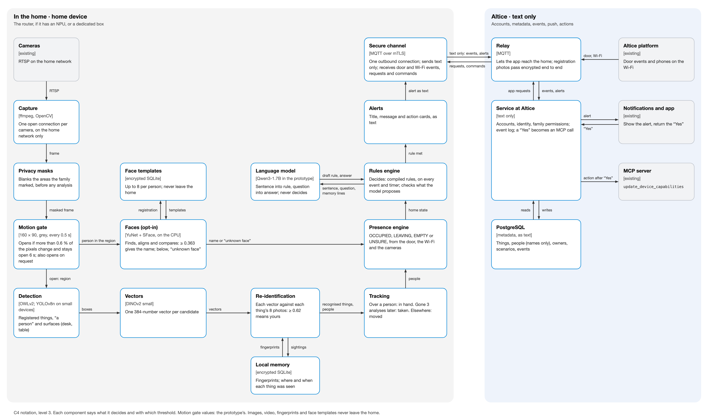

**Figure 4** – C4 level 3: the pipeline from capture to alert, with what each component decides.

| # | Component | Where | Input | Decides | Threshold or value | Output |
|---|---|---|---|---|---|---|
| 1 | Capture | Home agent | RTSP of each camera | Nothing; keeps one connection open | Last 3 s in memory only, for the judge | The latest frame |
| 2 | Privacy masks | Home agent | Frame | Which areas are never analysed | Areas the family drew | Masked frame |
| 3 | Motion gate | Home agent | 160 × 90 grey picture every 0.5 s against a slow background | Whether to analyse | More than 0.6 % of pixels changed by more than 22 grey levels; stays open 6 s (prototype values). Also opens on a request from the service | Open or closed |
| 4 | Region cutter | Home agent | Frame, gate | Which part to send | The changed region, or the requested one, at most 640 × 640; about 1 a second | Region |
| 5 | Faces (opt-in) | Home agent | Region | Who a visible face is | YuNet finds the face; SFace compares it with the templates; cosine bands give the name, "unknown face" or "face not visible" (§8.3) | A family member's name ("Ana"), "unknown face" or "face not visible", with the face box |
| 6 | Secure channel | Home agent | Region and labels | Nothing; queues events and labels while offline, never images | mTLS, one certificate per home | Messages to the broker |
| 7 | Vision queues | Altice | Regions, requests | Urgent or batch | Urgent: active checks, refreshes, registrations, clips for the judge, homes with an active safety rule. Batch: the rest | Ordered work |
| 8 | Detection | Vision workers | Region | Boxes of the home's registered things, "a person" and surfaces (desk, table) | OWLv2 scores (prototype: 0.1 to propose, 0.2 for a person) | Boxes |
| 9 | Vectors | Vision workers | Boxes | Nothing | DINOv2 small: 384 numbers per candidate | Boxes and vectors |
| 10 | Matching | Service | Vectors, fingerprints in pgvector | Whether a candidate is *your* thing | Cosine ≥ 0.62 to the closest of its 8 photos | Recognised things |
| 11 | Tracking | Service | Boxes across analyses | In hand, taken, moved (§8.2) | Box overlap; 3 analyses missing | Sightings, written only when something changes |
| 12 | Presence engine | Service | Phones, door, people and face labels | OCCUPIED, LEAVING, EMPTY, UNSURE (§7) | Timings in §7 | State, count, who; refresh requests |
| 13 | Rules engine | Service | Compiled rules, presence, sightings, events, timers | Whether a rule is met; whether to ask for an active check or the judge | Per rule (§8) | Alert or nothing |
| 14 | Alerts and actions | Service | A rule met | What the alert says and which actions it offers | Siren per the family's choice; arming always asks | Notification; MCP call after "Yes" |
| 15 | Judge | Language and vision-language models | 2 to 3 s of a region | Yes, no or unsure, with a sentence (§8.6) | Called rarely | Verdict to the home's stream |

The rules engine is event-driven: it runs for a home whenever an event for that home arrives (a vision result, a door event, a Wi-Fi event) and when a timer it set expires, so a rule is checked within about a second of the evidence. In the prototype it is a loop every 2 s.

## 7. Presence: who is home?

Figure 5 shows the presence state machine. It runs in the ThingTracker service, one state per home, recomputed on every event and every timer.

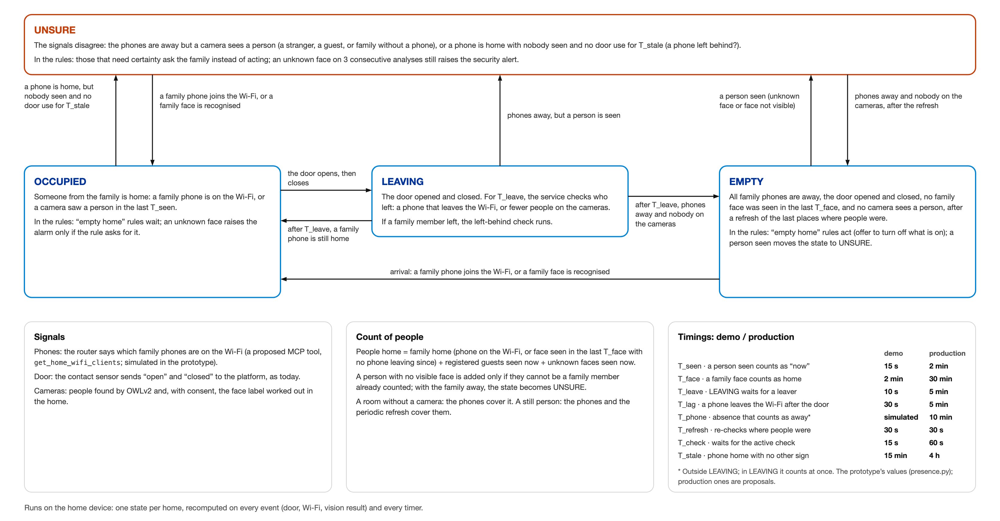

**Figure 5** – Presence: four states fused from the family's phones, the door sensor and the cameras, with demo and production timings.

**The three signals.**
- **The family's phones on the home Wi-Fi.** The Altice router sees which devices are connected. We propose to Altice a read-only MCP tool, `get_home_wifi_clients` (each client's MAC address, name, band and "connected since"), and `wifi.joined` / `wifi.left` events; the family pairs each phone with a person once, in the app. How the router keeps recognising a phone that randomises its MAC address is a question for Altice. The prototype simulates the phones.
- **The door contact sensor** (MS-D3D, with the MS-WES1AS hub): "open" and "closed", already reported to the platform. Today it is read by polling `get_home_devices` every 4 s; an event API is the first request to Altice. The family marks which contact sensor is the entrance door.
- **People on each camera**, from OWLv2's "a person" boxes, with the face label from the home agent: a Family member's name, "unknown face", or "face not visible" (a person box with no face judged inside it).

**The states and transitions.**

| From | To | Condition | Signals used |
|---|---|---|---|
| OCCUPIED | LEAVING | The door opens, then closes | Door |
| LEAVING | OCCUPIED | After T_leave, a Family phone is still home | Door, phones |
| LEAVING | EMPTY | After T_leave, all Family phones are away, no Family face was seen in the last T_face, and nobody is on any camera after a refresh | Door, phones, cameras |
| LEAVING | UNSURE | Phones away, but a person is seen | Phones, cameras |
| EMPTY | OCCUPIED | Arrival: a Family phone joins the Wi-Fi, or a Family face is recognised | Phones, faces |
| EMPTY | UNSURE | A person is seen (unknown face or face not visible) while all phones are away | Cameras, phones |
| OCCUPIED | UNSURE | A phone is home, but nobody has been seen and the door unused for T_stale (a phone left behind?) | Phones, cameras, door |
| UNSURE | OCCUPIED | A Family phone joins the Wi-Fi, or a Family face is recognised | Phones, faces |
| UNSURE | EMPTY | Phones away and nobody on the cameras, after the refresh | Phones, cameras |

**What the states mean for the rules.** In OCCUPIED, "empty home" rules wait. In EMPTY, they act (they offer to turn off what is still on). In UNSURE, rules that need certainty ask the family instead of acting; an unknown face on 3 consecutive analyses still raises the security alert.

**The count.** People home = Family members home (phone on the Wi-Fi, or face seen in the last T_face with no phone leaving since) + registered guests seen now + unknown faces seen now. A person with no visible face is added only if they cannot be a Family member already counted; with the Family away, that person makes the state UNSURE.

**What no camera sees.** A room without a camera is covered by the phones. A person who stays still triggers no motion, so while the state rests on the cameras alone (no Family phone home), the service asks the home agent every T_refresh for the regions where people were last seen, even without motion.

**Timings** (the prototype's values in `prototype/presence.py`; production values are proposals to tune in a pilot):

| Timer | Meaning | Demo | Production |
|---|---|---|---|
| T_seen | A person seen counts as "now" | 15 s | 2 min |
| T_face | A Family face counts as home | 2 min | 30 min |
| T_leave | How long LEAVING waits for whoever left | 10 s | 5 min |
| T_lag | A phone may leave the Wi-Fi this long after the door | 30 s | 5 min |
| T_phone | Outside LEAVING, how long a phone must be missing to count as away (inside LEAVING it counts at once) | Simulated | 10 min |
| T_refresh | Re-check where people were, without motion | 30 s | 30 s |
| T_check | Wait for an active check before calling it unsure | 15 s | 60 s |
| T_stale | A phone home with no other sign of anyone | 15 min | 4 h |

## 8. Decision tables, rule by rule

Every rule below is plain code in the rules engine. The models only perceive; the judge only answers a question the rule asked.

### 8.1 Left behind (the book)

Figure 6 shows the sequence for the rule "tell me if I leave home without my book".

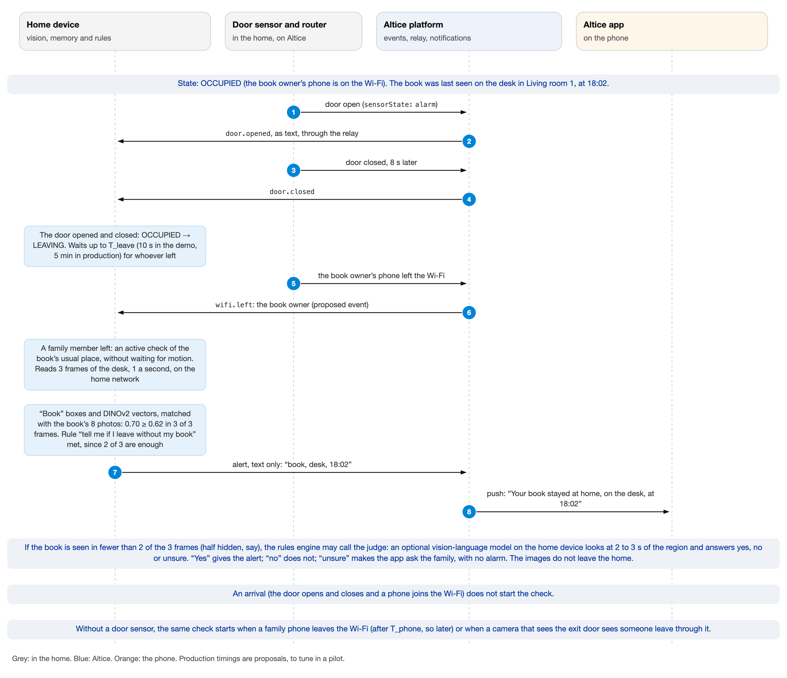

**Figure 6** – The book left behind: the door, the phone, the active check, and the optional judge.

| Item | Value |
|---|---|
| Runs in | The rules engine, in the ThingTracker service |
| Trigger | The door **closes** after an opening, and presence shows that a Family member left: a phone left the Wi-Fi within T_leave + T_lag, or the count of people dropped. If the rule names an owner, it is that person's phone |
| Not a trigger | An arrival: the door opens and closes and a phone joins the Wi-Fi, or the count rises |
| Active check | The service asks the home agent for the region of the thing's usual place (its last sighting's box, with a margin), 3 frames about 1 s apart, regardless of motion, on the urgent queue |
| Seen | The thing matched (cosine ≥ 0.62) in at least 2 of the 3 frames: **alert**, with the thumbnail just taken and "on the desk, at 18:02" |
| Not seen | Fewer than 2 of 3, or no answer within T_check: **"unsure"**, no alarm, only a log entry |
| Optional judge | When the check is unsure because the thing may be partly hidden, the rules engine may call the judge with 2 to 3 s of the region: "yes" gives the alert; "no" gives none; "unsure" makes the app ask the family |
| Already out | If the thing was seen in hand, or at the entrance, as the door opened, it went out: no alert |

**Does the book case need the door sensor?** The best trigger is the kit's door contact sensor: it is already part of the Altice kit and connected to the platform, ThingTracker only reads its events, and it is instant: the door closes after someone leaves, then the active check runs. Without a door sensor, two fallbacks start the same check. First, a family phone leaves the home Wi-Fi: the router sees it, but the rule waits T_phone (about 10 min in production) so that a short Wi-Fi drop does not count, and the alert arrives late, as "you left your book at home", which is still useful. Second, a camera that sees the exit door: a person track leaving through the door's area counts as "someone left", which works only if a camera covers the door. The minimum is one "someone left" signal plus the camera's active check of the thing.

### 8.2 Picked up, taken, moved

| Event | Condition | Output | Runs in |
|---|---|---|---|
| In hand | A thing's box overlaps a person's box in one analysis (prototype: overlap ratio ≥ 0.02) | Sighting "in hand", with who if the face is known in the same analysis | Tracking, in the service |
| Taken by | The thing is missing from its place for 3 or more consecutive analyses of that place after a person was near it | Event "taken by <who>" (the name if the face was known, otherwise "someone") | Tracking |
| Moved to | The thing is matched (≥ 0.62) by another camera, or on another surface of the same camera | Event "moved to <place>"; the last sighting changes | Tracking |
| Ambiguous | "Taken, or just moved out of view?" when the evidence disagrees | The rules engine may call the judge; "unsure" keeps the last sighting and says so | Rules engine |

Each camera is one place ("Living room 1"); the surface under the thing (desk, table) is a description inside that place. Zones inside a camera are a later feature.

### 8.3 Faces (opt-in, per household, with consent)

Figure 7 shows the unknown-person sequence.

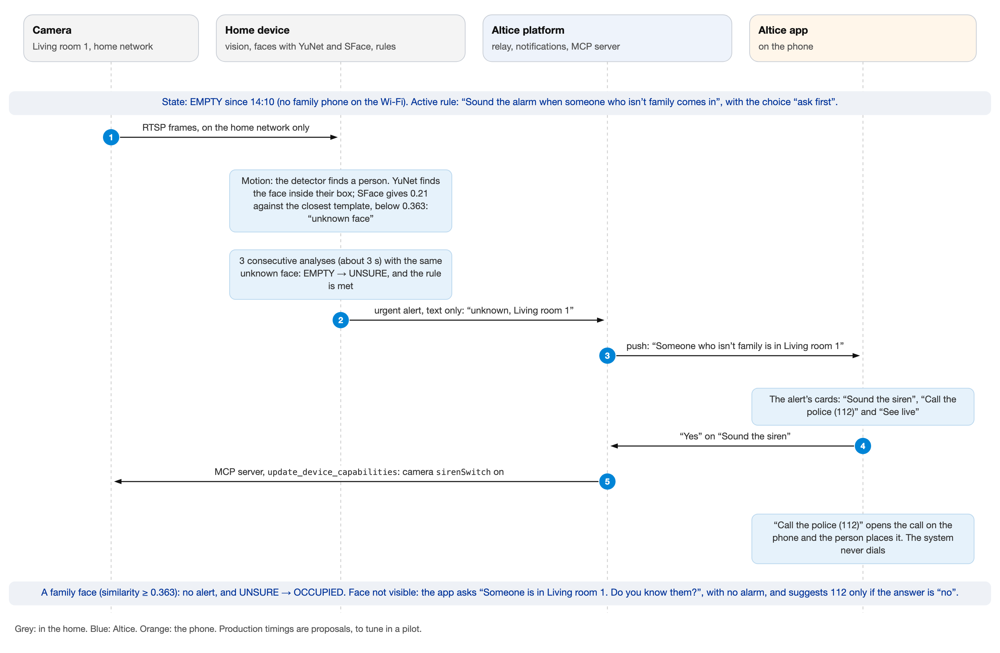

**Figure 7** – An unknown person while the family is away: the face label at home, three analyses, the alert, the siren after a "Yes", and the 112 suggestion.

**Registration.**

| Step | Where | What happens |
|---|---|---|
| 1 | App | The person themselves agrees to be recognised; nothing is pre-selected; the platform stores the consent record (who, when, which text) and never biometric data |
| 2 | App → home agent | A short selfie video goes through the secure channel to the home agent; the platform relays it without storing it |
| 3 | Home agent | YuNet finds the face in the frames; each face is aligned on its 5 landmarks and cropped to 112 × 112; SFace turns it into 128 numbers |
| 4 | Home agent | Up to 8 templates, chosen from different frames, are stored in the router's encrypted SQLite; the video is deleted |
| 5 | Withdrawal | The person turns recognition off; the templates are deleted in the home and the deletion is confirmed |

Document 20 (section 1.3) had proposed enrolment in front of the home camera so that no image of a face crosses the platform; the team's decision is the selfie video. Uploading it over the home Wi-Fi straight to the router would keep it off the platform entirely, and is listed as an option in §18.

**Recognition.**

| Step | Rule |
|---|---|
| Find | For each person box, the home agent looks for a face with YuNet inside it |
| Judge only clear faces | A face too small, too unclear or too turned is "face not visible" (prototype gates: YuNet score ≥ 0.8, width ≥ 40 px, turn ≤ 0.75) |
| Compare | SFace cosine against every template of the household |
| Name | Cosine ≥ 0.40 to one of a person's templates: that person. OpenCV recommends 0.363 for SFace (`samples/dnn/face_detect.py`), set on sharp close-up faces; on the kit camera's small faces an enrolled person's and a stranger's scores overlapped between about 0.30 and 0.36, so a name needs 0.40 |
| Unknown | A visible face below 0.25 to every template of the household: "unknown face" |
| Not sure | Between 0.25 and 0.40: answered "face not visible", never "unknown face" |
| How the bands were set | On the lab take, where the kit camera's faces were 40 to 86 px wide (`prototype/faces.py`, `THRESHOLD_NOTE`). At a single 0.30 cut, one of the stranger's faces scored 0.33 against the enrolled person while some of the enrolled person's own scored 0.31 to 0.36, so a band replaced the cut. On the replayed take the enrolled person scored 0.54 and 0.63, the stranger 0.17 and 0.14. One take is a check, not a measured accuracy; the bands are to be set per camera in the pilot |

Only the label leaves the home (a family member's name, "unknown face" or "face not visible", with the face box); the templates never do.

**Alarm and suggestions.**

| Situation | Condition | Output |
|---|---|---|
| Unknown person | A visible "unknown face" on 3 consecutive analyses of the same person, while no Family member is home (or the rule says so, for example at night) | Urgent alert with the crop of the person (one of the safety cases in which a person's crop is sent, document 20); siren per the family's choice |
| Family member | Any analysis recognises the person as Family | Never an alarm; UNSURE → OCCUPIED |
| Face not visible | A person on 3 consecutive analyses with no face judged, Family away | The app asks "Someone is in Living room 1. Do you know them?"; no alarm |
| Police | An unknown person while nobody from the Family is home | The alert suggests "Call the police (112)": the button opens the call on the phone and the person places it. The system never dials |

The EU AI Act and GDPR Article 9 apply to recognising people; the feature needs a legal review and a data protection impact assessment before launch (§12).

### 8.4 Nobody home: power saving and the door left open

Figure 8 shows both rules.

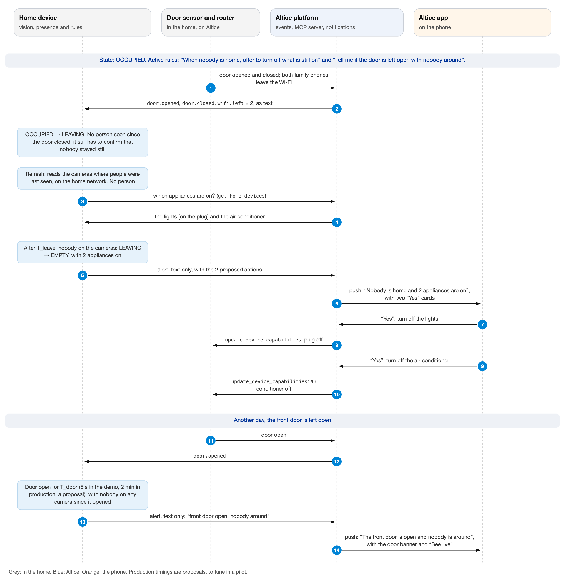

**Figure 8** – The empty home: an offer to turn off two appliances, each with its own "Yes", and, another day, the front door left open.

| Rule | Condition | Output | Action |
|---|---|---|---|
| Power saving | Presence enters EMPTY and the platform's device states (`get_home_devices`) show devices on | One alert per empty spell: "Nobody is home and 2 appliances are on", with one "Yes" card per device | Each "Yes" becomes `update_device_capabilities` (plug off, air conditioner off) |
| Door left open | The door has been open for T_door (5 s in the demo; 2 min in production, a proposal) and nobody has been on any camera since it opened | One alert per opening, with the door banner and "See live" | None automatic; the family decides |
| In UNSURE | The same conditions, but the state is UNSURE | The alert asks instead of offering to act | Only after a "Yes" |

### 8.5 Other kinds of rule

| Rule | Example | Evaluated on |
|---|---|---|
| Present / absent | "Tell me when the keys are not on the hall table at 08:00" | Last sighting and a timer |
| Dwell | "…left on the desk for 10 minutes" | Sightings and a timer |
| Not by a deadline | "If the cat hasn't been to the water bowl by 18:00" | Presence of the pet near a registered thing, and a timer |
| Person in a place | "Someone in the hall while no Family phone is home" | Cameras and presence |

Every rule shows the user, in plain words, what it watches and what it will do. Rules are saved as platform scenarios where possible (`post_new_scenario`, with the proposed `thingTracker` trigger of document 15), so they appear in the app next to the existing ones.

### 8.6 The judge

| Item | Value |
|---|---|
| What it is | A vision-language model on the home device, since it looks at images (in the hybrid alternative, on Altice's GPU servers) |
| When it is called | Only when a rule meets an ambiguous moment: "did the person take the book, or just move it?", or a left-behind check where the thing may be partly hidden |
| Input | 2 to 3 s of the region (from the home agent's 3 s in memory, or a short burst it records on request) and the rule's question |
| Output | Yes, no or unsure, with one sentence |
| Effect | The rules engine combines it with the other evidence; "unsure" makes the system ask the family, never act |
| Why not on every frame | Cost at 500,000 homes (document 17); *your* thing needs a fingerprint anyway; alarms must rest on rules that can be tested |
| What it cannot do | See someone who has left the picture: "did someone leave the house?" comes from the door sensor and the phones |

It replaces the earlier job "judge an unclear crop" of the text model. The prototype uses Qwen2-VL-2B-Instruct (Apache-2.0) through MLX (`prototype/judge.py`), on one tight crop of the place; Qwen2.5-VL-3B was ruled out because of its Qwen Research licence. The model for the home device is chosen in the pilot, with the same licence check.

### 8.7 Alerts and actions

An alert is a structured event: title, message, thumbnail, action cards, the door banner when the door is involved, and a suggestion (such as 112). The service sends it to the app through the app's notification service. A "Yes" on a card comes back to the service, which makes the MCP call (`update_device_capabilities` for a light, plug or the camera's `sirenSwitch`; `patch_home_security_status` for the alarm) and shows the result on the alert. Disruptive actions follow the family's choice made with the rule: the siren asks first or sounds at once (a child in danger is the example of sounding at once). Arming the alarm always asks for a "Yes". The language model is never the only evidence for an alarm.

## 9. Registering a thing

| Path | Where it runs | What happens | Result |
|---|---|---|---|
| Phone photos | App → home device (on the home Wi-Fi, or through an end-to-end-encrypted relay that Altice cannot read) | 6 to 8 photos from different sides (or frames of a short video); OWLv2 finds the thing in each photo, using its English name as the query; DINOv2 makes a vector of each crop | Fingerprint of up to 8 vectors |
| Shown to a camera | Home device | The user turns the thing slowly in front of a camera; each region goes through OWLv2 and DINOv2; a photo is kept only if its cosine to every photo already kept is below 0.97 (a new angle), until 8 | Fingerprint of 8 photos |
| The camera's proposals | Home device | The app shows what the cameras see ("Looking through your cameras…"); one tap picks a thing, then photos from the phone or the camera complete its 8 photos | As above |

The device builds the fingerprint and keeps it, with the thing's best crop as its photo; neither leaves the home. Altice keeps the thing's metadata as text (its name, owner and rules), so a replaced box gets back the list of things and the scenarios. Since fingerprints and face templates are not kept outside the home, a new box needs the photos of things and the faces registered again. (In the hybrid alternative, fingerprints lived in PostgreSQL with pgvector at Altice.)

## 10. The sensor language

A sentence is compiled once into a small, explicit rule; the rules engine runs rules and never interprets free text.

```json
{
  "title": "Book left behind",
  "kind": "leave_without",
  "thing": "book",
  "owner": "Ana",
  "trigger": { "door": "closed_after_open", "and_any": ["phone_left", "count_dropped"] },
  "check": { "frames": 3, "seen_at_least": 2, "match": 0.62, "judge_if_unsure": true },
  "then": [ { "notify": "Your book stayed at home." } ],
  "confirm_before_acting": true,
  "cooldown": "30m"
}
```

The language model writes the title, the message and the fields from the sentence; the service checks the rule against the home's things, people and devices, and falls back to templates when it is not valid.

## 11. Data model

Figures 9 and 10 show the two databases: the small one in the router and the per-customer one at Altice.

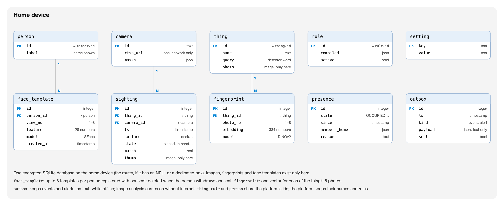

**Figure 9** – The home device's encrypted SQLite: people's labels, face templates, cameras and masks, things, fingerprints, sightings, rules, presence, the outbox and settings. Images, fingerprints and face templates exist only here.

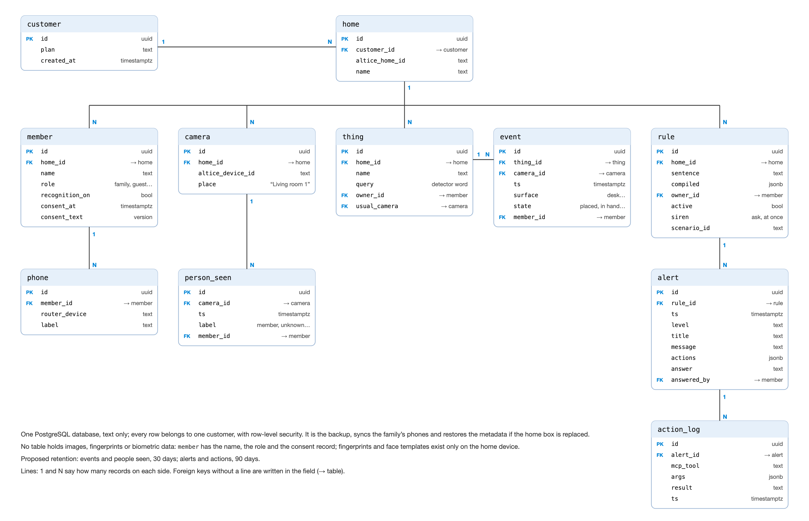

**Figure 10** – The platform's PostgreSQL, text only: one database, every row belonging to one customer, with row-level security.

| Data | Where | Retention |
|---|---|---|
| Face templates | Router only | Until consent is withdrawn |
| Members, consent records, phones | PostgreSQL | While the account exists; no biometric data |
| Things, fingerprints (vector(384)) | PostgreSQL | Until the thing is deleted |
| Sightings, people seen, thumbnails | PostgreSQL, object storage | 30 days (proposal) |
| Presence state and changes | Cache, PostgreSQL | Changes kept 30 days (proposal) |
| Rules | PostgreSQL | Until deleted |
| Alerts and actions | PostgreSQL | 90 days (proposal; an audit trail of what the home did) |
| Changed regions, clips for the judge | Memory of the vision workers and the judge | Deleted after analysis |

## 12. Privacy and security

Figure 11 is the data-flow diagram with trust boundaries: the home, Altice, the phone, and the language-model provider if the text model is not hosted by Altice. Its table lists what crosses each boundary.

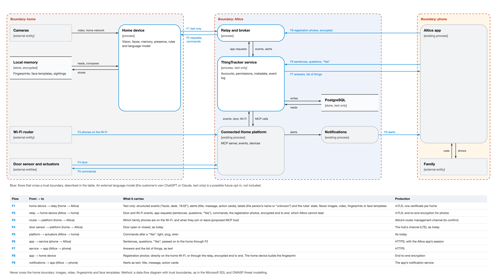

**Figure 11** – Data flow with trust boundaries, and what each flow that crosses a boundary carries.

**What leaves the home, precisely (final design).** Text only: events (for example "book, desk, 18:02"), labels (a thing's name, a family member's name, "unknown face"), rules and commands. Images, video, visual fingerprints and face templates never leave the home. In the hybrid alternative, not chosen, the region that changed (at most 640 × 640 pixels, about once a second while there is motion), the region asked for in an active check, and, rarely, 2 to 3 s of a region for the judge would have left the home. The text model receives text only (the sentence or the question, the names of things, places and devices, memory lines); document 20 proposes replacing people's names with placeholders before sending them.

**Threats per boundary** (the main ones, for a first threat model):

| Boundary | Threat | Mitigation |
|---|---|---|
| Home → Altice | A forged home sends regions or events | mTLS with one certificate per home, revocable from the app |
| Home → Altice | Regions read in transit or kept | TLS; processed in memory; no pixel logs |
| Altice → home | A forged request asks a home for regions | Requests only from the service, over the same mTLS channel, and logged |
| Altice | One customer's data read by another | Every row keyed by customer, with row-level security; per-home topics and partitions |
| Altice → provider | Text reused or kept by the provider | Contract with no training on the data, a DPA, EU processing; placeholders for names (proposal) |
| Phone → Altice | Someone else's "Yes" | The Altice app's session; the action logged with the rule and the evidence |

**Principles.** Data minimisation (GDPR Art. 5(1)(c)) and privacy by design (Art. 25): masks, no video kept by ThingTracker, regions deleted after analysis. A DPIA (Art. 35) is expected for cameras in homes and would be prepared with Altice before any pilot. Recognising people is opt-in only, per person, with explicit consent (Art. 9(2)(a)), and processed in the home; the EU AI Act lists remote biometric identification as high-risk, so the feature needs a legal review before launch. Nothing loud happens unless the family chose it; arming the alarm always needs a "Yes".

## 13. Flows in the app

Figure 12 shows the five flows in the Altice app: adding a thing, adding a person, a scenario from a sentence, a suggested scenario, and an alert with actions.

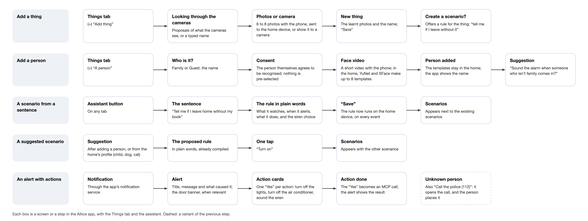

**Figure 12** – The app's flows, screen by screen; the dashed card is a variant of the previous step.

## 14. Performance and cost

**Measured on our Mac** (Apple GPU, 18 Nov, `prototype/vision/benchmark.py`, a 640 × 400 test frame):

| Step | Measured | Notes |
|---|---|---|
| OWLv2 detection, 10 named things | 557 ms per frame | On an L4 with TensorRT, document 17 estimates about 26 full frames a second (an assumption to measure) |
| DINOv2 fingerprint | 22 ms per crop | |
| A full perception cycle | about 0.65 s | About 1.5 frames per second on this Mac |
| MCP device command (plug off) | about 1.3 s | Measured on 16 Nov (document 10) |
| Local text model (Qwen3-1.7B, MLX) | answers 0.4 to 1.7 s, rules 1.5 to 3.2 s | Team measurement, 18 Nov |

**Cost in the final design (estimates):** the home device is bought once, €3.33 or €5.75 a month over 5 years (about €200 or €345), or about €15 more for a router with an NPU; the models' energy costs cents a month (YOLOv8n below €0.01, OWLv2 up to €0.72 at 12 h of motion a day, a team estimate on a Jetson Orin Nano). Team price research of 20 Nov, sources in document 17.

**Earlier estimates, for the alternative not chosen, per home a month at 500,000 homes:** vision about €0.49 with one camera on Altice's own L4 servers (document 17); a cloud language model about €0.43 (document 16, base case, €0.10 to €1.78). The judge's cost is not yet estimated: it is called only at ambiguous moments, and its rate has to be measured in a pilot before it is costed.

## 15. The language models

In the final design, the text model runs on the home device (Qwen3-1.7B in the prototype), for two jobs: compiling a sentence into a rule, and wording an answer from the memory. It never decides. The judge (§8.6) is a vision-language model on the home device too, since it looks at images, and is called rarely. In MCP terms, no model connects to the MCP server: the model asks for a tool, and the code calls it.

External language models (for example the user's own ChatGPT or Claude) are a possible future opt-in, text only; not now. The table below is the earlier analysis, for a text model hosted by Altice or a provider.

**Which text model:** any capable model, hosted by Altice (open weights) or under a contract that guarantees no training on our data, a data processing agreement (DPA) and processing in the EU. The prototype uses Qwen3-1.7B locally; Claude Haiku 5.5 and Sonnet 5.5 can be switched on. Checked at each provider's own terms and documentation on 18 Nov 2026:

| Option | Passes? | How | Watch out for |
|---|---|---|---|
| **Claude**, via Amazon Bedrock | Yes | `eu.` cross-region profile, called from an EU region (called from London or Zurich, it also routes there); inputs not used for training; AWS GDPR DPA | Anthropic's own API has **no EU option** (only "us" and "global"). On Bedrock, Claude Fable 5, 5.1 and 5.2 need 30-day review retention (`aws_review`); Haiku 5.5 and Sonnet 5.5 do not |
| **Claude**, via Google Vertex AI | Yes | `eu` multi-region endpoint (EU member states only) | None noted |
| **OpenAI**, via Azure (DataZone EU) | Yes | Processed in the EU Data Zone, which may include EFTA countries (Norway, Switzerland); not available to OpenAI; not used for training; Microsoft DPA | Avoid "Global" deployments |
| **OpenAI** API with EU residency | Yes, with conditions | `eu.api.openai.com` in a new project; the region is "Europe (EEA + Switzerland)" | Only eligible organisations can enable it; images in that region need extra approval from OpenAI |
| **Gemini**, via Vertex AI | Yes | `eu` endpoint, no training without permission, Cloud DPA | The Gemini developer API has no EU processing option: data may be stored transiently or cached in any country. For users in the EEA, Switzerland or the UK its paid-tier data terms apply and only paid services may serve them, so the free tier, which allows human review, is not an option |
| **Mistral** | Yes, with conditions | Stored data in the EU by default; EU inference only through `api.eu.mistral.ai` (EU and EFTA countries, at 1.1× the price); DPA | The default endpoint is global, with no commitment on where inference runs. Training on data is on by default: turn it off in the Admin panel's Privacy menu. Avoid Labs/Preview models |
| DeepSeek or Kimi, **hosted** | **No** | Not applicable | Data stored in China (DeepSeek, Kimi app) or Singapore (Kimi API); training on content allowed; no DPA. Italy's Garante limited DeepSeek (Jan 2025); Berlin's DPA called its transfers to China unlawful (Jun 2025) |
| **DeepSeek** open weights, run by Altice | Yes | MIT licence, vision-capable models | No data leaves Altice |
| **Qwen** open weights, run by Altice | Yes; larger models after a legal check | Qwen3.8-27B: Apache-2.0, vision-capable | Larger models use the "Qwen Community License 1.0" (Flash-Next) or the "Qwen3.8-Max License" (2.4T). Both require showing the model name above 100M monthly users or US$20M monthly revenue. The real constraint is a separate licence for anyone running a "Model as a Service or AI Work Assistant business" (the Max licence adds a condition on group revenue above US$50M); internal use is exempt. Needs a legal check, as for Kimi |
| **Kimi** open weights, run by Altice | Yes, after a legal check | K2.5: "Modified MIT"; K3 and K3.1-Pro: "Kimi K3 License"; vision-capable | K2.5 requires showing the model name above 100M monthly active users or US$20M monthly revenue. The K3 licence adds a separate agreement for model-as-a-service operators above US$20M revenue (licence §2–3). Altice's group size needs a legal check |
| Llama 3.2 vision / Llama 4 | **No** | Not applicable | Their licences exclude companies whose principal place of business is in the EU from the multimodal models. Llama 4 Scout and Maverick are multimodal, so this covers them; only the Llama 3.x text models are fine |

**The rule for any deployment:** pin EU endpoints, called from an EU region, never "global". Some "EU" zones also include EEA or EFTA countries (Azure's EU Data Zone, OpenAI's Europe region, Mistral's EU endpoint).

**The vision models' licences** (checked on the model cards and the OpenCV Zoo READMEs): OWLv2 and DINOv2 are Apache-2.0; YuNet (`face_detection_yunet_2023mar.onnx`) is MIT; SFace (`face_recognition_sface_2021dec.onnx`) is Apache-2.0.

## 16. Prototype vs target

Status on 20 Nov 2026, from the prototype's code, its end-to-end tests (`prototype/test_scenarios.py`) and the proof runs on the lab takes. The Target column is the hybrid design of 19 Nov; in the final design, the vision, matching, judge, rules engine and text model rows run on the home device, which the Mac plays in the demo, and the changed region is never sent.

| Part | Target | Prototype | Status |
|---|---|---|---|
| Capture | RTSP on the home network, one connection open | One connection open, through the organisers' relay | Implemented (relay in the demo only) |
| Privacy masks | Areas the family draws | Only the camera's clock overlay is masked | Not in the prototype |
| Motion gate | 160 × 90 grey, every 0.5 s, on the router | Same, on the Mac (`edge.py`) | Implemented |
| Changed region sent to Altice | Region ≤ 640 × 640, about 1 a second | The Mac analyses the whole frame where it is | Simulated |
| Faces | YuNet + SFace on the router, templates at home | YuNet + SFace on the Mac, templates in the edge's own SQLite, known at 0.40, unknown below 0.25 | Implemented |
| Vision workers | OWLv2, DINOv2 on L4 GPUs behind queues | OWLv2, DINOv2 on the Mac's GPU, no queue | Simulated |
| Matching | pgvector in the service | NumPy on the edge, threshold 0.62 | Implemented (different place) |
| In hand, taken, moved | Tracking in the service | "in_hand" from the edge; "taken" after 3 missed analyses on the server; "moved" on a new place | Implemented; covered by the end-to-end tests, not yet seen on the lab takes |
| Presence engine | Event-driven, per home | `presence.py`, four states, demo and production timings, state in SQLite | Implemented |
| Family phones on the Wi-Fi | Proposed `get_home_wifi_clients` tool | Toggled from the page (`/api/sim/phone`) | Simulated |
| Door sensor | Event API (requested) | Polling `get_home_devices` every 4 s when logged in; a simulated door otherwise | Implemented |
| Left behind | Door close + leaver + active check | Same; "unsure" when not seen or no answer | Implemented |
| Unknown person, 112 | 3 analyses, Family away; suggestion only | Same; the app's button never dials | Implemented |
| Power saving, door left open | On EMPTY, one alert per incident | Same | Implemented |
| Judge | Vision-language model at Altice | Qwen2-VL-2B (`judge.py`, MLX) on the Mac, asked only when an active check finds no match, on one tight crop; its "yes" or "unsure" becomes a question to the family | Implemented (different place) |
| Rules engine | Event-driven in the service | A loop every 2 s in `server.py` | Implemented (as a loop) |
| Alerts and actions | Notification service; MCP after "Yes" | In the web copy of the app; dry run unless `TT_LIVE_ACTIONS=1`; the alarm always simulated | Simulated |
| Registration from photos, from the camera | Vision workers | Implemented on the Mac | Implemented |
| The camera's proposals | Vision workers | The "Looking through your cameras…" screen lists common things; the camera does not propose them yet | Not in the prototype |
| Secure channel | MQTT over mTLS | HTTP on the Mac | Not in the prototype |
| Load balancers, stateless instances, queues | At Altice | One process | Not in the prototype |
| PostgreSQL, cache, object storage | At Altice | SQLite (`store.py`) and local files | Simulated |
| Text model | Altice-hosted or provider under contract | Qwen3-1.7B through MLX (`llm_local.py`); Claude off by default | Implemented |

## 17. Decisions, and the alternatives we rejected

| # | Decision | Alternatives | Why |
|---|---|---|---|
| D1 | **Fully local (20 Nov): all perception and inference on the home device; Altice is the control and data plane, text only** | Hybrid, with vision on Altice's L4 GPUs (the decision of 19 Nov, about €0.49 per home a month); full frames or video to the cloud | Images, video, fingerprints and face templates never leave the home; the device is bought once (€3.33 or €5.75 a month over 5 years) or the AI is on the router |
| D2 | **The language model compiles rules; the rules engine decides** | Ask a model yes or no on every frame (our first prototype) | Every-frame calls cost money, add seconds and give different answers; compiled rules are cheap, fast and testable |
| D3 | **A judge for ambiguous moments only** | No judge; a judge on every frame | Some questions need to see a moment ("taken or moved?"); on every frame it would cost too much and alarms would rest on a model |
| D4 | **Presence from phones, door and cameras** | Cameras only | Rooms without a camera and people who stay still; no camera sees someone who left the picture |
| D5 | **Load balancers and queues at Altice** | Anything to balance in the home | One agent per home; 500,000 homes meet at Altice; GPU work can wait in a queue |
| D6 | **Fingerprints by registration** | Fine-tune a detector per thing | Registration takes seconds and no training |
| D7 | **A tab in the existing Altice app** | A separate app | One app, one login, one place for alerts |
| D8 | **Recognising people: opt-in, in the home** | Never; or in the cloud | The family's safety scenarios need it; consent per person and templates at home keep the legal risk and the trust question manageable |
| D9 | **Each camera is one place** | Zones drawn inside a camera | Simpler for the family; zones are left to Altice as a later feature |

## 18. What the pilot must confirm with Altice

The design rests on seven assumptions about the Altice platform. Each is a next step for the pilot; the matching requests are in [document 15, section 9](15-integration-spec.md).

1. **Vision at home.** Decided on 20 Nov: vision runs on the home device. Next step: Altice says which routers or cameras have an NPU; with one, option A1 costs about €0.36 (§5.2); without one, the customer buys a dedicated box.
2. **Events.** Known: the MCP server has no push and no general event feed, so the prototype polls `get_home_devices` every 4 s. Next step: an event API for the door and the Wi-Fi.
3. **Phones on the Wi-Fi.** Known: no MCP tool exposes the router's clients, so the prototype simulates the phones. Next step: a read-only `get_home_wifi_clients` tool, and a way to keep recognising a phone that randomises its MAC address, designed with Altice.
4. **Local video.** Known: the prototype reads the camera through the organisers' cloud relay. Next step: RTSP access from the router on the home network.
5. **New MCP tools.** Known: the server has 18 tools and none deletes a scenario. Next step: the four Things tools, the `thingTracker` trigger and a tool to delete scenarios (document 15).
6. **The language model.** Decided on 20 Nov: on the home device; the prototype runs Qwen3-1.7B locally. An external model (the user's own ChatGPT or Claude) is a possible future opt-in, text only. Next step: confirm the model's speed on the chosen home device.
7. **The face video.** Decided: a short selfie video relayed to the home agent without being stored (§8.3). Next step: whether the app can upload it over the home Wi-Fi straight to the router, so that it never crosses the platform.

## Sources

- C4 model, Simon Brown: https://c4model.com
- arc42, runtime view (section 6) and deployment view (section 7): https://arc42.org
- Microsoft Threat Modeling Tool (SDL): https://learn.microsoft.com/en-us/azure/security/develop/threat-modeling-tool
- OWASP Threat Modeling Cheat Sheet: https://cheatsheetseries.owasp.org/cheatsheets/Threat_Modeling_Cheat_Sheet.html
- OpenCV, `samples/dnn/face_detect.py`: `cosine_similarity_threshold = 0.363` for SFace (read 19 Nov 2026): https://github.com/opencv/opencv/blob/4.x/samples/dnn/face_detect.py
- OpenCV Zoo, YuNet, "All files in this directory are licensed under MIT License" (read 19 Nov 2026): https://github.com/opencv/opencv_zoo/tree/main/models/face_detection_yunet
- OpenCV Zoo, SFace, "licensed under Apache 2.0 License" (read 19 Nov 2026): https://github.com/opencv/opencv_zoo/tree/main/models/face_recognition_sface
- Operator costs and the options' numbers: [document 17](17-operator-costs.md). Language-model cost: [document 16](16-business-case.md). Product rules (consent, crops of people, retention): [document 20](20-product.md).
