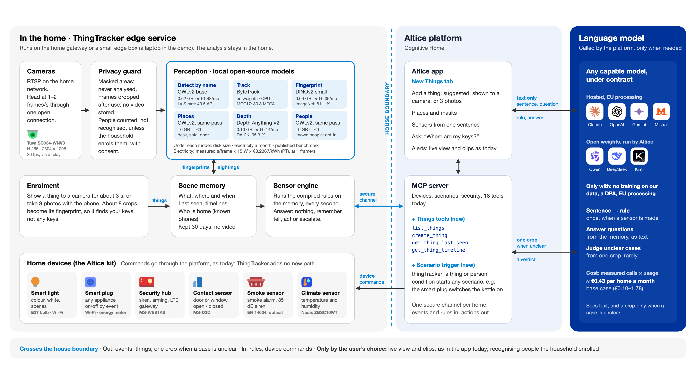

# ThingTracker · architecture

Version 1, Wed 18 Nov 2026. Audience: the Altice Labs jury and engineers, and our team. Technical enough to judge feasibility, without code.



*Source: [`architecture/thingtracker-architecture.svg`](architecture/thingtracker-architecture.svg), generated by [`architecture/build_diagram.py`](architecture/build_diagram.py).*

## 1. The idea in one paragraph

A home camera is the richest sensor in the house, but today it only reports "motion detected". ThingTracker makes it a source of information. **Local, open-source vision models** in the home recognise the things a household cares about (keys, wallet, glasses, the TV remote), the places they live (the desk, the hall table) and whether people are present. They keep a **memory of what was seen, where and when**.

A **language model** turns one sentence into a precise rule ("tell me if the mug is left on the desk when everyone is out"). It answers questions from the memory ("where are my keys?") and judges the rare unclear case from a single crop. Actions reach the existing Altice devices (light, plug, alarm) through Altice's **MCP server**, exactly as other commands do today.

Two principles shape everything below:

1. **Local eyes, contracted mind.** Seeing happens in the home, every second, for free. Reasoning happens in the cloud, rarely, and only with text or one crop.
2. **The AI writes the rule; the rule runs locally.** The language model is used when a sensor is created, not on every frame. That makes the system cheap, fast, predictable and auditable.

## 2. Requirements

| # | Requirement | Target | How it is met |
|---|---|---|---|
| F1 | Track things the user names, and tell them apart from similar things | "Your keys", not "any keys" | Open-vocabulary detection plus a per-thing visual fingerprint (§4.2) |
| F2 | Answer "where is X?" with place, time and a picture | Answer in ≤ 3 s | Last-seen index in the scene memory; the language model only phrases the answer |
| F3 | Create a sensor from one sentence | No settings screens | The language model compiles the sentence into a rule (§5) |
| F4 | Act on the home's devices | Same path as the app | MCP tools (`update_device_capabilities`, security status) |
| F5 | Add a thing: suggested, or shown to the camera | About 10 s per thing | Room scan suggestions; 3-second enrolment |
| F6 | Survive a camera that moves or zooms | No manual redrawing | Places are found by name in every frame, not stored as pixels (§4.3) |
| N1 | Privacy | No video or full frames leave the home for analysis; people are recognised only if the household opts in | Privacy guard, local perception, data rules (§7) |
| N2 | Cost | Under €0.50 cloud AI per home per month | Measured per-call costs × usage, see [business case](16-business-case.md) |
| N3 | Latency, event to action | ≤ 3 s | §8 |
| N4 | Adoption by Altice | No new app, no new device path | A tab in the existing app; MCP tools; platform scenarios |
| N5 | Replication | Any operator on the platform | Multi-tenant platform service; edge software, not custom hardware |

**Constraints today:**
- **The camera:** one Wi-Fi camera (Tuya SC034-WNV3), reachable as RTSP through the organisers' go2rtc relay: H.265, 2304 × 1296, 20 fps (checked with ffprobe, 18 Nov). Opening the stream costs about 5 s, because the decoder waits for a keyframe, so the prototype keeps one connection open and reads the latest frame from memory. No VLC or plug-in is needed.
- **The MCP server has 18 tools, with no event history and no push.** Its login token lasts about 24 h.
- **The kit's hub can't run vision models.** It's an LTE gateway, not a compute device.
- **The demo** runs on a laptop.

## 3. Components

### In the home: the edge service

Runs as one service per home. In production it would run on the operator's home gateway, if it has an NPU, or on a small edge box; in the demo, on a laptop. All of its models are open source and free for commercial use (Apache-2.0, checked on the model cards on 18 Nov).

| Component | What it does | Technology | Notes |
|---|---|---|---|
| **Capture** | Pulls 1–2 frames per second from each camera over RTSP on the home network | ffmpeg / OpenCV | Never records video |
| **Privacy guard** | Applies masks (areas never analysed); drops each frame after perception | In-process | The only full frame that ever exists is in memory, for under a second |
| **Perception: detection** | Finds things and places by name, in any frame | OWLv2 (open vocabulary) | No training needed for a new thing |
| **Perception: tracking** | Keeps the identity of each detection across frames | ByteTrack (MIT) | Makes "the mug moved from desk to sofa" possible |
| **Perception: fingerprints** | Compares a detection with the enrolled thing | DINOv2 image embeddings | Distinguishes your keys from a visitor's |
| **Perception: depth** | Relative distance in the picture, from a single camera | Depth Anything V2 Small | Separates "on the table" from "behind it". Approximate, not lidar |
| **Perception: people** | Presence and count; posture for falls or climbing (later). Recognises a household member only if the household enrolled that person, with their consent | Person detection; on-device face recognition (opt-in); a pose model in a later phase | **Off by default.** Face templates never leave the home |
| **Scene memory** | Sightings: thing, place, time, position, thumbnail. Last-seen index and timelines. Who is home, from known phones on the Wi-Fi | Local database | Kept 30 days; no video |
| **Sensor engine** | Evaluates the compiled rules against the memory every second; chooses a response on the ladder: nothing, remember, tell, act, escalate | Deterministic rule engine | Calls the language model only for unclear cases |
| **Enrolment** | Turns about 3 seconds of a thing held in front of a camera into ~8 crops, its fingerprint and its photo | Detection + DINOv2 | Also accepts 3 phone photos |
| **Secure channel** | One outbound, authenticated connection to the Altice platform | mTLS / OAuth, as the platform requires | The only way in or out of the edge |

**Footprint of the local models.** Size on disk is the Hugging Face weights file (fp32). Time is measured on our laptop's GPU (Apple, MPS). Electricity assumes 1 frame per second on a 15 W edge box (business case B15) at €0.2367/kWh (Portugal, Eurostat `nrg_pc_204`, first half of 2026).

| Model | Job | Size on disk | Time measured | Electricity a month | Published benchmark |
|---|---|---|---|---|---|
| OWLv2 base, patch16 ensemble | Detect things, places and people by name | 0.62 GB | 0.57 s per frame | ≈ €1.48 | 40.5 AP on rare LVIS classes, zero-shot ([scenic README](https://github.com/google-research/scenic/tree/main/scenic/projects/owl_vit)) |
| ByteTrack | Track detections across frames | no weights (CPU) | negligible | ≈ €0 | 80.3 MOTA on MOT17 test ([paper](https://arxiv.org/abs/2110.06864)) |
| DINOv2 small (ViT-S/14) | Fingerprint of your thing | 0.09 GB | 22 ms per crop | ≈ €0.06 (1 crop/s) | 81.1 % ImageNet-1k, linear probe ([README](https://github.com/facebookresearch/dinov2)) |
| Depth Anything V2 Small | Near / far without lidar | 0.10 GB | 55 ms per frame | ≈ €0.14 | 95.3 % on DA-2K ([paper](https://arxiv.org/abs/2406.09414), Table 3) |
| **Total** | | **0.81 GB** | **≈ 0.65 s per frame** | **≈ €1.68** | |

The whole edge box, always on at 15 W, costs €2.59 a month in electricity (business case C10); the models above are part of that, not extra.

### On the Altice platform

| Component | What it does | Status |
|---|---|---|
| **MCP server** | Device control, scenarios, security status (18 tools today). We add four **Things tools**: `list_things`, `create_thing`, `get_thing_last_seen`, `get_thing_timeline` | The tools exist today; the Things tools are proposed |
| **Altice app** | A new **Things** tab: suggested things, enrolment, places and masks, sensors from a sentence, "Ask", alerts | Proposed; prototype in [`prototype/`](../prototype/) |
| **Notifications** | Alerts reach the phone through the app's existing notification service | To confirm with Altice (§11) |

### The language model

Called by the platform, never by the edge directly, and only for three jobs:

| Job | Input | Output | How often |
|---|---|---|---|
| **Compile a sentence into a rule** | The sentence, the home's things, places and devices | A rule in the sensor language (§5) | When a user creates a sensor |
| **Answer a question** | The question and the relevant part of the memory, as text | A sentence and a reference to a sighting (with its photo) | When asked |
| **Judge an unclear case** | One crop and the rule's question | Yes, no or unsure, with evidence | Rarely: only when local confidence is low |

**Which model:** any capable model, under a contract that guarantees no training on our data, a data processing agreement (DPA) and processing in the EU. The prototype uses Claude Haiku 5.5 and Sonnet 5.5.

Checked at each provider's own terms and documentation on 18 Nov 2026:

| Option | Passes? | How | Watch out for |
|---|---|---|---|
| **Claude**, via Amazon Bedrock | Yes | `eu.` cross-region profile, only EU regions; inputs not used for training; AWS GDPR DPA | Anthropic's own API has **no EU option** (only "us" and "global"). Some models need 30-day review retention on Bedrock |
| **Claude**, via Google Vertex AI | Yes | `eu` multi-region endpoint | |
| **OpenAI**, via Azure (DataZone EU) | Yes | Processed in EU member states; not available to OpenAI; not used for training; Microsoft DPA | Avoid "Global" deployments |
| **OpenAI** API with EU residency | Yes, with a condition | `eu.api.openai.com` in a new project | Images in that region need extra approval from OpenAI |
| **Gemini**, via Vertex AI | Yes | `eu` endpoint, no training without permission, Cloud DPA | The Gemini developer API has no EU processing option; its free tier allows human review |
| **Mistral** | Yes | EU hosting by default, `api.eu.mistral.ai`, DPA | Check the training opt-out on pay-as-you-go; avoid Labs/Preview models |
| DeepSeek or Kimi, **hosted** | **No** | — | Data stored in China (DeepSeek, Kimi app) or Singapore (Kimi API); training on content allowed; no DPA. Italy's Garante limited DeepSeek (Jan 2025); Berlin's DPA called its transfers to China unlawful (Jun 2025) |
| **DeepSeek** open weights, run by Altice | Yes | MIT licence, vision-capable models | No data leaves Altice |
| **Qwen** open weights, run by Altice | Yes | Qwen3.8-27B: Apache-2.0, vision-capable | Larger Qwen models use a community licence with display and resale clauses |
| **Kimi** open weights, run by Altice | Yes, after a legal check | "Modified MIT", vision-capable | Display requirement above 100M users or $20M monthly revenue; Altice's group size needs a legal check |
| Llama 3.2 / 4 vision | **No** | — | Its licence excludes companies whose principal place of business is in the EU (text-only Llama is fine) |

**The rule for any deployment:** always pin EU endpoints, never "global".

## 4. How it works: the main flows

Each step names where it runs. **Bold** marks anything that crosses the house boundary.

### 4.1 Add a camera and its places

1. The user places the camera and names it ("Living room"), as for any device in the app.
2. *Edge:* one **room scan**. The detector looks at the full frame once and proposes places it recognises (sofa, desk, shelf, door) and things it sees (mug, laptop, remote).
3. *App:* the user accepts places, adds masks for areas never to analyse (a bathroom door, a window to the street) and picks suggested things.
4. Nothing from the scan leaves the home; **only the accepted names** go to the platform.

### 4.2 Add a thing

Two ways in, one flow:
- **Suggested:** from the room scan, one tap per thing.
- **Manual:** the user types a name.

Then:
1. *App:* "Show it to the camera". The user holds the thing in front of any camera and turns it slowly for about 3 s. A phone alternative is to take 3 photos.
2. *Edge:* the detector boxes the thing in about 8 frames. DINOv2 turns the crops into a fingerprint, and the best crop becomes its photo.
3. *Edge → platform:* **the thing's name and photo** (thumbnail), so the app can show it.
4. From now on, a detection of "keys" counts as **your keys** only if its fingerprint matches, which avoids confusing them with a visitor's.

### 4.3 Continuous tracking: last seen

Every 0.5–1 s, per camera:
1. *Edge:* capture a frame. The privacy guard removes masked areas.
2. *Edge:* detect the enrolled things, the places and people.
3. *Edge:* track the detections and match each one to a thing by fingerprint, then assign it to the place it overlaps. Depth separates on from behind.
4. *Edge:* write a **sighting** only when something changes: it appeared, moved or disappeared. That gives a few dozen sightings an hour, not 3,600 frames.
5. **If the camera moves or zooms,** places are found again by name in the next frame, so nothing needs redrawing. The tracker restarts, and fingerprints re-attach identities.

### 4.4 A sentence becomes a sensor

Example: "Turn the light red if the mug is left on the desk when everyone is out."
1. *App → platform → language model:* **the sentence, plus the names of things, places and devices.**
2. *Language model:* returns a rule in the sensor language (§5), and the app shows it in plain words for confirmation.
3. *Platform → edge:* **the rule.**
4. *Edge:* the sensor engine evaluates it every second on the memory, at no cost per check.
5. When it fires: *edge → platform:* **an event.** The platform sends the action through MCP (`update_device_capabilities`, light red) and a notification to the app, with the thumbnail.
6. **Disruptive actions** (siren, arming the alarm) always ask for a "yes" in the app first.

### 4.5 A question

"Where are my keys?"
1. *App → platform:* the question.
2. *Platform → edge:* `get_thing_last_seen("keys")`, returning place, time and thumbnail.
3. *Platform → language model:* **the question and that text** (no image). The model phrases the answer in the user's language: "On the hall table, at 08:42."
4. *App:* shows the answer with the photo.

## 5. The sensor language

A sentence is compiled into a small, explicit rule. The engine runs rules; it never interprets free text. Example:

```json
{
  "title": "Mug left on the desk",
  "when":  { "thing": "mug", "in_place": "desk", "for": "10m" },
  "and":   { "home": "empty" },
  "then":  [ { "notify": "The mug was left on the desk." },
             { "device": "Light", "set": { "color": "red" } } ],
  "confirm_before_acting": false,
  "cooldown": "30m"
}
```

**Kinds of rule:**

| Rule | Example |
|---|---|
| present / absent | "Tell me when the keys are not on the hall table at 08:00" |
| dwell | "…left on the desk for 10 minutes" |
| leaving without | "Warn me at the door if I leave without my keys" (door sensor + phone presence + keys still seen) |
| not by a deadline | "If the cat hasn't been to the water bowl by 18:00" |
| person in a place | "Someone in the hall while no known phone is home" |
| visual check | Rules no detector can answer ("is the plant drooping?"): a rate-limited check of one crop by the language model |

Every rule shows the user, in plain words, what it watches and what it will do. Rules are stored as **platform scenarios** where possible, so they appear in the app next to the existing ones.

## 6. Data model

| Entity | Key fields | Stored | Retention |
|---|---|---|---|
| Camera | id, name, stream, masks | Edge, platform | While installed |
| Place | id, name, camera, last box | Edge; names on the platform | While defined |
| Thing | id, name, photo, category | Edge, platform | Until deleted |
| Fingerprint | thing id, about 8 embeddings | **Edge only** | Until the thing is deleted |
| Sighting | thing, place, time, box, confidence, thumbnail | Edge | 30 days, then deleted |
| Presence | known phone, home / away, time | Edge | 30 days |
| Sensor | rule (§5), owner, active, history | Edge, platform | Until deleted |
| Event | sensor, time, evidence, action taken | Edge, platform | 90 days (an audit trail of what the home did) |

## 7. Privacy and security

**What crosses the house boundary:**

| Data | Leaves the home? |
|---|---|
| Video, full frames | **Not for analysis.** The user's own live view and clips work as in the Altice app today, through its relay |
| Faces, identities | **Only by opt-in.** Off by default; the household enrols a person, with that person's consent. The face template stays on the edge; an event may carry the name the household chose ("Ana arrived") |
| Fingerprints (embeddings) | Never |
| Thing names, place names, thumbnails of things | Yes, to the platform, so the app can show them |
| Events (sensor fired, thing seen) | Yes, to the platform |
| One crop of a zone | Only for an unclear case, to the language model under contract; not stored by it |
| Questions and sentences | Yes, to the language model under contract |

**Principles applied:**
- **Data minimisation** (GDPR Art. 5(1)(c)) and **privacy by design** (Art. 25): masks, frames dropped after use, no video stored by ThingTracker, people recognition off by default.
- **A DPIA** (Art. 35) is expected for cameras in homes; we would prepare it with Altice before any pilot.
- **Recognising people is opt-in only:** off by default, per person, with explicit consent (GDPR Art. 9(2)(a)), processed on the edge. The EU AI Act lists remote biometric identification as high-risk, so this feature needs a legal review and a DPIA before launch, as the executive summary says.
- **Security:**
  - one authenticated outbound channel per home;
  - no open ports on the edge;
  - platform tokens kept on the edge, never in the app;
  - secrets never in code;
  - every action logged with its rule and evidence.
- **Safety:** nothing loud (siren, alarm) without the user's confirmation. The language model is never the only evidence for an alarm.

## 8. Performance and cost

**Measured on our Mac** (Apple GPU, 18 Nov, `prototype/vision/benchmark.py`, a 640 × 400 test frame):

| Step | Measured | Notes |
|---|---|---|
| OWLv2 detection, 10 named things | **557 ms** per frame | Found the bulb (0.40) and the plug (0.59) in the test frame |
| DINOv2 fingerprint | **22 ms** per crop | |
| Depth Anything V2 Small | **55 ms** per frame | |
| A full perception cycle | about 0.65 s | So about 1.5 frames per second per camera on this Mac |
| MCP device command (plug off) | about **1.3 s** call | Measured on 16 Nov ([docs/10](10-mcp-in-practice.md)) |
| Event to action | about 2–3 s | Perception, then rule (milliseconds), then MCP |

**Cost:**
- **Local perception has no per-frame cost.** Its cost is edge compute.
- **Cloud AI comes from measured per-call costs:** about $0.0003 for one analysis (Haiku 5.5) and about $0.003 for a question or a new sensor (Sonnet 5.5). The base case is about **€0.43 per home per month**; see the [business case](16-business-case.md), which also shows that **edge hardware, not AI, decides the economics**.

## 9. Decisions, and the alternatives we rejected

| # | Decision | Alternatives | Why |
|---|---|---|---|
| D1 | **Perception runs locally** | Send frames to a cloud vision model | Privacy (no frames leave the home), cost (zero per frame), latency, works offline |
| D2 | **The language model compiles rules; it doesn't watch** | Ask the model yes/no on every frame (our first prototype) | Every-frame calls cost money, add 1–3 s each and give different answers; compiled rules are cheap, instant and auditable |
| D3 | **Places by name, found in each frame** | Pixel rectangles drawn once | Rectangles break when the camera moves or zooms; rectangles survive only as privacy masks |
| D4 | **Fingerprints by enrolment** | Fine-tune a detector per object | Enrolment takes 3 s and no training; works on the edge |
| D5 | **A tab in the existing Altice app** | A separate ThingTracker app | One app, one login, one place for alerts; the shortest path for Altice to ship |
| D6 | **Model-agnostic language model under contract** | Commit to one provider | Lets Altice choose by price, EU residency or self-hosting; avoids lock-in |
| D7 | **One secure channel from home to platform** | Each component calls the cloud | One thing to secure and audit; the platform controls which model sees what |
| D8 | **Recognising people: opt-in, on the device** | Never; or always on | The authorised-people scenarios need it. Off by default, consent per person and on-device processing keep the legal risk (AI Act, GDPR Art. 9) and the trust question manageable |

## 10. Prototype vs target

| Part | Prototype (Friday) | Target |
|---|---|---|
| Cameras | Laptop webcam or a recorded clip; the kit camera once its stream answers | Kit cameras over RTSP on the LAN |
| Perception | Local models installed and benchmarked; the demo analyses zone crops | Full local pipeline on a gateway NPU or edge box |
| Language model | Claude Haiku 5.5 / Sonnet 5.5; off by default, with simulated answers | Any model under contract (§3) |
| Rules | The model answers each zone's question | Compiled rules run by the sensor engine (§5) |
| App | A web copy of the Altice app with the Things tab | Inside the real Altice app |
| Device actions | MCP calls built; dry run unless switched on | Same tools, plus the Things tools |

## 11. Open questions for Altice

1. Does the platform offer **events or push notifications** we can use, instead of polling the MCP server?
2. Which **home gateways** have an NPU, and could they host the edge service? If not, would Altice ship a small box with the camera?
3. Can the edge read the camera's **RTSP stream on the home network** directly, instead of through the cloud relay?
4. Would Altice **add the Things tools** to the MCP server, and how are new tools approved?
5. Which **language model** contracts does Altice already have (EU residency, DPA)?
6. Can **scenarios be deleted** through the MCP? Today they can only be created.
