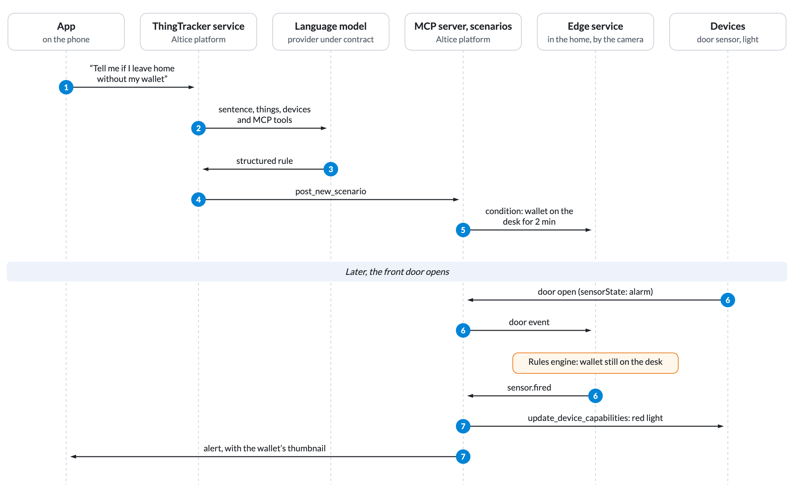

# ThingTracker · integration with the Cognitive Home platform

Version 2, Wednesday 18 November 2026. For Altice Labs engineers. It describes what ThingTracker adds to the platform, what it reuses unchanged and what it needs from Altice. The overall design is in the [architecture document](14-architecture.md).

## In short

- ThingTracker turns the home's camera into a sensor configured with sentences: the user enrols their things and writes rules such as "tell me if I leave home without my wallet".
- It adds four components: an edge service in each home, the ThingTracker service on the platform, four MCP ("Model Context Protocol") tools for things and a new type of scenario trigger.
- Device commands still go through the MCP tools the platform already has. No new path to the devices is opened.
- To reach production, seven items are needed on Altice's side, listed in section 9. The most important is a way to receive events without polling the MCP server.

## 1. Glossary

| Term | Meaning |
|---|---|
| Edge service | A program that runs in the home, next to the camera. It stays idle until there is motion or sound, and only then analyses images with open-source vision models |
| Object enrolment | The part of the edge service that learns a new thing from several views shown to the camera |
| Visual fingerprint | A set of 8 numeric vectors (DINOv2 embeddings), one per view, that tells a particular thing apart from others of the same kind |
| Home memory | A local record of where and when each thing was seen, with a cropped thumbnail of the thing |
| Rules engine | The part of the edge service that evaluates the rules on things and people, and sends an event when one is met |
| ThingTracker service | The platform component that receives sentences and questions from the app. It is the only one that calls the language model, and it runs the MCP tools the model asks for |
| Things tools | The four new MCP tools, described in section 5 |
| `thingTracker` trigger | A new type of scenario trigger, whose condition is about things or people and is evaluated in the home (section 7) |

## 2. What is new and what is reused

New components:

| Component | Where it runs | What it does |
|---|---|---|
| Edge service | In the home: the operator's gateway or a small edge box (a laptop in the demo) | Analyses images only when there is motion or sound, keeps the home memory and evaluates the local rules |
| ThingTracker service | Altice platform | Turns sentences into rules and answers questions, with the language model and the MCP tools |
| Things tools | The platform's MCP server | `list_things`, `create_thing`, `get_thing_last_seen` and `get_thing_timeline` |
| `thingTracker` trigger | The platform's scenario model | Lets a scenario start when a condition on things is met |
| "Things" tab | Altice app | Enrolled things by room, sensors and suggestions, built from the same components as the other four tabs |
| Assistant button | Altice app, on every tab | Questions ("where is the book?") and sensors described in one sentence |

Existing MCP tools, used unchanged:

| Tool | Use |
|---|---|
| `update_device_capabilities` | Actions on the light and the plug |
| `patch_home_security_status` | Arming the alarm, always after the user confirms |
| `post_new_scenario`, `get_home_scenarios` | Saving rules as scenarios and showing them in the app's scenario list |
| `get_home_devices`, `get_home_security_status` | Giving the language model the home's context (devices and alarm status) |

## 3. First example: "tell me if I leave home without my wallet"

Figure 1 shows the messages exchanged between the components, from the sentence to the action.



**Figure 1** – From the sentence to the action: messages between the app, the platform, the language model and the home.

1. The user writes the sentence in the assistant. The app sends it to the ThingTracker service.
2. The service sends the language model the sentence, the enrolled things (the result of `list_things`), the home's devices (`get_home_devices`) and the list of available MCP tools.
3. The model returns a structured rule: when the door contact sensor opens, if the wallet is still on the desk 2 minutes later, the light turns red and the user receives an alert.
4. The service saves the rule as a scenario, with `post_new_scenario`. The door part uses the existing device trigger; the wallet part uses the new `thingTracker` trigger (section 7). The rule appears in the app's scenario list.
5. The platform sends the condition on the wallet to the home's edge service.
6. When the door opens, the rules engine checks in the home memory whether the wallet is still on the desk. If it is, it sends the `sensor.fired` event.
7. The platform runs the scenario's actions: the light turns red, with `update_device_capabilities`, and the app shows the alert with the wallet's thumbnail.

The language model is called only once, in step 2. From then on, the rule is evaluated in the home, with no cost per event.

## 4. Second example: "where is my wallet?"

1. The user writes the question in the assistant, a button on every tab of the app, which sends it to the ThingTracker service.
2. The service sends it to the language model, with the Things tools available.
3. The model calls `list_things`. If more than one thing matches the question (for example, two wallets), it answers with a question: "Which one?".
4. Once the thing is identified, the model calls `get_thing_last_seen`. The platform gets the answer from the home memory, through the edge service.
5. The model answers in natural language ("On the desk, at 15:02"), and the app shows the cropped thumbnail of the thing.

## 5. The four Things tools

The new tools follow the conventions of the existing ones: JSON arguments, scope limited to the authenticated user's home, and results as JSON text. Only `create_thing` changes data.

### `list_things`

Lists the things enrolled in a home, with the last sighting of each one.

| Argument | Type | Required | Notes |
|---|---|---|---|
| `homeId` | string | No | Defaults to the user's current home, as in the other tools |

Result:
```json
{ "things": [
  { "id": "wallet", "name": "Wallet", "photo": "https://…/things/wallet.jpg",
    "lastSeen": { "place": "desk", "camera": "Living room", "at": "2026-11-18T15:02:10Z" } },
  { "id": "phone", "name": "Phone", "photo": null, "lastSeen": null }
] }
```

### `create_thing`

Enrols a new thing. It saves the name and asks the edge service to start the visual enrolment (section 6).

| Argument | Type | Required | Notes |
|---|---|---|---|
| `name` | string, 1 to 40 characters | Yes | Name shown in the app, for example `"Wallet"` |
| `category` | string | No | English name the detector uses as its search term, for example `"wallet"`. Defaults to the name itself |
| `enrol` | enum: `camera`, `photos` or `none` | No | Defaults to `camera`: the app asks the user to show the thing to the camera |

Result: `{ "id": "wallet", "status": "enrolling" }`. Errors: `409` if the name already exists; `422` if the home has no camera.

### `get_thing_last_seen`

Answers the question "where is X?".

| Argument | Type | Required | Notes |
|---|---|---|---|
| `thing` | Identifier or name | Yes | If the name matches several things, it returns the list so that the model can ask which one |

Result:
```json
{ "thing": "wallet", "place": "desk", "camera": "Living room",
  "at": "2026-11-18T15:02:10Z", "match": 0.84,
  "thumbnail": "https://…/sightings/9f2c.jpg" }
```
`match` is the similarity to the thing's visual fingerprint (from 0 to 1). If the thing has never been seen, the result is `{ "thing": "wallet", "seen": false }`. The thumbnail is a crop that shows only the thing, never the full image.

### `get_thing_timeline`

Shows where a thing has been over a period, for questions such as "when did I last have my glasses with me?".

| Argument | Type | Required | Notes |
|---|---|---|---|
| `thing` | Identifier or name | Yes | As in `get_thing_last_seen` |
| `from`, `to` | ISO 8601 date and time | No | Defaults to the last 24 h; at most 30 days |

Result: `{ "thing": "glasses", "sightings": [ { "place": "desk", "from": "…", "to": "…" }, … ] }`. Consecutive sightings in the same place are merged into one.

## 6. Enrolling a thing

Enrolment follows the pattern the app already uses to add a device (screen recording of the Altice app beta, 18 November 2026): the (+) button, a full-screen step with an illustration, a title and a main button fixed at the bottom, and the "Cancel installation" dialog on exit.

| Adding a device (today) | Adding a thing (proposal) |
|---|---|
| (+) on "Devices" | (+) on "Things" |
| List of device types and nearby Matter devices | The thing's name, or a suggestion from the list of common things (keys, wallet, glasses, phone) |
| "Choose a security hub" panel | "Choose a camera" panel, with the cameras and their status |
| "No smart hub installed" panel | "No camera installed" panel (error `422` from `create_thing`) |
| Serial number or "Scan label" | "Show it to the camera", with live progress |
| Final step | The learned views and the name, followed by "Done" |

In the "Show it to the camera" step:

1. The user holds the thing about 50 cm from the camera and turns it slowly, for 10 to 20 seconds.
2. The edge service looks for the thing with the OWLv2 detector, using the English name as the search term.
3. In each image where it finds the thing, it crops it and computes a vector with DINOv2. It keeps the view only if it differs from the previous ones, until it has 8.
4. The 8 views make up the visual fingerprint, stored in the edge service (for the local models) and in the platform's database, associated with the customer. A new or reset edge service can therefore recover it without repeating the enrolment.
5. The app shows the learned views. The fingerprint is deleted when the thing is deleted.

After enrolment, whenever there is motion, the detector finds candidates of the same kind and the edge service compares each one with the 8 views. Only a candidate that is similar enough counts as "your wallet"; the others are ignored.

## 7. Sensors and scenarios

Each sentence from the user becomes a rule, compiled once by the language model.

- Conditions and actions on devices (door contact, light colour, plug) already map onto the platform's scenario model.
- Conditions on things and people ("wallet on the desk for 2 minutes", "no one in the living room for 30 minutes") have no equivalent among today's triggers. We therefore propose the `thingTracker` trigger, evaluated by the rules engine in the home. When the condition is met, the edge service sends the `sensor.fired` event and the platform runs the scenario's start actions.

The scenario of the first example, in the `post_new_scenario` format (the values of `triggerLogic` and `operator` that the platform accepts are still to be confirmed):
```json
{ "name": "Left without the wallet", "isActive": true, "triggerLogic": "AND",
  "triggers": [
    { "type": "device", "device": { "id": "<door contact sensor>" },
      "capabilities": [ { "name": "sensorState", "operator": "==", "value": "alarm" } ] },
    { "type": "thingTracker",
      "condition": { "thing": "wallet", "in_place": "desk", "for": "2m" } } ],
  "startActions": [
    { "type": "device", "device": { "id": "<light>" },
      "capabilities": [ { "type": "color_rgb", "redValue": 255, "greenValue": 0, "blueValue": 0 } ] } ] }
```

The door contact sensor reports an open door as `sensorState` with the value `alarm`, as observed on the challenge kit.

## 8. Connection between the edge service and the platform

| Aspect | Proposal |
|---|---|
| Connection | The edge service opens a single outbound connection to the platform (WebSocket or MQTT over TLS); the home needs no open inbound port |
| Identity | One credential per home, issued when the camera is added in the app and revocable from it |
| From the home to the platform | Events (`thing.seen`, `thing.moved`, `sensor.fired`), thumbnails and visual fingerprints of the things, and answers to the Things tools |
| From the platform to the home | Rule conditions, calls to the Things tools, enrolment requests and zones to ignore |
| Offline | The edge service keeps tracking the things and evaluating the rules; events are queued and sent when the connection returns, but actions on devices depend on the platform |
| Language model | Called only by the ThingTracker service, on the platform, which chooses the model and the region; never by the edge service |

## 9. What we ask of Altice

| No. | Need | Why | Current situation |
|---|---|---|---|
| 1 | An event API, with push or webhooks | Rules must react to the door opening without polling | The MCP has no push notifications and no general event feed; there is only the alarm history (`get_home_security_alarm_history`) |
| 2 | Local RTSP access to the camera | Video should stay on the home network | Video goes through a cloud relay (go2rtc) |
| 3 | Computing capacity in the home | The vision models take about 0.6 s per image on a laptop GPU, at 1 or 2 images per second and only when there is motion or sound | The kit's LTE hub cannot run vision models |
| 4 | A way to add tools to the MCP server | For the four Things tools | To be determined |
| 5 | A tool to delete scenarios | Users must be able to remove sensors | The MCP can create scenarios but not delete them |
| 6 | Push notifications to the app | For the rules' alerts | Unknown which service the app uses |
| 7 | Contracts for the language model | No use of the data for training, a data processing agreement (DPA) and processing in the EU | Unknown which providers Altice already uses |

## 10. Status of the prototype

| Item | In the prototype (`prototype/` folder) |
|---|---|
| Edge service | Runs on a laptop with the kit camera: idle until there is motion, then OWLv2 and DINOv2 on the GPU |
| Object enrolment | Implemented: 8 views make the visual fingerprint, stored in the edge service and in a copy that stands for the platform's database |
| Detection | Only enrolled things are searched for; the app draws live, over the camera image, one box per thing, with its name and similarity |
| Questions | Answered from the home memory; if several things match the question, the app asks which one |
| Sensors | Created from a sentence and evaluated by a local rules engine; actions on devices are simulated until they are switched on |
| Things tools | Available as HTTP endpoints of the team's server (`/api/state`, `/api/things`, `/api/ask`), with the same data |
| Database | Local SQLite (`prototype/data/home.db`): a copy of the platform's home, rooms and devices, in the platform's own model, and the ThingTracker tables (things, visual fingerprints, sightings, sensors, events) |
| App | A faithful copy of the Altice app (screens, sizes, colours and transitions captured from the beta on 18 November 2026), with the "Things" tab and the assistant button |
| Home ↔ platform connection | A single local server plays both roles |
