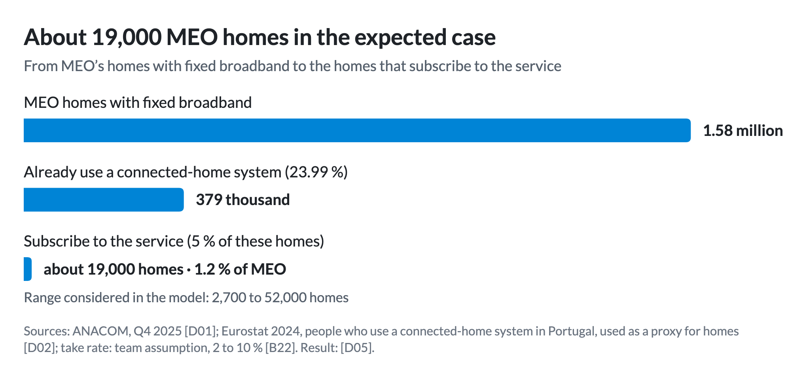
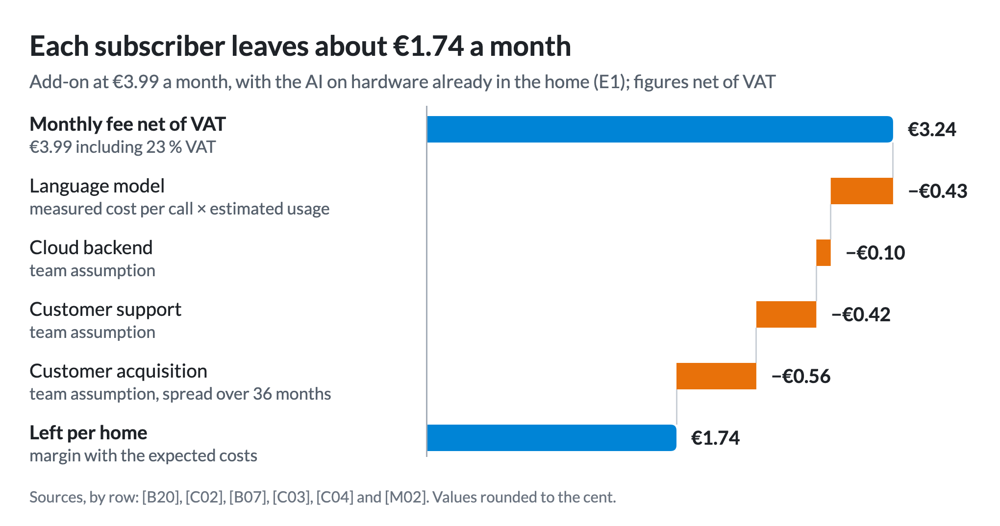
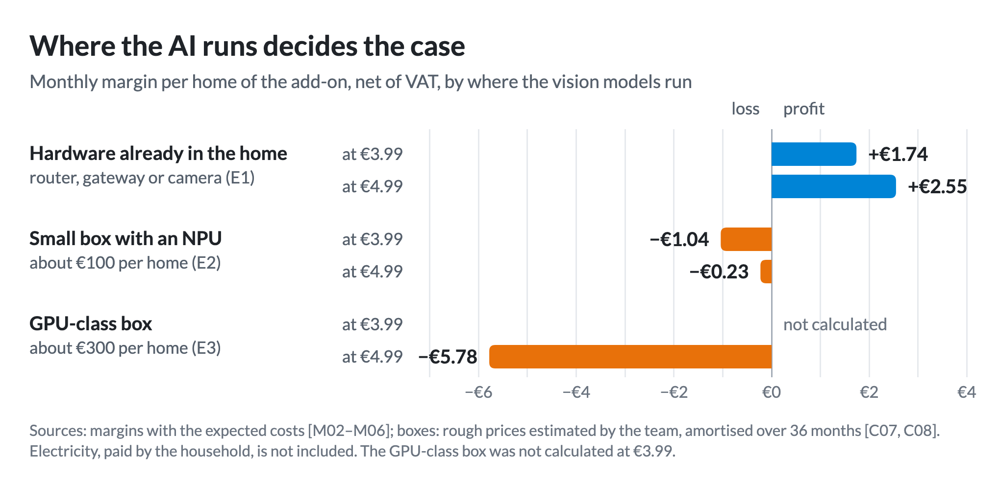
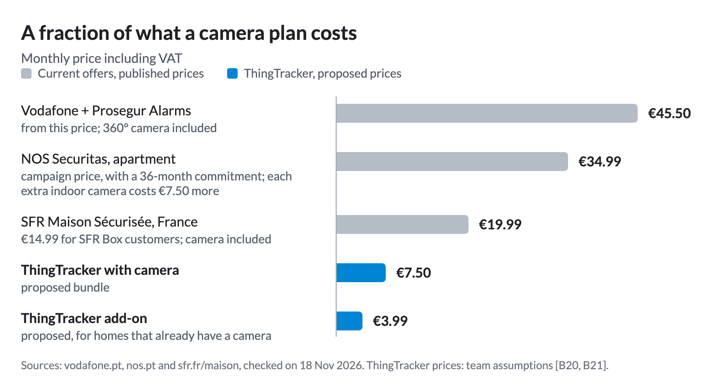
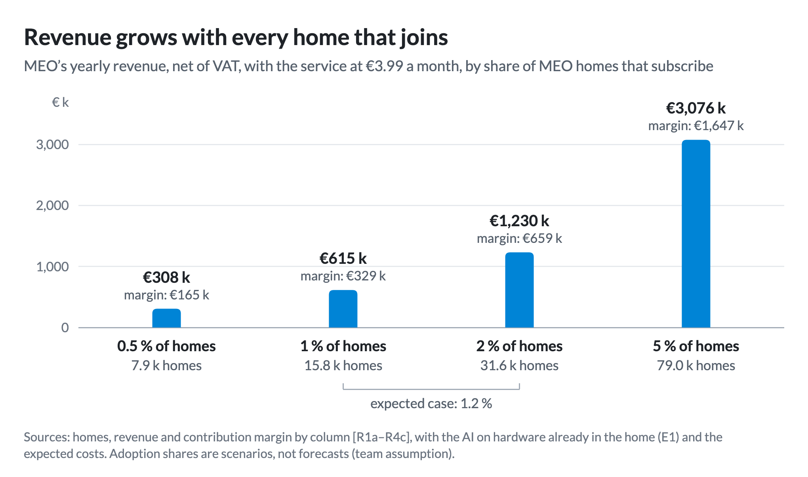

# Business case — ThingTracker

State on **Wed 18 Nov 2026**. The charts are built from [the model](16-business-case-model.csv) by `business-case/build_graficos.py --lang en`, which stops if a chart shows a value that this text does not. Every number is either sourced or marked as our assumption; the details and sources are at the end.

## Final design (20 Nov): fully local

- **The decision.** All perception and inference run on the home device, including the language model (Qwen3-1.7B in the prototype): the router, if it has an NPU, or a dedicated box such as a Raspberry Pi 5 with an AI accelerator or a Jetson Orin Nano Super. Images, video, visual fingerprints and face templates never leave the home; the Altice platform carries text only.
- **Cost, the chosen option.** Equipment bought once: an indoor camera, about €45; a Raspberry Pi 5, about €200, or a Jetson Orin Nano Super, about €345; or a router with an NPU, about €15 more (an estimate). Over 5 years the device comes to €3.33 or €5.75 a month. Electricity for the models costs cents a month: below €0.01 for YOLOv8n, up to €0.72 for OWLv2 at 12 h of motion a day (a team estimate on a Jetson Orin Nano). Figures and sources: the team's price research of 20 Nov, in [document 17](17-operator-costs.md), "Final design".
- **Who buys the device.** A box paid for by Altice does not pay back at €3.99 a month (−€4.81 to −€6.90 per home a month, document 17, section 9). The case works with the AI on the router, or with equipment the customer buys.
- **The analysis below is the earlier one (18 Nov)** and stays as context. Vision on Altice's own L4 servers (about €0.49 per home a month) is the alternative evaluated and not chosen: images would leave the home. The language model was costed as a cloud service paid per call (about €0.43 per home a month); with the model on the home device that per-call cost falls away, and the figures below have not been recomputed for it.

## In one minute

- **Who pays:** households pay their operator a small monthly fee; Altice Labs supplies ThingTracker on its Cognitive Home platform.
- **How many:** about 19,000 MEO homes in the expected case, 1.2 % of MEO's fixed-broadband homes.
- **Per home:** €3.99 a month leaves about €1.74 after the language model, the servers, support and the cost of winning the customer, and, in the earlier analysis, about €1.25 with the vision models on Altice's own servers (about €0.49, [document 17](17-operator-costs.md)).
- **The condition:** no box in every home paid for by Altice. The models run on the router or on equipment the customer buys (final design, above); with a box per home paid for by Altice, the add-on loses money (document 17).
- **Price:** a fraction of today's camera alarm plans in Portugal, which start at €34.99 a month.

## 1. The market

Figure 1 – About 19,000 MEO homes in the expected case

MEO has about 1.58 million homes with fixed broadband (ANACOM, Q4 2025). About one person in four in Portugal already uses a connected-home system (Eurostat 2024). If one in twenty of them subscribes, which is our assumption, that makes about 19,000 homes (Figure 1). The range we model runs from about 2,700 to 52,000.

## 2. One home, one month

Figure 2 – Each subscriber leaves about €1.74 a month

Figure 2 shows what is left of the monthly fee after the costs. The language model costs about €0.43 per home a month, because it is called only when a sensor is created, a question is asked or a case is unclear. The cameras are analysed by open-source models: light ones at home, on the router, and OWLv2 and DINOv2 on Altice's own L4 servers, whose cost is worked out in document 17. With vision at about €0.49, the margin is about €1.25 (document 17, section 9). The other costs are our assumptions.

## 3. Where the AI runs decides the case

Figure 3 – Where the AI runs decides the case

The local vision models are the heavy part. If they run on a router, gateway or camera already in the home, every subscriber leaves money; with a box per home, the add-on loses money (Figure 3). The earlier analysis's hybrid route avoids the box: only the light models run at home, and OWLv2 and DINOv2 run on Altice's own servers (document 17). Whether Altice's home hardware has spare capacity is the first item to confirm with Altice, because it would move vision into the home (see *What we need from Altice* below).

## 4. Price

Figure 4 – A fraction of what a camera plan costs

Camera alarm plans in Portugal start at €34.99 a month at NOS (a campaign price, plus €7.50 a month for each extra indoor camera) and at €45.50 at Vodafone. ThingTracker is proposed at €3.99 for a home that already has a camera, or €7.50 with a camera (Figure 4).

## 5. What MEO can earn

Figure 5 – Revenue grows with every home that joins

Revenue grows in a straight line with the share of homes that subscribe; the expected case (1.2 %) sits between the 1 % and 2 % columns of Figure 5. These are scenarios, not forecasts: a pilot would give the real take rate.

## 6. Beyond Portugal

France fits better. SFR Maison Sécurisée already includes a camera, and connected-home use is higher (39 % of people, against 24 % in Portugal). The expected case there is about 115,000 homes. SFR is being sold ([iliad, 6 Jun 2026](https://www.iliad.fr/media/CP_ILD_060626_Eng_227f572f6d.pdf)), so ThingTracker should be offered as a platform feature for any operator.

---

## Details and sources

*Low / base / high* below mean a cautious, an expected and an optimistic case. Row ids in brackets, such as [C02], point to [the model](16-business-case-model.csv).

### D1. Who pays and why

| Party | Pays | Gets |
|---|---|---|
| Household | A monthly fee on its operator bill | Last-seen answers, sensors from one sentence, actions on its own devices |
| Operator (MEO, SFR) | Altice Labs, under a licence model that is **unknown** | Revenue on its existing base; an answer to the NOS and Vodafone camera plans (D3) |
| Altice Labs | Not applicable | A feature for every operator on Cognitive Home, a white-label, multi-tenant B2B2C platform sold to telcos (docs/12 §2) |

The operator already holds the bill, the app and the devices that the Model Context Protocol (MCP) server acts on. Portugal has room to grow: 23.99 % of people used a connected-home system in 2024, against 33.04 % in the EU (Eurostat, docs/12 §3.7). MEO sells an Ajax alarm kit with no monthly fee whose only camera is a motion detector that takes photos when it detects motion; its shop also sells third-party video cameras (meo.pt, loja.meo.pt/seguranca, checked 18 Nov 2026).

### D2. Market size

#### Portugal (MEO)

| Step | Low | Base | High | Source |
|---|---|---|---|---|
| Residential fixed broadband accesses | 4,052 k | 4,052 k | 4,052 k | [ANACOM Q4 2025](https://www.anacom.pt/streaming/SAI4T2025.pdf?contentId=1828507&field=ATTACHED_FILE), Table 5 |
| × MEO share of residential accesses | 39.0 % | 39.0 % | 39.0 % | ANACOM Q4 2025, Table 6 |
| = MEO residential accesses [D01] | 1,580 k | 1,580 k | 1,580 k | Product of the two rows above |
| × homes ready for an add-on [D02] | 8.49 % | 23.99 % | 33.04 % | PROXY, Eurostat 2024: PT security devices / PT any connected-home system / EU average |
| × take rate [B22] | 2 % | 5 % | 10 % | **ASSUMPTION** |
| = **subscribing homes** [D05] | **2.7 k** | **19.0 k** | **52.2 k** | 0.17 % / 1.20 % / 3.30 % of the MEO base |

Caveats: ANACOM counts accesses, not homes, and Eurostat counts individuals. MEO's alarm camera only takes photos on motion, so in Portugal the realistic route is still the bundle (D3).

#### France (SFR)

| Step | Low | Base | High | Source |
|---|---|---|---|---|
| SFR total fixed customers | 5,890 k | 5,890 k | 5,890 k | [Altice France Q2 2026](https://static.s-sfr.fr/AlticeFrance/investors/results-presentation/AlticeFrance-Q22026-PR.pdf), KPI table; 17.8 % of 33.1 M French subscriptions ([Arcep, 10 Sep 2026](https://www.arcep.fr/fileadmin/cru-1786970039/user_upload/48-26-version-francaise.pdf)) |
| × ready share [F02] | 14.16 % | 39.01 % | 39.01 % | PROXY, Eurostat 2024: FR security devices / FR any connected-home system |
| × take rate | 2 % | 5 % | 10 % | **ASSUMPTION** |
| = **subscribing homes** [F04] | **16.7 k** | **114.9 k** | **229.8 k** | €0.67 M / €4.58 M / €9.17 M net a year at €3.99 [F05] |

**Unknown:** the number of Maison Sécurisée subscribers. They are the best first market, but the count is not public.

### D3. Pricing options

| Competitor offer | Price | Camera | Source |
|---|---|---|---|
| Vodafone + Prosegur Alarms | "desde €45,5/mês" | 360° camera in the base package | [vodafone.pt](https://www.vodafone.pt/alarmes-prosegur.html) |
| NOS Securitas, apartment | €34.99/month campaign (€39.99 struck through); 36 months | Motion detector with camera in the kit; each extra indoor camera **+€7.50/month** | [nos.pt alarm](https://www.nos.pt/alarmes/alarme-casa), [nos.pt cameras](https://www.nos.pt/alarmes/equipamentos/camaras-vigilancia) |
| SFR Maison Sécurisée | €19.99/month, no commitment; €14.99 for SFR Box customers; the €99 "pack alerte vidéo" must be bought | Included | [sfr.fr/maison](https://www.sfr.fr/maison/), checked 18 Nov 2026; docs/12 §2 |
| MEO | Ajax Starter kit, no service subscription | Motion detector with a camera that takes photos; no video camera | meo.pt, checked 18 Nov 2026 |

| Our option (**ASSUMPTION**) | Retail incl. VAT | Net of 23 % VAT | Fits | Why this price |
|---|---|---|---|---|
| A. Camera + Things bundle [B21] | €7.50 | €6.10 | MEO | What NOS charges for each extra indoor camera |
| B. Add-on [B20] | €2.99 / €3.99 / €4.99 | €2.43 / €3.24 / €4.06 | Homes with a platform camera, e.g. Maison Sécurisée | €4.99 is 25 % of SFR's price (33 % of the €14.99 SFR Box price), 14 % of NOS's and 11 % of Vodafone's |
| C. Inside an alarm plan | €0 extra | €0 | Retention | Value is lower churn, **unknown** |

### D4. Unit economics per home per month

Vision runs only when there is motion or sound, and its cost is in document 17. The language model in the cloud is called only for these three kinds of call:

| Call | Model | Measured cost per call | Calls a month, low / base / high (**ASSUMPTION**) |
|---|---|---|---|
| Sentence → sensor | Sonnet 5.5 | $0.003612 [A16] | 2 / 5 / 15 |
| Question | Sonnet 5.5 | $0.002546 [A17] | 30 / 60 / 150 |
| Ambiguous event | Haiku 5.5 | $0.0003077 [A18] | 60 / 300 / 900 |

The total is **$0.10 / $0.43 / $1.78** [C01], used as €0.10 / €0.43 / €1.78 below. It includes three ASSUMPTIONS:
- a per-call factor of 1.0 / 1.5 / 2.0, since only one call of each kind was measured;
- a data-residency uplift of 1.00 / 1.10 / 1.25;
- an exchange rate of 1 USD = 1 EUR.

By contrast, sending one busy zone to the cloud costs up to $0.37 an hour ([prototype README](../prototype/README.md)).

| Cost, €/home/month | Low | Base | High | Basis |
|---|---|---|---|---|
| Cloud AI [C02] | 0.10 | 0.43 | 1.78 | Above |
| Cloud backend [B07] | 0.05 | 0.10 | 0.25 | **ASSUMPTION** |
| Support [C03] | 0.17 | 0.42 | 1.25 | **ASSUMPTION**: 0.25 / 0.5 / 1 contacts a year at €8 / €10 / €15 |
| Acquisition [C04] | 0.28 | 0.56 | 1.11 | **ASSUMPTION**: €10 / €20 / €40 over 36 months |
| **Running cost** [C05] | **0.60** | **1.51** | **4.39** | Sum of the four rows above |

**Edge options.** Hardware prices are rough **ASSUMPTIONS**, amortised over 36 months to match NOS's commitment.

| Option | Hardware | €/month | Household electricity (€0.2367/kWh, Eurostat) |
|---|---|---|---|
| E1: existing gateway or camera | €0 | 0 | Not estimated (feasibility **unknown**) |
| E2: small box with an NPU | €60 / €100 / €150 | 1.67 / 2.78 / 4.17 | 0.52 / 0.86 / 1.38 (3 / 5 / 8 W) |
| E3: GPU-class box | €200 / €300 / €400 | 5.56 / 8.33 / 11.11 | 1.73 / 2.59 / 4.32 (10 / 15 / 25 W) |

**Margin, € per home per month, net of VAT.** Base costs, with the low-cost to high-cost range in brackets.

| Offer | E1 | E2 | E3 |
|---|---|---|---|
| Add-on €2.99 [M01] | 0.92 (1.83 to −1.96) | Not calculated | Not calculated |
| Add-on €3.99 [M02, M04] | **1.74** (2.65 to −1.15) | −1.04 | Not calculated |
| Add-on €4.99 [M03, M05, M06] | 2.55 (3.46 to −0.34) | −0.23 | −5.78 |
| Bundle €7.50, camera supplied (€25 / €40 / €60, **ASSUMPTION**) [M07–M09] | 3.48 | 0.70 | −4.85 |

A GPU-class box per home never pays back. The open-vocabulary detectors we use (OWLv2, Grounding DINO) are the heavy part. The case needs a lighter detector, at a low frame rate, on hardware already in the home.

### D5. Revenue for MEO

| Adoption, share of 1,580 k accesses (**ASSUMPTION**) | Homes | Net revenue a year at €2.99 / €3.99 / €4.99 | Contribution at €3.99, E1, base costs |
|---|---|---|---|
| 0.5 % | 7.9 k | €230 k / €308 k / €385 k | €165 k |
| 1 % | 15.8 k | €461 k / €615 k / €769 k | €329 k |
| 2 % | 31.6 k | €922 k / €1,230 k / €1,539 k | €659 k |
| 5 % | 79.0 k | €2,305 k / €3,076 k / €3,847 k | €1,647 k |

The base funnel scenario (1.2 %) falls between the 1 % and 2 % rows. Bundle revenue, churn effects and any Altice Labs licence fee are not included; all three are **unknown**.

### D6. Competitors and differentiation

| Who | What they sell | Overlap |
|---|---|---|
| NOS Securitas; Vodafone + Prosegur | Alarm plans with cameras (D3) | Security only; ThingTracker could use the same camera |
| SFR Maison Sécurisée (built by Altice Labs) | Hub, 2 motion detectors, a camera, a door/window detector (docs/12 §2) | Same camera; ThingTracker adds an information use |
| Altice Cognitive Home | Reliable Security with alerts and video playback ([02-challenge](02-challenge.md)); Family Care; Aging in place. Brochure: scenarios "will be powered by generative AI to enable the automatic generation of scenario scripts" (docs/12 §5) | **High** for the rule builder (docs/12 §5, row F); **none** for lost & found (row G) |

**Differentiation.** The camera remembers where and when each thing was last seen, without storing video. Video stays at home, only the region that changed is analysed, and the areas the family masks are never analysed ([document 14](14-architecture.md)). Actions reach the customer's own devices through Altice's MCP, and four new MCP tools let any assistant query that memory. Lead with the object memory, not the rule builder.

docs/12 did not survey camera vendors, so **we do not claim that no home camera keeps a last-seen memory of objects.** A survey of camera vendors is a next step before any such claim.

### D7. Replication

- **Same platform, same tab.** Cognitive Home is multi-tenant and white-label (docs/12 §2), so a new operator needs configuration, not new code. *Inference.*
- **Costs are nearly country-neutral.** Only VAT, electricity and data residency differ.
- **Language.** Portuguese and English sentences work; French is untested.
- **France has more demand.** Connected-home use is 39.01 % in France against 23.99 % in Portugal; security devices are 14.16 % against 8.49 % (Eurostat 2024).
- **The SFR sale.** The MoU was signed "with a view to acquiring SFR", subject to employee consultation and regulatory clearance (iliad, 6 Jun 2026). What happens to Maison Sécurisée is unknown, so ThingTracker should be pitched as a Cognitive Home feature for any licensee. The brochure names no other operator (docs/12 §2).

### D8. Key risks to the business case

| Risk | Effect | Mitigation |
|---|---|---|
| Perception does not fit on existing hardware | +€2.78 to €8.33 a month [C07, C08]; the add-on loses money | Light detector at a low frame rate; bundle |
| Few MEO homes have a camera | The Portuguese add-on market is far below D03 | Bundle in Portugal, add-on in France |
| Usage heavier than assumed (n = 1 per call) | AI up to €1.78 [C02] | Prompt caching, spending caps, more Haiku calls |
| EU data residency | Uplift **unknown** [B05]. The Anthropic API does not guarantee EU-only processing ([executive summary](../deliverables/executive-summary/sumario-executivo.md)) | Bedrock EU regions or an open model hosted by Altice; both unpriced |
| GDPR; EU AI Act on remote biometric identification | Adoption, legal cost | Zones, no stored video, face recognition optional and local |
| Overlap with Altice's GenAI scenarios | Weaker differentiation | Lead with object memory |
| SFR sale | France uncertain | Pitch it as a platform feature |
| Older users: 8.8 % of 65–74s use connected-home systems in Portugal (docs/12 §3.7) | Low take-up | Family-facing use |
| Take rate unknown | Revenue scales linearly [R rows] | A pilot |

### D9. What we need from Altice to firm up the numbers

1. MEO homes with an active Cognitive Home, and with a camera; the number of Maison Sécurisée subscribers.
2. Spare CPU or NPU capacity on the gateway, hub, router or set-top box (E1).
3. Camera hardware cost, and whether MEO will sell one.
4. Take rate, price, churn, support cost and acquisition cost of past add-ons.
5. Data-residency policy for the LLM: EU-only, Bedrock or self-hosted.
6. The licence model per home, and which operators license Cognitive Home.
7. Whether GenAI scenario scripts have shipped, and what the SFR sale means for Maison Sécurisée.
