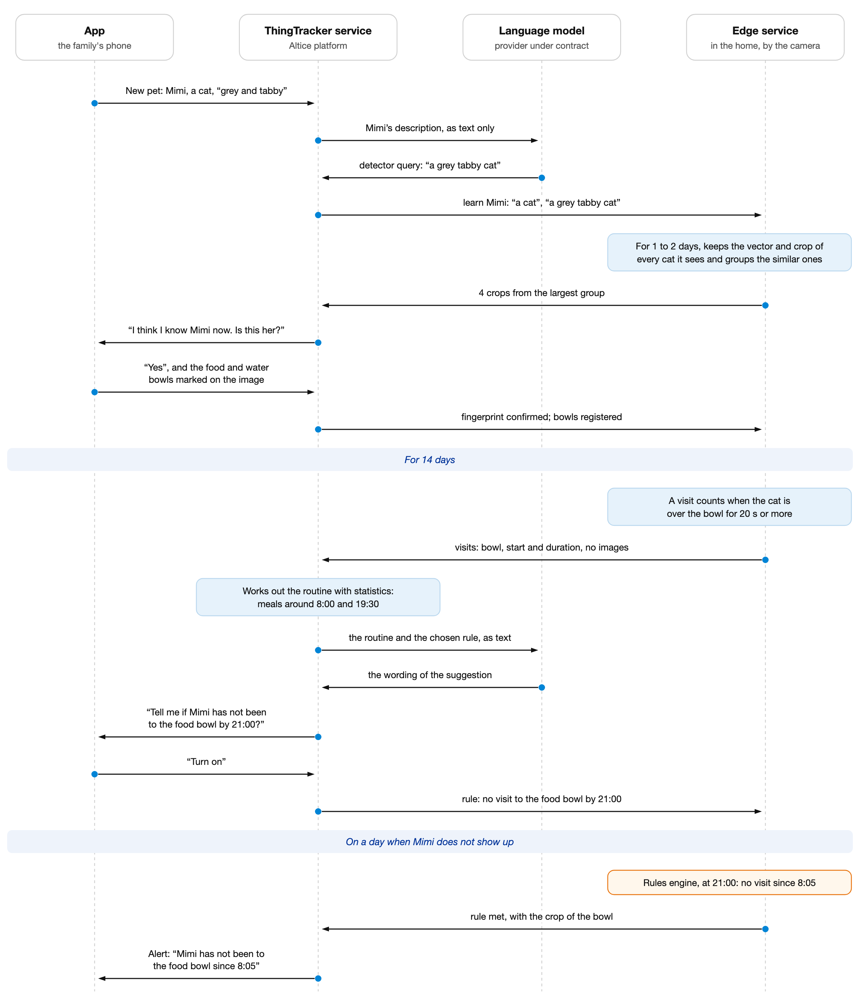
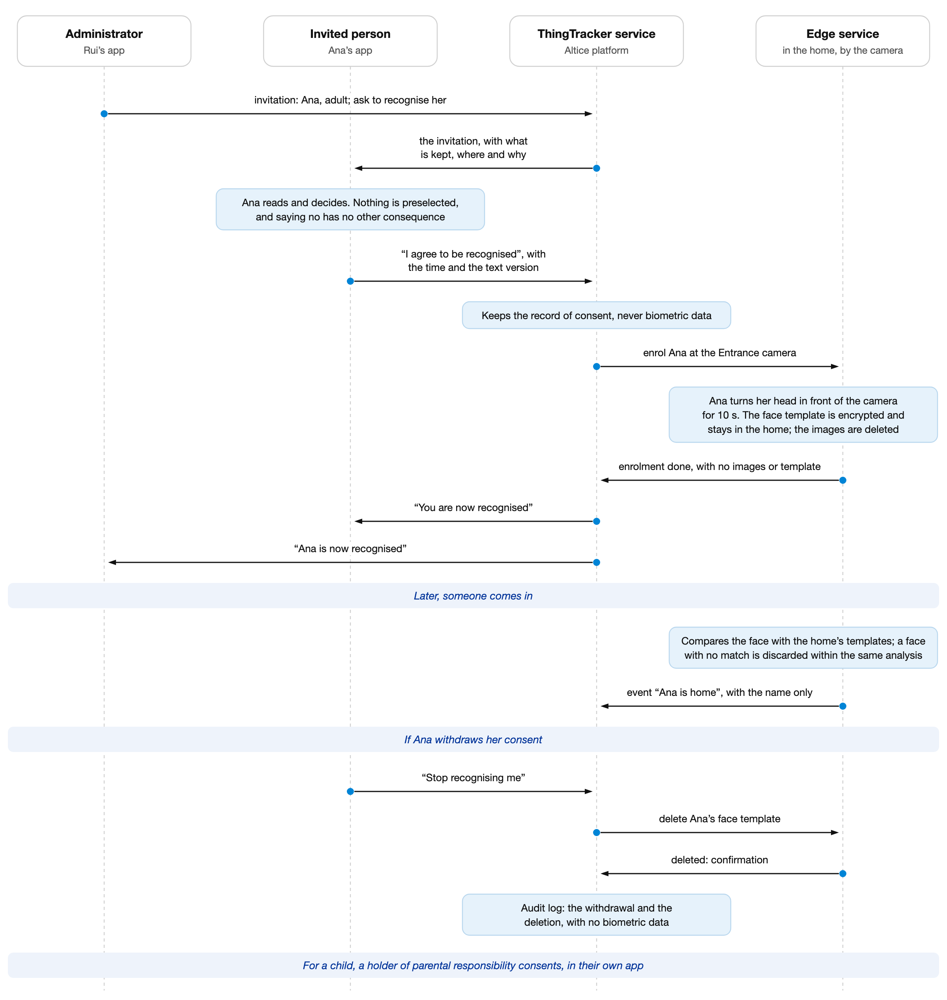
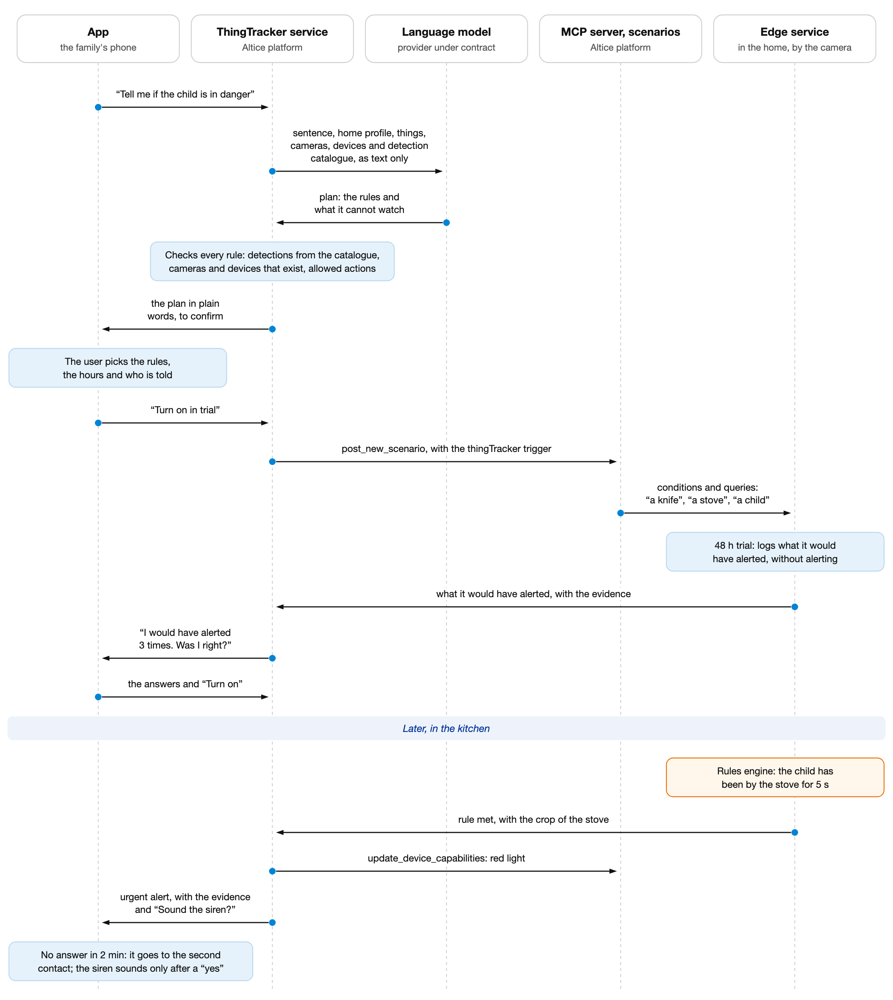
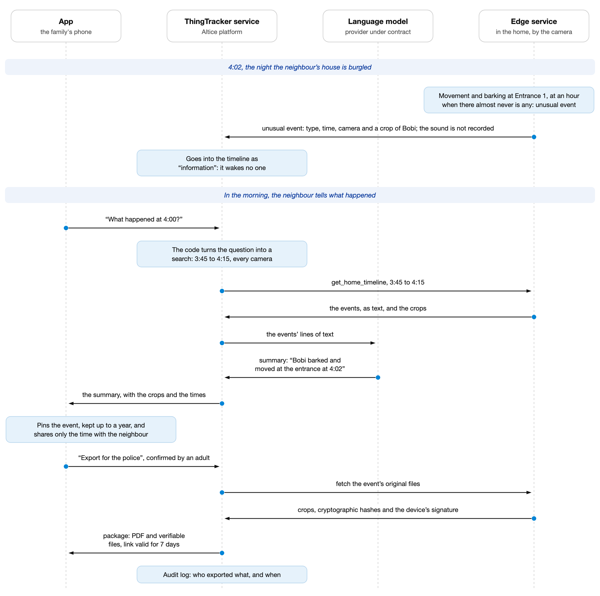

# ThingTracker · product specification for the MEO launch

Version 1, Wednesday 18 November 2026. For the team, the mentors and the Altice Labs engineers. It is written from the point of view of the Altice Labs product and engineering team preparing to launch ThingTracker for MEO customers, before building it, and it answers, with implementation detail, the hard questions that come up in planning. The architecture, the integration with the MCP ("Model Context Protocol") server, the operator's costs and the use cases are in documents 14 to 18, which this document does not repeat. The Portuguese version, shared on Drive, is [`pt/20-produto.md`](pt/20-produto.md).

## How to read this document

It assumes that everything is available: the Altice app, the platform, the MCP server with new tools, indoor and outdoor cameras, the kit's sensors, smart speakers, locks, lights and local equipment with AI capacity, either a router with an NPU ("Neural Processing Unit") or a small box. Wherever today's reality differs, a line starting with "Today," says so.

Five markers are used throughout:
- proposal, for a new product decision the team has not yet validated;
- assumption, for a value still to be confirmed, chosen to make the specification concrete;
- target, for an objective to measure in a pilot, which is not a result;
- hypothesis, for a business idea or a risk that nobody has validated yet;
- to verify, for a legal point not yet confirmed in the primary source.

Anything that does not come from documents 14 to 18 or from the prototype is a proposal, even in sentences where the marker is not repeated.

## Summary

- The customer follows four kinds of things (objects, pets, people and places) and creates rules with one sentence. Each kind has its own enrolment flow, because what is learnt, what leaves the home and the consent required differ from one kind to another (section 1).
- Objects are learnt from 8 views, as in the prototype; pets from views the camera itself collects over one or two days and the customer confirms; people only with the explicit consent of the person themselves or, for a child, of whoever holds parental responsibility, and the face template never leaves the home.
- A vague sentence such as "tell me if the child is in danger" does not produce one rule but a plan of several rules, chosen by the language model from a closed catalogue of detections, validated by the code and confirmed by the customer, together with the list of what the system cannot watch.
- The home timeline is a core feature, because the same memory that answers "where is the book?" keeps the events, including unusual ones (a bark at 4 am), with the time, the camera and a crop, for 30 days, and lets the family search ("what happened at 4 am?") and export an incident to the authorities with an adult's confirmation (section 2).
- Every alert has a level (information, alert or urgent), carries its evidence and moves on to a second contact if nobody answers. The siren and the alarm act only after a "yes".
- The hybrid route recommended in document 17 (motion check at home and the changed region analysed on Altice servers) forces the privacy promise to be reworded and has a less obvious consequence: people recognition can only exist in homes with local AI capacity.
- A three-phase launch is proposed, with quality targets measured per use case, before general availability at €3.99 a month (section 7).
- Before any pilot, the team has to take five decisions, listed in section 10: where vision runs at launch, what the language model receives, whether people recognition is part of the launch, who is the data controller, and what number of false alarms is acceptable.

## Glossary

| Term | Meaning |
|---|---|
| Thing | Whatever the customer follows: an object, a pet, a person or a place |
| Edge service | The ThingTracker program that runs in the home, on the router or on a small box: motion check, home memory, rules engine and, when there is capacity, the vision models |
| ThingTracker service | The Altice platform component that receives the app's requests and the homes' events; it is the only one that calls the language model |
| Detector | The OWLv2 model, which finds in an image whatever an English query describes ("a knife") |
| Visual fingerprint | 8 DINOv2 vectors, one per view, that tell a specific thing apart from others of the same kind |
| Face template | The vectors that allow an enrolled person's face to be recognised; it exists only with consent and only in the home |
| Place | A camera ("Kitchen 1"); within a place, surfaces (the counter, the desk) are found by name |
| Rule | A condition and an action, compiled once from a sentence and evaluated in the home by the rules engine |
| Plan | A group of rules created from a vague sentence, such as "the child in danger" |
| Evidence | What goes with every alert: a crop, the place, the time and the reason |
| Timeline | The record of the home's events, with the time, the camera and a crop, which can be searched and exported (section 2) |
| Unusual event | Motion, pet activity or sound at a time when it almost never happens (proposal) |
| Trial mode | A period in which a new rule records what it would have alerted on, without alerting anyone (proposal) |
| Hybrid route | Motion check at home and analysis of the changed region of the image on Altice servers (document 17, section 8) |

## 0. Starting point

The table below shows what this specification takes as available and what exists today.

| Element | Assumed in this specification | Today |
|---|---|---|
| Altice app | A Things tab and the assistant button on every tab, in Portuguese | A web replica in the prototype; the beta version of the app is in English |
| Platform | ThingTracker service, a per-customer database, push notifications and an events API | None of these exists; the MCP has no push notifications and no event stream |
| MCP server | The current 18 tools, the four Things tools of document 15 and the new tools of section 7.5 | 18 tools, with no way to delete scenarios |
| Cameras | Indoor and outdoor, read over RTSP on the home network | One kit Wi-Fi camera, read through a cloud relay |
| Local equipment | A router with an NPU or a small box, or the hybrid route with Altice servers | A laptop (Apple M1 Pro) |
| Devices | The kit, smart speakers, locks, floodlights, a connected hob | The kit: camera, contact sensor, smoke detector, temperature and humidity sensor, plug, security hub and light |
| Language model | Under contract, with EU processing, or a local model | Claude off by default; local model Qwen3-1.7B on the laptop |

## 1. Adding things

All things come in through the same (+) button on the Things tab, which opens the question "What do you want to keep track of?" with four options (an object, a pet, a person, a camera), while rules are created in the assistant, present on every tab. The screens follow the pattern the app already uses to add a device (document 15, section 6): one step per screen, a main button fixed at the bottom and a confirmation dialog to cancel. The table below summarises what changes from one kind to another.

| Aspect | Object | Pet | Person | Camera |
|---|---|---|---|---|
| How it is learnt | 8 views, shown to the camera or photographed with the phone | Views collected by the camera over 1 to 2 days and confirmed by the customer | Face template computed in the home, only with consent | One room scan |
| Detector query | The category, in English ("a bunch of keys") | "a cat" or "a dog" and the described appearance | "a person", "a child" | Surfaces and common objects |
| What leaves the home | Name, thumbnail and visual fingerprint | Name, thumbnail, fingerprint and bowl visits | Name and events; never the face template | The accepted names and the masks |
| Consent | Not needed | Not needed | Explicit, person by person | A posted notice, outdoors (to verify) |
| Automatic suggestions | Leaving without the object; out of place | Bowls, front door, forbidden sofa | Arrivals; nobody in the kitchen by a given time | Those the place allows (document 18, section 2.4) |

### 1.1 An object

Enrolling an object is the flow the prototype already runs, and it is the model for the others. Each row of the table below is one screen.

| # | Screen: what is seen and tapped | In the home (edge service) | On the platform and in the language model |
|---|---|---|---|
| 1 | (+) → "An object". A "What is it called?" field and suggestion buttons (Keys, Wallet, Glasses, Phone, Remote, Book); below, "The Living room camera saw: mug, laptop" | Nothing; the suggestions come from the latest room scan | Stores the name and looks the category up in the catalogue ("chaves" → "a bunch of keys"). If it is not there, the language model proposes three short English queries from the name, receiving text only |
| 2 | "How do you want to register it?", with three options: show it to the camera, take photos, or pick it in the camera image (the last one only if the room scan saw it) | Nothing | Creates the thing in the "registering" state (`create_thing`) |
| 3a | Show it to the camera: the customer picks the camera and sees "Hold it about 50 cm away and turn it slowly", with a progress ring ("view 3 of 8") and tips ("closer", "too dark") | In each image, the detector looks for the category with a low threshold (0.06, as in the prototype), crops the largest box and computes the DINOv2 vector; a view is only kept if it differs from the previous ones (similarity below 0.97). Of the three candidate queries, the one with the best average score is kept (proposal) | Relays the progress to the app |
| 3b | Take photos: eight photos from different sides, with a guide silhouette on screen | The photos arrive over the secure channel, are cropped and turned into vectors and then deleted; only the thumbnail is kept | Forwards the photos without storing them |
| 4 | "Where does it usually live?": the camera image with the surfaces found; the customer taps one (the hall table) or "No fixed place" | Stores the usual place: camera and surface | Stores the usual place, which feeds the "out of place" rules |
| 5 | "Let's test it": "Put it where it usually lives and step away". Result: "Found it on the hall table (similarity 0.74)", with the crop, or "I couldn't find it", with the likely cause | Analyses the next images as in normal operation; if the object covers too few pixels, measures it and returns that cause | Shows the result; after two failures, offers to repeat the enrolment |
| 6 | Optional: "Is there a similar one in the home?". The customer shows, for example, another family member's wallet | Stores those views as negatives and sets this thing's threshold between the similarity of its own views and that of the look-alikes (proposal) | Stores the threshold |
| 7 | "Done", with three suggested sentences ("Tell me if I leave without my keys") | Starts following the object | Stores the visual fingerprint in the platform database, linked to the customer |

Each object gets a stable identifier, the name, the other names (section 3), the owner, the English category, the usual place, the threshold, the thumbnail and the visual fingerprint, which takes about 12 KB (8 vectors of 384 single-precision numbers), together with the name and version of the model that computed it. The crops of the 8 views are also kept by the edge service, so that a new model version can recompute the fingerprint without repeating the enrolment (section 7.2).

Today, the prototype enrols an object with 8 views shown to the camera and recognises it with a fixed threshold of 0.62; enrolment from views captured with the phone was tested once, with the book (similarity 0.70). The usual place, the guided test, the negative views and the per-object threshold do not exist yet.

### 1.2 A pet

A pet cannot be held up to the camera and turned slowly, so enrolment is reversed: instead of the customer showing the pet, the camera collects views over one or two days and the customer confirms them. Figure 1 shows the complete flow, from enrolment to the first alert.



**Figure 1** – Adding a pet and learning its routine: from the app to the edge service and back, with the first alert (generated by `docs/product/build_flows.py`).

| # | Screen: what is seen and tapped | In the home (edge service) | On the platform and in the language model |
|---|---|---|---|
| 1 | (+) → "A pet": "What is its name?" (Mimi), "Dog, cat or other?" and "What does it look like?", as free text or buttons (colour, coat, size; breed optional) | Nothing | The species gives the detector query ("a cat"). From the description, the language model writes a second query ("a grey tabby cat"), which the customer never sees |
| 2 | "Which cameras does she usually walk past?" and "I'll learn to recognise her over the next few days" | For 1 to 2 days (assumption), keeps the vector and the crop of every cat detected with a high score and groups similar vectors | Nothing |
| 3 | Notification: "I think I know Mimi now. Is this her?", with 4 crops from the largest group and three buttons: "Yes", "That's not her" and "There's more than one cat" | Sends the group's crops, which show only the animal | Forwards the crops |
| 4 | If there are two groups: "I found two different cats. Which one is Mimi?", with the option to register the other | The 8 views that differ most from each other, within the confirmed group, make up the fingerprint; the other crops are deleted | Stores the fingerprint, as for an object |
| 5 | "Where does she eat and drink?": the camera image with the bowls found ("a pet bowl") highlighted; the customer taps the food bowl and the water bowl. Optional: "Show me the bowl full and then empty" | Registers each bowl as a thing and, if the customer does so, the "full" and "empty" views (proposal) | Stores the bowls |
| 6 | "Any off-limits spots?", with buttons for the sofa, the kitchen counter and the front door | Adds those surfaces to the camera's vocabulary | Prepares the suggestions for cases V4, S1 and C7 of document 18 |
| 7 | "Learning Mimi's routine", with a day counter; after 14 days (assumption), the "Mimi's routine" screen shows the visits by hour and the suggested rules | Records every visit (pet, bowl, start and duration), without images | Computes the routine with statistics, without the language model, which only writes the text of the suggestions |

The routine and the question "has Mimi eaten?" rest on the following calculation rules, all of them proposals:
- a visit counts when the pet's box overlaps the bowl's box, with the 15 % margin the prototype already uses, in at least two consecutive analyses and for 20 s or more (assumption); anything shorter is a pass-by;
- for each bowl, the visits of the last 14 days are grouped into meals (visits less than 2 h apart are merged into one, assumption), and for each meal the median time and the 90th percentile of the first visit are computed;
- the suggested rule is "tell me if Mimi hasn't been to the food bowl by X", where X is the 90th percentile plus 30 minutes, rounded to the quarter hour (assumption); for water, the 12-hour rule the prototype already suggests is kept;
- the routine is recomputed every week and, if the 90th percentile shifts by more than 45 minutes for two weeks in a row, the app offers to update the time ("Mimi now eats later. Move the alert to 9:30 pm?").

The camera does not see a pet eating, it sees it next to the bowl, and the product must say so. For the question "has Mimi eaten?", the code gathers the facts (today's visits, their duration and, if available, the state of the bowl before and after) and the language model only writes the answer, as already happens in the prototype. Without the bowl state, the answer is "I can't see whether she ate. She was at the food bowl at 8:05 am, for 3 minutes"; with it, "She was at the food bowl at 8:05 am. The bowl looked full before and half empty after". The bowl state comes from comparing the bowl's crop, before and after each visit, with the "full" and "empty" views registered in step 5, using the same technique as the visual fingerprint (proposal, not tested). A connected feeder (other IoT) would give the amount served and would be the reference wherever there is one.

With two or more pets of the same species, per-pet rules only hold if each one has its own fingerprint. Without it, the rule applies to "a cat", as document 18 foresees (case C1), and the alert says so. A pet that grows changes its appearance, so the fingerprint is updated over time (section 6.2).

Today, the prototype detects "a dog" and "a cat", links the pet to the bowl it touches, suggests the rules for food by 8 pm and water within 12 hours after seeing the pet clearly in three analyses within 10 minutes, and evaluates the `not_by` rule. A pet's individual fingerprint, the grouping of views, the learnt routine and the bowl state have not been tested.

### 1.3 A person

People recognition is the most sensitive part of the product, and the flow was designed from five principles:
- recognition is off by default and, without it, the camera sees "a person" or "a child", without identifying anyone (document 18, section 2.5);
- consent is given by the person themselves, in their own app, or, for a child, by whoever holds parental responsibility, and the home's administrator cannot consent on behalf of another adult;
- the face template is computed and stored only by the edge service, and the platform stores the name, the role and the consent record (who consented, when and with which version of the text), never biometric data;
- withdrawing consent is as easy as giving it and deletes the template in the home;
- whoever has not enrolled is never identified, and there is no "frequent faces" feature that groups unknown visitors.

The legal framework justifies this care. Biometric data processed to identify a person are a special category of data (GDPR, Article 4(14) and Article 9(1)), whose processing is only admissible, in this case, with explicit consent (Article 9(2)(a)), which can be withdrawn at any time (Article 7(3)). Document 14 foresees a data protection impact assessment (DPIA, Article 35) before any pilot. The AI Act (Regulation (EU) 2024/1689) classifies remote biometric identification systems as high risk, but excludes biometric verification whose sole purpose is to confirm that a person is who they claim to be (Annex III, point 1(a), to verify), and does not apply to the obligations of whoever uses an AI system in a purely personal, non-professional activity (Article 2(10), to verify), which may cover the family, but not Altice as the provider.

The table below sets out how each kind of person is handled.

| Who | Recognition | Who consents | What is stored | Example alerts |
|---|---|---|---|---|
| Adult family member | Optional | The person themselves, in their own app | Name, role and consent record; the face template, only in the home | "Ana is home"; rules about a specific person |
| Child | Optional and discouraged by default (proposal) | Whoever holds parental responsibility; from age 13, also the child (proposal, by analogy with Article 16 of Law 58/2019, to verify) | Name and age band, never the date of birth | "A child arrived home" (C6); dangers (S1, S2, S5, S6) |
| Older relative being cared for | Rarely needed | The person themselves; if they cannot decide, their legal representative (to verify) | Name and "lives alone" profile, always declared by the family and never inferred by the camera | "Nobody has been in the kitchen by midday" (C2) |
| Carer or cleaner | No (proposal) | Not applicable | Name, days and hours | No "unknown person" alerts during their hours |
| Guest | No | Not applicable | Nothing about the person; only the visit mode's time window | Alerts about people paused or softened during the visit |
| Stranger | Never | Not applicable | Nothing | "A person at the entrance" (S7, E1, E2) |

Figure 2 and the table below describe how an adult family member is enrolled, with recognition.



**Figure 2** – Adding a person: the invitation, the person's own consent, enrolment in the home and withdrawal of consent (generated by `docs/product/build_flows.py`).

| # | Screen: what is seen and tapped | In the home (edge service) | On the platform and in the language model |
|---|---|---|---|
| 1 | Administrator: (+) → "A person" → "Family member (adult)"; name, contact and the "Ask to recognise them" switch, off by default | Nothing | Creates the member and sends the invitation |
| 2 | In Ana's app: "Rui invited you to the Rua das Flores home". Consent screen with four short blocks (what is stored, where, what for, how to withdraw) and two buttons of the same size, "I agree to be recognised" and "Not now", with nothing pre-selected | Nothing | Stores the decision, the time and the version of the text; declining has no consequence other than Ana remaining "a person" |
| 3 | "Stand in front of the Entrance camera and turn your head slowly", with a progress ring on Ana's phone and no image on screen | The edge service detects the face, computes 5 to 10 vectors with a face recognition model run in the home and stores them encrypted; the images are deleted | Asks the edge service for the enrolment and receives only "done" |
| 4 | "Walk past the entrance so we can test it" → "I recognised you at 6:02 pm" | Compares the face seen with the home's templates | Shows the result |
| 5 | Ana and Rui: "Ana will now be recognised. You can turn this off in Settings → Privacy" | Nothing | Writes the entry in the audit log (section 5.5) |
| 6 | Later, Ana taps "Stop recognising me" | Deletes the face template and confirms | Sends the deletion request, records the confirmation and keeps only the record of the consent and its withdrawal, without biometric data |

Enrolment happens in front of the home camera, not with a selfie on the phone, so that no image of the face crosses the platform. The price of this choice is that a new or reset edge service requires people to enrol again, unlike objects, whose fingerprint the platform keeps. The face recognition model is still to be chosen, with one precondition: several published models have weights for non-commercial use only, so the licence must be checked model by model (to verify).

Each kind of person has its own particulars:
- Child. One of the holders of parental responsibility consents and the other receives a notification (proposal). The age band (0–2, 3–5, 6–9, 10–12 years) is stored, because the danger for a two-year-old is not the danger for a ten-year-old and the plan in section 1.5 depends on it. Alerts about children never carry a photo of the child (section 6.3).
- Older relative. Case C2 ("nobody has been in the kitchen by midday") works without recognition, because in a home where the person lives alone, anyone seen is almost always her. The app shows her, or the kitchen speaker announces, what is being watched, and she can pause the analysis for an hour (section 8).
- Carer or cleaner. They are added as a "person with a schedule" ("Mrs Rosa, Tuesdays 9 am to 1 pm"). Recognition is not proposed, because the consent of someone who works for the family is hardly free (EDPB, Guidelines 05/2020 on consent, section 3.1.1, to verify). A carer with access to the app has the "carer" role (section 4).
- Guest. Visit mode is turned on, with an end time; during that period, "unknown person" alerts are paused or downgraded to information, and nothing is stored about the visit.
- Stranger. Always "a person". Only the safety cases S7, E1, E2 and E4 send a photo of a person (document 18, section 2.5).

The most delicate point is visitors. To recognise Ana, the edge service has to compute the template of every face the camera sees and compare it with the home's templates; those that do not match are discarded within the analysis itself, without being stored or leaving the home. Even so, the EDPB's Guidelines 3/2019, in the section on biometric data, give the example of a hotel that recognises VIP guests and conclude that the system would only be lawful if every other person analysed had also consented (section 5.1, to verify). A verification mode is therefore proposed, which limits comparison to the moments when the phone of an enrolled member joins the home's Wi-Fi, confirming "is this Ana?" instead of searching "who is this?". This mode reduces the number of faces analysed, but it still compares every face seen at that moment with Ana's template, with nobody claiming who they are; it may therefore still count as identification rather than the biometric verification the AI Act excludes from high risk, so its legal framing must be reviewed before launch (to verify).

Today, the prototype does not recognise people: it detects "a person" and "a child" and stores who, where and when, without any image.

### 1.4 A camera and its place

Each camera is a place ("Kitchen 1"), as the team decided, and the flow adds to today's camera installation the steps that protect privacy.

| # | Screen: what is seen and tapped | In the home (edge service) | On the platform and in the language model |
|---|---|---|---|
| 1 | The camera is installed as today, under "Add device"; at the end, "Use this camera in ThingTracker?" appears | Nothing | Links the camera to the home and, if it is the first one, issues the edge service's credential (document 15, section 8) |
| 2 | "Where is it?": indoor or outdoor, and the room. The name is suggested automatically ("Kitchen 1", or "Kitchen 2" if there is already one) | Nothing | Stores the place |
| 3 | Room scan: the camera image with the surfaces and objects found and an "Accept" button on each | The detector runs once over the full image with the vocabulary of surfaces and common objects; nothing from this scan leaves the home (document 14, section 4.1) | Receives only the accepted names |
| 4 | Checks: "This camera seems to see a bed. ThingTracker cameras should not be in bedrooms or bathrooms." Outdoors: "It seems to see the street. Reframe it or mask that area." | Queries "a bed", "a toilet" and "a shower" indoors; "a road", "a sidewalk" and "a car on the street" outdoors (proposal; reliability to be measured) | Nothing |
| 5 | Masks: the areas never analysed are drawn with a finger; outdoors, the customer cannot move on without reviewing the mask | Masks are applied before any analysis, in the privacy guard | Stores the masks, to restore them on a reset edge service |
| 6 | "What this camera can see": the app says whether a small object, such as a knife or keys, is visible at the camera's distance and, if not, suggests moving the camera closer | Measures the main surface in pixels and estimates the size of a small object on it (minimum of 32 pixels, assumption) | Nothing |
| 7 | Outdoors only: "Put up a CCTV notice where it can be seen" (to verify) and the note that sound is not used as a trigger on this camera | Turns off sound as a trigger | Records the confirmation in the audit log |

A ThingTracker camera must never see a bedroom, a bathroom, the public road, a neighbour's property or the common parts of a building, such as the landing. Law 58/2019 forbids cameras from covering "public roads, neighbouring properties or other places that are not in the controller's exclusive domain, except where strictly necessary to cover the accesses to the property" (Article 19(2)(a)), and a camera that films the public space, even partly, no longer benefits from the GDPR's household exemption (Article 2(2)(c); Ryneš judgment, C-212/13; document 18, section 2.6). Masks prevent the analysis of what remains, but they do not change what the camera captures, so correct framing always comes first. It is also proposed that people recognition be unavailable on outdoor cameras, where people pass who never consented.

Today, there is a single camera, whose place is the room it is assigned to in the app; there are no masks (the edge service only ignores the time overlaid on the image) and no framing checks.

### 1.5 A rule from a sentence

A precise sentence ("tell me if I leave home without my wallet") produces one rule, as document 15 describes. A vague sentence, such as "tell me if the child is in danger", requires the system to decide what danger is, and this is where the language model adds the most value and the most risk. It is proposed that the model does not invent detectors, but chooses from a closed catalogue maintained by Altice, in which each entry gives the concept in Portuguese, the English query, the validation status (measured or not measured), the minimum size in pixels and the behaviour at night. Figure 3 shows the complete path.



**Figure 3** – From the sentence "tell me if the child is in danger" to the rules, the trial period and the first alert (generated by `docs/product/build_flows.py`).

| # | Screen: what is seen and tapped | In the home (edge service) | On the platform and in the language model |
|---|---|---|---|
| 1 | In the assistant, the customer types or says "Tell me if the child is in danger" | Nothing | The service recognises that it is a rule, not a question |
| 2 | "Thinking…" (2 to 5 s) | Nothing | Sends the language model, as text only, the sentence, the home's profile (a child aged 3 to 5, a cat), the things, the cameras with their type (indoor or outdoor), the devices (`get_home_devices`), the detection catalogue and the rule format |
| 3 | Nothing | Nothing | The model returns a plan: for each danger, who is at risk, the catalogue detections, the rule, the action, the alert level and one sentence of justification, plus the list of what it cannot watch |
| 4 | Nothing | Nothing | The code validates each rule: the format, the detections (catalogue only), the cameras and devices (existing ones only) and the actions (allowed ones only). An invalid rule leaves the plan, and is never fixed with a second call to the model |
| 5 | "Plan: child in danger", with one line per rule, each with a switch, what it watches, where, what it does, "needs" (for example, "a camera in the kitchen") and the status ("works now", "not yet measured"); below, "What I can't watch" | Nothing | Presents the plan in plain language |
| 6 | The user chooses the rules, the hours ("only when the child is home"), who is alerted, and taps "Start in trial" | Nothing | Saves each rule as a scenario (`post_new_scenario`, with the `thingTracker` trigger) and groups them in the plan |
| 7 | "In trial for 48 hours: I'll record what I would have alerted on, without alerting" (proposal) | Receives the conditions and the queries ("a knife", "a stove", "a child") and starts evaluating them | Nothing |
| 8 | After 48 hours: "I would have alerted 3 times", with the evidence for each, and the buttons "That was right" and "Not a danger"; then "Turn on" | Nothing | Uses the answers to adjust each rule's minimum duration before it is turned on |
| 9 | Urgent alert: "The child has been next to the stove for 5 seconds", with the evidence and the buttons "Seen it", "All fine" and "Sound the siren" | The rules engine fires and sends the event with the crop of the stove | Turns the light red through the MCP and sends the alert; if nobody answers within 2 minutes, it moves on to the second contact (section 4.4) |

The plan expected from the model for a home with a child aged 3 to 5, a cat, and cameras in the kitchen, the living room and the entrance is the following. The word "danger" covers the child and also the others: the pet, a younger sibling and the home itself.

| Danger | For whom | What the camera looks for | Rule | Action | Feasibility |
|---|---|---|---|---|---|
| Knife within reach | Child | "a knife", "a child", in Kitchen 1 | Knife near the child for 2 s | Urgent alert, with the crop of the knife; red light | Small extension (S2) |
| Stove or oven | Child | "a child", "a stove", "an oven" | Child next to the stove for 5 s; only with the hob on, if it is connected | Urgent alert; voice alert on the speaker | Small extension (S2) |
| Hazardous products out of place | Child | The registered bleach and medicine box; "a child" | Product seen out of its usual place with the child in the same room | Alert, with the crop of the product | Small extension (S5) |
| Open window | Child | "a child", in Living room 1, and the window's contact sensor | Window open and child in the living room for 10 s | Alert; voice alert | Small extension (S6) |
| Child goes out the door alone | Child | "a child" in Entrance 1 and the door sensor | The door opens, the child is seen at the entrance and no other person in the next 30 s | Urgent alert | Proposal, similar to case C7 |
| Knife near the cat | Others | "a knife", "a cat", "a kitchen counter" | Knife and cat on the counter for 3 s | Alert; red light | Small extension (S1) |
| Child next to the cat while it eats | Child and pet | "a child", "a cat" and the registered bowl | Child near the cat while it is at the bowl | Information | Proposal; the risk has to be validated |
| Hob on with nobody there | Everyone | No person in Kitchen 1 | Hob on and nobody in the kitchen for 15 min | Alert; turn off only after a "yes" | Small extension (S3) |

The plan also lists, just as clearly, what the system cannot watch: bedrooms and bathrooms, where there are no cameras; a child swallowing a small object; electrical sockets; anything outside the cameras' field of view; and a child holding a knife, which requires a pose model not yet integrated (document 18, case S2). The limits of each detection are in document 18; the most relevant one here is that the detector can mistake a child for a short adult, which affects the "goes out alone" rule.

Each rule is stored in a format that extends the one in document 14 (section 5) with the plan, the level, the recipients, the hours, the evidence policy and the trial period:

```json
{
  "plan": "Criança em perigo",
  "title": "Criança junto ao fogão",
  "when": { "near": ["child", "stove"], "camera": "Cozinha 1", "for": "5s" },
  "then": [ { "notify": "A criança está junto ao fogão.", "level": "urgent", "to": "adults_at_home" },
            { "device": "Light", "set": { "color": "red" } } ],
  "evidence": "object_crop",
  "active": { "when": "child_at_home" },
  "trial_until": "2026-11-20T18:00:00Z",
  "confirm_before": ["siren", "alarm", "lock"],
  "cooldown": "10m"
}
```

(The values are in Portuguese because they are what a MEO customer would see: plan "Child in danger", title "Child next to the stove", message "The child is next to the stove.", camera "Kitchen 1".)

A rule can be changed in three ways. In the structured editor, each field (what, where, for how long, action, who is alerted, when it is active) is a picker. With a sentence, such as "weekdays only", the language model returns only the change to the matching field, which the app shows before saving. Or from the buttons on the alert itself, such as "Only alert after 10 seconds". Every change creates a new version of the rule, visible in the audit log. Rules are paused one by one or per plan, with a deadline ("1 hour", "until tomorrow", "until I turn it back on"), and are paused automatically in visit and holiday modes when the customer chooses so. Deleting a rule deletes the matching scenario, which requires an MCP tool that does not exist yet.

Today, the prototype compiles a sentence into a single rule of seven kinds (`leave_without`, `not_by`, `nobody_by`, `left_for`, `nobody_for`, `someone_arrives` and `seen_in`), with the local model or with Claude, and the code fixes what the sentence states literally (times, places, actions). There are no plans, catalogue, trial period or alert levels, nor the `near` and "out of place" rules, and scenarios are not saved on the platform.

## 2. The home timeline

The memory that answers "where is the book?" also keeps what happened in the home, and it is proposed that this timeline be a core feature of the product, not an accessory. The same data serve to know where things are, to understand what went on when one gets home late, for example what the child ate or drank and at what time, and to review an incident, after an alarm or a burglary in the neighbourhood. The idea came from a real case lived by a teammate, whose neighbour was burgled during the night; the teammate's dog barked at 4 am, which it never does, and that time is what let the neighbour find the right moment in her own camera's footage. Figure 4 shows the path of an unusual event, from its record in the home to the export for the authorities.



**Figure 4** – The home timeline: an unusual event at 4 am, the search made in the morning and the export for the authorities (generated by `docs/product/build_flows.py`).

### 2.1 What is recorded

The timeline brings together two kinds of entries. The first are the events the edge service already produces: a thing changing place, a visit to the bowl, an arrival, a rule firing. The second are unusual events (proposal), which the edge service flags in the following situations:
- motion on a camera at a time when, over the last 14 days, there was almost never motion (on fewer than 5 % of days, assumption);
- a registered pet active at a time when it is usually still;
- a loud sound, if the family has turned on sound as a trigger (section 2.5);
- the door opening at night, the Altice alarm going off or a safety rule being met.

Each entry stores the fields in the table below.

| Field | Example | Notes |
|---|---|---|
| Type | Object changed place; bowl visit; arrival; rule fired; unusual motion; unusual sound; alarm | The unusual types are a proposal |
| Time | From 4:02 to 4:03 am | Start and end; consecutive events in the same place are merged into one, as in `get_thing_timeline` |
| Place | Entrance 1 and, if any, the surface | Each camera is a place |
| What or who | "Bobi", "a person", "the biscuit packet" | A person only has a name if they consented to recognition |
| Image | The crop of what caused the event | Never the full image, except in an alarm |
| Sound | "Bark, loud" | Optional; only the type and the level, never the recording |
| Source | Detector, rule, kit sensor or alarm | Separates what the camera saw from what a sensor reported |

The full image is only justified in an alarm. When the Altice alarm goes off, or when a safety rule involving people is met (S7, E1, E2 or E4), the edge service keeps three full images from that camera in the home, one before, one at the moment and one after (assumption). If the family turns on the incident backup (proposal), an encrypted copy goes to the platform, so that the evidence survives the theft or destruction of the home equipment, and this is the only situation in which a full image leaves the home.

### 2.2 How long

By default, each entry is kept for 30 days and then deleted automatically (proposal, the same period as observations in document 14). An event the family pins, such as the 4 am bark, is kept for up to one year, with a reminder seven days before it is deleted, and can be unpinned at any time (proposal). The full images of an alarm follow the same rule. Any adult can delete an entry, and the deletion goes into the audit log, without the deleted content.

### 2.3 Who sees it

| Role | What they see in the timeline |
|---|---|
| Administrator and adult members | The home's whole timeline; images of people, only in the safety cases |
| Carer | Only the events of the person they care for, such as "nobody has been in the kitchen by midday" |
| Child and guest | Nothing |
| Altice customer support | Nothing |

Every view of a pinned event and every export is recorded in the audit log (section 5.5).

### 2.4 Search

The timeline can be searched in two ways. In the app, with filters by camera, type, thing, day and "unusual only". In the assistant, with a question, which the code turns into a search (time window, cameras, types and things) before the language model comes in:
- "What happened at 4 am?" gives the window from 3:45 to 4:15 am, on every camera and of every type;
- "What did the child eat today?" gives today, on the kitchen cameras, the events in which a child is seen with food or drink, that is, with registered things (the cereal box, the juice carton) or with detector queries such as "a cookie" or "a juice box", whose reliability is still to be measured.

The language model receives only the text lines of the events found (type, time, place, what) and writes the summary, and the app shows the crop next to each line. The answer says what the camera saw, and no more: "At 4:12 pm, the child was seen in the kitchen with the biscuit packet and, at 4:20 pm, with the juice carton." The camera sees the child with the packet, not eating; what happens outside the field of view does not appear; and the crop shows the object, not the child (section 5.6).

### 2.5 Sound as a trigger

Sound can flag what the image does not show, such as the 4 am bark, but it raises a legal question. Law 58/2019 forbids capturing sound in places where video surveillance is allowed, except when the premises are closed or with prior authorisation from the CNPD (Article 19(4)), and whether the rule applies to a private home is still to be verified (document 18, section 2.6). Until then, it is proposed that sound as a trigger be off by default, never be used on outdoor cameras and, indoors, only work if the family turns it on after reading what it does. A small sound classifier, on the edge service, assigns only a type (bark, breaking glass, smoke alarm) and a level; the sound is never recorded or sent. The classifier is still to be chosen, and its licence to be verified.

### 2.6 Export for the authorities

The export follows these steps (proposal):
1. An adult opens the incident, or picks a time window, and taps "Export for the authorities".
2. The app shows exactly what will be exported (the events, the crops and, if any, the alarm's full images), and the adult can remove any item.
3. The export requires an adult's confirmation and goes into the audit log.
4. The service builds a package with a PDF any officer can read (events, times, places and images) and the original files, with their cryptographic hashes and the signature of the home equipment, so that their integrity can be checked.
5. The family downloads the package to the phone or sends the police a link valid for seven days (assumption), and every access to that link is recorded.

For the neighbour's case, there is a lighter path, "Share the time only", which sends text only ("My dog barked at 4:02 am; the entrance camera recorded motion from 4:02 to 4:03 am"), without images, so that the neighbour can look for the right moment in their own camera. The family hands over its own data; requests the authorities send directly to Altice follow the legal procedures Altice already applies (to verify).

### 2.7 Safeguards

The timeline rests on the following safeguards:
- there is no video, and crops are kept, never full images, except in alarms;
- people have no name without consent, and children appear through the object, never through their photo;
- sound is off by default, never recorded and never used outdoors;
- masks are applied before anything is recorded, and there are no cameras in bedrooms or bathrooms;
- the privacy pause also suspends the timeline, where the gap shows as "paused";
- everything is deleted after 30 days, and pinning an event is always an explicit choice;
- the language model receives only text lines;
- incident views and exports go into the audit log.

Today, the prototype keeps the things' observations, presence (who, where and when, without an image) and events in an SQLite database, and answers "what did the camera see today?" from those events. There are no unusual events, sound, pinned events, alarm images or export.

## 3. Names

### 3.1 What has a name

Each thing has a stable identifier, a main name ("Car keys"), a list of other names ("chaves do carro", "chave do Golf", "porta-chaves vermelho", that is, "the car keys", "the Golf key", "red keyring"), an optional owner ("Rui's") and the English category the detector uses. Rules and events always refer to the identifier, never to the name.

### 3.2 How a name is resolved in a sentence or a question

The code, not the language model, decides which thing is meant, as in the prototype, in five steps (proposal, building on what already exists in `brain.py`):
1. it normalises the text (lower case, accents, articles, plurals) and maps common words to a single vocabulary ("carteira" and "wallet" give the same word);
2. it looks for the main name and the other names, and then the category ("the keys" matches every thing in the "keys" category);
3. it uses the context of who is asking: "my keys", said by Rui, prefers the things whose owner is Rui;
4. if more than one thing is left, it asks "Which one?", with the thumbnails;
5. if none is left, it answers that it does not know the thing and offers to register it.

### 3.3 Nicknames and synonyms

When the customer uses an unknown word and then picks a thing in the "Which one?" question, the app offers "Save 'bichana' as another name for Mimi?", and only saves the nickname with that "yes". For the names of people and pets, diminutives and forms with an article are accepted ("a Mimi", "o Bobi", "a avó", that is, "Mimi", "Bobi", "Grandma"). The other names belong to the home, not to each member, so a nickname one member uses works for everyone (proposal).

### 3.4 Two things with the same name

The main name is unique within each home. When a second set of keys is registered, the app asks "You already have Keys. How do you tell them apart?", with suggestions (car, house, Rui's), and only then moves on. Other names can repeat, and resolution then falls back on the "Which one?" question.

### 3.5 Renaming

Since rules use the identifier, renaming does not change them. Rule titles and messages are stored as templates with the name as a placeholder ("You left without {thing}"), so they show the new name. The old name stays as another name for 30 days (assumption), so that the usual questions keep working, and the scenario's name on the platform is updated, which also needs a new MCP tool.

### 3.6 English queries, hidden from the customer

The OWLv2 detector is queried in English, but the customer never sees those queries. The category comes from a curated catalogue ("chaves" → "a bunch of keys"; "comando" → "a TV remote control") and, for words outside the catalogue, the language model proposes three short queries, of which enrolment keeps the one that finds the object best (section 1.1, step 3a). The appearance of a pet or an object adds a second, more specific query ("a red leather wallet"), which is only used if it improves the results in the test.

### 3.7 Several languages in one family

Each member chooses the language of their app, and answers follow the language of the question, as in the prototype. Other names have no language: "keys", "chaves" and "clés" can coexist on the same thing. Alert messages are written once for each of the family's languages when the rule is created, and each recipient gets their own (proposal).

Today, the prototype maps a common vocabulary from Portuguese to English, asks "Which one?" when there are two wallets and corrects the local model's answers into European Portuguese; there are no other names, owners, learnt nicknames or per-language messages.

## 4. Household and roles

### 4.1 Roles

Five roles are proposed, with the permissions in the table below.

| Permission | Administrator | Adult member | Child | Carer | Guest |
|---|---|---|---|---|---|
| View live video | Yes | Yes | No | No, unless the administrator allows it | No |
| See the Things tab and ask questions | Yes | Yes | Only about their own things (proposal) | Only about the person they care for | No |
| Create and change rules | Yes | Yes | No | Only those for the person they care for | No |
| Receive alerts | Those they choose | Those they choose | None, by default | Those for the person they care for | None |
| See the timeline | All of it | All of it | No | Only the events of the person they care for | No |
| Export an incident for the authorities | Yes | Yes | No | No | No |
| See evidence showing people (S7, E1, E2, E4) | Yes | Yes | No | No | No |
| Invite members and manage cameras | Yes | No | No | No | No |
| Consent to their own recognition | Yes | Yes | No; the parents consent | Not proposed | No |
| See the audit log | All of it | All of it | No | Their own entries | No |
| Delete data | All the home's | Their own | No | Their own | No |

The administrator is the holder of the MEO contract. A carer always has a time-limited, renewable access, and a child may have no app at all.

### 4.2 Alert levels

| Level | Examples | How it arrives | Quiet hours |
|---|---|---|---|
| Information | "Mimi went to the food bowl"; "A parcel arrived" | Only in the app's activity, with no notification, unless chosen otherwise | Do not apply |
| Alert | "You left without the book"; "Nobody has been in the kitchen by midday" | Notification | Respects each member's quiet hours |
| Urgent | "The child is next to the stove"; "A person in the garden at 3 am" | Critical notification, with sound, and escalation to another contact | Overrides quiet hours, as far as the phone's operating system allows (to verify) |

### 4.3 Who receives each alert

Each rule has recipients, defined by default by its category. Safety alerts go first to the adults who are at home, because they are the ones who can act, and the others receive the same information (proposal). Each member's presence comes from the known phones connected to the home's Wi-Fi, as document 14 foresees. Care alerts (case C2) go to the relatives named in the rule, who are usually not at home. When one recipient answers, the others see "Ana has seen it", so that nobody repeats the action.

### 4.4 When nobody answers

Urgent alerts move on to another contact when nobody answers, in the following sequence (proposal; the times are assumptions):
1. At 0 s, every recipient gets the notification, with the buttons "Seen it", "All fine" and, if the rule provides for it, "Sound the siren".
2. At 2 minutes, with no answer, the alert goes to the second contact on the list, by notification and by SMS.
3. At 5 minutes, with no answer, MEO places an automated voice call to the first and second contacts, an advantage only a telecoms operator has.
4. The siren never sounds on its own: the "Sound the siren" button only appears on the alert, and only an explicit "yes" from an adult triggers it. The same applies to arming the alarm and locking a lock.

For case C2, the sequence is slower and gentler: the first relative gets the alert, the second gets it 30 minutes later and, if the family subscribes to one, a telecare service is the third contact (hypothesis).

### 4.5 Quiet hours

Each member sets their own quiet hours, such as 11 pm to 7 am. Alerts at the "alert" level accumulate and arrive in a morning summary; urgent ones always get through.

### 4.6 Several homes

One account can have several homes, such as the family home and the grandmother's home, because the platform already identifies each home (`homeId`). The Things tab has a home switcher at the top, and cameras, rules and data are kept separate per home, each with its own edge service. In the grandmother's home, the contract holder can be the grandmother herself or one of her children, and the grandmother is always a member, with a simplified view ("what is watched in this home"). A question such as "where is my tablet?" searches every home the asker is a member of and says in which home the answer was found.

Today, the prototype has one home and one user, with no roles, levels, quiet hours, recipients or escalation.

## 5. Privacy and trust

### 5.1 What never leaves the home

What leaves the home depends on where the vision models run, and the promise made to the customer has to be written for the chosen route.

| Data | With vision in the home (router with an NPU, or a box) | On the hybrid route (document 17) |
|---|---|---|
| Video, ThingTracker recordings | Never exist | Never exist |
| Full images | Never leave, except the encrypted copy of an alarm's images, if the family turns it on (section 2.1) | The same |
| Changed region of the image | Does not leave | Goes to Altice servers, is analysed in memory and deleted; it may show a person |
| Face templates | Never leave | Never leave; people recognition does not exist on this route |
| Crops of people | Only in the safety cases S7, E1, E2 and E4 | The same |
| Fingerprints, thumbnails and names of objects and pets | To the platform, linked to the customer | The same |
| Events, bowl visits, presence without identity | To the platform | The same |
| Sound | Only as a trigger, off by default, never recorded or sent; in the timeline, only the type and the level | The same; never on outdoor cameras |

Live viewing and the customer's own recordings keep working as today in the Altice app, outside ThingTracker.

### 5.2 The hybrid route's crops

On the hybrid route, the motion check runs in the home and only the changed region of the image, scaled down to at most 640 × 640 pixels, goes to Altice servers (document 17, section 8). The promise to the customer therefore stops being "no image leaves the home" and becomes "no video is kept; only the region that changed is analysed on Altice servers and deleted straight away". It is proposed that those regions be processed in memory only, with no pixel logs, on servers located in Portugal (assumption), and never sent to the language model. Since the face template never leaves the home, people recognition can only exist in homes with local AI capacity, which has consequences for pricing and timing (sections 7.7 and 10). The hybrid route has a further consequence: without an internet connection, the home has no vision (section 6.2).

### 5.3 Retention

| Data | Where | How long |
|---|---|---|
| Thing observations and thumbnails | Edge service | 30 days (document 14) |
| Presence without identity (person, child, pet; place; time) | Edge service | 30 days (proposal, the period document 14 gives to phone presence) |
| Events and actions taken | Edge service and platform | 90 days, as the audit log (document 14) |
| Timeline entries, with the crop | Edge service; the text also on the platform | 30 days; up to one year if the family pins them (proposal) |
| Full images of an alarm | Edge service; encrypted copy on the platform, if the family turns it on | Like the entry they belong to |
| Visual fingerprints and enrolment crops | Edge service; the fingerprint also on the platform | Until the thing is deleted |
| Face templates | Edge service only | Until consent is withdrawn |
| Record of consent and its withdrawal | Platform | While the account exists and for the legal period after it (to verify) |
| Changed regions on the hybrid route | Altice servers, in memory | Only during the analysis |
| Requests to the language model | Provider under contract | No retention, with the models and contracts that allow it (document 14, section 3) |
| Platform backups | Platform | 35 days in rotation (assumption) |

### 5.4 Deleting a thing or a person

The right to erasure (GDPR, Article 17) is met with the following flow (proposal):
1. The customer taps "Delete", and the app shows what will be deleted: the thing, its fingerprint in the home and on the platform, the observations and thumbnails, and the rules that use it, which are deleted or paused, as the customer chooses.
2. The platform deletes its data and sends the edge service the `forget(thing_id)` command.
3. The edge service deletes the fingerprint, the enrolment crops, the observations and the thumbnails and replies with a confirmation.
4. If the edge service is offline, the platform keeps the pending command and the edge service runs it when it comes back, before resuming any analysis.
5. The audit log records the request and the confirmation, without the deleted data. Backups expire in the normal rotation cycle, and the screen says so.

For a person, the flow is the same, with one difference: the record of the consent and its withdrawal is kept, so that Altice can show that the processing was consented to (GDPR, Article 7(1)), but without any biometric data. On cancelling the service, the customer can export their data in a readable format (Article 20), and everything is deleted within 30 days (assumption).

Today, when a thing is deleted in the app, the prototype's edge service deletes its fingerprint when it refreshes the list, every 10 seconds, and the database deletes the observations and the fingerprint in cascade.

### 5.5 An audit log the family can see

An "Activity and access" screen is proposed, visible to every adult in the home, with entries such as the following, which no member can delete:
- "6:02 pm · Rui watched the live video from Kitchen 1 for 2 minutes."
- "6:05 pm · The rule 'Child next to the stove' fired; alert sent to Ana and Rui; Ana answered 'Seen it'."
- "7:00 pm · Ana is no longer recognised; face template deleted in the home at 7:00 pm."
- "8:10 pm · Customer support viewed the Entrance camera's diagnostics, with Rui's permission."

Recording who watched the live video is the measure that does the most for trust within the family, because it makes the use of the camera visible among the members themselves. Each entry is chained to the previous one by a cryptographic hash, so that any change can be detected (proposal).

### 5.6 Children's data

A child is "a child" by default. Alerts about children never carry the child's photo, but the crop of the object (the knife, the stove) or the evidence without people of section 6.3; arriving home (C6) never sends any photo. The date of birth is not stored, only the age band, and individual recognition of a child, if the family asks for it, requires the consent of whoever holds parental responsibility and, from age 13, also that of the child (proposal; to verify).

### 5.7 Outdoor cameras and the street

The rules of document 18 (section 2.6) become mandatory steps in the installation (section 1.4): framing without the street or the neighbour's house, a reviewed mask, the reminder about the posted notice (Article 19(1) of Law 58/2019, which refers to Article 31 of Law 34/2013, to verify), sound off as a trigger (Article 19(4), whose application to a private home is still to be verified) and people recognition unavailable. Reading number plates is left out of the launch, because a number plate is personal data (EDPB, Guidelines 3/2019, paragraph 8).

### 5.8 What the language model receives

To compile rules and answer questions, the language model receives text only: the sentence or the question, the names of the things, places and devices, the home's profile and the relevant memory lines (thing, place and time). It is also proposed that people's names be replaced with placeholders before sending ("Ana" becomes "person_1") and restored in the answer, so that the provider never receives the family's names. Document 14 foresees that, in an unclear case, the model receives a crop, and that is one of the open decisions in section 10; the alternative is an open-weight vision model hosted by Altice (document 14, section 3), so that no crop leaves Altice. The prototype's local model (Qwen3-1.7B) shows that questions and simple rules can be handled without any external provider.

### 5.9 Who is the data controller

The roles of each party still have to be decided with Altice's lawyers: the family, when it uses the camera only inside the home, may be covered by the household exemption (GDPR, Article 2(2)(c)), but Altice processes data to provide the service, as controller or as processor (Article 28), and the language model provider is Altice's processor. This decision determines who answers data subjects' requests, who carries out the DPIA and the wording of the terms of service (to verify). Combining the household exemption, on the family's side, with Altice as a processor is unusual and needs a legal opinion.

## 6. Quality and failure modes

### 6.1 False alarms

A service that alerts too often ends up muted by the customer, so the following targets per home are proposed (to be validated in the pilot):
- at most 1 false alert a week at the "alert" level;
- at most 1 false alert a month at the "urgent" level;
- no siren or noisy action without confirmation, which is already a product rule.

To meet them, six mechanisms are combined: a minimum duration for each condition ("for 3 s"); confirmation in two consecutive analyses; the interval between repeated alerts, which the prototype already has; trial mode for new rules; the "That was right" and "Not a danger" buttons on every alert, which adjust that rule's minimum duration; and, at a rule's third false alert in a week, an automatic suggestion to make it stricter or pause it.

### 6.2 Failure modes

| Failure | What happens | What the customer sees |
|---|---|---|
| Night and infrared | The image turns black and white and detection gets worse (not measured); fingerprints learnt in colour may fail | Rules that depend on colour or small objects show "reduced reliability at night". It is proposed to add to the fingerprint, during the first nights, night views of confident detections |
| Occlusion | An object put away in a drawer is no longer seen | The answer always gives the time: "Last seen on the desk, at 2:02 pm" |
| A pet that grows | The fingerprint drifts away from its current look | The fingerprint renews itself gradually: a new view replaces an old one, once a month, if the match is clear and nobody has flagged an error; the 8 enrolment views stay as the reference (proposal) |
| Different clothes | Does not affect face recognition; affects tracking without a face | Identity comes from the face, never from the clothes |
| Look-alike siblings or twins | The face templates are too close | At enrolment, if two of the home's templates are too similar, the app warns "I can't reliably tell Tiago from Rui" and events say "Tiago or Rui" |
| Camera offline | The edge service notices the missing image after 60 s | The camera shows in grey. That camera's safety and absence rules do not fire by mistake; recipients get "I can't confirm: the Kitchen 1 camera has been offline since 9:12 am". For convenience rules, the failure is not reported |
| Power cut | Cameras, router and edge service go off | On return, the edge service loads the stored rules and fingerprints and sends "Resumed at 10:40 am"; the timeline shows the gap. The kit's security hub has a battery and remains the reference for the alarm |
| No internet, with vision in the home | The edge service keeps following things and evaluating rules, and events are queued (document 15, section 8) | Alerts and actions arrive when the connection comes back |
| No internet, on the hybrid route | The changed regions cannot be analysed | The home has no vision; the app shows it and the safety rules' recipients are told, as with an offline camera |
| Model updated | A new model's vectors cannot be compared with the old one's | Object and pet fingerprints are recomputed from the enrolment crops; face templates require a new 10 s enrolment, asked of the person, and the old model stays active until then (section 7.2) |

ThingTracker is not a certified safety device: it alerts, but it does not protect. The smoke detector, the alarm and an adult's supervision remain the reference, and the terms of service and the app itself have to say so.

### 6.3 The evidence in every alert

Every alert carries evidence, made of the reason in text ("child seen next to the stove for 5 s, at 6:02 pm, in Kitchen 1") and an image chosen according to the rule's policy:
- the crop of the object (the knife, the book, the bowl), in most cases;
- the person's photo, only in the safety cases S7, E1, E2 and E4;
- evidence without people, in the cases that involve people, especially children: the room's reference image, captured when it was empty, with the outline of the box where the person was detected drawn on top (proposal).

Evidence without people shows where and what without showing who, and answers the objection that an alert with no image does not deserve trust.

### 6.4 Targets for the pilot

The following targets are objectives to measure, not results. The ground truth comes from three sources: the buttons on each alert, a short diary kept by the pilot homes, and labelled videos from homes that gave consent, kept in the lab only.

| Case (document 18) | Measure | Target |
|---|---|---|
| V1. Leaving without the thing | Precision and recall of the alerts | Precision ≥ 90 %; recall ≥ 80 % |
| V2. "Where is it?" | Answers with the right place, for things seen in the last 24 h | ≥ 90 % |
| C1. Pet bowls | Visits detected, against the diary | Recall ≥ 85 % |
| C2. Nobody in the kitchen by midday | False alerts | ≤ 1 per home a month |
| S1 and S2. Knife and child or pet | Recall, at the camera's real distance | Measure first; no target before measuring |
| S3. Hob on with nobody there | Precision | ≥ 90 % |
| E5. Parcel at the door | Precision | ≥ 85 % |
| Enrolling an object | Enrolments completed in under 60 s | ≥ 90 % |
| All | From event to action | ≤ 3 s (document 14, requirement N3) |
| All | False alerts | Section 6.1 |

## 7. Edge and operations

### 7.1 Which model runs where

| Component | Camera or router | Box or router with an NPU | Altice servers (hybrid route) |
|---|---|---|---|
| Motion check (a 160 × 90 greyscale image, every 0.5 s) or the camera's own motion detection | Always | Always | Never |
| Detection (OWLv2 or a lighter detector) | No | Yes | Yes, on the changed region, with a queue for what is not urgent |
| Fingerprints (DINOv2), tracking, depth | No | Yes | Yes |
| Face recognition | No | Yes, only with consent | Never |
| Home memory and rules engine | On the router, if it has the memory and processor for it (assumption) | Yes | No; memory and rules always stay in the home |

On the hybrid route, the edge service marks as urgent the changed region of a camera that has an active safety rule, so that the servers' queue handles it at once, and the server returns only the detections, which the home memory keeps. So memory and rules stay in the home on every route.

### 7.2 Over-the-air model updates

Models are updated in signed packages (model, version, cryptographic hash and Altice's signature), installed through the channel Altice already uses to manage its routers (assumption: TR-069 or TR-369, to confirm with Altice). Before switching models, the edge service runs the new one in parallel on the next detections and only adopts it if it recognises the same things at least as well as the old one. Rollout happens in stages (1 %, 10 %, 50 % and 100 % of homes) and stops automatically if analysis time, the recognition rate or false alerts get worse. The previous version is kept to allow rollback, and an update never happens during an enrolment or while there is motion in the home. Fingerprints store the name and version of the model that computed them, as the prototype already does.

### 7.3 Capacity per home

Two or three indoor cameras are expected and, in a house, one or two outdoor ones (document 18). The full perception cycle takes about 0.65 s per image on the team's laptop, that is, about 1.5 images per second for the whole home; with three cameras seeing motion at the same time, each gets about 0.5 images per second (document 18's estimate). The edge service shares its time among the cameras, giving priority to those with active safety rules and skipping images without changes. For a Jetson Orin Nano Super, document 17 estimates about 3.6 images per second with full images, and a router NPU probably needs a lighter detector. The proposed target is 1 image per second per camera with motion, with up to three cameras at once.

### 7.4 Support and monitoring

Altice monitors every home without ever seeing images. The edge service sends health indicators: each camera's status, images per second, hours of motion per day, analysis time, queue length, each rule's firings and the customers' answers. An operations dashboard aggregates them by model version, equipment type and region. When a customer calls support, they can share from the app a diagnostics package without images (configuration, counts and timings) and, if they wish, authorise for one session a look at the latest object thumbnails, with the access recorded in the audit log. Support scripts cover the most likely problems: an object that is not recognised (repeat the enrolment, move the camera closer), false alerts (trial mode, minimum duration) and an offline camera. The business case assumes 0.5 contacts per home a year, at €10 each (document 16), a figure to be confirmed in the pilot.

### 7.5 New MCP tools and events

The following are added to the four Things tools of document 15 (proposal). Actions that require consent or change who sees what are never within the language model's reach.

| Tool | Purpose | Who can call it |
|---|---|---|
| `get_pet_routine` | A pet's learnt routine | Language model |
| `list_rules`, `get_rule` | Active, paused and trial rules, per plan | Language model |
| `update_rule`, `pause_rule`, `resume_rule` | Change and pause rules | Language model, always with confirmation in the app |
| `delete_scenario`, `update_scenario` | Delete and rename scenarios (missing today) | App; language model with confirmation |
| `get_home_timeline` | The events of a time window, by camera, type or thing, as text, to answer "what happened at 4 am?" | Language model |
| Pin events and export incidents | Keep an event for longer and build the package for the authorities | App only, with an adult's confirmation |
| `get_home_presence` | Who is home, from their phones, and where "a person" was last seen, without identity | Language model |
| `ack_alert` | Record the answer to an alert | App |
| People, consent, sharing between homes, live video | Manage recognition and access | App only, with its own screen; never the model |

The events API (the first request to Altice in document 15) must carry at least `thing.seen`, `thing.moved`, `sensor.fired`, `event.unusual`, `camera.offline`, `edge.resumed`, `consent.withdrawn` and `data.deleted`.

### 7.6 Phased launch

| Phase | Who | Duration (assumption) | Goal | To move on (target) |
|---|---|---|---|---|
| 0. Lab | Altice Labs teams and model homes | 4 weeks | Measure real throughput on the servers, detection on the changed region at 640 × 640, bowls and knives (document 17, section 11) | Throughput and precision measured; DPIA completed; language model contracts signed |
| 1. Internal pilot | 50 homes of MEO staff, with the informed consent of everyone who lives there | 8 weeks | The targets in section 6.4, real costs and support contacts | Targets met for V1, V2, C1 and C2; false alerts within section 6.1 |
| 2. Customers by invitation | 1000 MEO customers with a camera, free for 3 months | 12 weeks | Uptake, weekly use, churn, support and conversion to paid | At least 40 % of homes ask a question or receive a useful alert every week; conversion rate measured |
| 3. General availability | MEO customers with a camera | Ongoing | Scale | Cost per home within document 17 |

People recognition stays out of phases 1 and 2, unless the DPIA and the legal review approve it earlier, and even then only in homes with local AI capacity. In phase 3, vision starts on GPUs rented in the cloud, with no fixed cost while uptake is unknown, and moves to Altice's own servers as the base grows (document 17, section 10).

### 7.7 Pricing

The business case proposes €3.99 a month for homes that already have a camera and €7.50 with a camera included (document 16). Altice's costs are about €0.43 per home a month for the language model and €0.49 per camera for vision, on the hybrid route on its own servers (document 17), which leaves about €1.25 per home with one camera and about €0.75 with two. It is therefore proposed to include two cameras in the base price and to charge from the third, at a price still to be set that covers the roughly €0.49 cost per camera. People recognition, since it needs AI capacity in the home, can only be offered where the router has it; a box in every home would cost between €6.55 and €8.64 a month (document 17) and does not fit the price.

## 8. Out-of-the-box ideas

The home timeline, first thought of as one of these ideas, has become a core feature (section 2). The others are the following.

1. "Where did I last see…" on the MEO Box. On the remote with a microphone, the customer says "where are the keys?" and the TV shows a card with the answer and the thumbnail. The box's app calls the ThingTracker service with the home's account, and "information" alerts can appear as a discreet banner on screen ("A parcel arrived at the door"). The MEO Box's capabilities are still to be confirmed (to verify with Altice).
2. Voice on a smart speaker. The speaker is used to ask ("where is my wallet?") and to alert in the right room ("The hob is on and there is nobody in the kitchen"). Speech recognition is done by the speaker itself, which sends the service only the text, and the answer comes back as text to be spoken.
3. Automatic suggestions from the profile and from use. Beyond the profile suggestions the prototype already makes (child, dog, cat, older person living alone), the system proposes rules from repeated questions ("You asked four times this week where your glasses were. Do you want me to tell you if you leave without them?") and from observed habits (the keys are always on the hall table, so it proposes "tell me if the keys are not on the hall table at 11 pm").
4. Lending a thing to grandma's home. Since fingerprints are kept on the platform, linked to the customer, lending a thing means sending it, for a set period, to another home's edge service, provided that home's contract holder accepts. The dog spending the holidays at grandma's takes its fingerprint and rules with it ("Bobi is at grandma's until Sunday"); grandma's walking stick or hearing-aid case can be followed in her daughter's home during a visit. At the end of the period, the fingerprint is deleted in the home that received it.
5. Insurance and assistance (hypothesis). An insurer could reward prevention (the hob turned off in time, a water leak detected) with a discount on home insurance, and a telecare service could be the third contact for care alerts. Any sharing with third parties would be optional, with explicit consent, limited to aggregated indicators and without images. This is a business hypothesis, with no contact made.
6. The door checklist. When the door opens in the morning, the phone's lock screen shows a card with the things the customer usually takes ("Keys, wallet, glasses: the glasses were left on the desk"). It is the preventive version of case V1, which warns before the person leaves rather than after, and uses the same home memory.
7. Pause and privacy light. A voice command or a button in the app ("pause the living room camera for an hour") suspends all analysis on that camera, and the camera's indicator light, which the kit's device model already exposes, comes on whenever the edge service is analysing images. This way, whoever is in the room knows when the camera is "looking", which is especially useful in an older person's home or when there are visitors.
8. The alarm that knows it was the cat. When the alarm is armed and a motion sensor goes off, Altice's alert says "Motion in the living room: it was Mimi", with the crop of the pet, if the camera only saw the registered cat. ThingTracker adds context to the alarm, but never disarms it.

## 9. Hard questions

1. Isn't this watching the family?
   The camera starts answering questions and alerting to the dangers the family chose. Nobody is identified without their own consent, the audit log shows every adult who saw what, and the pause and the privacy light make it visible when the camera is analysing. Surveillance scenarios, such as an unknown person or the alarm, exist, but the customer chooses them.

2. What sets ThingTracker apart from a camera that says "person detected"?
   It follows specific things (your keys, not just any keys), turns a sentence into a rule, answers "where is it?" and acts on the devices MEO already installs, through the MCP. It works inside the Altice app, with no new app.

3. How much does it cost Altice per home?
   About €0.43 a month for the language model and €0.49 per camera for vision, on the hybrid route on its own servers (documents 16 and 17). With one camera and a price of €3.99, about €1.25 per home is left. The figures rest on assumptions, such as 2 hours of motion a day, which can double the cost or halve it.

4. Does every home need a box installed?
   No, on the recommended route. A box in every home would cost between €6.55 and €8.64 a month and an investment of €100 to €140 million for 500,000 homes (document 17). The best scenario is an Altice router with an NPU, at about €0.36 per home a month, if it is confirmed that it can run the models.

5. Why not send the video to the cloud and use a large vision model?
   Sending continuous video moves 37 times more data than the images with motion, and asking a language model, image by image, costs money, takes 1 to 3 s per call and gives inconsistent answers (documents 14 and 17). The AI writes the rule once, and the rule runs in the home.

6. Why not just use a hyperscaler?
   It is the right starting point while uptake is unknown, because it has no fixed cost. As the base grows, the hybrid route costs about €0.49 per home on Altice's own servers, against €1.53 on AWS on demand (document 17).

7. What leaves the home?
   Video and full images never leave. What leaves is the names, thumbnails and fingerprints of objects and pets, the events and, on the hybrid route, the region of the image that changed, analysed in memory and deleted. Face templates never leave (section 5.1).

8. Does the language model see images?
   To create rules and answer questions, it receives text only, and people's names are proposed to be replaced with placeholders. Sending a crop in unclear cases is foreseen in document 14, but it is an open decision, and the alternative is a vision model hosted by Altice.

9. Do you recognise faces?
   Only if the person themselves agrees, and recognition is off by default. The face template stays in the home, so the feature needs local AI capacity, and its launch depends on a DPIA and a legal review. The recommendation is to launch without this feature.

10. What about visitors' faces?
    To recognise the family, the system has to compare every face it sees; those that do not match are discarded within the analysis itself. The EDPB considers that such a system may require the consent of every person analysed (Guidelines 3/2019, to verify), so a verification mode is proposed for study, which only compares when a member's phone arrives home and whose legal framing is also to verify.

11. What about children?
    By default, they are "a child", with no identification. Alerts never carry the child's photo, only the age band is stored, and individual recognition requires the consent of whoever holds parental responsibility.

12. How many false alarms?
    The target is at most 1 false alert a week and 1 urgent one a month, per home, to be confirmed in the pilot. New rules spend 48 hours in trial, and every alert has the "That was right" and "Not a danger" buttons, which adjust the rule.

13. What if it fails just when the child picks up the knife?
    ThingTracker alerts, but it does not protect, and it is not a certified safety device. Knife detection at a distance has not been measured yet, and a child holding a knife needs a pose model left for the future. An adult's supervision, the smoke detector and the alarm remain the reference.

14. Does it work at night?
    The camera uses night vision, in black and white, and detection gets worse, to a degree not yet measured. The affected rules show "reduced reliability at night", and it is proposed to add night views to the fingerprints.

15. What about without internet?
    With vision in the home, rules keep being evaluated and events are queued; actions on devices wait for the connection. On the hybrid route, the home has no vision until the connection comes back, and the app says so. The kit's security hub keeps the alarm going.

16. Does it tell my keys from a visitor's keys?
    Yes, through the visual fingerprint, which is what the prototype already does. In a test with the book, eight views captured with the phone were enough to recognise it on the kit camera (similarity 0.70, for a threshold of 0.62). It is a single test, and the real rate is one of the pilot's targets.

17. What if I have two identical cats?
    It may not tell them apart, because recognising a specific pet has not been tested yet. In that case, rules apply to "a cat" and the alerts say so.

18. How long does it take to register a thing?
    An object, 10 to 20 seconds in front of the camera (document 15); a pet, one to two days of passive learning and one tap to confirm; a person, about 10 seconds, after consent.

19. Could the language model do something dangerous?
    The model only chooses from a catalogue of detections and a list of actions, and the code validates every rule. The siren, the alarm and locks always ask for a "yes", and the model is never the sole basis for an alarm (document 14, section 7). The MCP tool that arms the alarm is labelled read-only, so the confirmation is enforced by the service, not by the label.

20. What if the model makes up an answer?
    The code decides which thing is meant and checks the answer against the home memory; an answer that contradicts it is replaced by a sentence built from the memory, as already happens in the prototype.

21. Who is the data controller?
    It is still to be decided with Altice's lawyers. The family may be covered by the household exemption, Altice will be controller or processor, and the language model provider is Altice's processor (section 5.9).

22. What about the AI Act?
    Remote biometric identification is high risk; identity verification, which confirms that someone is who they claim to be, is excluded from that category (to verify). Whether telling "child" from "adult" counts as biometric categorisation (Article 3(40)) is also to be verified. That is why it is proposed to launch without recognition and to study the verification mode.

23. Isn't the timeline a recording of the family's life?
    It keeps no video, but events, with the time, the camera and the crop of what caused them, for 30 days, except those the family pins. Only an alarm justifies keeping full images, sound is never recorded, and exporting for the authorities requires an adult's confirmation and is recorded (section 2). On cancelling the service, everything is deleted within 30 days (assumption).

24. What does Altice need to provide for the launch?
    The seven items in document 15 (section 9), first of all the events API and push notifications, plus the tools in section 7.5, confirmation of the routers' NPU and an over-the-air update channel for the models.

25. How is success measured?
    In the pilot, by the quality targets in section 6.4; at launch, by uptake, the share of homes with weekly use, false alerts, support contacts and churn, against the business case's figures.

## 10. Decisions for the team

The following five decisions shape the rest of the specification and must be taken before any pilot.

| No. | Decision | Options | Recommendation | Consequence |
|---|---|---|---|---|
| 1 | Where vision runs at launch | Router with an NPU; box in the home; hybrid route | Hybrid route on GPUs rented in the cloud and, later, on Altice's own servers; a router with an NPU where there is one | The privacy promise becomes "only the region that changed is analysed and deleted"; without internet, there is no vision |
| 2 | What the language model receives | Text only; text and a crop in unclear cases; a vision model hosted by Altice | Text only, with people's names replaced by placeholders; unclear cases on a model hosted by Altice | No image goes to an external provider |
| 3 | Is people recognition part of the launch? | Yes; no; only in verification mode | No; study the verification mode after the DPIA | The launch does not depend on the NPU or on the AI Act legal review |
| 4 | Who is the data controller, and how long data are kept | Altice as controller or as processor; 30 days of observations or fewer | Decide with Altice's lawyers; keep 30 days of observations and 90 of events (document 14) until the pilot | Defines the terms of service, the DPIA and the handling of data subjects' requests |
| 5 | How many false alarms are acceptable, and how alerts escalate | The targets in section 6.1; escalation to another contact at 2 and 5 minutes | Adopt the targets as the criterion for moving between phases | Defines the rules' minimum duration, trial mode and the criterion to move on |

Still open: the timeline periods (30 days, and one year for pinned events), sound as a trigger, the backup of alarm images, the price from the third camera, the face recognition model and its licence, the length of trial mode, and the initial list in the detection catalogue.

## Sources

Legislation and guidance (those marked "to verify" were not confirmed in the primary source on 18 November 2026):
- Regulation (EU) 2016/679 (GDPR): Article 2(2)(c); Article 4(14); Article 7(1) and (3); Article 9(1) and (2)(a); Articles 17, 20, 28 and 35.
- Law 58/2019 of 8 August, Article 19 (Diário da República, 1st series, no. 151), checked by the team on 18 November 2026 (document 18); Article 16, on the consent of minors (to verify).
- Law 34/2013, Article 31 (to verify).
- Regulation (EU) 2024/1689 (AI Act): Article 2(10); Article 3(40); Annex III, point 1(a) (to verify).
- European Data Protection Board, Guidelines 3/2019 on processing of personal data through video devices, version 2.0, 29 January 2020: paragraphs 8, 12 and 13 and section 7.1 (checked by the team, document 18); section 5.1, the hotel example (to verify).
- European Data Protection Board, Guidelines 05/2020 on consent, version 1.1, 4 May 2020, section 3.1.1 (to verify).
- Court of Justice of the European Union, Ryneš judgment, C-212/13, 11 December 2014.
- Representation of adults unable to decide for themselves, the "maior acompanhado" regime, Law 49/2018 (to verify).

Team documents: architecture ([`14-architecture.md`](14-architecture.md)), integration specification ([`15-integration-spec.md`](15-integration-spec.md)), business case ([`16-business-case.md`](16-business-case.md)), operator costs ([`17-operator-costs.md`](17-operator-costs.md)), use cases ([`18-use-cases.md`](18-use-cases.md)), the MCP in practice ([`10-mcp-in-practice.md`](10-mcp-in-practice.md)) and the prototype (`prototype/edge.py`, `server.py`, `brain.py`, `store.py`), consulted on 18 November 2026.
