# Arquitetura do _ThingTracker_

Versão 2, de 19 de novembro de 2026, com o estado do protótipo revisto a 20 de novembro. Destina-se ao júri e aos engenheiros da Altice Labs e descreve a solução final, com o local onde corre cada parte, o componente que decide cada coisa e o sinal e o limiar em que se baseia. A secção 16 indica, ponto a ponto, o que o protótipo já faz.

As vistas seguem três referências. O modelo C4 (c4model.com) organiza o contexto, os contentores e os componentes; o arc42 (arc42.org) orienta a vista de execução, com as sequências, e a vista de implantação; o diagrama de fluxo de dados com fronteiras de confiança segue a prática de modelação de ameaças do _Microsoft Security Development Lifecycle_ e da OWASP. Todas as figuras são geradas por `docs/architecture/build_views.py`, que verifica se cada texto cabe na respetiva caixa e interrompe a geração quando algum não cabe.

## Em resumo

- A solução é híbrida. Em casa, no equipamento que já lá existe (o processador do _router_ Altice, sem acelerador de IA), correm o filtro de movimento, as máscaras de privacidade, o recorte da região que mudou e o reconhecimento facial opcional, pelo que os padrões faciais nunca saem de casa. Na Altice, os modelos de visão (_OWLv2_ e _DINOv2_) correm em GPU _L4_ próprias, alimentadas por filas, e o serviço _ThingTracker_ determina a presença e avalia as regras de cada casa.
- O vídeo nunca sai de casa. Saem apenas a região que mudou (no máximo 640 × 640 píxeis, cerca de uma vez por segundo enquanto há movimento), a região pedida numa verificação, os rótulos dos rostos (o nome de uma pessoa registada ou “rosto desconhecido”) e, raramente, um clipe de 2 a 3 s da região para o juiz.
- Há três tipos de evidência e um único decisor. Os olhos rápidos atuam sempre que há movimento (filtro de movimento, _OWLv2_, _DINOv2_ e rostos), o juiz de visão-linguagem é chamado raramente, perante um momento duvidoso, e os factos que a câmara não vê (o sensor da porta e os telemóveis da família no Wi-Fi) respondem a “saiu alguém de casa?”. Quem decide é o motor de regras, em código simples.
- Com 500 000 casas, a visão custa cerca de 0,49 € por casa e por mês, com uma câmara, nos servidores _L4_ da própria Altice (documento 17), a que se somam cerca de 0,43 € do modelo de linguagem (documento 16), ambos estimativas.
- Caso o _router_ ou a câmara disponham de uma NPU capaz de correr um detetor, a visão passa para casa e o custo desce para cerca de 0,36 € (documento 17, opção A1).

## 1. A ideia num parágrafo

A câmara é o sensor mais rico da casa, mas hoje limita-se a comunicar “movimento detetado”; o _ThingTracker_ transforma-a numa fonte de informação. Modelos de visão _open-source_ encontram os objetos que a família registou (um livro, as chaves, a carteira) e as pessoas que aparecem na imagem, e é um filtro de movimento de baixo custo, em casa, que decide quando correm. Um modelo de linguagem converte uma frase numa regra precisa (“avisa-me se sair de casa sem o livro”) e responde a perguntas a partir da memória (“onde está o meu livro?”). As regras correm como código simples no serviço _ThingTracker_, que junta o que as câmaras viram àquilo que nenhuma câmara consegue ver, ou seja, a porta a abrir e a fechar e os telemóveis da família a sair do Wi-Fi da casa ou a entrar nele. As ações chegam aos dispositivos Altice já instalados (lâmpada, tomada, sirene) através do servidor MCP (“_Model Context Protocol_”) da Altice, depois de um “Sim” na aplicação.

Três princípios orientam tudo o que se descreve a seguir:

1. Olhos baratos sempre, um juiz dispendioso raramente. O filtro de movimento, a deteção, as assinaturas visuais e os rostos atuam sempre que há movimento, enquanto o modelo de visão-linguagem só observa um momento duvidoso, e a sua resposta “incerto” leva o sistema a perguntar à família, nunca a agir.
2. O modelo de linguagem escreve a regra e o motor de regras decide. O modelo é usado quando uma frase se torna regra, e não em cada imagem, pelo que os alarmes assentam em regras que se podem ler e testar.
3. O que fica em casa não sai de casa. O vídeo e os padrões faciais nunca saem; a região que mudou sai cerca de uma vez por segundo durante o movimento e é apagada depois da análise, com exceção das miniaturas guardadas nas observações.

## 2. Requisitos e restrições

| # | Requisito | Objetivo | Como se cumpre |
|---|---|---|---|
| F1 | Seguir os objetos que o utilizador nomeia e distingui-los de objetos semelhantes | “As suas chaves”, e não “quaisquer chaves” | O _OWLv2_ encontra os candidatos e os vetores do _DINOv2_ são comparados com as 8 vistas do objeto (§6 e §9) |
| F2 | Responder a “onde está X?” com o lugar, a hora e uma fotografia | Resposta em ≤ 3 s | Última observação no _PostgreSQL_; o modelo de linguagem só redige a resposta |
| F3 | Criar um sensor a partir de uma frase | Sem ecrãs de configuração | O modelo de linguagem compila a frase numa regra (§10) |
| F4 | Saber quem está em casa | Fiável para as regras de casa vazia | Motor de presença sobre os telemóveis, a porta e as câmaras (§7) |
| F5 | Atuar sobre os dispositivos da casa | O mesmo caminho que a aplicação já usa | Ferramentas MCP, depois de um “Sim” (§8.7) |
| N1 | Privacidade | Nenhum vídeo sai de casa, nem os padrões faciais | Divisão híbrida, diagrama de fluxo de dados e regras sobre os dados (§12) |
| N2 | Custo para 500 000 casas | Visão abaixo dos 1,73 € por mês que o serviço comporta (documento 17) | Filtro de movimento em casa, só a região que mudou e uma fila para o que não é urgente: cerca de 0,49 € |
| N3 | Latência, do evento ao aviso | Alguns segundos | Evento da porta, fila urgente e regra; as partes medidas estão na §14 |
| N4 | Adoção pela Altice | Nenhuma aplicação nova e nenhum caminho novo até aos dispositivos | Um separador na aplicação existente, ferramentas MCP e cenários da plataforma |

Atualmente, aplicam-se as seguintes restrições:
- Existe uma única câmara Wi-Fi (_Tuya SC034-WNV3_), acessível por RTSP através do _relay_ _go2rtc_ disponibilizado pela organização, em H.265, 2304 × 1296 e 20 fps (verificado com o _ffprobe_ a 18 de novembro). A abertura do _stream_ demora cerca de 5 s, porque o descodificador espera por uma imagem-chave, pelo que se mantém uma ligação aberta e se lê da memória a imagem mais recente.
- O servidor MCP tem 18 ferramentas, sem notificações _push_ nem um fluxo geral de eventos (existe apenas o histórico do alarme, `get_home_security_alarm_history`), e o _token_ de autenticação é válido durante cerca de 24 h. O estado da porta é lido por consulta periódica de `get_home_devices`.
- A central do kit não consegue executar modelos de visão, uma vez que é um _gateway_ LTE e não um equipamento de computação.
- Nenhuma ferramenta expõe hoje os clientes Wi-Fi do _router_, pelo que a presença dos telemóveis é uma proposta (§7).

## 3. Contexto (C4, nível 1)

A Figura 1 situa o _ThingTracker_ entre as pessoas e os sistemas que o rodeiam. A família usa a aplicação Altice que já tem, e o _ThingTracker_ lê as câmaras do kit, recebe da plataforma _Connected Home_ os eventos da porta e do Wi-Fi, envia-lhe chamadas MCP e recorre aos modelos de linguagem.

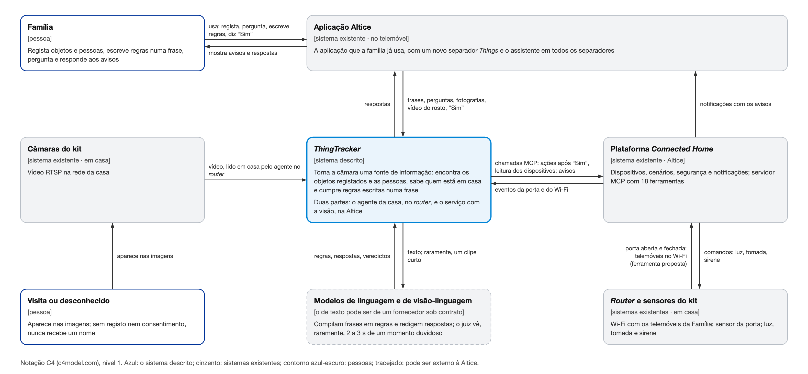

**Figura 1** – C4, nível 1: o _ThingTracker_, a família, uma visita ou um desconhecido e os sistemas Altice existentes.

Uma visita ou um desconhecido aparece nas imagens, mas, sem registo nem consentimento, nunca recebe um nome; um rosto não reconhecido fica com o rótulo “rosto desconhecido” e nada sobre ele é guardado.

## 4. Contentores (C4, nível 2)

A Figura 2 apresenta os contentores, a tecnologia de cada um e o que leva cada seta, com uma seta por sentido.

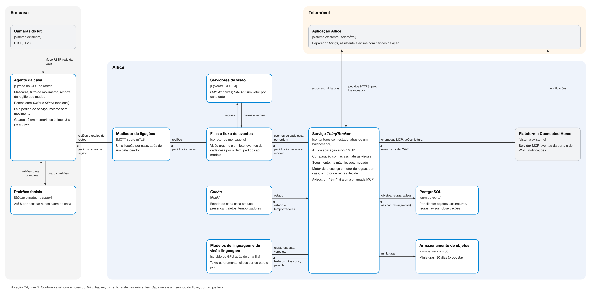

**Figura 2** – C4, nível 2: os contentores do _ThingTracker_ em casa e na Altice, e os sistemas existentes que utilizam.

| Contentor | Onde | Tecnologia | Função | Escala em função de |
|---|---|---|---|---|
| Agente da casa | Processador do _router_ | _Python_, _OpenCV_ | Máscaras, filtro de movimento, região que mudou e rostos; lê a pedido; guarda em memória os últimos 3 s, para o juiz | Um por casa |
| Padrões faciais | _Router_ | _SQLite_ cifrado | Até 8 padrões _SFace_ por pessoa que consentiu | Um por casa |
| Mediador de ligações | Altice | MQTT sobre mTLS, atrás de um balanceador de carga | Uma ligação de saída por casa e um tópico por casa, para as regiões e os pedidos | Nós do mediador |
| Filas e fluxo de eventos | Altice | Sistema de mensagens | Filas de visão urgente e em lote; eventos de cada casa por ordem (partição por casa); pedidos aos modelos | Partições |
| Servidores de visão | Altice | _PyTorch_ em _NVIDIA L4_ | Caixas do _OWLv2_ e vetores do _DINOv2_, sem estado | Placas GPU |
| Serviço _ThingTracker_ | Altice | Contentores sem estado, atrás de um balanceador de carga | API da aplicação, _host_ MCP, comparação, seguimento, motor de presença, motor de regras e avisos | Instâncias |
| _Cache_ | Altice | _Redis_ | Estado corrente de cada casa: presença, trajetos, contadores e temporizadores | Memória |
| _PostgreSQL_ | Altice | _PostgreSQL_ com _pgvector_ | Por cliente: objetos, assinaturas visuais, regras, avisos, observações e presença | Primário e réplica |
| Armazenamento de objetos | Altice | Compatível com S3 | Miniaturas das observações, durante 30 dias (proposta) | Capacidade |
| Modelos de linguagem e de visão-linguagem | Altice (o de texto pode ser de um fornecedor sob contrato) | Servidores GPU atrás de uma fila | Texto, para converter frases em regras e redigir respostas; juiz, para os raros clipes curtos | Servidores GPU |

O serviço não guarda estado, para que qualquer instância possa servir qualquer casa. Os eventos de cada casa chegam por ordem a uma única partição, o estado corrente fica na _cache_ e tudo o que tem de durar fica no _PostgreSQL_. O documento 15 descreve as ferramentas MCP e o formato de cenário que o serviço usa, com o motor de regras também no serviço.

## 5. Implantação (arc42, secção 7)

A Figura 3 mostra onde corre cada parte, o equipamento, os números para 500 000 casas, a evolução prevista e as duas opções rejeitadas.

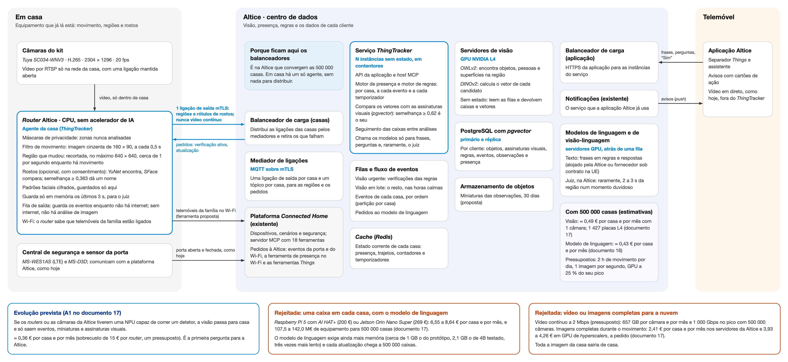

**Figura 3** – Implantação: o agente da casa no _router_, o _ThingTracker_ no centro de dados da Altice, o telemóvel e as opções consideradas.

### 5.1 A solução escolhida: híbrida, nos servidores _L4_ da Altice

Em casa, no equipamento que já lá existe, o _router_ Altice (processador sem acelerador de IA) corre o agente da casa, as câmaras do kit enviam RTSP apenas na rede da casa, a central de segurança e o sensor de contacto da porta comunicam com a plataforma Altice, como hoje, e o _router_ sabe que telemóveis da família estão ligados. Tudo o que o _ThingTracker_ envia a partir de casa segue por uma única ligação de saída com autenticação mútua (mTLS).

Na Altice, ficam dois balanceadores de carga (um para as ligações das casas e outro para a aplicação), o mediador de ligações, as filas, as instâncias do serviço _ThingTracker_, os servidores de visão em GPU _L4_, o _PostgreSQL_ com _pgvector_ (primário e réplica), a _cache_, o armazenamento de objetos e os servidores GPU dos modelos de linguagem e de visão-linguagem. A plataforma _Connected Home_ existente (servidor MCP, dispositivos e eventos) e o serviço de notificações da aplicação são usados tal como estão.

Os balanceadores de carga ficam na Altice, e não em casa, porque uma casa tem um único agente num único _router_, sem nada para distribuir. É na Altice que convergem as 500 000 casas, cujas ligações e cujos pedidos da aplicação têm de ser repartidos por muitas instâncias do serviço, e onde uma instância que falhe tem de ser retirada sem que ninguém o note. O trabalho das GPU passa por filas, e não por balanceadores, porque pode esperar e ser agrupado. A fila urgente é servida de imediato e a fila em lote nas horas calmas, pelo que as GPU são dimensionadas para a média mais a parte urgente (66 376 imagens por segundo com 500 000 casas), e não para o pico do fim do dia (124 031), conforme calcula o documento 17.

O documento 17 estima, para 500 000 casas, cerca de 1 427 placas _L4_ e 6,4 M€ de equipamento, o que corresponde a cerca de 0,49 € por casa e por mês com uma câmara (0,98 € com duas). O cálculo pressupõe 2 h de movimento por câmara e por dia, analisadas a uma imagem por segundo, com as GPU a 25 % da sua velocidade de pico, e um erro de duas vezes em qualquer destes três pressupostos duplica ou reduz para metade o custo, razão pela qual a primeira verificação prevista no documento 17 é medir o débito real.

### 5.2 Evolução prevista: a visão em casa (A1)

Se os _routers_ ou as câmaras da Altice tiverem uma NPU capaz de correr um detetor, o _OWLv2_ e o _DINOv2_ (ou um detetor mais leve) passam para o agente da casa, e de casa saem apenas eventos, miniaturas e assinaturas visuais. O documento 17 estima cerca de 0,36 € por casa e por mês, com base num sobrecusto de 15 € por _router_, que é um pressuposto. Confirmar se o _router_ tem essa NPU é o primeiro ponto a validar com a Altice (§18).

### 5.3 As opções rejeitadas

| Opção | O que significa | Números (documento 17, salvo indicação) | Porque foi rejeitada |
|---|---|---|---|
| (a) Tudo em casa, incluindo o modelo de linguagem | Uma caixa por casa corre a visão e um modelo de linguagem | _Raspberry Pi 5_ com _AI HAT+_ (200 €) ou _Jetson Orin Nano Super_ (269 €): 6,55 a 8,64 € por casa e por mês e 107,5 a 142,0 M€ de equipamento para 500 000 casas. O modelo de linguagem do protótipo (_Qwen3-1.7B_, 4 bits) ocupa cerca de 1 GB e um modelo de 4B testado ocupou 2,1 GB e foi três vezes mais lento (medição da equipa, 18 de novembro) | O serviço comporta no máximo 1,73 € por mês para a visão, e uma caixa custa quatro a cinco vezes mais. Um modelo de linguagem exige ainda mais memória, os modelos pequenos escreveram um português que nem sempre era europeu e cada atualização de modelos teria de chegar a 500 000 caixas |
| (b) Visão na nuvem da Altice, a partir de imagens completas ou de vídeo | Cada câmara envia imagens ou um _stream_ para servidores GPU | Um _stream_ contínuo a 2 Mbps (pressuposto) corresponde a 657 GB por câmara e por mês, 1 000 Gbps no pico para 500 000 câmaras e 1,00 € por casa e por mês só em rede. Imagens completas durante o movimento correspondem a 17,5 GB por câmara e por mês, com GPU dimensionadas para o pico do fim do dia: 2,41 € por casa e por mês nos servidores da Altice e 3,93 a 4,26 € em GPU de _hyperscalers_, a pedido | Custa mais do que o serviço comporta, e toda a imagem da casa sairia de casa, a toda a hora |

A solução escolhida mantém em casa o filtro de movimento, que é o que torna viável qualquer opção central, já que a região que mudou representa cerca de 8,8 GB por câmara e por mês (40 KB por região, um pressuposto), face a 657 GB de um _stream_.

### 5.4 Onde corre cada parte na demonstração

Na demonstração, o _MacBook_ da equipa desempenha todos os papéis ao mesmo tempo. O `edge.py` faz de agente da casa (o filtro de movimento e os rostos) e de servidores de visão da Altice (_OWLv2_ e _DINOv2_, na GPU do _Mac_). O `server.py` faz de serviço _ThingTracker_, com o motor de presença, o motor de regras e o _SQLite_ no lugar do _PostgreSQL_, e o `llm_local.py` faz de servidores do modelo de linguagem, com o _Qwen3-1.7B_ através do _MLX_. Os ecrãs do telemóvel são um navegador no mesmo _Mac_. O _stream_ da câmara chega ao _Mac_ através do _relay_ na nuvem da organização, o que nunca acontece no produto, em que o _stream_ não sai da rede da casa.

## 6. Componentes (C4, nível 3)

A Figura 4 detalha o agente da casa, os servidores de visão e o serviço _ThingTracker_, pela ordem em que uma imagem os atravessa.

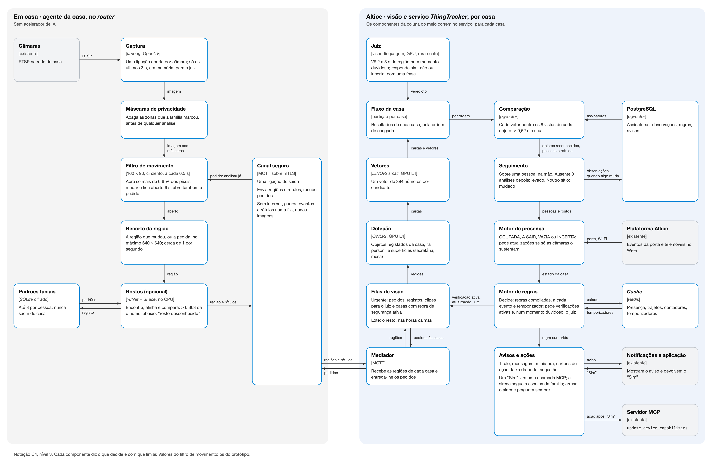

**Figura 4** – C4, nível 3: a cadeia da captura ao aviso, com o que decide cada componente.

| # | Componente | Onde | Entrada | Decide | Limiar ou valor | Saída |
|---|---|---|---|---|---|---|
| 1 | Captura | Agente da casa | RTSP de cada câmara | Nada; mantém uma ligação aberta | Últimos 3 s só em memória, para o juiz | A imagem mais recente |
| 2 | Máscaras de privacidade | Agente da casa | Imagem | Que zonas nunca são analisadas | Zonas desenhadas pela família | Imagem com máscaras |
| 3 | Filtro de movimento | Agente da casa | Imagem de 160 × 90 em tons de cinzento, a cada 0,5 s, comparada com um fundo que se atualiza lentamente | Se há análise | Mais de 0,6 % dos píxeis com uma diferença superior a 22 níveis de cinzento; fica aberto 6 s (valores do protótipo); abre também a pedido do serviço | Aberto ou fechado |
| 4 | Recorte da região | Agente da casa | Imagem e filtro | Que parte enviar | A região que mudou, ou a pedida, no máximo 640 × 640, cerca de uma por segundo | Região |
| 5 | Rostos (opcional) | Agente da casa | Região | A quem pertence um rosto visível | O _YuNet_ encontra o rosto e o _SFace_ compara-o com os padrões; semelhança ≥ 0,40 dá o nome, e inferior a 0,25 com todos os padrões dá “rosto desconhecido” (§8.3) | O nome da pessoa, “rosto desconhecido” ou “rosto não visível”, com a caixa do rosto |
| 6 | Canal seguro | Agente da casa | Região e rótulos | Nada; sem internet, guarda eventos e rótulos numa fila, nunca imagens | mTLS, um certificado por casa | Mensagens para o mediador |
| 7 | Filas de visão | Altice | Regiões e pedidos | Urgente ou em lote | Urgente: verificações ativas, atualizações, registos, clipes para o juiz e casas com uma regra de segurança ativa; em lote, o resto | Trabalho por ordem |
| 8 | Deteção | Servidores de visão | Região | Caixas dos objetos registados da casa, de “a person” e de superfícies (secretária, mesa) | Pontuações do _OWLv2_ (no protótipo, 0,1 para propor e 0,2 para uma pessoa) | Caixas |
| 9 | Vetores | Servidores de visão | Caixas | Nada | _DINOv2 small_: 384 números por candidato | Caixas e vetores |
| 10 | Comparação | Serviço | Vetores e assinaturas no _pgvector_ | Se um candidato é o objeto registado | Semelhança ≥ 0,62 com a mais próxima das 8 vistas | Objetos reconhecidos |
| 11 | Seguimento | Serviço | Caixas entre análises | Na mão, levado ou mudado (§8.2) | Sobreposição de caixas; 3 análises sem o objeto | Observações, escritas só quando algo muda |
| 12 | Motor de presença | Serviço | Telemóveis, porta, pessoas e rótulos dos rostos | OCUPADA, A SAIR, VAZIA ou INCERTA (§7) | Tempos na §7 | Estado, contagem e quem; pedidos de atualização |
| 13 | Motor de regras | Serviço | Regras compiladas, presença, observações, eventos e temporizadores | Se uma regra se cumpre e se pede uma verificação ativa ou o juiz | Por regra (§8) | Aviso ou nada |
| 14 | Avisos e ações | Serviço | Uma regra cumprida | O que diz o aviso e que ações oferece | A sirene segue a escolha da família; armar o alarme exige sempre um “Sim” | Notificação; chamada MCP depois de um “Sim” |
| 15 | Juiz | Modelos de linguagem e de visão-linguagem | Um clipe de 2 a 3 s da região | Sim, não ou incerto, com uma frase (§8.6) | Chamado raramente | Veredicto para o fluxo da casa |

O motor de regras funciona por eventos, ou seja, corre para uma casa sempre que chega um evento dessa casa (um resultado da visão, um evento da porta ou do Wi-Fi) e quando expira um temporizador que ele próprio definiu, pelo que uma regra é avaliada até cerca de um segundo depois de surgir a evidência. No protótipo, corre num ciclo a cada 2 s.

## 7. Presença: quem está em casa?

A Figura 5 mostra a máquina de estados da presença, que corre no serviço _ThingTracker_, com um estado por casa, recalculado a cada evento e a cada temporizador.

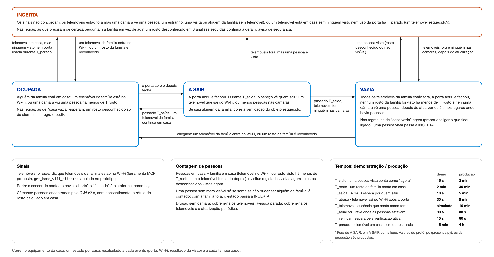

**Figura 5** – Presença: quatro estados, a partir dos telemóveis da família, do sensor da porta e das câmaras, com os tempos da demonstração e de produção.

O motor de presença combina três sinais:
- Os telemóveis da família no Wi-Fi da casa. O _router_ Altice sabe que dispositivos estão ligados, pelo que se propõe à Altice uma ferramenta MCP só de leitura, `get_home_wifi_clients` (o endereço MAC, o nome, a banda e a hora de ligação de cada cliente), e os eventos `wifi.joined` e `wifi.left`, cabendo à família associar uma vez, na aplicação, cada telemóvel a uma pessoa. Reconhecer um telemóvel que muda de endereço MAC cabe ao _router_ e é um ponto a validar com a Altice (§18). O protótipo simula os telemóveis.
- O sensor de contacto da porta (_MS-D3D_, com a central _MS-WES1AS_), que já comunica “aberta” e “fechada” à plataforma. Hoje é lido por consulta de `get_home_devices` a cada 4 s, sendo uma API de eventos o primeiro pedido à Altice. A família indica qual dos sensores de contacto é o da porta de entrada.
- As pessoas vistas por cada câmara, a partir das caixas “a person” do _OWLv2_, com o rótulo do rosto calculado pelo agente da casa, que pode ser o nome de um membro da família, “rosto desconhecido” ou “rosto não visível” (uma caixa de pessoa sem nenhum rosto avaliado no seu interior).

A tabela seguinte descreve as transições entre estados.

| De | Para | Condição | Sinais usados |
|---|---|---|---|
| OCUPADA | A SAIR | A porta abre e depois fecha | Porta |
| A SAIR | OCUPADA | Passado T_saída, um telemóvel da família continua em casa | Porta e telemóveis |
| A SAIR | VAZIA | Passado T_saída, todos os telemóveis da família estão fora, nenhum rosto da família foi visto há menos de T_rosto e ninguém aparece nas câmaras depois de uma atualização | Porta, telemóveis e câmaras |
| A SAIR | INCERTA | Telemóveis fora, mas uma pessoa é vista | Telemóveis e câmaras |
| VAZIA | OCUPADA | Chegada: um telemóvel da família entra no Wi-Fi, ou um rosto da família é reconhecido | Telemóveis e rostos |
| VAZIA | INCERTA | Uma pessoa é vista (rosto desconhecido ou não visível) com todos os telemóveis fora | Câmaras e telemóveis |
| OCUPADA | INCERTA | Um telemóvel está em casa, mas ninguém foi visto nem a porta foi usada durante T_parado (possivelmente um telemóvel esquecido em casa) | Telemóveis, câmaras e porta |
| INCERTA | OCUPADA | Um telemóvel da família entra no Wi-Fi, ou um rosto da família é reconhecido | Telemóveis e rostos |
| INCERTA | VAZIA | Telemóveis fora e ninguém nas câmaras, depois da atualização | Telemóveis e câmaras |

No estado OCUPADA, as regras de casa vazia esperam; em VAZIA, agem, propondo, por exemplo, desligar o que ficou ligado; em INCERTA, as regras que precisam de certeza perguntam à família em vez de agir, embora um rosto desconhecido em 3 análises seguidas continue a gerar o aviso de segurança.

O número de pessoas em casa corresponde aos membros da família em casa (com o telemóvel no Wi-Fi, ou com o rosto visto há menos de T_rosto sem que o telemóvel tenha saído depois), somados às visitas registadas vistas no momento e aos rostos desconhecidos vistos no momento. Uma pessoa sem rosto visível só é contada se não puder ser um membro da família já contado, e, com a família fora, essa pessoa faz passar o estado a INCERTA.

Uma divisão sem câmara fica coberta pelos telemóveis. Uma pessoa parada não provoca movimento, pelo que, enquanto o estado depender apenas das câmaras (sem nenhum telemóvel da família em casa), o serviço pede ao agente da casa, a cada T_atualizar e mesmo sem movimento, as regiões onde as pessoas foram vistas pela última vez.

Os tempos são os do protótipo, em `prototype/presence.py`; os de produção são propostas, a afinar num piloto.

| Tempo | Significado | Demonstração | Produção |
|---|---|---|---|
| T_visto | Uma pessoa vista conta como “agora” | 15 s | 2 min |
| T_rosto | Um rosto da família conta como pessoa em casa | 2 min | 30 min |
| T_saída | Quanto tempo A SAIR espera por quem saiu | 10 s | 5 min |
| T_atraso | Um telemóvel pode sair do Wi-Fi até este tempo depois da porta | 30 s | 5 min |
| T_telemóvel | Fora de A SAIR, quanto tempo um telemóvel tem de faltar para contar como fora (em A SAIR, conta logo) | Simulado | 10 min |
| T_atualizar | Revê onde estavam as pessoas, sem movimento | 30 s | 30 s |
| T_verificar | Espera por uma verificação ativa antes de a dar como incerta | 15 s | 60 s |
| T_parado | Um telemóvel em casa sem outros sinais de ninguém | 15 min | 4 h |

## 8. Tabelas de decisão, regra a regra

Todas as regras seguintes são código simples no motor de regras. Os modelos limitam-se à perceção, e o juiz apenas responde a uma pergunta feita pela regra.

### 8.1 O objeto esquecido (o livro)

A Figura 6 mostra a sequência da regra “avisa-me se sair de casa sem o livro”.

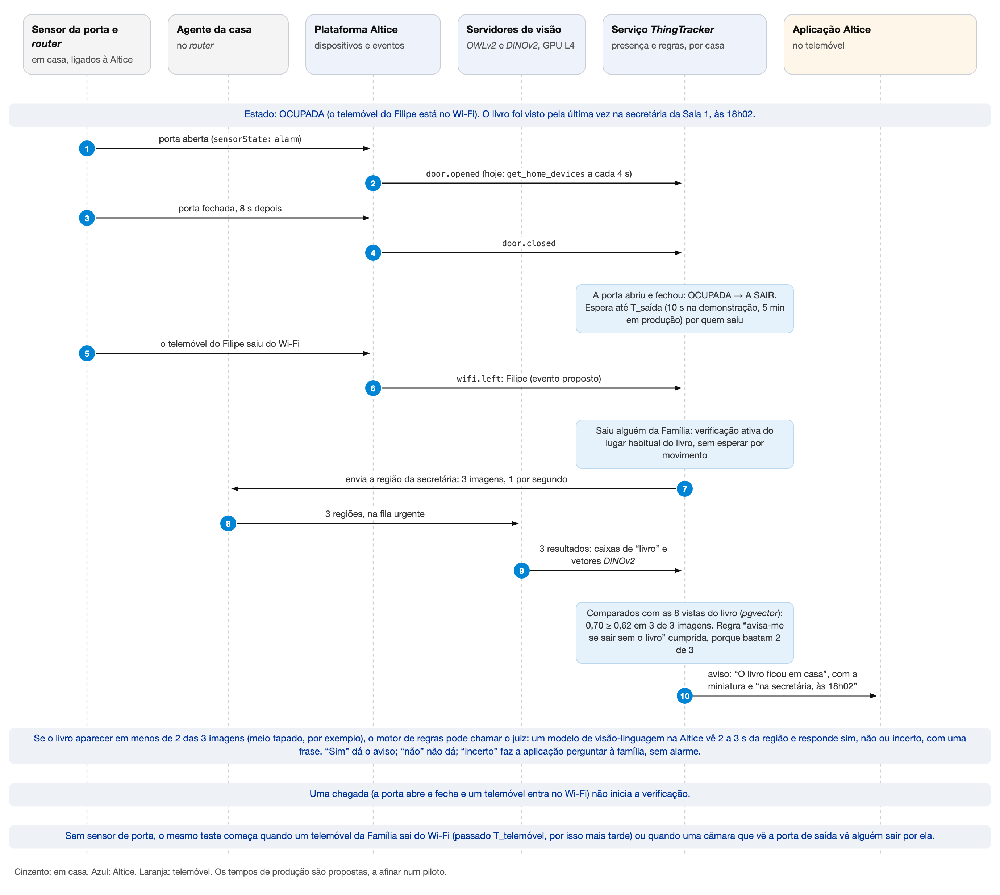

**Figura 6** – O livro esquecido: a porta, o telemóvel, a verificação ativa e o juiz opcional.

| Elemento | Valor |
|---|---|
| Onde corre | No motor de regras, no serviço _ThingTracker_ |
| Acionador | A porta fecha depois de ter sido aberta e a presença indica que saiu um membro da família, isto é, um telemóvel saiu do Wi-Fi no prazo de T_saída + T_atraso, ou o número de pessoas desceu. Se a regra nomear o dono, conta o telemóvel dessa pessoa |
| Não aciona | Uma chegada, em que a porta abre e fecha e um telemóvel entra no Wi-Fi, ou o número de pessoas sobe |
| Verificação ativa | O serviço pede ao agente da casa a região do lugar habitual do objeto (a caixa da última observação, com margem), em 3 imagens com cerca de 1 s de intervalo, independentemente do movimento, na fila urgente |
| Visto | O objeto corresponde (semelhança ≥ 0,62) em pelo menos 2 das 3 imagens, o que gera um aviso com a miniatura acabada de tirar e “na secretária, às 18h02” |
| Não visto | Menos de 2 em 3, ou nenhuma resposta dentro de T_verificar, o que resulta em “incerto”, sem alarme e apenas com um registo |
| Juiz opcional | Quando a verificação fica incerta porque o objeto pode estar parcialmente tapado, o motor de regras pode chamar o juiz com um clipe de 2 a 3 s da região; “Sim” gera o aviso, “Não” não gera, e “Incerto” leva a aplicação a perguntar à família |
| Já saiu | Se o objeto foi visto na mão, ou à entrada, quando a porta abriu, saiu com a pessoa e não há aviso |

O caso do livro beneficia do sensor da porta, mas não depende dele. O melhor sinal é o sensor de contacto da porta, que já faz parte do kit Altice e está ligado à plataforma, cabendo ao _ThingTracker_ apenas ler os seus eventos. É imediato, porque a porta fecha depois de alguém sair e a verificação ativa corre logo a seguir. Sem sensor da porta, há duas alternativas que acionam a mesma verificação. A primeira é um telemóvel da família sair do Wi-Fi da casa, o que o _router_ deteta; a regra espera, porém, T_telemóvel (cerca de 10 min em produção), para que uma breve falha do Wi-Fi não conte, e o aviso chega mais tarde, como “o livro ficou em casa”, continuando a ser útil. A segunda é uma câmara que veja a porta de saída, em que o trajeto de uma pessoa que sai pela zona da porta conta como “saiu alguém”, o que só funciona se uma câmara cobrir a porta. O mínimo necessário é um sinal de “saiu alguém” e a verificação ativa do objeto pela câmara.

### 8.2 Na mão, levado ou mudado

| Evento | Condição | Saída | Onde corre |
|---|---|---|---|
| Na mão | A caixa de um objeto sobrepõe-se à caixa de uma pessoa numa análise (no protótipo, razão de sobreposição ≥ 0,02) | Observação “na mão”, com o nome da pessoa, se o rosto for reconhecido na mesma análise | Seguimento, no serviço |
| Levado por | O objeto está ausente do seu lugar em 3 ou mais análises seguidas desse lugar, depois de uma pessoa ter estado junto dele | Evento “levado por” seguido do nome, se o rosto foi reconhecido, ou de “alguém” | Seguimento |
| Mudado para | O objeto corresponde (≥ 0,62) noutra câmara, ou noutra superfície da mesma câmara | Evento “mudado para” seguido do lugar; a última observação passa a ser essa | Seguimento |
| Duvidoso | “Levado, ou apenas fora do campo de visão?”, quando a evidência não concorda | O motor de regras pode chamar o juiz; com “incerto”, mantém a última observação e indica-o | Motor de regras |

Cada câmara corresponde a um lugar (“Sala 1”), e a superfície sob o objeto (secretária, mesa) é uma descrição dentro desse lugar. As zonas dentro de uma câmara ficam para uma fase posterior.

### 8.3 Rostos (opcional, por casa, com consentimento)

A Figura 7 mostra a sequência de uma pessoa desconhecida.

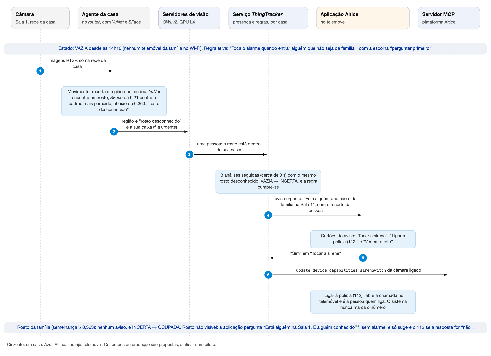

**Figura 7** – Uma pessoa desconhecida com a família fora: o rótulo do rosto calculado em casa, três análises, o aviso, a sirene depois de um “Sim” e a sugestão do 112.

O registo de uma pessoa decorre em cinco passos.

| Passo | Onde | O que acontece |
|---|---|---|
| 1 | Aplicação | A própria pessoa aceita ser reconhecida, sem nada pré-selecionado; a plataforma guarda o registo do consentimento (quem, quando e com que texto) e nunca dados biométricos |
| 2 | Aplicação → agente da casa | Um vídeo curto do rosto, gravado com o telemóvel, segue pelo canal seguro até ao agente da casa; a plataforma reencaminha-o sem o guardar |
| 3 | Agente da casa | O _YuNet_ encontra o rosto nas imagens, cada rosto é alinhado pelos 5 pontos de referência e recortado em 112 × 112 e o _SFace_ converte-o em 128 números |
| 4 | Agente da casa | Até 8 padrões, escolhidos em imagens diferentes, ficam guardados no _SQLite_ cifrado do _router_, e o vídeo é apagado |
| 5 | Retirada | A pessoa desativa o reconhecimento; os padrões são apagados em casa e o apagamento é confirmado |

O registo usa um vídeo gravado com o telemóvel, que a plataforma reencaminha sem o guardar. Uma alternativa é enviar esse vídeo pelo Wi-Fi da casa diretamente para o _router_, o que o manteria totalmente fora da plataforma (§18).

O reconhecimento segue as regras da tabela seguinte.

| Passo | Regra |
|---|---|
| Procurar | Para cada caixa de pessoa, o agente da casa procura um rosto com o _YuNet_ no seu interior |
| Avaliar só rostos nítidos | Um rosto demasiado pequeno, pouco nítido ou demasiado virado fica como “rosto não visível” (no protótipo, pontuação do _YuNet_ ≥ 0,8, largura ≥ 40 px e rotação ≤ 0,75) |
| Comparar | Semelhança de cosseno do _SFace_ com todos os padrões da casa |
| Nomear | Semelhança ≥ 0,40 com um dos padrões de uma pessoa identifica essa pessoa |
| Desconhecido | Um rosto visível com semelhança inferior a 0,25 com todos os padrões fica como “rosto desconhecido” |
| Incerto | Entre 0,25 e 0,40, a resposta é “incerto” e o rosto conta como “rosto não visível”, que não dispara nem silencia um alarme |
| Origem dos limiares | O _OpenCV_ recomenda 0,363 para o _SFace_ (`samples/dnn/face_detect.py`), um valor definido em rostos nítidos e próximos. As três faixas foram fixadas na gravação do laboratório, em que os rostos na câmara do kit tinham 40 a 86 px de largura: com um único corte a 0,30, um dos rostos do estranho obteve 0,33 contra a pessoa registada e alguns rostos desta ficaram entre 0,31 e 0,36, por isso o corte passou a faixa. Na gravação reproduzida, a pessoa registada (um membro da equipa, registado com consentimento) obteve 0,54 e 0,63 e o estranho 0,17 e 0,14. Uma gravação é uma verificação, e não uma medição de exatidão, pelo que as faixas se fixam por câmara no piloto |

De casa sai apenas o rótulo (o nome da pessoa, “rosto desconhecido” ou “rosto não visível”, com a caixa do rosto), e nunca os padrões.

As decisões de alarme e as sugestões constam da tabela seguinte.

| Situação | Condição | Saída |
|---|---|---|
| Pessoa desconhecida | Um “rosto desconhecido” visível em 3 análises seguidas da mesma pessoa, sem nenhum membro da família em casa (ou quando a regra o determina, por exemplo, à noite) | Aviso urgente com o recorte da pessoa (um dos casos de segurança em que se envia o recorte de uma pessoa, segundo o documento 20); a sirene segue a escolha da família |
| Membro da família | Uma análise reconhece a pessoa como sendo da família | Nunca há alarme; INCERTA passa a OCUPADA |
| Rosto não visível | Uma pessoa em 3 análises seguidas sem nenhum rosto avaliado, com a família fora | A aplicação pergunta “Está alguém na Sala 1. É alguém conhecido?”, sem alarme |
| Polícia | Uma pessoa desconhecida quando não está ninguém da família em casa | O aviso sugere “Ligar à polícia (112)”, um botão que abre a chamada no telemóvel, sendo a pessoa quem liga; o sistema nunca marca o número |

O reconhecimento de pessoas está abrangido pelo Regulamento Europeu da Inteligência Artificial e pelo artigo 9.º do RGPD, pelo que exige uma revisão jurídica e uma avaliação de impacto sobre a proteção de dados antes do lançamento (§12).

### 8.4 Casa vazia: poupança de energia e porta aberta

A Figura 8 mostra as duas regras.

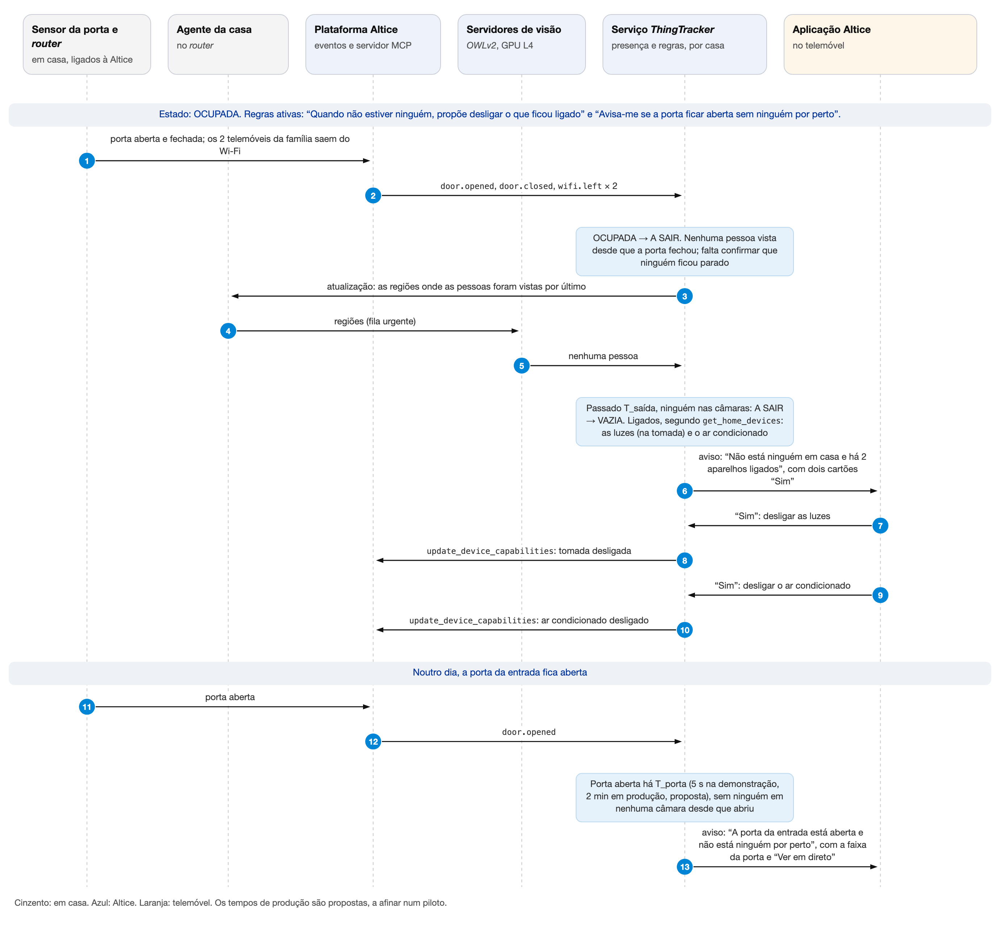

**Figura 8** – A casa vazia: a proposta de desligar dois aparelhos, cada um com o seu “Sim”, e, noutro dia, a porta da entrada deixada aberta.

| Regra | Condição | Saída | Ação |
|---|---|---|---|
| Poupança de energia | A presença passa a VAZIA e o estado dos dispositivos na plataforma (`get_home_devices`) mostra aparelhos ligados | Um aviso por período de casa vazia, “Não está ninguém em casa e há 2 aparelhos ligados”, com um cartão “Sim” por aparelho | Cada “Sim” dá origem a `update_device_capabilities` (tomada desligada, ar condicionado desligado) |
| Porta aberta | A porta está aberta há T_porta (5 s na demonstração e 2 min em produção, uma proposta) e ninguém apareceu em nenhuma câmara desde que foi aberta | Um aviso por abertura, com a faixa da porta e “Ver em direto” | Nenhuma ação automática; a família decide |
| Em INCERTA | As mesmas condições, mas com o estado INCERTA | O aviso pergunta em vez de propor uma ação | Só depois de um “Sim” |

### 8.5 Outros tipos de regra

| Regra | Exemplo | Avaliada sobre |
|---|---|---|
| Presente ou ausente | “Avisa-me se as chaves não estiverem na mesa da entrada às 8h” | Última observação e um temporizador |
| Permanência | “…esquecida na secretária durante 10 minutos” | Observações e um temporizador |
| Ausência até uma hora limite | “Se o gato não tiver ido à taça da água até às 18h” | Presença do animal junto de um objeto registado e um temporizador |
| Pessoa num lugar | “Alguém na entrada quando não está em casa nenhum telemóvel da família” | Câmaras e presença |

Cada regra mostra ao utilizador, em linguagem corrente, o que observa e o que fará. Sempre que possível, as regras ficam guardadas como cenários da plataforma (`post_new_scenario`, com o acionador `thingTracker` proposto no documento 15), para aparecerem na aplicação ao lado dos cenários existentes.

### 8.6 O juiz

| Elemento | Valor |
|---|---|
| O que é | Um modelo de visão-linguagem nos servidores GPU da Altice |
| Quando é chamado | Só quando uma regra encontra um momento duvidoso, como “a pessoa levou o livro ou apenas o mudou de sítio?”, ou uma verificação de objeto esquecido em que o objeto pode estar parcialmente tapado |
| Entrada | Um clipe de 2 a 3 s da região (dos 3 s que o agente da casa guarda em memória, ou de uma curta sequência que grava a pedido) e a pergunta da regra |
| Saída | Sim, não ou incerto, com uma frase |
| Efeito | O motor de regras combina a resposta com a restante evidência; “incerto” leva o sistema a perguntar à família, nunca a agir |
| Porque não em cada imagem | O custo para 500 000 casas (documento 17), o facto de um objeto concreto da família precisar sempre de uma assinatura visual e a necessidade de os alarmes assentarem em regras que se podem testar |
| O que não consegue fazer | Ver alguém que já saiu da imagem; “saiu alguém de casa?” responde-se com o sensor da porta e com os telemóveis |

O juiz substitui a tarefa anterior do modelo de texto, que era avaliar um recorte duvidoso. No protótipo, o juiz é o _Qwen2-VL-2B-Instruct_ (4 bits, _MLX_, licença Apache-2.0), opcional, chamado só quando uma verificação ativa não encontra o objeto, sobre um recorte apertado do lugar; o seu “sim” ou “incerto” torna-se uma pergunta à família. O modelo da solução final escolhe-se no piloto, com a licença verificada antes.

### 8.7 Avisos e ações

Um aviso é um evento estruturado, com título, mensagem, miniatura, cartões de ação, a faixa da porta quando a porta está envolvida e uma sugestão (como o 112), que o serviço envia à aplicação através do serviço de notificações que esta já usa. Um “Sim” num cartão regressa ao serviço, que faz a chamada MCP (`update_device_capabilities` para uma lâmpada, uma tomada ou o `sirenSwitch` da câmara, ou `patch_home_security_status` para o alarme) e apresenta o resultado no aviso. As ações mais intrusivas seguem a escolha que a família fez ao criar a regra (a sirene pode pedir primeiro um “Sim” ou tocar de imediato, por exemplo com uma criança em perigo). Armar o alarme exige sempre um “Sim”, e o modelo de linguagem nunca é o único fundamento de um alarme.

## 9. Registar um objeto

| Caminho | Onde corre | O que acontece | Resultado |
|---|---|---|---|
| Fotografias do telemóvel | Aplicação → serviço → servidores de visão | 6 a 8 fotografias de lados diferentes (ou imagens de um vídeo curto); o _OWLv2_ encontra o objeto em cada fotografia, usando o nome em inglês como termo de pesquisa, e o _DINOv2_ calcula o vetor de cada recorte | Assinatura visual com até 8 vetores |
| Mostrado a uma câmara | Agente da casa → servidores de visão | O utilizador roda o objeto devagar em frente a uma câmara; cada região passa pelo _OWLv2_ e pelo _DINOv2_, e uma vista só é guardada se a semelhança com todas as já guardadas for inferior a 0,97 (um ângulo novo), até haver 8 | Assinatura visual com 8 vistas |
| Propostas da câmara | Servidores de visão | A aplicação mostra o que as câmaras veem (“A procurar nas câmaras…”); a família escolhe o objeto com um toque, e as fotografias ou a câmara completam as vistas | Como acima |

A assinatura visual fica no _PostgreSQL_ (_pgvector_) desse cliente, e o melhor recorte passa a ser a fotografia do objeto, no armazenamento de objetos. Um _router_ novo ou reposto de fábrica não exige novo registo dos objetos, uma vez que as assinaturas visuais ficam na Altice, mas exige novo registo dos rostos, cujos padrões nunca saem de casa.

## 10. A linguagem de sensores

Cada frase é compilada uma única vez numa regra pequena e explícita, e o motor de regras executa regras sem nunca interpretar texto livre, como se vê no exemplo seguinte:

```json
{
  "title": "Livro esquecido",
  "kind": "leave_without",
  "thing": "livro",
  "owner": "Ana",
  "trigger": { "door": "closed_after_open", "and_any": ["phone_left", "count_dropped"] },
  "check": { "frames": 3, "seen_at_least": 2, "match": 0.62, "judge_if_unsure": true },
  "then": [ { "notify": "O livro ficou em casa." } ],
  "confirm_before_acting": true,
  "cooldown": "30m"
}
```

O modelo de linguagem escreve o título, a mensagem e os campos a partir da frase, e o serviço valida a regra face aos objetos, às pessoas e aos dispositivos da casa, recorrendo a regras-tipo (_templates_) quando a regra não é válida.

## 11. Modelo de dados

As Figuras 9 e 10 apresentam as duas bases de dados, a pequena, no _router_, e a da plataforma, na Altice, com os dados de todos os clientes.

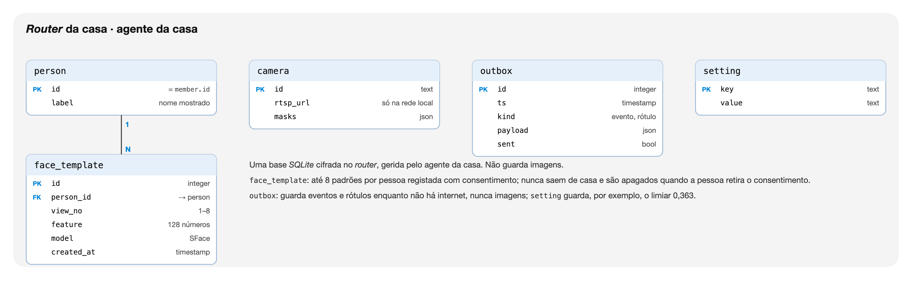

**Figura 9** – O _SQLite_ cifrado do _router_, gerido pelo agente da casa, com os nomes das pessoas, os padrões faciais, as câmaras e as máscaras, a fila de saída e as definições, sem nenhuma imagem.

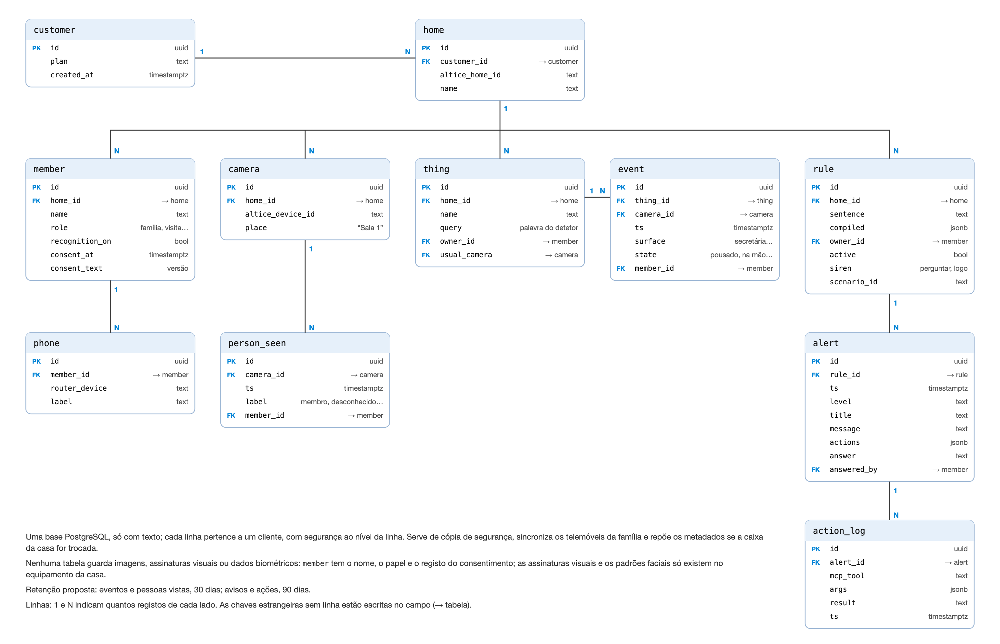

**Figura 10** – O _PostgreSQL_ com _pgvector_ da plataforma: uma base de dados em que cada linha pertence a um cliente, com segurança ao nível da linha.

| Dados | Onde ficam | Retenção |
|---|---|---|
| Padrões faciais | Só no _router_ | Até à retirada do consentimento |
| Membros, registos de consentimento e telemóveis | _PostgreSQL_ | Enquanto a conta existir; sem dados biométricos |
| Objetos e assinaturas visuais (vector(384)) | _PostgreSQL_ | Até o objeto ser apagado |
| Observações, pessoas vistas e miniaturas | _PostgreSQL_ e armazenamento de objetos | 30 dias (proposta) |
| Estado e mudanças de presença | _Cache_ e _PostgreSQL_ | Mudanças guardadas 30 dias (proposta) |
| Regras | _PostgreSQL_ | Até serem apagadas |
| Avisos e ações | _PostgreSQL_ | 90 dias (proposta; registo de auditoria das ações executadas na casa) |
| Regiões e clipes para o juiz | Memória dos servidores de visão e do juiz | Apagados depois da análise |

## 12. Privacidade e segurança

A Figura 11 é o diagrama de fluxo de dados com as fronteiras de confiança (a casa, a Altice, o telemóvel e o fornecedor do modelo de linguagem, caso o modelo de texto não seja alojado pela Altice), acompanhado de uma tabela com o que atravessa cada fronteira.

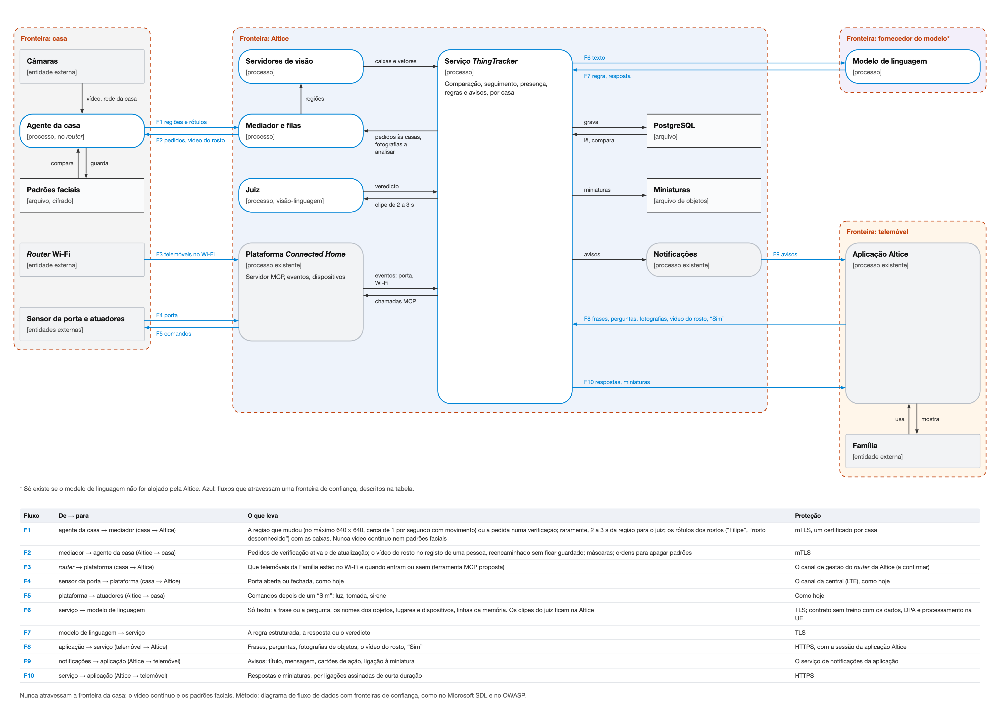

**Figura 11** – Fluxo de dados com fronteiras de confiança e o que leva cada fluxo que atravessa uma fronteira.

De casa saem a região que mudou, no máximo 640 × 640 píxeis e cerca de uma vez por segundo enquanto há movimento, a região pedida numa verificação ativa ou numa atualização, raramente um clipe de 2 a 3 s da região para o juiz, os rótulos e as caixas dos rostos e os eventos. A região pode cobrir quase toda a imagem quando alguém atravessa todo o campo de visão. O vídeo nunca sai de casa, nem os padrões faciais, e as regiões e os clipes são apagados depois da análise, com exceção das miniaturas guardadas nas observações. O modelo de texto recebe apenas texto (a frase ou a pergunta, os nomes dos objetos, dos lugares e dos dispositivos e excertos da memória), e o documento 20 propõe substituir os nomes das pessoas por marcadores antes do envio.

A tabela seguinte reúne as principais ameaças por fronteira, como ponto de partida de um modelo de ameaças.

| Fronteira | Ameaça | Mitigação |
|---|---|---|
| Casa → Altice | Um dispositivo que se faz passar por uma casa envia regiões ou eventos | mTLS com um certificado por casa, revogável na aplicação |
| Casa → Altice | Regiões lidas em trânsito ou guardadas | TLS; processamento em memória; sem registos de píxeis |
| Altice → casa | Um pedido forjado pede regiões a uma casa | Pedidos só do serviço, pelo mesmo canal mTLS, e registados |
| Altice | Dados de um cliente lidos por outro | Cada linha associada ao cliente, com segurança ao nível da linha; tópicos e partições por casa |
| Altice → fornecedor | Texto reutilizado ou guardado pelo fornecedor | Contrato sem treino com os dados, DPA e processamento na UE; marcadores no lugar dos nomes (proposta) |
| Telemóvel → Altice | Um “Sim” de outra pessoa | Sessão da aplicação Altice; ação registada com a regra e a evidência |

Aplicam-se a minimização dos dados, prevista na alínea c) do n.º 1 do artigo 5.º do RGPD, e a proteção de dados desde a conceção, prevista no artigo 25.º, através das máscaras, da ausência de vídeo guardado pelo _ThingTracker_ e do apagamento das regiões depois da análise. Prevê-se que as câmaras em casa exijam uma avaliação de impacto sobre a proteção de dados (AIPD, artigo 35.º), a preparar com a Altice antes de qualquer piloto. O reconhecimento de pessoas é apenas opcional, ativado pessoa a pessoa, com consentimento explícito, nos termos da alínea a) do n.º 2 do artigo 9.º, e processado em casa, e, uma vez que o Regulamento Europeu da Inteligência Artificial classifica a identificação biométrica à distância como de risco elevado, a funcionalidade exige uma revisão jurídica antes do lançamento. Nenhuma ação sonora acontece sem que a família a tenha escolhido, e armar o alarme exige sempre um “Sim”.

## 13. Fluxos na aplicação

A Figura 12 mostra os cinco fluxos na aplicação Altice, nomeadamente adicionar um objeto, adicionar uma pessoa, criar um cenário a partir de uma frase, aceitar um cenário sugerido e responder a um aviso com ações.

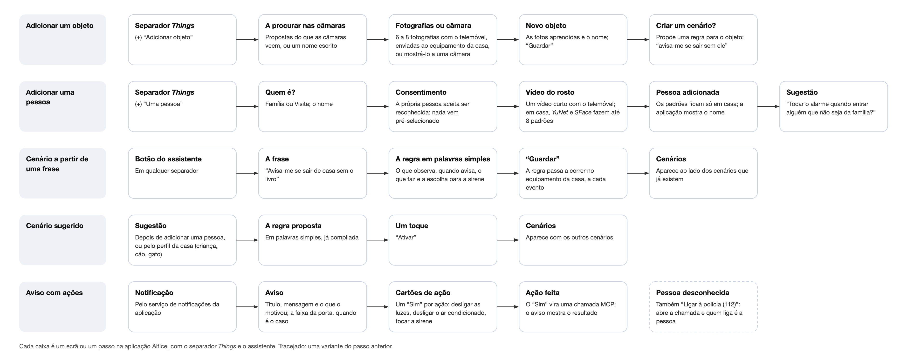

**Figura 12** – Os fluxos na aplicação, ecrã a ecrã; o cartão a tracejado é uma variante do passo anterior.

## 14. Desempenho e custo

Medições feitas no Mac da equipa (GPU Apple, 18 de novembro, `prototype/vision/benchmark.py`, com uma imagem de teste de 640 × 400):

| Passo | Medido | Notas |
|---|---|---|
| Deteção com o _OWLv2_, 10 objetos nomeados | 557 ms por imagem | Numa _L4_ com _TensorRT_, o documento 17 estima cerca de 26 imagens completas por segundo (pressuposto a medir) |
| Assinatura visual com o _DINOv2_ | 22 ms por recorte | |
| Ciclo completo de perceção | Cerca de 0,65 s | Cerca de 1,5 imagens por segundo neste Mac |
| Comando MCP a um dispositivo (desligar a tomada) | Cerca de 1,3 s | Medido a 16 de novembro (documento 10) |
| Modelo de texto local (_Qwen3-1.7B_, _MLX_) | Respostas em 0,4 a 1,7 s e regras em 1,5 a 3,2 s | Medição da equipa, 18 de novembro |

Com 500 000 casas, estima-se que a visão custe cerca de 0,49 € por casa e por mês, com uma câmara, nos servidores _L4_ da Altice (documento 17), e o modelo de linguagem cerca de 0,43 € (documento 16, cenário base, de 0,10 a 1,78 €). O custo do juiz ainda não está estimado, uma vez que só é chamado em momentos duvidosos e a frequência dessas chamadas tem de ser medida num piloto antes de ser orçamentada.

## 15. Os modelos de linguagem

O modelo de texto é chamado apenas pelo serviço _ThingTracker_, para duas tarefas, compilar uma frase numa regra e redigir uma resposta a partir da memória. O juiz (§8.6) é um modelo de visão-linguagem na Altice, chamado raramente. Na terminologia do MCP, nenhum modelo se liga ao servidor MCP, uma vez que o modelo pede uma ferramenta e é o serviço que a chama.

Pode usar-se qualquer modelo de texto com qualidade suficiente, alojado pela Altice (_open-weight_) ou sob um contrato que garanta que os dados não são usados para treino, inclua um acordo de tratamento de dados, ou DPA (“_Data Processing Agreement_”), e assegure o processamento na UE. O protótipo usa o _Qwen3-1.7B_ localmente, podendo ativar-se o _Claude Haiku 5.5_ e o _Claude Sonnet 5.5_. As opções seguintes foram verificadas nos termos e na documentação de cada fornecedor a 18 de novembro de 2026:

| Opção | Cumpre? | Como | Cuidados |
|---|---|---|---|
| _Claude_, via _Amazon Bedrock_ | Sim | Perfil entre regiões `eu.`, chamado a partir de uma região da UE (se for chamado a partir de Londres ou de Zurique, também encaminha os pedidos para essas regiões); os dados de entrada não são usados para treino; DPA da AWS para o RGPD | A API da própria Anthropic não tem opção para a UE (só “us” e “global”). No _Bedrock_, os modelos _Claude Fable 5_, _5.1_ e _5.2_ exigem a retenção dos dados durante 30 dias, para revisão (`aws_review`), o que não acontece com o _Claude Haiku 5.5_ nem com o _Claude Sonnet 5.5_ |
| _Claude_, via _Google Vertex AI_ | Sim | _Endpoint_ multirregião `eu` (só Estados-Membros da UE) | Nada a assinalar |
| OpenAI, via _Azure_ (_DataZone EU_) | Sim | Processamento na _DataZone_ da UE, que pode incluir países da EFTA (Noruega, Suíça); sem acesso por parte da OpenAI; sem uso para treino; DPA da Microsoft | Evitar as implementações “Global” |
| API da OpenAI com residência na UE | Sim, com condições | `eu.api.openai.com`, num projeto novo; a região é “_Europe (EEA + Switzerland)_” | Só as organizações elegíveis a podem ativar, e o envio de imagens nessa região exige uma aprovação adicional da OpenAI |
| _Gemini_, via _Vertex AI_ | Sim | _Endpoint_ `eu`, treino só com autorização, DPA do Google Cloud | A API para programadores do _Gemini_ não tem opção de processamento na UE, e os dados podem ser guardados temporariamente ou em _cache_ em qualquer país. Aos utilizadores do EEE, da Suíça ou do Reino Unido aplicam-se os termos de dados do nível pago, e só os serviços pagos os podem servir, pelo que o nível gratuito, que admite revisão humana, não pode ser usado |
| Mistral | Sim, com condições | Dados guardados na UE por omissão; inferência na UE só através de `api.eu.mistral.ai` (países da UE e da EFTA, a 1,1 vezes o preço do _endpoint_ global); DPA | O _endpoint_ por omissão é global, sem compromisso quanto ao local da inferência. O treino com os dados está ativo por omissão e desativa-se no menu _Privacy_ do _Admin panel_. Evitar os modelos _Labs_ e _Preview_ |
| _DeepSeek_ ou _Kimi_, alojados pelos fornecedores | Não | Não se aplica | Dados guardados na China (_DeepSeek_, aplicação _Kimi_) ou em Singapura (API do _Kimi_); o treino com o conteúdo é permitido; sem DPA. A autoridade italiana de proteção de dados (Garante) limitou o _DeepSeek_ (janeiro de 2025), e a autoridade de proteção de dados de Berlim considerou ilegais as suas transferências para a China (junho de 2025) |
| _DeepSeek_ (_open-weight_), alojado pela Altice | Sim | Licença MIT, modelos com visão | Nenhum dado sai da Altice |
| _Qwen_ (_open-weight_), alojado pela Altice | Sim; os modelos maiores, após verificação jurídica | _Qwen3.8-27B_: Apache-2.0, com visão | Os modelos maiores usam a “_Qwen Community License 1.0_” (_Flash-Next_) ou a “_Qwen3.8-Max License_” (_2.4T_). Ambas exigem a indicação visível do nome do modelo acima de 100 milhões de utilizadores mensais ou de 20 milhões de dólares de receita mensal. A verdadeira restrição é a licença separada exigida a quem explore um “_Model as a Service or AI Work Assistant business_” (a licença _Max_ acrescenta uma condição sobre a receita do grupo acima de 50 milhões de dólares); o uso interno está isento. Exige uma verificação jurídica, como no caso do _Kimi_ |
| _Kimi_ (_open-weight_), alojado pela Altice | Sim, após verificação jurídica | _K2.5_: “MIT modificada”; _K3_ e _K3.1-Pro_: “_Kimi K3 License_”; com visão | O _K2.5_ exige a indicação visível do nome do modelo acima de 100 milhões de utilizadores ativos mensais ou de 20 milhões de dólares de receita mensal. A licença do _K3_ acrescenta um acordo separado para os operadores de modelos como serviço (_model-as-a-service_) com receita superior a 20 milhões de dólares (§2–3 da licença). Dada a dimensão do grupo Altice, é necessária uma verificação jurídica |
| _Llama 3.2_ com visão / _Llama 4_ | Não | Não se aplica | As licenças excluem dos modelos multimodais as empresas cujo estabelecimento principal se situe na UE. O _Llama 4 Scout_ e o _Llama 4 Maverick_ são multimodais e estão abrangidos; só os modelos de texto _Llama 3.x_ podem ser usados |

Em qualquer implementação, fixam-se os _endpoints_ da UE, chamados a partir de uma região da UE, e nunca o “global”. Algumas zonas “UE” incluem também países do EEE ou da EFTA (a _DataZone_ da UE do _Azure_, a região europeia da OpenAI e o _endpoint_ europeu da Mistral).

Quanto às licenças dos modelos de visão, verificadas nas fichas dos modelos e nos README do _OpenCV Zoo_, o _OWLv2_ e o _DINOv2_ têm licença Apache-2.0, o _YuNet_ (`face_detection_yunet_2023mar.onnx`) tem licença MIT e o _SFace_ (`face_recognition_sface_2021dec.onnx`) tem licença Apache-2.0.

## 16. Protótipo e solução final

Estado a 20 de novembro de 2026, verificado no código do protótipo (pasta `prototype/`).

| Parte | Solução final | Protótipo | Estado |
|---|---|---|---|
| Captura | RTSP na rede da casa, uma ligação aberta | Uma ligação aberta, através do _relay_ da organização | Implementado (o _relay_ só na demonstração) |
| Máscaras de privacidade | Zonas desenhadas pela família | Só o relógio sobreposto pela câmara é mascarado | Não existe no protótipo |
| Filtro de movimento | 160 × 90 em tons de cinzento, a cada 0,5 s, no _router_ | O mesmo, no Mac (`edge.py`) | Implementado |
| Região que mudou enviada para a Altice | Região ≤ 640 × 640, cerca de uma por segundo | O Mac analisa a imagem completa e, para os objetos, também regiões de resolução total à volta do que mudou (até 640 × 640) e da última caixa de cada objeto; nada é enviado, porque tudo corre no mesmo Mac | Parcial |
| Rostos | _YuNet_ e _SFace_ no _router_, padrões em casa | _YuNet_ e _SFace_ no Mac, padrões no _SQLite_ do próprio agente, conhecido a 0,40, desconhecido abaixo de 0,25 | Implementado |
| Servidores de visão | _OWLv2_ e _DINOv2_ em GPU _L4_, com filas | _OWLv2_ e _DINOv2_ na GPU do Mac, sem fila | Simulado |
| Comparação | _pgvector_ no serviço | _NumPy_ no agente, limiar 0,62 | Implementado (noutro componente) |
| Na mão, levado e mudado | Seguimento no serviço | “Na mão” calculado no agente (sobreposição ≥ 0,02 com a caixa de uma pessoa); “levado” após 3 análises sem o objeto, no servidor; “mudado” num lugar novo; “reposto” quando volta ao lugar | Implementado |
| Motor de presença | Por eventos, por casa | `presence.py`, quatro estados, tempos de demonstração e de produção, estado em _SQLite_ | Implementado |
| Telemóveis da família no Wi-Fi | Ferramenta proposta `get_home_wifi_clients` | Alternados a partir da página (`/api/sim/phone`) | Simulado |
| Sensor da porta | API de eventos (pedida) | Consulta de `get_home_devices` a cada 4 s com sessão iniciada; porta simulada nos restantes casos | Implementado |
| Objeto esquecido | Porta fechada, alguém que saiu e verificação ativa | O mesmo; “incerto” quando não é visto ou não há resposta | Implementado |
| Pessoa desconhecida e 112 | 3 análises com a família fora; apenas sugestão | O mesmo; o botão da aplicação nunca marca o número | Implementado |
| Poupança de energia e porta aberta | Em VAZIA, um aviso por ocorrência | O mesmo | Implementado |
| Juiz | Modelo de visão-linguagem na Altice | Opcional: _Qwen2-VL-2B-Instruct_ (4 bits, _MLX_, `judge.py`), só quando uma verificação ativa não encontra o objeto, sobre um recorte apertado do lugar; cerca de 1,5 s por chamada no Mac; “sim” ou “incerto” tornam-se uma pergunta à família | Implementado (opcional) |
| Motor de regras | Por eventos, no serviço | Um ciclo a cada 2 s no `server.py` | Implementado (em ciclo) |
| Avisos e ações | Serviço de notificações; MCP depois de um “Sim” | Na réplica _web_ da aplicação; em simulação salvo `TT_LIVE_ACTIONS=1`; o alarme é sempre simulado | Simulado |
| Registo por fotografias e pela câmara | Servidores de visão | Implementado no Mac | Implementado |
| Propostas da câmara | Servidores de visão | Ecrã “A procurar nas câmaras…” com uma lista fixa de objetos comuns, sem propostas a partir do que a câmara vê | Não existe no protótipo (só o ecrã) |
| Canal seguro | MQTT sobre mTLS | HTTP no Mac | Não existe no protótipo |
| Balanceadores de carga, instâncias sem estado e filas | Na Altice | Um único processo | Não existe no protótipo |
| _PostgreSQL_, _cache_ e armazenamento de objetos | Na Altice | _SQLite_ (`store.py`) e ficheiros locais | Simulado |
| Modelo de texto | Alojado pela Altice ou por um fornecedor sob contrato | _Qwen3-1.7B_ através do _MLX_ (`llm_local.py`); _Claude_ desativado por omissão | Implementado |

## 17. Decisões e alternativas rejeitadas

| # | Decisão | Alternativas | Justificação |
|---|---|---|---|
| D1 | Solução híbrida, com movimento, regiões e rostos em casa e a visão na Altice | Uma caixa por casa; imagens completas ou vídeo para a nuvem | Custo (§5.3), de 0,49 € face a 6,55 a 8,64 € ou a 2,41 a 4,26 € por casa e por mês; o vídeo e os padrões faciais ficam em casa |
| D2 | O modelo de linguagem compila regras e o motor de regras decide | Perguntar a um modelo, em cada imagem, se a resposta é sim ou não (o primeiro protótipo da equipa) | As chamadas por imagem custam dinheiro, acrescentam segundos e dão respostas diferentes; as regras compiladas são baratas, rápidas e testáveis |
| D3 | Um juiz apenas para momentos duvidosos | Nenhum juiz; um juiz em cada imagem | Algumas perguntas exigem ver um momento (“levado ou mudado?”); em cada imagem, custaria demasiado e os alarmes passariam a assentar num modelo |
| D4 | Presença a partir dos telemóveis, da porta e das câmaras | Só as câmaras | Divisões sem câmara e pessoas paradas; nenhuma câmara vê quem já saiu da imagem |
| D5 | Balanceadores de carga e filas na Altice | Distribuição de carga em casa | Um agente por casa; as 500 000 casas juntam-se na Altice; o trabalho das GPU pode esperar numa fila |
| D6 | Assinaturas visuais obtidas no registo | Afinar um detetor para cada objeto (_fine-tuning_) | O registo demora segundos e não exige treino |
| D7 | Um separador na aplicação Altice existente | Uma aplicação separada | Uma só aplicação, uma só autenticação e um único sítio para os avisos |
| D8 | Reconhecimento de pessoas opcional e em casa | Nunca, ou na nuvem | Os cenários de segurança da família precisam dele; o consentimento pessoa a pessoa e os padrões em casa mantêm controláveis o risco jurídico e a questão da confiança |
| D9 | Cada câmara corresponde a um lugar | Zonas desenhadas dentro de uma câmara | Mais simples para a família; as zonas ficam para a Altice, numa fase posterior |

## 18. Pontos a validar com a Altice

Cada ponto indica o pressuposto adotado neste documento e o que muda se a Altice o confirmar ou não. Os pedidos correspondentes estão na secção 9 do documento 15.

| # | Ponto | Pressuposto neste documento | Se se confirmar, ou não |
|---|---|---|---|
| 1 | NPU nos _routers_ ou nas câmaras | Não se conta com ela; a solução escolhida (§5.1) não depende dela | Com uma NPU capaz de correr um detetor, aplica-se a opção A1, com cerca de 0,36 € por casa e por mês (§5.2) |
| 2 | Eventos da porta e do Wi-Fi | O servidor MCP não tem notificações _push_; a porta é lida por consulta de `get_home_devices` a cada 4 s, como no protótipo | Com uma API de eventos, a regra reage ao fecho da porta sem esperar pela consulta seguinte |
| 3 | Telemóveis da família no Wi-Fi | É acrescentada a ferramenta só de leitura `get_home_wifi_clients`, e o _router_ continua a reconhecer um telemóvel que muda de endereço MAC | Sem ela, “saiu alguém” assenta só na porta e nas câmaras (§8.1) |
| 4 | Leitura local do RTSP | O _router_ lê o _stream_ da câmara na rede da casa; o _relay_ na nuvem existe só na demonstração | Se não puder, o agente da casa precisa de outro equipamento na rede da casa, cujo custo este documento não estima |
| 5 | Ferramentas _Things_, acionador `thingTracker` e ferramenta para apagar cenários | Acrescentadas ao servidor MCP (documento 15) | Até lá, as regras ficam na base de dados do serviço e as ferramentas _Things_ são uma API do serviço, como no protótipo |
| 6 | Contratos de modelos de linguagem e capacidade de GPU | Uma das opções da §15 que cumprem; GPU dimensionadas pelo documento 17 (cerca de 1 427 placas _L4_ para 500 000 casas) | O custo do modelo de linguagem varia entre 0,10 e 1,78 € por casa e por mês, consoante o modelo (documento 16) |
| 7 | Caminho do vídeo do rosto no registo | A plataforma reencaminha-o para o _router_ sem o guardar (§8.3) | Enviá-lo pelo Wi-Fi da casa diretamente para o _router_ mantê-lo-ia totalmente fora da plataforma |

## Fontes

- Modelo C4, de Simon Brown: https://c4model.com
- arc42, vista de execução (secção 6) e vista de implantação (secção 7): https://arc42.org
- _Microsoft Threat Modeling Tool_ (SDL): https://learn.microsoft.com/en-us/azure/security/develop/threat-modeling-tool
- OWASP, _Threat Modeling Cheat Sheet_: https://cheatsheetseries.owasp.org/cheatsheets/Threat_Modeling_Cheat_Sheet.html
- _OpenCV_, `samples/dnn/face_detect.py`, com `cosine_similarity_threshold = 0.363` para o _SFace_ (consultado a 19 de novembro de 2026): https://github.com/opencv/opencv/blob/4.x/samples/dnn/face_detect.py
- _OpenCV Zoo_, _YuNet_, com licença MIT (consultado a 19 de novembro de 2026): https://github.com/opencv/opencv_zoo/tree/main/models/face_detection_yunet
- _OpenCV Zoo_, _SFace_, com licença Apache-2.0 (consultado a 19 de novembro de 2026): https://github.com/opencv/opencv_zoo/tree/main/models/face_recognition_sface
- Custos do operador e números das opções: documento 17 (`docs/pt/17-custos-operador.md`). Custo do modelo de linguagem: documento 16. Regras do produto (consentimento, recortes de pessoas, retenção): documento 20.
