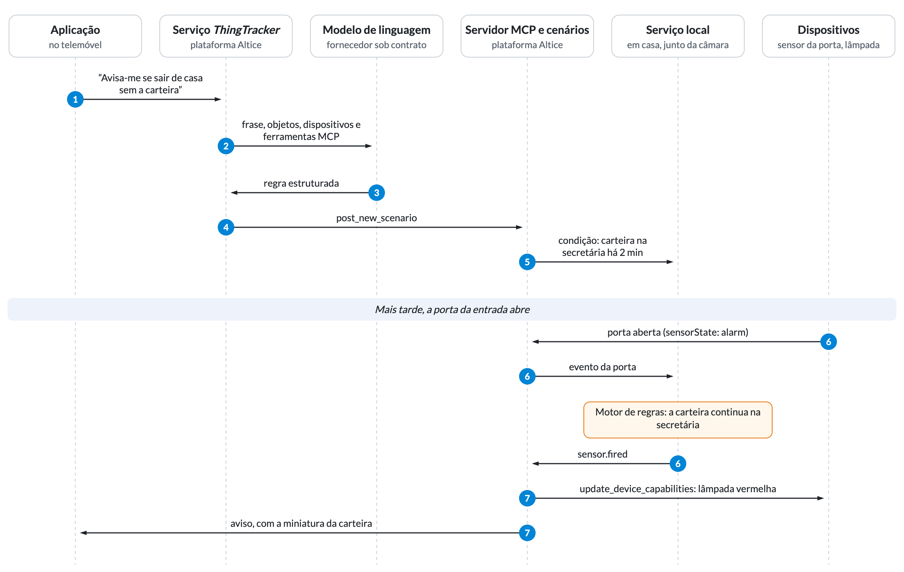

# _ThingTracker_ · integração com a plataforma _Cognitive Home_

Versão 2, quarta-feira, 18 de novembro de 2026. Documento destinado aos engenheiros da Altice Labs. Descreve o que o _ThingTracker_ acrescenta à plataforma, o que reutiliza sem alterações e o que precisa da Altice. A visão de conjunto encontra-se no documento de arquitetura.

## Em resumo

- O _ThingTracker_ transforma a câmara da casa num sensor configurado por frases: o utilizador regista os seus objetos e escreve regras como “avisa-me se sair de casa sem a carteira”.
- Acrescenta quatro componentes: um serviço local em cada casa, o Serviço _ThingTracker_ na plataforma, quatro ferramentas MCP (“_Model Context Protocol_”) para objetos e um novo tipo de acionador de cenário.
- Os comandos aos dispositivos continuam a passar pelas ferramentas MCP que a plataforma já tem. Não se abre nenhum caminho novo até aos dispositivos.
- Para chegar a produção, faltam sete elementos do lado da Altice, listados na secção 9. O mais importante é uma forma de receber eventos sem consultar o servidor MCP periodicamente.

## 1. Glossário

| Termo | Significado |
|---|---|
| Serviço local (_edge_) | Programa que corre em casa, junto da câmara. Fica em repouso até haver movimento ou som e só então analisa imagens com modelos de visão _open-source_ |
| Registo de objetos | Componente do serviço local que aprende um objeto novo a partir de várias vistas mostradas à câmara |
| Assinatura visual | Conjunto de 8 vetores numéricos (_embeddings_ do _DINOv2_), um por vista, que distingue um objeto concreto de outros do mesmo tipo |
| Memória da casa | Registo local de onde e quando cada objeto foi visto, com uma miniatura recortada do objeto |
| Motor de regras | Componente do serviço local que avalia as regras sobre objetos e pessoas e envia um evento quando uma se cumpre |
| Serviço _ThingTracker_ | Componente da plataforma que recebe as frases e as perguntas da aplicação. É o único que chama o modelo de linguagem e executa as ferramentas MCP que este pede |
| Ferramentas _Things_ | As quatro novas ferramentas MCP, descritas na secção 5 |
| Acionador `thingTracker` | Novo tipo de acionador de cenário, cuja condição é sobre objetos ou pessoas e é avaliada em casa (secção 7) |

## 2. O que é novo e o que se reutiliza

Componentes novos:

| Componente | Onde corre | Função |
|---|---|---|
| Serviço local | Em casa: _gateway_ do operador ou pequena caixa _edge_ (na demonstração, um portátil) | Analisa as imagens só quando há movimento ou som, mantém a memória da casa e avalia as regras locais |
| Serviço _ThingTracker_ | Plataforma Altice | Converte frases em regras e responde a perguntas, com o modelo de linguagem e as ferramentas MCP |
| Ferramentas _Things_ | Servidor MCP da plataforma | `list_things`, `create_thing`, `get_thing_last_seen` e `get_thing_timeline` |
| Acionador `thingTracker` | Modelo de cenários da plataforma | Permite que um cenário comece quando uma condição sobre objetos se cumpre |
| Separador “_Things_” | Aplicação Altice | Objetos registados, por divisão, sensores e sugestões, com os mesmos componentes dos outros quatro separadores |
| Botão do assistente | Aplicação Altice, em todos os separadores | Perguntas (“onde está o livro?”) e sensores descritos numa frase |

Ferramentas MCP existentes, usadas sem alterações:

| Ferramenta | Utilização |
|---|---|
| `update_device_capabilities` | Ações sobre a lâmpada e a tomada |
| `patch_home_security_status` | Ativar o alarme, sempre com confirmação prévia do utilizador |
| `post_new_scenario`, `get_home_scenarios` | Guardar as regras como cenários e mostrá-las na lista de cenários da aplicação |
| `get_home_devices`, `get_home_security_status` | Dar ao modelo de linguagem o contexto da casa (dispositivos e estado do alarme) |

## 3. Primeiro exemplo: “avisa-me se sair de casa sem a carteira”

A Figura 1 mostra as mensagens trocadas entre os componentes, desde a frase até à ação.

{width=100%}

**Figura 1** – Da frase à ação: mensagens entre a aplicação, a plataforma, o modelo de linguagem e a casa.

1. O utilizador escreve a frase no assistente. A aplicação envia-a ao Serviço _ThingTracker_.
2. O serviço envia ao modelo de linguagem a frase, os objetos registados (resultado de `list_things`), os dispositivos da casa (`get_home_devices`) e a lista das ferramentas MCP disponíveis.
3. O modelo devolve uma regra estruturada: quando o sensor de contacto da porta abrir, se a carteira continuar na secretária 2 minutos depois, a lâmpada fica vermelha e o utilizador recebe um aviso.
4. O serviço grava a regra como cenário, com `post_new_scenario`. A parte sobre a porta usa o acionador de dispositivo que já existe; a parte sobre a carteira usa o novo acionador `thingTracker` (secção 7). A regra aparece na lista de cenários da aplicação.
5. A plataforma envia a condição sobre a carteira ao serviço local da casa.
6. Quando a porta abre, o Motor de regras verifica na memória da casa se a carteira continua na secretária. Se continuar, envia o evento `sensor.fired`.
7. A plataforma executa as ações do cenário: a lâmpada fica vermelha, com `update_device_capabilities`, e a aplicação mostra o aviso com a miniatura da carteira.

O modelo de linguagem é chamado uma única vez, no passo 2. Daí em diante, a regra é avaliada em casa, sem custo por evento.

## 4. Segundo exemplo: “onde está a carteira?”

1. O utilizador escreve a pergunta no assistente, um botão presente em todos os separadores da aplicação, que a envia ao Serviço _ThingTracker_.
2. O serviço envia-a ao modelo de linguagem, com as ferramentas _Things_ disponíveis.
3. O modelo chama `list_things`. Se houver mais do que um objeto que corresponda à pergunta (por exemplo, duas carteiras), responde com uma pergunta: “Qual delas?”.
4. Com o objeto identificado, o modelo chama `get_thing_last_seen`. A plataforma obtém a resposta da memória da casa, através do serviço local.
5. O modelo responde em linguagem natural (“Na secretária, às 15h02”), e a aplicação mostra a miniatura recortada do objeto.

## 5. As quatro ferramentas _Things_

As novas ferramentas seguem as convenções das existentes: argumentos em JSON, âmbito restrito à casa do utilizador autenticado e resultados em texto JSON. Só a `create_thing` altera dados.

### `list_things`

Lista os objetos registados numa casa, com a última deteção de cada um.

| Argumento | Tipo | Obrigatório | Notas |
|---|---|---|---|
| `homeId` | _string_ | Não | Por omissão, a casa atual do utilizador, como nas restantes ferramentas |

Resultado:
```json
{ "things": [
  { "id": "wallet", "name": "Wallet", "photo": "https://…/things/wallet.jpg",
    "lastSeen": { "place": "desk", "camera": "Living room", "at": "2026-11-18T15:02:10Z" } },
  { "id": "phone", "name": "Phone", "photo": null, "lastSeen": null }
] }
```

### `create_thing`

Regista um objeto novo. Guarda o nome e pede ao serviço local que inicie o registo visual (secção 6).

| Argumento | Tipo | Obrigatório | Notas |
|---|---|---|---|
| `name` | _string_, de 1 a 40 caracteres | Sim | Nome mostrado na aplicação, por exemplo `"Wallet"` |
| `category` | _string_ | Não | Nome em inglês usado como pesquisa pelo detetor, por exemplo `"wallet"`. Por omissão, o próprio nome |
| `enrol` | _enum_: `camera`, `photos` ou `none` | Não | Por omissão, `camera`: a aplicação pede ao utilizador que mostre o objeto à câmara |

Resultado: `{ "id": "wallet", "status": "enrolling" }`. Erros: `409` se o nome já existir; `422` se a casa não tiver câmara.

### `get_thing_last_seen`

Responde à pergunta “onde está X?”.

| Argumento | Tipo | Obrigatório | Notas |
|---|---|---|---|
| `thing` | Identificador ou nome | Sim | Se o nome corresponder a vários objetos, devolve a lista para o modelo perguntar qual |

Resultado:
```json
{ "thing": "wallet", "place": "desk", "camera": "Living room",
  "at": "2026-11-18T15:02:10Z", "match": 0.84,
  "thumbnail": "https://…/sightings/9f2c.jpg" }
```
`match` é a semelhança com a assinatura visual do objeto (de 0 a 1). Se o objeto nunca tiver sido visto, o resultado é `{ "thing": "wallet", "seen": false }`. A miniatura é um recorte que mostra só o objeto, nunca a imagem completa.

### `get_thing_timeline`

Indica por onde andou um objeto num período, para perguntas como “quando é que tive os óculos comigo pela última vez?”.

| Argumento | Tipo | Obrigatório | Notas |
|---|---|---|---|
| `thing` | Identificador ou nome | Sim | Como em `get_thing_last_seen` |
| `from`, `to` | Data e hora ISO 8601 | Não | Por omissão, as últimas 24 h; no máximo, 30 dias |

Resultado: `{ "thing": "glasses", "sightings": [ { "place": "desk", "from": "…", "to": "…" }, … ] }`. As deteções seguidas no mesmo lugar são agregadas numa só.

## 6. Registo de um objeto

O registo segue o padrão que a aplicação já usa para adicionar um dispositivo (gravação de ecrã da versão beta da aplicação Altice, 18 de novembro de 2026): o botão (+), um passo em ecrã inteiro com ilustração, título e um botão principal fixo no fundo, e o diálogo “_Cancel installation_” ao sair.

| Adicionar um dispositivo (hoje) | Adicionar um objeto (proposta) |
|---|---|
| (+) em “_Devices_” | (+) em “_Things_” |
| Lista de tipos de dispositivo e dispositivos _Matter_ próximos | Nome do objeto, ou uma sugestão da lista de objetos comuns (chaves, carteira, óculos, telemóvel) |
| Painel “_Choose a security hub_” | Painel “_Choose a camera_”, com as câmaras e o seu estado |
| Painel “_No smart hub installed_” | Painel “_No camera installed_” (erro `422` da `create_thing`) |
| Número de série ou “_Scan label_” | “_Show it to the camera_”, com o progresso em tempo real |
| Passo final | As vistas aprendidas e o nome, seguidos de “_Done_” |

No passo “_Show it to the camera_”:

1. O utilizador segura o objeto a cerca de 50 cm da câmara e roda-o devagar, durante 10 a 20 segundos.
2. O serviço local procura o objeto com o detetor _OWLv2_, usando o nome em inglês como pesquisa.
3. Em cada imagem em que o encontra, recorta-o e calcula um vetor com o _DINOv2_. Só guarda a vista se for diferente das anteriores, até reunir 8.
4. As 8 vistas formam a assinatura visual, guardada no serviço local (para os modelos locais) e na base de dados da plataforma, associada ao cliente. Assim, um serviço local novo ou reposto recupera-a sem repetir o registo.
5. A aplicação mostra as vistas aprendidas. A assinatura é apagada quando o objeto é eliminado.

Depois do registo, sempre que há movimento, o detetor encontra candidatos do mesmo tipo e o serviço local compara cada um com as 8 vistas. Só um candidato suficientemente semelhante conta como “a sua carteira”; os outros são ignorados.

## 7. Sensores e cenários

Cada frase do utilizador dá origem a uma regra, compilada uma única vez pelo modelo de linguagem.

- As condições e as ações sobre dispositivos (contacto da porta, cor da lâmpada, tomada) já têm correspondência no modelo de cenários da plataforma.
- As condições sobre objetos e pessoas (“carteira na secretária há 2 minutos”, “ninguém na sala há 30 minutos”) não têm equivalente nos acionadores atuais. Propõe-se, por isso, o acionador `thingTracker`, avaliado pelo Motor de regras em casa. Quando a condição se cumpre, o serviço local envia o evento `sensor.fired` e a plataforma executa as ações de início do cenário.

O cenário do primeiro exemplo, no formato de `post_new_scenario` (os valores de `triggerLogic` e de `operator` aceites pela plataforma estão por confirmar):
```json
{ "name": "Saiu sem a carteira", "isActive": true, "triggerLogic": "AND",
  "triggers": [
    { "type": "device", "device": { "id": "<sensor de contacto da porta>" },
      "capabilities": [ { "name": "sensorState", "operator": "==", "value": "alarm" } ] },
    { "type": "thingTracker",
      "condition": { "thing": "wallet", "in_place": "desk", "for": "2m" } } ],
  "startActions": [
    { "type": "device", "device": { "id": "<lâmpada>" },
      "capabilities": [ { "type": "color_rgb", "redValue": 255, "greenValue": 0, "blueValue": 0 } ] } ] }
```

O sensor de contacto da porta comunica a porta aberta como `sensorState` com o valor `alarm`, tal como se observou no kit do desafio.

## 8. Ligação entre o serviço local e a plataforma

| Aspeto | Proposta |
|---|---|
| Ligação | O serviço local abre uma única ligação de saída para a plataforma (_WebSocket_ ou MQTT sobre TLS); a casa não precisa de nenhuma porta de entrada aberta |
| Identidade | Uma credencial por casa, emitida quando a câmara é adicionada na aplicação e revogável a partir dela |
| Da casa para a plataforma | Eventos (`thing.seen`, `thing.moved`, `sensor.fired`), miniaturas e assinaturas visuais dos objetos, e respostas às ferramentas _Things_ |
| Da plataforma para a casa | Condições das regras, chamadas às ferramentas _Things_, pedidos de registo de objetos e zonas a ignorar |
| Sem ligação | O serviço local continua a seguir os objetos e a avaliar as regras; os eventos ficam em fila e seguem quando a ligação volta, mas as ações sobre dispositivos dependem da plataforma |
| Modelo de linguagem | Chamado só pelo Serviço _ThingTracker_, na plataforma, que escolhe o modelo e a região; nunca pelo serviço local |

## 9. O que se pede à Altice

| N.º | Necessidade | Motivo | Situação atual |
|---|---|---|---|
| 1 | Uma API de eventos, de _push_ ou de _webhooks_ | As regras têm de reagir à abertura da porta sem consultas periódicas | O MCP não tem notificações _push_ nem um fluxo geral de eventos; existe apenas o histórico do alarme (`get_home_security_alarm_history`) |
| 2 | Acesso RTSP local à câmara | O vídeo deve ficar na rede da casa | O vídeo passa por um _relay_ na nuvem (_go2rtc_) |
| 3 | Capacidade de computação em casa | Os modelos de visão demoram cerca de 0,6 s por imagem na GPU de um portátil, a 1 ou 2 imagens por segundo e só quando há movimento ou som | A central LTE do kit não tem capacidade para correr modelos de visão |
| 4 | Uma forma de acrescentar ferramentas ao servidor MCP | Para as quatro ferramentas _Things_ | Por apurar |
| 5 | Uma ferramenta para eliminar cenários | Os utilizadores têm de poder remover sensores | O MCP permite criar cenários, mas não eliminá-los |
| 6 | Notificações _push_ para a aplicação | Para os avisos das regras | Não se sabe que serviço a aplicação usa |
| 7 | Contratos para o modelo de linguagem | Exclusão do uso dos dados para treino, acordo de tratamento de dados (DPA) e tratamento na UE | Não se sabe que fornecedores a Altice já usa |

## 10. Estado do protótipo

| Elemento | No protótipo (pasta `prototype/`) |
|---|---|
| Serviço local | Corre num portátil com a câmara do kit: em repouso até haver movimento, depois _OWLv2_ e _DINOv2_ na GPU |
| Registo de objetos | Implementado: 8 vistas geram a assinatura visual, guardada no serviço local e numa cópia que representa a base de dados da plataforma |
| Deteção | Só os objetos registados são procurados; a aplicação desenha em direto, sobre a imagem da câmara, um retângulo por objeto, com o nome e a semelhança |
| Perguntas | Respondidas a partir da memória da casa; se vários objetos corresponderem à pergunta, a aplicação pergunta qual |
| Sensores | Criados a partir de uma frase e avaliados por um Motor de regras local; as ações sobre dispositivos são simuladas até serem ativadas |
| Ferramentas _Things_ | Disponíveis como _endpoints_ HTTP do servidor da equipa (`/api/state`, `/api/things`, `/api/ask`), com os mesmos dados |
| Base de dados | SQLite local (`prototype/data/home.db`): uma cópia da casa, das divisões e dos dispositivos da plataforma, no modelo desta, e as tabelas do _ThingTracker_ (objetos, assinaturas visuais, deteções, sensores, eventos) |
| Aplicação | Cópia fiel da aplicação Altice (ecrãs, medidas, cores e transições captados na versão beta a 18 de novembro de 2026), com o separador “_Things_” e o botão do assistente |
| Ligação casa ↔ plataforma | Um único servidor local desempenha os dois papéis |
