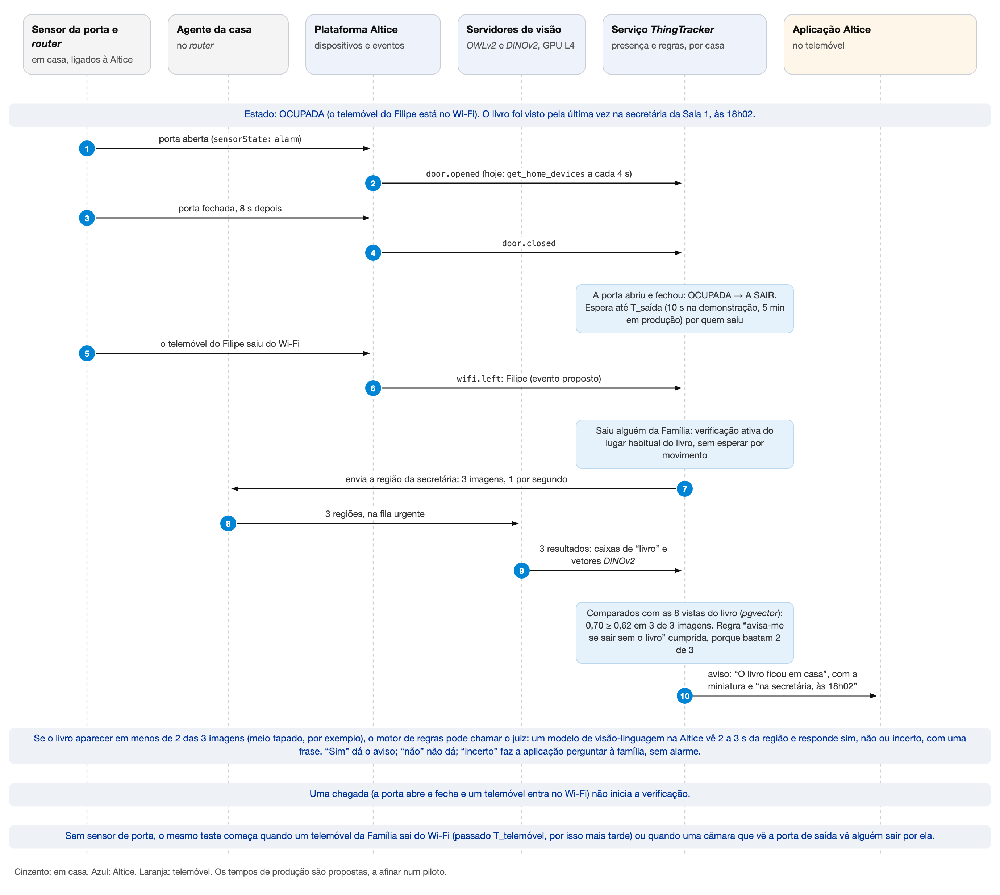

# _ThingTracker_ · integração com a plataforma _Cognitive Home_

Versão 3, quinta-feira, 19 de novembro de 2026. Documento destinado aos engenheiros da Altice Labs, que descreve o que o _ThingTracker_ acrescenta à plataforma, o que reutiliza sem alterações e o que precisa da Altice. A visão de conjunto encontra-se no documento de arquitetura, cujas figuras este documento reutiliza.

## Em resumo

- O _ThingTracker_ transforma a câmara da casa num sensor configurado por frases, em que o utilizador regista os seus objetos e escreve regras como “avisa-me se sair de casa sem o livro”.
- Acrescenta um agente da casa no _router_ Altice (movimento, região que mudou e rostos, opcionalmente), o serviço _ThingTracker_ e os servidores de visão na Altice (onde correm, para cada casa, o motor de presença e o motor de regras), quatro ferramentas MCP (“_Model Context Protocol_”) para objetos, um novo tipo de acionador de cenário e uma ferramenta só de leitura, proposta, para os telemóveis ligados ao Wi-Fi da casa.
- Os comandos aos dispositivos continuam a passar pelas ferramentas MCP que a plataforma já tem, depois de um “Sim” na aplicação, sem se abrir nenhum caminho novo até aos dispositivos.
- Para chegar a produção, faltam oito elementos do lado da Altice, listados na secção 9, sendo os mais importantes uma forma de receber os eventos da porta e do Wi-Fi sem consultar periodicamente o servidor MCP e saber se os _routers_ dispõem de uma NPU.

## 1. Glossário

| Termo | Significado |
|---|---|
| Agente da casa | Programa que corre no processador do _router_ Altice, sem acelerador de IA. Aplica as máscaras de privacidade, executa um filtro de movimento de baixo custo, recorta a região que mudou e, se a família o tiver autorizado, reconhece rostos com o _YuNet_ e o _SFace_. Os padrões faciais nunca saem de casa |
| Servidores de visão | Servidores GPU na Altice (_NVIDIA L4_) que correm o _OWLv2_ (deteção) e o _DINOv2_ (vetores) sobre as regiões enviadas pelas casas, alimentados por uma fila urgente e por uma fila em lote |
| Serviço _ThingTracker_ | Componente da plataforma, com instâncias sem estado atrás de um balanceador de carga. É o _host_ MCP e o único que chama os modelos de linguagem; compara os vetores com as assinaturas visuais, segue objetos e pessoas e corre o motor de presença e o motor de regras de cada casa |
| Motor de presença | Parte do serviço que decide, para cada casa, entre OCUPADA, A SAIR, VAZIA ou INCERTA, a partir dos telemóveis da família no Wi-Fi, do sensor da porta e das câmaras |
| Motor de regras | Parte do serviço que avalia as regras compiladas de cada casa a cada evento e temporizador e envia um aviso quando uma se cumpre |
| Assinatura visual | Até 8 vetores numéricos (_embeddings_ do _DINOv2_), um por vista, que distinguem um objeto concreto de outros do mesmo tipo; ficam no _PostgreSQL_ com _pgvector_, por cliente |
| Ferramentas _Things_ | As quatro novas ferramentas MCP, descritas na secção 5 |
| Acionador `thingTracker` | Novo tipo de acionador de cenário, cuja condição é sobre objetos ou pessoas e é avaliada pelo motor de regras no serviço _ThingTracker_ (secção 7) |
| `get_home_wifi_clients` | Ferramenta MCP só de leitura, proposta, que lista os dispositivos ligados ao Wi-Fi da casa (secção 8) |

## 2. O que é novo e o que se reutiliza

Componentes novos:

| Componente | Onde corre | Função |
|---|---|---|
| Agente da casa | Em casa, no processador do _router_ Altice (no portátil da equipa, na demonstração) | Máscaras, filtro de movimento, região que mudou (no máximo 640 × 640, cerca de uma por segundo durante o movimento) e rostos, opcionalmente; lê uma região a pedido, mesmo sem movimento |
| Servidores de visão | Altice, em GPU _L4_ | Caixas do _OWLv2_ e vetores do _DINOv2_ para as regiões, as fotografias de registo e as verificações ativas |
| Serviço _ThingTracker_ | Plataforma Altice | Converte frases em regras e responde a perguntas; comparação, seguimento, motor de presença e motor de regras, para cada casa; avisos e chamadas MCP |
| Ferramentas _Things_ | Servidor MCP da plataforma | `list_things`, `create_thing`, `get_thing_last_seen` e `get_thing_timeline` |
| Acionador `thingTracker` | Modelo de cenários da plataforma | Permite iniciar um cenário quando se cumpre uma condição sobre objetos ou pessoas |
| `get_home_wifi_clients` (proposta) | Servidor MCP da plataforma, a partir do _router_ | Que telemóveis da família estão no Wi-Fi da casa, para a presença |
| Separador “_Things_” | Aplicação Altice | Objetos e pessoas registados, sensores e sugestões, construído com os mesmos componentes dos outros quatro separadores |
| Botão do assistente | Aplicação Altice, em todos os separadores | Perguntas (“onde está o livro?”) e sensores descritos numa frase |

Ferramentas MCP existentes, usadas sem alterações:

| Ferramenta | Utilização |
|---|---|
| `update_device_capabilities` | Ações sobre a lâmpada, a tomada e a sirene da câmara (`sirenSwitch`), depois de um “Sim” |
| `patch_home_security_status` | Armar o alarme, sempre depois de o utilizador confirmar |
| `post_new_scenario`, `get_home_scenarios` | Guardar as regras como cenários e mostrá-las na lista de cenários da aplicação |
| `get_home_devices` | O estado do sensor de contacto da porta (consultado periodicamente, enquanto não houver um fluxo de eventos) e os dispositivos ligados; contexto para o modelo de linguagem |
| `get_home_security_status` | O estado do alarme, como contexto |

Os avisos chegam ao telemóvel através do serviço de notificações da própria aplicação Altice, uma vez que o servidor MCP não tem nenhuma ferramenta de notificações.

## 3. Primeiro exemplo: “avisa-me se sair de casa sem o livro”

A Figura 1 mostra as mensagens trocadas quando a regra se cumpre, nomeadamente a porta, o telemóvel, a verificação ativa, o aviso e o juiz opcional.

{width=100%}

**Figura 1** – O livro esquecido: mensagens entre o sensor da porta e o _router_, o agente da casa, a plataforma Altice, os servidores de visão, o serviço _ThingTracker_ e a aplicação.

A regra é criada em quatro passos:
1. O utilizador escreve a frase no assistente, e a aplicação envia-a ao serviço _ThingTracker_.
2. O serviço envia ao modelo de linguagem a frase, os objetos registados (resultado de `list_things`), os dispositivos da casa (`get_home_devices`) e a lista das ferramentas MCP disponíveis.
3. O modelo devolve uma regra estruturada, segundo a qual, quando a porta da entrada fechar depois de ter sido aberta e tiver saído um membro da família, se verifica o lugar habitual do livro e, se o livro continuar lá, se avisa o utilizador.
4. O serviço grava a regra como cenário, com `post_new_scenario`, usando o novo acionador `thingTracker` (secção 7), e a regra aparece na lista de cenários da aplicação. A regra é avaliada no serviço _ThingTracker_, na Altice, sem que nada seja enviado para casa.

Quando a regra se cumpre (Figura 1), sucede o seguinte:
5. O sensor da porta comunica “aberta” e depois “fechada” à plataforma (`sensorState: alarm` significa aberta), e o serviço recebe os dois eventos (hoje, por consulta de `get_home_devices` a cada 4 s), passando o motor de presença de OCUPADA para A SAIR.
6. O telemóvel de um membro da família sai do Wi-Fi da casa, o que o serviço fica a saber através do evento proposto `wifi.left` (ou de `get_home_wifi_clients`), e conclui que saiu um membro da família.
7. O serviço pede ao agente da casa a região do lugar habitual do livro, em 3 imagens com cerca de 1 s de intervalo, independentemente do movimento, e as regiões seguem pela fila urgente para os servidores de visão.
8. Os servidores de visão devolvem as caixas de “livro” e os respetivos vetores do _DINOv2_, que o serviço compara com as 8 vistas do livro (semelhança ≥ 0,62). Se o livro for visto em pelo menos 2 das 3 imagens, a regra cumpre-se e a aplicação mostra o aviso com a miniatura do livro; com menos, o resultado é “incerto” e não há aviso, ou, se o livro puder estar parcialmente tapado, o motor de regras pode chamar o juiz de visão-linguagem, cuja resposta “incerto” leva a aplicação a perguntar à família.

O modelo de linguagem é chamado uma única vez, no passo 2. A partir daí, a regra é avaliada por código simples, sem nenhum modelo na decisão, salvo se o juiz for chamado para um momento duvidoso.

## 4. Segundo exemplo: “onde está o meu livro?”

1. O utilizador escreve a pergunta no assistente, um botão presente em todos os separadores da aplicação, que a envia ao serviço _ThingTracker_.
2. O serviço envia-a ao modelo de linguagem, com as ferramentas _Things_ disponíveis.
3. O modelo chama `list_things` e, se mais do que um objeto corresponder à pergunta (por exemplo, duas carteiras), responde com uma pergunta: “Qual delas?”.
4. Identificado o objeto, o modelo chama `get_thing_last_seen`, e o serviço responde a partir da última observação guardada no _PostgreSQL_ desse cliente.
5. O modelo responde em linguagem corrente (“Na secretária, às 15h02”), e a aplicação mostra a miniatura recortada do objeto.

## 5. As quatro ferramentas _Things_

As novas ferramentas seguem as convenções das existentes, com argumentos em JSON, âmbito limitado à casa do utilizador autenticado e resultados em texto JSON. Só a `create_thing` altera dados.

### `list_things`

Lista os objetos registados numa casa, com a última observação de cada um.

| Argumento | Tipo | Obrigatório | Notas |
|---|---|---|---|
| `homeId` | texto | Não | Por omissão, a casa atual do utilizador, como nas restantes ferramentas |

Resultado:
```json
{ "things": [
  { "id": "book", "name": "Livro", "photo": "https://…/things/book.jpg",
    "lastSeen": { "place": "Sala 1", "surface": "secretária", "at": "2026-11-19T18:02:10Z" } },
  { "id": "phone", "name": "Telemóvel", "photo": null, "lastSeen": null }
] }
```

### `create_thing`

Regista um objeto novo, guardando o nome e iniciando o registo das suas vistas (secção 6).

| Argumento | Tipo | Obrigatório | Notas |
|---|---|---|---|
| `name` | texto, de 1 a 40 carateres | Sim | Nome mostrado na aplicação, por exemplo `"Livro"` |
| `category` | texto | Não | Nome em inglês que o detetor usa como termo de pesquisa, por exemplo `"book"`; por omissão, o próprio nome |
| `enrol` | enumeração: `photos`, `camera` ou `none` | Não | Por omissão, `photos`, em que a aplicação pede 6 a 8 fotografias; com `camera`, pede para mostrar o objeto a uma câmara |

Resultado: `{ "id": "book", "status": "enrolling" }`. Erros: `409` se o nome já existir; `422` se `enrol` for `camera` e a casa não tiver câmara.

### `get_thing_last_seen`

Responde à pergunta “onde está X?”.

| Argumento | Tipo | Obrigatório | Notas |
|---|---|---|---|
| `thing` | Identificador ou nome | Sim | Se o nome corresponder a vários objetos, devolve a lista, para que o modelo pergunte qual |

Resultado:
```json
{ "thing": "book", "place": "Sala 1", "surface": "secretária",
  "at": "2026-11-19T18:02:10Z", "match": 0.70,
  "thumbnail": "https://…/sightings/9f2c.jpg" }
```
O campo `match` é a semelhança com a assinatura visual do objeto (de 0 a 1). Se o objeto nunca tiver sido visto, o resultado é `{ "thing": "book", "seen": false }`. A miniatura é um recorte que mostra apenas o objeto, nunca a imagem completa, servido por uma ligação assinada de curta duração.

### `get_thing_timeline`

Mostra por onde andou um objeto num período, para perguntas como “quando é que tive os óculos comigo pela última vez?”.

| Argumento | Tipo | Obrigatório | Notas |
|---|---|---|---|
| `thing` | Identificador ou nome | Sim | Como em `get_thing_last_seen` |
| `from`, `to` | Data e hora ISO 8601 | Não | Por omissão, as últimas 24 h; no máximo, 30 dias |

Resultado: `{ "thing": "glasses", "sightings": [ { "place": "Sala 1", "from": "…", "to": "…", "state": "placed" }, … ] }`. As observações consecutivas no mesmo lugar são agrupadas numa só, e `state` toma os valores `placed`, `in_hand`, `taken` ou `moved`.

## 6. Registar um objeto

O registo segue o padrão que a aplicação já usa para adicionar um dispositivo (gravação do ecrã da versão beta da aplicação Altice, 18 de novembro de 2026), com o botão (+), um passo em ecrã inteiro com uma ilustração, um título e um botão principal fixo em baixo, e a caixa de diálogo “Cancelar instalação” à saída.

| Adicionar um dispositivo (hoje) | Adicionar um objeto (proposta) |
|---|---|
| (+) em “Dispositivos” | (+) em “_Things_” |
| Lista de tipos de dispositivo e de dispositivos Matter próximos | O que as câmaras veem (“A procurar nas câmaras…”), ou um nome escrito |
| Painel “Escolha uma central de segurança” | “Tirar fotografias” ou “Mostrar a uma câmara da casa” |
| Painel “Nenhuma central inteligente instalada” | Painel “Nenhuma câmara instalada”, quando se mostra o objeto a uma câmara (erro `422` de `create_thing`) |
| Número de série ou “Ler etiqueta” | As fotografias, ou a câmara com o progresso em direto |
| Passo final | As vistas aprendidas e o nome, seguidos de “Concluído” |

As vistas obtêm-se de uma de duas formas:
1. Fotografias do telemóvel. A aplicação envia ao serviço _ThingTracker_ 6 a 8 fotografias de lados diferentes (ou imagens de um vídeo curto); os servidores de visão encontram o objeto em cada fotografia com o _OWLv2_, usando o nome em inglês como termo de pesquisa, e o _DINOv2_ calcula o vetor de cada recorte.
2. Mostrar o objeto a uma câmara. O utilizador segura o objeto a cerca de 50 cm de uma câmara e roda-o devagar durante 10 a 20 segundos; o agente da casa envia as regiões, os servidores de visão encontram o objeto e calculam o vetor de cada recorte, e uma vista só é guardada se for diferente das anteriores (semelhança inferior a 0,97), até haver 8.

As vistas formam a assinatura visual, guardada no _PostgreSQL_ com _pgvector_ e associada ao cliente, e o melhor recorte passa a ser a fotografia do objeto. Um _router_ novo ou reposto de fábrica não exige, por isso, novo registo dos objetos. A assinatura visual é apagada quando o objeto é apagado.

Depois do registo, sempre que há movimento, os servidores de visão encontram candidatos do mesmo tipo e o serviço compara cada vetor com as vistas. Só um candidato suficientemente semelhante (semelhança ≥ 0,62) conta como “o seu livro”, sendo os restantes ignorados.

## 7. Sensores e cenários

Cada frase do utilizador torna-se uma regra, compilada uma única vez pelo modelo de linguagem.

- As condições e as ações sobre dispositivos (contacto da porta, cor da lâmpada, tomada) já têm correspondência no modelo de cenários da plataforma.
- As condições sobre objetos e pessoas (“o livro continua na secretária depois de alguém sair”, “ninguém na sala há 30 minutos”) não têm equivalente entre os acionadores atuais. Propõe-se, por isso, o acionador `thingTracker`, avaliado pelo motor de regras no serviço _ThingTracker_. Quando a condição se cumpre, o serviço assinala o acionador como cumprido (`sensor.fired`) e a plataforma executa as ações de início do cenário; uma ação que a família tenha escolhido confirmar aguarda um “Sim” na aplicação.

O cenário do primeiro exemplo, no formato de `post_new_scenario`, é o seguinte. O esquema da ferramenta define `triggerLogic` como texto, sem uma lista de valores; o exemplo pressupõe `"AND"`.
```json
{ "name": "Saiu sem o livro", "isActive": true, "triggerLogic": "AND",
  "triggers": [
    { "type": "thingTracker",
      "condition": { "door": "<sensor de contacto da porta da entrada>", "on": "closed_after_open", "leaver": "family",
                     "thing": "book", "check": "usual_place", "seen_at_least": "2/3" } } ],
  "startActions": [
    { "type": "notification", "message": "O livro ficou em casa." } ] }
```

A porta faz parte da condição `thingTracker`, porque “fechada depois de ter sido aberta” e “saiu um membro da família” são determinados pelo serviço a partir das comunicações da porta e do motor de presença. O sensor de contacto da porta comunica uma porta aberta como `sensorState` com o valor `alarm`, conforme observado no kit do desafio, e a família indica qual dos sensores de contacto é o da porta da entrada. O aviso é entregue pelo serviço de notificações da aplicação, e não por uma ferramenta MCP. No esquema de `post_new_scenario`, as `startActions` aplicam capacidades a dispositivos e não incluem um tipo de notificação, pelo que a ação `notification` do exemplo é um acréscimo proposto (pedido 7 da secção 9).

## 8. Ligação entre o agente da casa e a plataforma

| Aspeto | Proposta |
|---|---|
| Ligação | O agente da casa abre uma única ligação de saída para a plataforma (MQTT sobre TLS com autenticação mútua), através de um balanceador de carga, até a um mediador; a casa não precisa de nenhuma porta de entrada aberta |
| Identidade | Um certificado por casa, emitido quando se adiciona a câmara na aplicação e revogável a partir dela |
| De casa para a plataforma | A região que mudou (no máximo 640 × 640, cerca de uma por segundo durante o movimento); a região pedida numa verificação ativa ou numa atualização; raramente, um clipe de 2 a 3 s da região para o juiz; os rótulos dos rostos (o nome de uma pessoa registada, “rosto desconhecido” ou “rosto não visível”) com as respetivas caixas; eventos. Nunca vídeo contínuo nem padrões faciais |
| Da plataforma para casa | Pedidos de verificação ativa ou de atualização; o vídeo do rosto no registo de uma pessoa, reencaminhado sem ser guardado; as máscaras de privacidade; ordens para apagar padrões faciais |
| Porta | Hoje, o serviço consulta `get_home_devices` a cada 4 s; com um fluxo de eventos, os eventos da porta chegariam de imediato |
| Telemóveis no Wi-Fi | A ferramenta só de leitura proposta, `get_home_wifi_clients` (endereço MAC, nome, banda e hora de ligação de cada cliente), com os eventos `wifi.joined` e `wifi.left`; a família associa uma vez, na aplicação, cada telemóvel a uma pessoa |
| Sem ligação | Sem internet, não há análise de imagem e as regras (que correm na Altice) não podem disparar; o agente da casa guarda eventos e rótulos numa fila, nunca imagens, e envia-os quando a ligação regressa |
| Modelos de linguagem | Chamados apenas pelo serviço _ThingTracker_, que escolhe o modelo e a região, e nunca pelo agente da casa |

## 9. O que se pede à Altice

| N.º | Necessidade | Porquê | Situação atual |
|---|---|---|---|
| 1 | Uma API de eventos, com _push_ ou _webhooks_, para a porta e o Wi-Fi | As regras têm de reagir ao fecho da porta sem consultas periódicas | O MCP não tem notificações _push_ nem um fluxo geral de eventos; existe apenas o histórico do alarme (`get_home_security_alarm_history`) |
| 2 | Uma ferramenta só de leitura, `get_home_wifi_clients` | A presença precisa dos telemóveis da família, já que nenhuma câmara vê quem saiu | O _router_ vê os clientes, mas nenhuma ferramenta os expõe |
| 3 | Acesso local ao RTSP da câmara a partir do _router_ | O vídeo deve ficar na rede da casa | O vídeo passa por um _relay_ na nuvem (_go2rtc_) |
| 4 | Saber se os _routers_ ou as câmaras têm uma NPU | Com uma NPU, a visão passa para casa e custa cerca de 0,36 € por casa e por mês, em vez de 0,49 € (documento 17) | A central LTE do kit não consegue executar modelos de visão |
| 5 | Uma forma de acrescentar ferramentas ao servidor MCP | Para as quatro ferramentas _Things_ e o acionador `thingTracker` | O servidor MCP tem 18 ferramentas, nenhuma sobre objetos. Até lá, as ferramentas _Things_ são uma API do serviço, como no protótipo |
| 6 | Uma ferramenta para apagar cenários | Os utilizadores têm de poder remover sensores | O MCP permite criar cenários, mas não apagá-los |
| 7 | Notificações _push_ para a aplicação | Para os avisos das regras | A aplicação tem o seu serviço de notificações, mas o servidor MCP não expõe nenhuma ferramenta para o chamar; propõe-se que o serviço _ThingTracker_ o chame diretamente, como mais um emissor de avisos |
| 8 | Contratos ou capacidade de GPU para os modelos | Modelos de texto sem uso dos dados para treino, com DPA e processamento na UE; GPU para os servidores de visão e para o juiz | A informação não é pública. A arquitetura funciona com qualquer das opções de modelo de texto que cumprem estes requisitos (documento 14, §15), e a capacidade de GPU dimensiona-se pelo documento 17 (cerca de 1 427 placas _L4_ para 500 000 casas) |

## 10. Estado do protótipo

| Elemento | No protótipo (pasta `prototype/`) |
|---|---|
| Agente da casa e servidores de visão | Um único programa no portátil da equipa (`edge.py`) desempenha os dois papéis, com o filtro de movimento, os rostos com o _YuNet_ e o _SFace_ e o _OWLv2_ e o _DINOv2_ na GPU do portátil, sobre a imagem completa e, para os objetos, sobre regiões de resolução total à volta do que mudou |
| Registo | A partir de fotografias do telemóvel e de 8 vistas mostradas à câmara; a assinatura visual fica numa cópia que representa a base de dados da plataforma |
| Motor de presença | `presence.py`, com os quatro estados, a partir dos telemóveis simulados, da porta e das câmaras |
| Porta | Lida por consulta de `get_home_devices` a cada 4 s quando a sessão MCP está ativa; porta simulada nos restantes casos |
| Sensores | Criados a partir de uma frase e avaliados pelo motor de regras do servidor (`server.py`), num ciclo a cada 2 s; as ações nos dispositivos são simuladas salvo se forem ativadas, e o alarme é sempre simulado |
| Ferramentas _Things_ | Disponíveis como _endpoints_ HTTP do servidor da equipa (`/api/state`, `/api/things`, `/api/ask`), com os mesmos dados |
| Base de dados | _SQLite_ local (`prototype/data/home.db`), no lugar do _PostgreSQL_ |
| Aplicação | Uma réplica fiel da aplicação Altice (ecrãs, dimensões, cores e transições captados da versão beta a 18 de novembro de 2026), com o separador “_Things_”, o botão do assistente e os avisos |
| Ligação entre a casa e a plataforma | Um único servidor local desempenha os dois papéis; o _stream_ da câmara chega através do _relay_ da organização |
