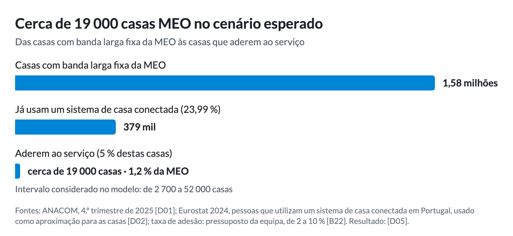
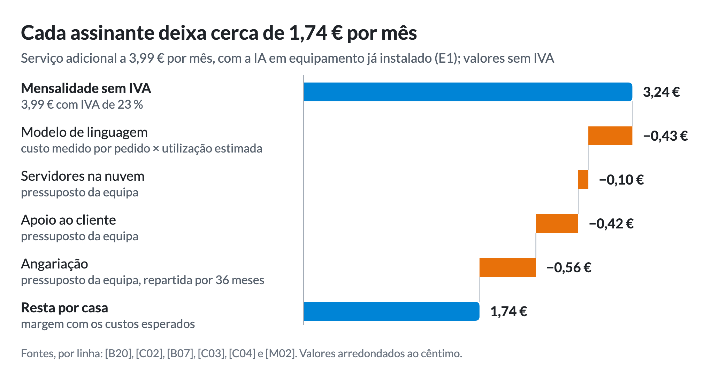
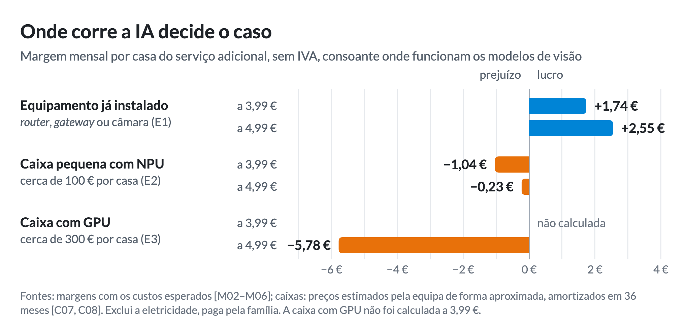
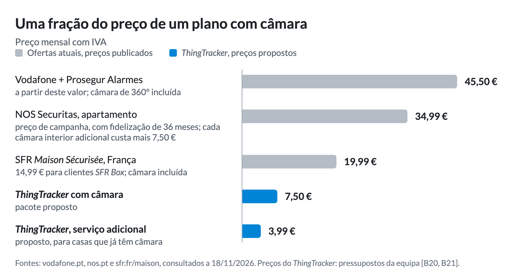
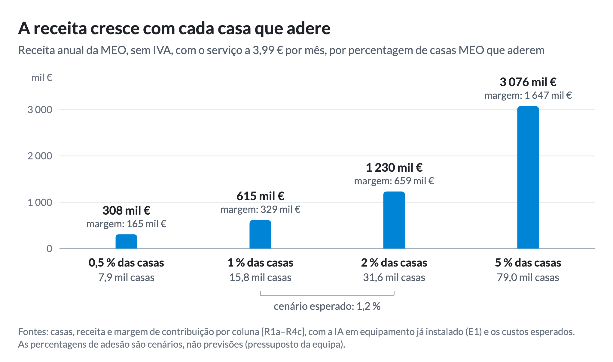

# Viabilidade de negócio · _ThingTracker_

Dados atualizados a 18 de novembro de 2026. Os gráficos são gerados a partir do modelo de cálculo que acompanha este documento, no qual cada número tem uma fonte identificada ou está assinalado como pressuposto da equipa. Os detalhes e as fontes encontram-se no final.

## Em resumo

- As famílias pagam ao seu operador uma pequena mensalidade, e a Altice Labs fornece o _ThingTracker_ através da plataforma _Cognitive Home_.
- No cenário esperado, aderem ao serviço cerca de 19 000 casas MEO, ou seja, 1,2 % das casas com banda larga fixa da operadora.
- De uma mensalidade de 3,99 €, restam cerca de 1,74 € por casa, depois de descontados o IVA e os custos do modelo de linguagem, dos servidores, do apoio ao cliente e da angariação.
- A condição essencial é dispensar uma caixa dedicada em cada casa, correndo os modelos de visão mais exigentes nos servidores da própria Altice ou em equipamento já instalado em casa (documento 17). Com uma caixa dedicada em cada casa, o serviço adicional dá prejuízo.
- O preço proposto corresponde a uma fração do preço dos atuais planos de alarme com câmara em Portugal, que começam nos 34,99 € por mês.

## 1. O mercado

Figura 1 – Cerca de 19 000 casas MEO no cenário esperado

A MEO tem cerca de 1,58 milhões de casas com banda larga fixa (ANACOM, 4.º trimestre de 2025) e, em Portugal, cerca de uma pessoa em cada quatro já utiliza um sistema de casa conectada (Eurostat, 2024). Admitindo, como pressuposto da equipa, que adere ao serviço uma em cada vinte casas que já utilizam estes sistemas, chega-se a cerca de 19 000 casas, como mostra a Figura 1. O intervalo considerado no modelo vai de cerca de 2 700 a 52 000 casas.

## 2. Uma casa, um mês

Figura 2 – Cada assinante deixa cerca de 1,74 € por mês

A Figura 2 mostra o que resta de uma mensalidade depois de descontados os custos. O modelo de linguagem custa cerca de 0,43 € por casa e por mês no cenário base (de 0,10 a 1,78 €), uma vez que só é chamado quando se cria um sensor a partir de uma frase, quando o utilizador faz uma pergunta ou quando surge um caso duvidoso. Este valor diz respeito apenas ao modelo de linguagem, já que as imagens das câmaras são analisadas por modelos de visão _open-source_, os mais leves em casa, no _router_, e o _OWLv2_ e o _DINOv2_ nos servidores _L4_ da própria Altice, cujo custo se calcula no documento 17 (ver também a secção 3). Os valores dos restantes custos são pressupostos da equipa.

## 3. Onde corre a IA

Figura 3 – Onde corre a IA decide o caso

Os modelos de visão locais são a parte mais exigente do sistema. Se funcionarem num _router_, num _gateway_ ou numa câmara já instalados em casa, cada assinante dá lucro, mas, com uma caixa dedicada em cada casa, o serviço adicional dá prejuízo, como mostra a Figura 3. A câmara fica em repouso até haver movimento ou som, e só então os modelos analisam imagens. Admitindo, a título de exemplo, cerca de 2 horas de movimento por dia, os modelos exigem muito menos processamento e eletricidade do que em funcionamento contínuo, com um custo de cerca de 0,14 € de eletricidade por mês num equipamento de 15 W. Este modo de funcionamento torna mais plausível a utilização de equipamento já instalado em casa (opção E1), embora o custo do equipamento continue a ser o fator decisivo. A via híbrida adotada na arquitetura dispensa a caixa, uma vez que só os modelos leves correm em casa e o _OWLv2_ e o _DINOv2_ correm nos servidores da própria Altice (documento 17). Ainda assim, a primeira questão a colocar à Altice é se o equipamento que instala em casa dos clientes tem capacidade disponível, porque permitiria trazer a visão para casa (ver D9).

## 4. Preço

Figura 4 – Uma fração do preço de um plano com câmara

Em Portugal, os planos de alarme com câmara custam a partir de 34,99 € por mês na NOS (preço de campanha, a que acrescem 7,50 € por cada câmara interior adicional) e a partir de 45,50 € na Vodafone. Propõe-se o _ThingTracker_ a 3,99 € por mês para as casas que já têm câmara, ou a 7,50 € com câmara incluída, o que corresponde a uma fração daqueles valores, como mostra a Figura 4.

## 5. Receita para a MEO

Figura 5 – A receita cresce com cada casa que adere

A receita cresce na mesma proporção que a percentagem de casas que aderem ao serviço, e o cenário esperado (1,2 %) situa-se entre as colunas de 1 % e de 2 % da Figura 5. Trata-se de cenários e não de previsões, e um projeto-piloto permitiria conhecer a taxa de adesão real.

## 6. Para além de Portugal

O mercado francês é mais favorável. O serviço _Maison Sécurisée_, da SFR, já inclui uma câmara, e a utilização de sistemas de casa conectada é mais elevada (39 % das pessoas, face a 24 % em Portugal). Nesse mercado, o cenário esperado aponta para cerca de 115 000 casas. A SFR está, no entanto, em processo de venda ([iliad, 6 de junho de 2026](https://www.iliad.fr/media/CP_ILD_060626_Eng_227f572f6d.pdf)), pelo que o _ThingTracker_ deve ser proposto como uma funcionalidade da plataforma, disponível para qualquer operador.

## Detalhes e fontes

Nas tabelas seguintes, consideram-se três cenários, designados prudente, esperado (o cenário base) e otimista. Nas tabelas de mercado, as colunas seguem essa ordem; nas tabelas de custos, indicam o valor mínimo, o esperado e o máximo, pelo que o custo mínimo corresponde ao cenário otimista. Os identificadores entre parênteses retos, como [C02], remetem para as linhas do modelo de cálculo.

### D1. Quem paga e porquê

| Parte | Paga | Recebe |
|---|---|---|
| Família | Uma mensalidade na fatura do operador | Respostas sobre o último local onde cada objeto foi visto, sensores criados com uma frase e ações sobre os seus próprios dispositivos |
| Operador (MEO, SFR) | À Altice Labs, segundo um modelo de licenciamento ainda desconhecido | Receita adicional gerada na base de clientes existente e uma resposta aos planos com câmara da NOS e da Vodafone (D3) |
| Altice Labs | Não se aplica | Uma funcionalidade para todos os operadores que utilizam a _Cognitive Home_, uma plataforma B2B2C de marca branca e _multi-tenant_, vendida a operadores de telecomunicações (estudo de mercado, secção 2) |

O operador já gere a faturação, a aplicação e os dispositivos sobre os quais atua o servidor MCP (“_Model Context Protocol_”). O mercado português tem margem para crescer, já que, em 2024, 23,99 % das pessoas utilizaram um sistema de casa conectada, face a 33,04 % na União Europeia (Eurostat; estudo de mercado, secção 3.7). A MEO vende um kit de alarme Ajax sem mensalidade cuja única câmara é um detetor de movimento que tira fotografias quando há movimento; a loja da MEO vende também câmaras de vídeo de outras marcas (meo.pt e loja.meo.pt/seguranca, consultados a 18/11/2026).

### D2. Dimensão do mercado

#### Portugal (MEO)

| Etapa | Prudente | Esperado | Otimista | Fonte |
|---|---|---|---|---|
| Acessos residenciais de banda larga fixa | 4 052 mil | 4 052 mil | 4 052 mil | [ANACOM, 4.º trimestre de 2025](https://www.anacom.pt/streaming/SAI4T2025.pdf?contentId=1828507&field=ATTACHED_FILE), tabela 5 |
| × quota da MEO nos acessos residenciais | 39,0 % | 39,0 % | 39,0 % | ANACOM, 4.º trimestre de 2025, tabela 6 |
| = acessos residenciais da MEO [D01] | 1 580 mil | 1 580 mil | 1 580 mil | |
| × casas preparadas para um serviço adicional [D02] | 8,49 % | 23,99 % | 33,04 % | Aproximação, Eurostat 2024: dispositivos de segurança em Portugal / qualquer sistema de casa conectada em Portugal / média da UE |
| × taxa de adesão [B22] | 2 % | 5 % | 10 % | Pressuposto da equipa |
| = casas aderentes [D05] | 2,7 mil | 19,0 mil | 52,2 mil | 0,17 % / 1,20 % / 3,30 % da base da MEO |

Ressalva-se que a ANACOM contabiliza acessos e não casas, e que o Eurostat contabiliza pessoas. Como a câmara do alarme da MEO só tira fotografias quando há movimento, a via realista em Portugal continua a ser o pacote com câmara (D3).

#### França (SFR)

| Etapa | Prudente | Esperado | Otimista | Fonte |
|---|---|---|---|---|
| Total de clientes fixos da SFR | 5 890 mil | 5 890 mil | 5 890 mil | [Altice France, 2.º trimestre de 2026](https://static.s-sfr.fr/AlticeFrance/investors/results-presentation/AlticeFrance-Q22026-PR.pdf), tabela de indicadores; 17,8 % de 33,1 milhões de subscrições em França ([Arcep, 10 de setembro de 2026](https://www.arcep.fr/fileadmin/cru-1786970039/user_upload/48-26-version-francaise.pdf)) |
| × percentagem de casas preparadas [F02] | 14,16 % | 39,01 % | 39,01 % | Aproximação, Eurostat 2024: dispositivos de segurança em França / qualquer sistema de casa conectada em França |
| × taxa de adesão | 2 % | 5 % | 10 % | Pressuposto da equipa |
| = casas aderentes [F04] | 16,7 mil | 114,9 mil | 229,8 mil | 0,67 / 4,58 / 9,17 milhões de euros por ano, sem IVA, a 3,99 € [F05] |

Os assinantes do _Maison Sécurisée_ seriam o melhor mercado para começar, mas o seu número é desconhecido, por não ser público.

### D3. Opções de preço

| Oferta concorrente | Preço | Câmara | Fonte |
|---|---|---|---|
| Vodafone + Prosegur Alarmes | “desde €45,5/mês” | Câmara de 360° incluída no pacote base | [vodafone.pt](https://www.vodafone.pt/alarmes-prosegur.html) |
| NOS Securitas, apartamento | 34,99 €/mês em campanha (preço anterior de 39,99 €), com fidelização de 36 meses | Detetor de movimento com câmara incluído no kit; cada câmara interior adicional custa mais 7,50 €/mês | [nos.pt, alarme](https://www.nos.pt/alarmes/alarme-casa), [nos.pt, câmaras](https://www.nos.pt/alarmes/equipamentos/camaras-vigilancia) |
| SFR _Maison Sécurisée_ | 19,99 €/mês, sem fidelização; 14,99 €/mês para clientes _SFR Box_; compra obrigatória do _pack alerte vidéo_, por 99 € | Incluída | [sfr.fr/maison](https://www.sfr.fr/maison/), consultado a 18/11/2026; estudo de mercado, secção 2 |
| MEO | Kit _Ajax Starter_, sem subscrição de serviço | Detetor de movimento com câmara que tira fotografias; sem câmara de vídeo | meo.pt, consultado a 18/11/2026 |

| Opção proposta (pressuposto da equipa) | Preço com IVA | Preço sem IVA (23 %) | Adequada a | Justificação do preço |
|---|---|---|---|---|
| A. Pacote com câmara e _ThingTracker_ [B21] | 7,50 € | 6,10 € | MEO | O que a NOS cobra por cada câmara interior adicional |
| B. Serviço adicional [B20] | 2,99 € / 3,99 € / 4,99 € | 2,43 € / 3,24 € / 4,06 € | Casas com uma câmara da plataforma, por exemplo do _Maison Sécurisée_ | 4,99 € equivale a 25 % do preço da SFR (33 % do preço para clientes _SFR Box_, de 14,99 €), 14 % do da NOS e 11 % do da Vodafone |
| C. Incluído num plano de alarme | 0 € adicionais | 0 € | Retenção de clientes | O valor está na redução do abandono de clientes, ainda desconhecida |

### D4. Custos e margem por casa e por mês

A análise das imagens só arranca quando há movimento ou som. O modelo de linguagem é chamado apenas para três tipos de pedido.

| Pedido | Modelo | Custo medido por pedido | Pedidos por mês, mínimo / esperado / máximo (pressuposto da equipa) |
|---|---|---|---|
| Frase → sensor | _Sonnet 5.5_ | 0,003612 USD [A16] | 2 / 5 / 15 |
| Pergunta | _Sonnet 5.5_ | 0,002546 USD [A17] | 30 / 60 / 150 |
| Evento duvidoso | _Haiku 5.5_ | 0,0003077 USD [A18] | 60 / 300 / 900 |

O total é de 0,10 / 0,43 / 1,78 USD por casa e por mês [C01] e assenta em três pressupostos da equipa:

- um fator multiplicativo de 1,0 / 1,5 / 2,0 sobre o custo medido de cada pedido, uma vez que só foi medido um pedido de cada tipo;
- um fator de 1,00 / 1,10 / 1,25, isto é, um acréscimo de 0 a 25 %, associado à residência dos dados;
- uma taxa de câmbio de 1 USD = 1 EUR.

Em comparação, enviar para a nuvem as imagens de uma única zona com muito movimento custa até 0,37 USD por hora (documentação do protótipo).

| Custo (€ por casa e por mês) | Mínimo | Esperado | Máximo | Base de cálculo |
|---|---|---|---|---|
| Modelo de linguagem na nuvem [C02] | 0,10 | 0,43 | 1,78 | Ver acima |
| Servidores na nuvem [B07] | 0,05 | 0,10 | 0,25 | Pressuposto da equipa |
| Apoio ao cliente [C03] | 0,17 | 0,42 | 1,25 | Pressuposto da equipa, com 0,25 / 0,5 / 1 contactos por ano a 8 / 10 / 15 € |
| Angariação [C04] | 0,28 | 0,56 | 1,11 | Pressuposto da equipa, com 10 / 20 / 40 € repartidos por 36 meses |
| Custo de funcionamento [C05] | 0,60 | 1,51 | 4,39 | |

O custo de funcionamento não inclui o da visão local, ou seja, a eletricidade e o equipamento onde os modelos funcionam. Para esse equipamento local (_edge_), consideram-se três opções, com preços estimados pela equipa de forma aproximada. O custo do equipamento é amortizado em 36 meses, o mesmo período da fidelização da NOS.

| Opção | Equipamento | €/mês | Eletricidade paga pela família, em funcionamento contínuo (0,2367 €/kWh, Eurostat) |
|---|---|---|---|
| E1: _gateway_ ou câmara já existente | 0 € | 0 | Não estimada (viabilidade desconhecida) |
| E2: caixa pequena com NPU | 60 / 100 / 150 € | 1,67 / 2,78 / 4,17 | 0,52 / 0,86 / 1,38 (3 / 5 / 8 W) |
| E3: caixa com GPU | 200 / 300 / 400 € | 5,56 / 8,33 / 11,11 | 1,73 / 2,59 / 4,32 (10 / 15 / 25 W) |

A tabela seguinte apresenta a margem em euros por casa e por mês, sem IVA, com os custos esperados e, entre parênteses, a margem com o custo mínimo e com o custo máximo.

| Oferta | E1 | E2 | E3 |
|---|---|---|---|
| Serviço adicional a 2,99 € [M01] | 0,92 (de 1,83 a −1,96) | Não calculada | Não calculada |
| Serviço adicional a 3,99 € [M02, M04] | 1,74 (de 2,65 a −1,15) | −1,04 | Não calculada |
| Serviço adicional a 4,99 € [M03, M05, M06] | 2,55 (de 3,46 a −0,34) | −0,23 | −5,78 |
| Pacote a 7,50 €, com câmara fornecida (25 / 40 / 60 €, pressuposto da equipa) [M07, M08, M09] | 3,48 | 0,70 | −4,85 |

Uma caixa com GPU em cada casa nunca compensa o investimento. Os detetores de vocabulário aberto utilizados (_OWLv2_, _Grounding DINO_) são a parte mais exigente, pelo que a viabilidade do negócio depende de os correr nos servidores da própria Altice (a via híbrida, documento 17) ou de um detetor mais leve, com poucas imagens por segundo, em equipamento que já existe em casa.

### D5. Receita para a MEO

| Adesão, em percentagem dos 1 580 mil acessos (pressuposto da equipa) | Casas | Receita anual sem IVA a 2,99 / 3,99 / 4,99 € | Margem de contribuição anual a 3,99 €, E1, custos esperados |
|---|---|---|---|
| 0,5 % | 7,9 mil | 230 / 308 / 385 mil € | 165 mil € |
| 1 % | 15,8 mil | 461 / 615 / 769 mil € | 329 mil € |
| 2 % | 31,6 mil | 922 / 1 230 / 1 539 mil € | 659 mil € |
| 5 % | 79,0 mil | 2 305 / 3 076 / 3 847 mil € | 1 647 mil € |

O cenário esperado (1,2 %) situa-se entre as linhas de 1 % e de 2 %. Os valores não incluem a receita do pacote, o efeito no abandono de clientes nem uma eventual taxa de licença da Altice Labs, por serem desconhecidos.

### D6. Concorrência e diferenciação

| Quem | O que vende | Sobreposição |
|---|---|---|
| NOS Securitas; Vodafone + Prosegur | Planos de alarme com câmara (D3) | Apenas segurança; o _ThingTracker_ poderia utilizar a mesma câmara |
| SFR _Maison Sécurisée_ (desenvolvido pela Altice Labs) | _Hub_, 2 detetores de movimento, uma câmara e um detetor de abertura de portas e janelas (estudo de mercado, secção 2) | A mesma câmara, à qual o _ThingTracker_ acrescenta uma utilização como fonte de informação |
| Altice _Cognitive Home_ | _Reliable Security_, com alertas e reprodução de vídeo (descrição do desafio); _Family Care_; _Aging in place_. Segundo a brochura, os cenários “_will be powered by generative AI to enable the automatic generation of scenario scripts_” (estudo de mercado, secção 5) | Elevada na criação de regras (estudo de mercado, secção 5, linha F); nula na procura de objetos perdidos (linha G) |

A diferenciação assenta na Memória da casa, que regista onde e quando cada objeto foi visto pela última vez, sem guardar vídeo. O vídeo nunca sai de casa, e as zonas que a família exclui com máscaras de privacidade nunca são analisadas. As ações chegam aos dispositivos do próprio cliente através do servidor MCP da Altice, e quatro novas ferramentas MCP permitem a qualquer assistente consultar a Memória da casa. Na apresentação da proposta, o destaque deve ir para a memória de objetos, e não para a criação de regras.

O estudo de mercado não analisou os fabricantes de câmaras, pelo que não se afirma que nenhuma câmara doméstica registe já o último local onde cada objeto foi visto.

### D7. Replicação noutros mercados

- Como a _Cognitive Home_ é _multi-tenant_ e de marca branca (estudo de mercado, secção 2), um novo operador utiliza a mesma plataforma e o mesmo separador, bastando configurá-los, sem código novo. Trata-se de uma inferência da equipa.
- Os custos quase não variam de país para país, já que só o IVA, a eletricidade e a residência dos dados diferem.
- Quanto à língua, as frases em português e em inglês funcionam, mas o francês ainda não foi testado.
- A procura é maior em França, onde 39,01 % das pessoas utilizam sistemas de casa conectada, face a 23,99 % em Portugal, e 14,16 % utilizam dispositivos de segurança, face a 8,49 % (Eurostat, 2024).
- Quanto à venda da SFR, foi assinado um memorando de entendimento com vista à aquisição da empresa, sujeito à consulta dos trabalhadores e à aprovação das autoridades reguladoras (iliad, 6 de junho de 2026). Desconhece-se o futuro do _Maison Sécurisée_, pelo que o _ThingTracker_ deve ser apresentado como uma funcionalidade da _Cognitive Home_ para qualquer operador que licencie a plataforma. A brochura não identifica outros operadores (estudo de mercado, secção 2).

### D8. Principais riscos

| Risco | Efeito | Mitigação |
|---|---|---|
| O equipamento existente não tem capacidade para a perceção | Acréscimo de 2,78 a 8,33 € por mês [C07, C08], com prejuízo no serviço adicional | Via híbrida, com o _OWLv2_ e o _DINOv2_ nos servidores da Altice (documento 17); pacote com câmara |
| Poucas casas MEO têm câmara | O mercado português do serviço adicional fica muito abaixo do valor da linha D03 | Pacote em Portugal, serviço adicional em França |
| Utilização mais intensa do que o previsto (n = 1 por tipo de pedido) | Modelo de linguagem até 1,78 € [C02] | _Prompt caching_, limites de gasto, mais pedidos ao _Haiku_ |
| Residência dos dados na UE | Acréscimo desconhecido [B05]; a API da Anthropic não garante o tratamento dos dados exclusivamente na UE (sumário executivo) | Regiões europeias do _Bedrock_ ou um modelo _open-source_ alojado pela Altice, ambos por orçamentar |
| RGPD; Regulamento da IA da UE, quanto à identificação biométrica à distância | Menor adesão e custos jurídicos | Máscaras de privacidade definidas pela família, sem vídeo guardado, reconhecimento facial opcional e feito em casa |
| Sobreposição com os cenários de IA generativa da Altice | Menor diferenciação | Destacar a memória de objetos |
| Venda da SFR | Incerteza no mercado francês | Apresentar o serviço como funcionalidade da plataforma |
| Utilizadores mais velhos (8,8 % das pessoas dos 65 aos 74 anos utilizam sistemas de casa conectada em Portugal; estudo de mercado, secção 3.7) | Baixa adesão | Utilização orientada para os familiares |
| Taxa de adesão desconhecida | A receita varia na mesma proporção [linhas R] | Projeto-piloto |

### D9. Informação a obter junto da Altice para consolidar os números

1. Número de casas MEO com a _Cognitive Home_ ativa e, destas, com câmara; número de assinantes do _Maison Sécurisée_.
2. Capacidade de CPU ou NPU disponível no _gateway_, no _hub_, no _router_ ou na _set-top box_ (E1).
3. Custo da câmara e disponibilidade da MEO para a incluir no pacote.
4. Taxa de adesão, preço, abandono de clientes, custo de apoio e custo de angariação de serviços adicionais anteriores.
5. Política de residência dos dados para o modelo de linguagem (tratamento exclusivamente na UE, recurso ao _Bedrock_ ou alojamento próprio).
6. Modelo de licenciamento por casa e operadores que licenciam a _Cognitive Home_.
7. Ponto de situação da geração de _scripts_ de cenários com IA generativa e consequências da venda da SFR para o _Maison Sécurisée_.
