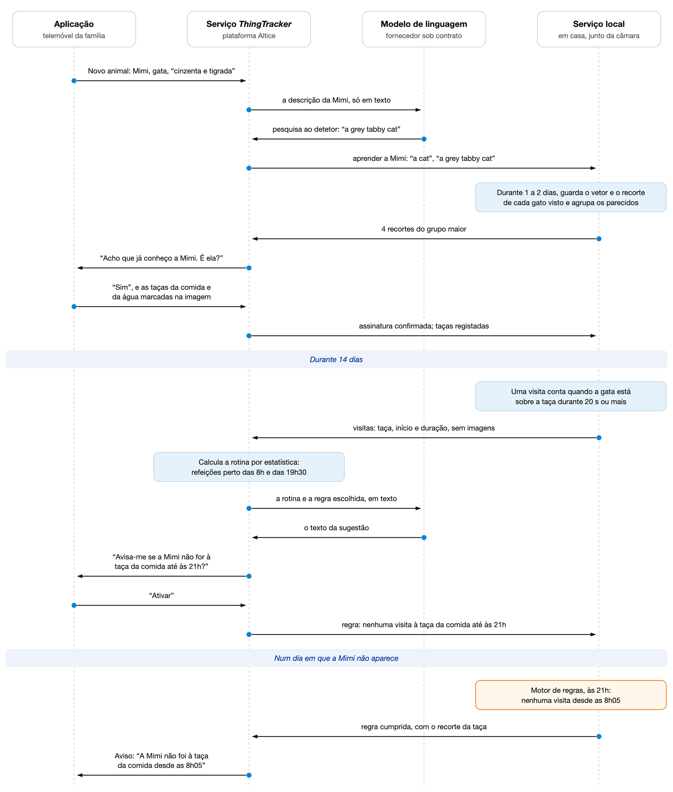
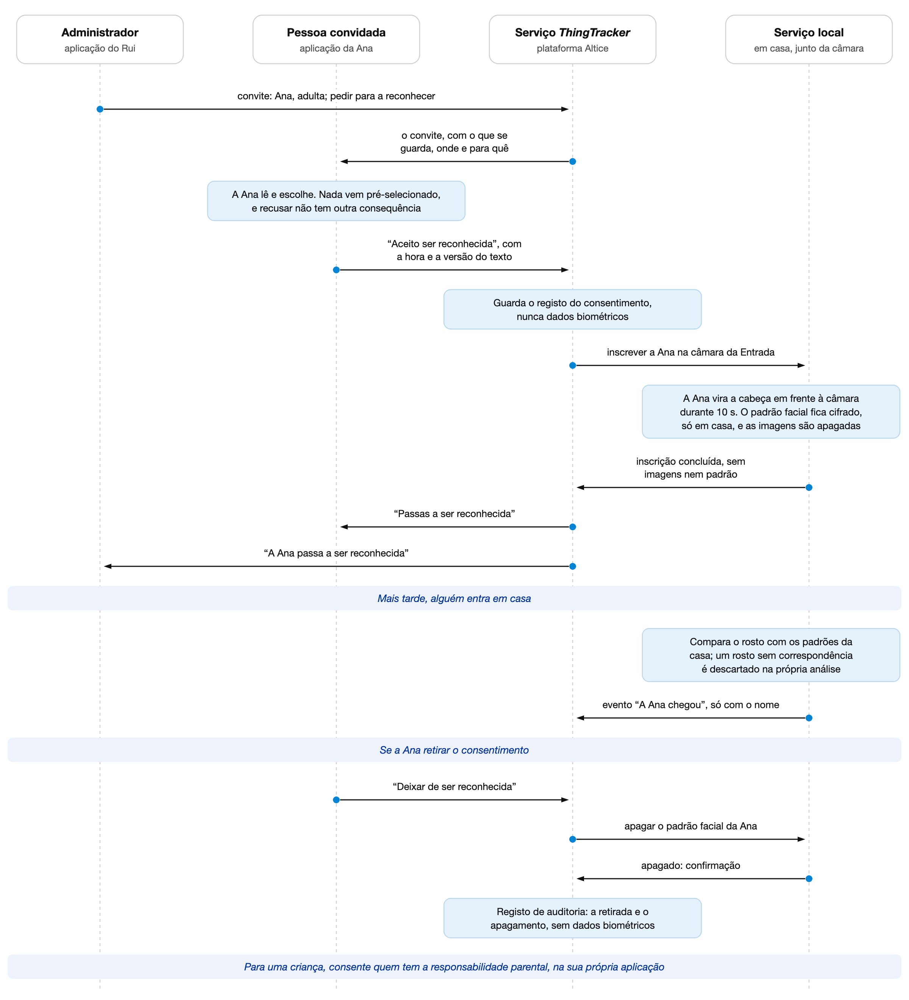
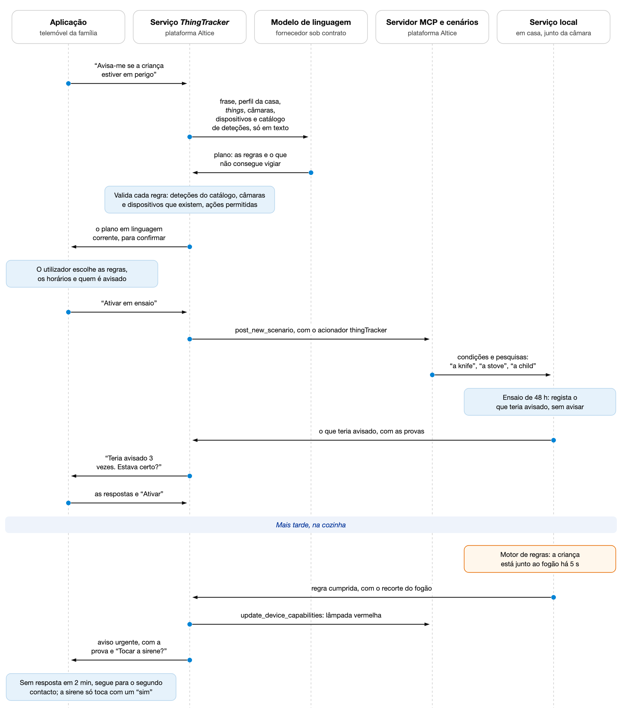
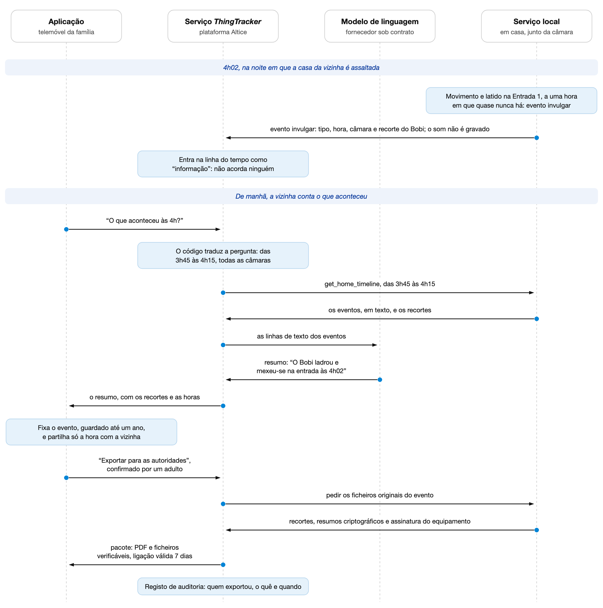

# _ThingTracker_ · especificação de produto para o lançamento na MEO

Versão 1, quarta-feira, 18 de novembro de 2026. Documento destinado à equipa, aos mentores e aos engenheiros da Altice Labs. Foi escrito do ponto de vista da equipa de produto e engenharia da Altice Labs que prepara o lançamento do _ThingTracker_ para os clientes MEO, antes de o começar a construir, e responde, com detalhe de implementação, às perguntas difíceis que surgem no planeamento. A arquitetura, a integração com o servidor MCP (“_Model Context Protocol_”), os custos para o operador e os casos de uso encontram-se nos documentos 14 a 18, que este documento não repete.

## Como ler este documento

Parte-se do princípio de que tudo está disponível, ou seja, a aplicação Altice, a plataforma, o servidor MCP com ferramentas novas, câmaras interiores e exteriores, os sensores do kit, colunas inteligentes, fechaduras, luzes e equipamento local com capacidade de IA, seja um _router_ com NPU (“_Neural Processing Unit_”), seja uma pequena caixa. Sempre que a realidade de hoje é diferente, uma linha começada por “Hoje,” indica-o.

Usam-se cinco marcas ao longo do texto:
- proposta, para uma decisão de produto nova, que a equipa ainda não validou;
- pressuposto, para um valor por confirmar, escolhido para tornar a especificação concreta;
- meta, para um objetivo a medir num piloto, que não é um resultado;
- hipótese, para uma ideia de negócio ou um risco que ninguém validou ainda;
- a verificar, para um ponto jurídico que não foi confirmado na fonte primária.

Tudo o que não provém dos documentos 14 a 18 nem do protótipo é proposta, mesmo nas frases em que a marca não se repete.

## Em resumo

- O cliente acompanha quatro tipos de _things_ (objetos, animais, pessoas e lugares) e cria regras com uma frase. Cada tipo tem um fluxo de registo próprio, porque o que se aprende, o que sai de casa e o consentimento exigido diferem de um tipo para outro (secção 1).
- Os objetos aprendem-se com 8 vistas, como no protótipo; os animais, com vistas que a própria câmara recolhe durante um ou dois dias e que o cliente confirma; as pessoas, apenas com o consentimento explícito da própria pessoa ou, no caso de uma criança, de quem tem a responsabilidade parental, e o padrão facial nunca sai de casa.
- Uma frase vaga como “avisa-me se a criança estiver em perigo” não dá origem a uma regra, mas a um plano com várias regras, que o modelo de linguagem escolhe num catálogo fechado de deteções, o código valida e o cliente confirma; o plano inclui ainda a lista do que o sistema não consegue vigiar.
- A linha do tempo da casa é uma funcionalidade central, porque a mesma memória que serve para responder a “onde está o livro?” guarda os eventos, incluindo os invulgares (um latido às 4h), com a hora, a câmara e um recorte, durante 30 dias, e permite pesquisar (“o que aconteceu às 4h?”) e exportar um incidente para as autoridades com a confirmação de um adulto (secção 2).
- Cada aviso tem um nível (informação, aviso ou urgente), leva a respetiva prova e passa para um segundo contacto se ninguém responder. A sirene segue a escolha da família para cada regra: perguntar primeiro ou tocar logo (a criança em perigo é o exemplo de tocar logo). Armar o alarme pede sempre um “sim”.
- A via híbrida recomendada no documento 17 (verificação de movimento em casa e análise da zona alterada nos servidores da Altice) obriga a reformular a promessa de privacidade e tem uma consequência pouco evidente, a de que o reconhecimento de pessoas só pode existir nas casas com capacidade de IA local.
- Propõe-se um lançamento em três fases, com metas de qualidade medidas por caso de uso, antes da disponibilidade geral a 3,99 € por mês (secção 7).
- Antes de qualquer piloto, a equipa tem de tomar cinco decisões, listadas na secção 10: onde corre a visão no lançamento, o que recebe o modelo de linguagem, se o reconhecimento de pessoas entra no lançamento, quem é o responsável pelo tratamento dos dados e qual é o limite aceitável de falsos alarmes.

## Glossário

| Termo | Significado |
|---|---|
| _Thing_ | Aquilo que o cliente acompanha: um objeto, um animal, uma pessoa ou um lugar |
| Serviço local | O programa do _ThingTracker_ que corre em casa, no _router_ ou numa pequena caixa: verificação de movimento, memória da casa, Motor de regras e, quando há capacidade, os modelos de visão |
| Serviço _ThingTracker_ | O componente da plataforma Altice que recebe os pedidos da aplicação e os eventos das casas; é o único que chama o modelo de linguagem |
| Detetor | O modelo _OWLv2_, que encontra numa imagem aquilo que uma pesquisa em inglês descreve (“a knife”) |
| Assinatura visual | 8 vetores do _DINOv2_, um por vista, que distinguem uma _thing_ concreta de outras do mesmo tipo |
| Padrão facial | Os vetores que permitem reconhecer o rosto de uma pessoa registada; só existe com consentimento e só em casa |
| Lugar | Uma câmara (“Cozinha 1”); dentro de um lugar, as superfícies (a bancada, a secretária) encontram-se pelo nome |
| Regra | Uma condição e uma ação, compiladas uma única vez a partir de uma frase e avaliadas em casa pelo Motor de regras |
| Plano | Um grupo de regras criado a partir de uma frase vaga, como “a criança em perigo” |
| Prova | O que acompanha cada aviso: um recorte, o lugar, a hora e o motivo |
| Linha do tempo | O registo dos eventos da casa, com a hora, a câmara e um recorte, que se pesquisa e se exporta (secção 2) |
| Evento invulgar | Movimento, atividade de um animal ou som a uma hora em que quase nunca acontecem (proposta) |
| Modo de ensaio | Período em que uma regra nova regista o que teria avisado, sem avisar ninguém (proposta) |
| Via híbrida | Verificação de movimento em casa e análise da zona alterada da imagem nos servidores da Altice (documento 17, secção 8) |

## 0. Ponto de partida

A tabela seguinte indica o que esta especificação dá como disponível e o que existe hoje.

| Elemento | Pressuposto nesta especificação | Hoje |
|---|---|---|
| Aplicação Altice | Separador _Things_ e botão do assistente em todos os separadores, em português | Réplica web no protótipo; a versão beta da aplicação está em inglês |
| Plataforma | Serviço _ThingTracker_, base de dados por cliente, notificações _push_ e uma API de eventos | Nenhum destes elementos existe; o MCP não tem notificações _push_ nem um fluxo de eventos |
| Servidor MCP | As 18 ferramentas atuais, as quatro ferramentas _Things_ do documento 15 e as ferramentas novas da secção 7.5 | 18 ferramentas, sem forma de apagar cenários |
| Câmaras | Interiores e exteriores, lidas por RTSP na rede da casa | Uma câmara Wi-Fi do kit, lida através de um _relay_ na nuvem |
| Equipamento local | _Router_ com NPU ou pequena caixa, ou a via híbrida com os servidores da Altice | Um portátil (Apple M1 Pro) |
| Dispositivos | Kit, colunas inteligentes, fechaduras, holofotes, placa conectada | Kit: câmara, sensor de contacto, detetor de fumo, sensor de temperatura e humidade, tomada, central e lâmpada |
| Modelo de linguagem | Sob contrato, com processamento na UE, ou um modelo local | _Claude_ desligado por omissão; modelo local _Qwen3-1.7B_ no portátil |

## 1. Adicionar _things_

Todas as _things_ entram pelo mesmo botão (+) do separador _Things_, que abre a pergunta “O que queres acompanhar?” com quatro opções (um objeto, um animal, uma pessoa, uma câmara), ao passo que as regras se criam no assistente, presente em todos os separadores. Os ecrãs seguem o padrão que a aplicação já usa para adicionar um dispositivo (documento 15, secção 6), com um passo por ecrã, um botão principal fixo no fundo e um diálogo de confirmação para cancelar. A tabela seguinte resume o que muda de um tipo para outro.

| Aspeto | Objeto | Animal | Pessoa | Câmara |
|---|---|---|---|---|
| Como se aprende | 8 vistas, mostradas à câmara ou fotografadas com o telemóvel | Vistas recolhidas pela câmara durante 1 a 2 dias e confirmadas pelo cliente | Padrão facial calculado em casa, só com consentimento | Uma análise da divisão |
| Pesquisa ao detetor | A categoria, em inglês (“a bunch of keys”) | “a cat” ou “a dog” e a aparência descrita | “a person”, “a child” | Superfícies e objetos comuns |
| O que sai de casa | Nome, miniatura e assinatura visual | Nome, miniatura, assinatura e visitas às taças | Nome e eventos; nunca o padrão facial | Os nomes aceites e as máscaras |
| Consentimento | Não é necessário | Não é necessário | Explícito, pessoa a pessoa | Aviso afixado, no exterior (a verificar) |
| Sugestões automáticas | Sair sem o objeto; fora do sítio | Taças, porta da rua, sofá proibido | Chegadas; ninguém na cozinha até uma hora | As que o lugar permite (documento 18, secção 2.4) |

### 1.1 Um objeto

O registo de um objeto é o fluxo que o protótipo já executa e serve de modelo aos restantes. Cada linha da tabela seguinte corresponde a um ecrã.

| # | Ecrã: o que se vê e se toca | Em casa (serviço local) | Na plataforma e no modelo de linguagem |
|---|---|---|---|
| 1 | (+) → “Um objeto”. Campo “Como se chama?” e sugestões em botões (Chaves, Carteira, Óculos, Telemóvel, Comando, Livro); por baixo, “A câmara da Sala viu: caneca, portátil” | Nada; as sugestões vêm da última análise da divisão | Guarda o nome e procura a categoria no catálogo (“chaves” → “a bunch of keys”). Se não existir, o modelo de linguagem, que recebe apenas texto, propõe três pesquisas curtas em inglês a partir do nome |
| 2 | “Como queres registá-lo?”, com três opções: mostrar à câmara, tirar fotografias ou escolher na imagem da câmara (esta última só se a análise da divisão o tiver visto) | Nada | Cria a _thing_ no estado “a registar” (`create_thing`) |
| 3a | Mostrar à câmara: escolhe-se a câmara e surge “Segura-o a cerca de 50 cm e roda-o devagar”, com um anel de progresso (“vista 3 de 8”) e dicas (“mais perto”, “pouca luz”) | Em cada imagem, o detetor procura a categoria com um limiar baixo (0,06, como no protótipo), recorta a maior caixa e calcula o vetor do _DINOv2_; a vista só se guarda se for diferente das anteriores (semelhança inferior a 0,97). Das três pesquisas candidatas, fica a que obtiver a melhor pontuação média (proposta) | Transmite o progresso à aplicação |
| 3b | Tirar fotografias: oito fotografias de lados diferentes, com uma silhueta-guia no ecrã | As fotografias chegam pelo canal seguro, são recortadas e convertidas em vetores e depois apagadas; fica apenas a miniatura | Encaminha as fotografias sem as guardar |
| 4 | “Onde costuma estar?”: a imagem da câmara com as superfícies encontradas; toca-se numa (a mesa da entrada) ou em “Não tem sítio fixo” | Guarda o lugar habitual: câmara e superfície | Guarda o lugar habitual, que alimenta as regras “fora do sítio” |
| 5 | “Vamos testar”: “Pousa-o onde costuma estar e afasta-te”. Resultado: “Encontrei-o na mesa da entrada (semelhança 0,74)”, com o recorte, ou “Não o encontrei”, com a causa provável | Analisa as imagens seguintes como em funcionamento normal; se o objeto ocupar poucos píxeis, mede-o e devolve essa causa | Mostra o resultado; ao fim de duas falhas, propõe repetir o registo |
| 6 | Opcional: “Há algum parecido cá em casa?”. Mostra-se, por exemplo, a carteira de outro membro da família | Guarda essas vistas como negativas e ajusta o limiar desta _thing_ entre a semelhança das vistas próprias e a das parecidas (proposta) | Guarda o limiar |
| 7 | “Pronto”, com três frases sugeridas (“Avisa-me se sair sem as chaves”) | Começa a seguir o objeto | Guarda a assinatura visual na base de dados da plataforma, associada ao cliente |

Cada objeto fica com um identificador estável, o nome, os outros nomes (secção 3), o dono, a categoria em inglês, o lugar habitual, o limiar, a miniatura e a assinatura visual, que ocupa cerca de 12 KB (8 vetores de 384 números em precisão simples), acompanhada do nome e da versão do modelo que a calculou. Os recortes das 8 vistas ficam também guardados no serviço local, para que uma nova versão do modelo possa recalcular a assinatura sem repetir o registo (secção 7.2).

Hoje, o protótipo regista um objeto com 8 vistas mostradas à câmara e reconhece-o com um limiar fixo de 0,62; o registo a partir de vistas captadas com o telemóvel foi testado uma vez, com o livro (semelhança de 0,70). O lugar habitual, o teste guiado, as vistas negativas e o limiar por objeto ainda não existem.

### 1.2 Um animal

Um animal não se segura à frente da câmara nem roda devagar, pelo que o registo se inverte: em vez de o cliente mostrar o animal, a câmara recolhe vistas durante um ou dois dias e o cliente confirma-as. A Figura 1 mostra o fluxo completo, do registo ao primeiro aviso.



**Figura 1** – Adicionar um animal e aprender a sua rotina: da aplicação ao serviço local e de volta, com o primeiro aviso (gerada por `docs/product/build_flows.py`).

| # | Ecrã: o que se vê e se toca | Em casa (serviço local) | Na plataforma e no modelo de linguagem |
|---|---|---|---|
| 1 | (+) → “Um animal”: “Como se chama?” (Mimi), “Cão, gato ou outro?” e “Como é?”, em texto livre ou em botões (cor, pelo, tamanho; raça opcional) | Nada | A espécie dá a pesquisa ao detetor (“a cat”). A partir da descrição, o modelo de linguagem escreve uma segunda pesquisa (“a grey tabby cat”), que o cliente nunca vê |
| 2 | “Em que câmaras costuma andar?” e “Vou aprender a reconhecê-la nos próximos dias” | Durante 1 a 2 dias (pressuposto), guarda o vetor e o recorte de cada gato detetado com pontuação alta e agrupa os vetores parecidos | Nada |
| 3 | Notificação: “Acho que já conheço a Mimi. É ela?”, com 4 recortes do grupo maior e três botões: “Sim”, “Não é” e “Há mais do que um gato” | Envia os recortes do grupo, que mostram só o animal | Encaminha os recortes |
| 4 | Se houver dois grupos: “Encontrei dois gatos diferentes. Qual é a Mimi?”, com a opção de registar o outro | As 8 vistas mais diferentes entre si, dentro do grupo confirmado, formam a assinatura; os restantes recortes são apagados | Guarda a assinatura, como num objeto |
| 5 | “Onde come e bebe?”: a imagem da câmara com as taças encontradas (“a pet bowl”) realçadas; toca-se na da comida e na da água. Opcional: “Mostra-me a taça cheia e depois vazia” | Regista cada taça como _thing_ e, se o cliente o fizer, as vistas “cheia” e “vazia” (proposta) | Guarda as taças |
| 6 | “Há sítios proibidos?”, com botões para o sofá, a bancada da cozinha e a porta da rua | Acrescenta essas superfícies ao vocabulário da câmara | Prepara as sugestões dos casos V4, S1 e C7 do documento 18 |
| 7 | “A aprender a rotina da Mimi”, com um contador de dias; ao fim de 14 dias (pressuposto), o ecrã “Rotina da Mimi” mostra as visitas por hora e as regras sugeridas | Regista cada visita (animal, taça, início e duração), sem imagens | Calcula a rotina por estatística, sem o modelo de linguagem, que só redige o texto das sugestões |

A rotina e a pergunta “a Mimi já comeu?” assentam nas seguintes regras de cálculo, todas propostas:
- uma visita conta quando a caixa do animal se sobrepõe à da taça, com a margem de 15 % que o protótipo já usa, em pelo menos duas análises seguidas e durante 20 s ou mais (pressuposto); menos do que isso é uma passagem;
- para cada taça, as visitas dos últimos 14 dias agrupam-se em refeições (visitas a menos de 2 h umas das outras juntam-se numa só, pressuposto), e para cada refeição calculam-se a hora mediana e o percentil 90 da primeira visita;
- a regra sugerida é “avisa-me se a Mimi não for à taça da comida até às X”, em que X é o percentil 90 mais 30 minutos, arredondado ao quarto de hora (pressuposto); para a água, mantém-se a regra das 12 horas que o protótipo já propõe;
- a rotina recalcula-se todas as semanas e, se o percentil 90 se deslocar mais de 45 minutos durante duas semanas seguidas, a aplicação propõe atualizar a hora (“A Mimi agora come mais tarde. Mudar o aviso para as 21h30?”).

A câmara não vê um animal a comer, vê-o junto à taça, e o produto deve dizê-lo. À pergunta “a Mimi já comeu?”, o código reúne os factos (visitas de hoje, duração e, se existir, o estado da taça antes e depois) e o modelo de linguagem limita-se a redigir a resposta, como já acontece no protótipo. Sem o estado da taça, a resposta é “Não consigo ver se comeu. Esteve na taça da comida às 8h05, durante 3 minutos”; com ele, “Esteve na taça da comida às 8h05. A taça parecia cheia antes e meio vazia depois”. O estado da taça obtém-se comparando o recorte da taça, antes e depois de cada visita, com as vistas “cheia” e “vazia” registadas no passo 5, com a mesma técnica da assinatura visual (proposta, não testada). Onde exista, um comedouro conectado (outro IoT) daria a quantidade servida e seria a referência.

Com dois ou mais animais da mesma espécie, as regras por animal só valem se cada um tiver a sua assinatura. Sem ela, a regra aplica-se a “um gato”, como prevê o documento 18 (caso C1), e o aviso di-lo. Um animal que cresce altera o seu aspeto, pelo que a assinatura se atualiza com o tempo (secção 6.2).

Hoje, o protótipo deteta “a dog” e “a cat”, associa o animal à taça que toca, sugere as regras da comida até às 20h e da água em 12 horas, depois de ver o animal com nitidez em três análises no espaço de 10 minutos, e avalia a regra `not_by`. A assinatura individual de um animal, o agrupamento das vistas, a rotina aprendida e o estado da taça não foram testados.

### 1.3 Uma pessoa

O reconhecimento de pessoas é a parte mais sensível do produto, e o fluxo foi desenhado a partir de cinco princípios:
- o reconhecimento está desligado por omissão e, sem ele, a câmara vê “uma pessoa” ou “uma criança”, sem identificar ninguém (documento 18, secção 2.5);
- consente a própria pessoa, na sua aplicação, ou quem tem a responsabilidade parental, no caso de uma criança, e o administrador da casa não pode consentir em nome de outro adulto;
- o padrão facial calcula-se e guarda-se apenas no serviço local, e a plataforma guarda o nome, o papel e o registo do consentimento (quem consentiu, quando e com que versão do texto), nunca dados biométricos;
- retirar o consentimento é tão simples como dá-lo e apaga o padrão em casa;
- quem não se registou nunca é identificado, e não existe nenhuma função de “rostos frequentes” que agrupe visitas desconhecidas.

O enquadramento jurídico justifica este cuidado. Os dados biométricos tratados para identificar uma pessoa são uma categoria especial de dados (RGPD, artigo 4.º, n.º 14, e artigo 9.º, n.º 1), cujo tratamento só é admissível, neste caso, com consentimento explícito (artigo 9.º, n.º 2, alínea a)), que pode ser retirado a qualquer momento (artigo 7.º, n.º 3). O documento 14 prevê uma avaliação de impacto (AIPD, artigo 35.º) antes de qualquer piloto. O Regulamento da IA (Regulamento (UE) 2024/1689) classifica como de risco elevado os sistemas de identificação biométrica à distância, mas exclui a verificação biométrica cujo único fim seja confirmar que uma pessoa é quem afirma ser (anexo III, ponto 1, alínea a), a verificar), e não se aplica às obrigações de quem usa um sistema de IA numa atividade pessoal e não profissional (artigo 2.º, n.º 10, a verificar), o que pode abranger a família, mas não a Altice enquanto fornecedora.

A tabela seguinte define o tratamento de cada tipo de pessoa.

| Quem | Reconhecimento | Quem consente | O que se guarda | Exemplos de avisos |
|---|---|---|---|---|
| Membro adulto da família | Opcional | A própria pessoa, na sua aplicação | Nome, papel e registo do consentimento; o padrão facial, só em casa | “A Ana chegou”; regras sobre uma pessoa concreta |
| Criança | Opcional e, por omissão, desaconselhado (proposta) | Quem tem a responsabilidade parental; a partir dos 13 anos, também a própria criança (proposta, por analogia com o artigo 16.º da Lei n.º 58/2019, a verificar) | Nome e faixa etária, nunca a data de nascimento | “Uma criança chegou a casa” (C6); perigos (S1, S2, S5, S6) |
| Familiar idoso de quem se cuida | Raramente necessário | A própria pessoa; se não puder decidir, o seu representante legal (a verificar) | Nome e perfil “vive só”, sempre declarado pela família e nunca deduzido pela câmara | “Ninguém passou na cozinha até ao meio-dia” (C2) |
| Cuidador ou empregada | Não (proposta) | Não se aplica | Nome, dias e horas | Não há avisos de “pessoa desconhecida” dentro do horário |
| Convidado | Não | Não se aplica | Nada sobre a pessoa; apenas o período do modo visita | Avisos sobre pessoas suspensos ou atenuados durante a visita |
| Desconhecido | Nunca | Não se aplica | Nada | “Uma pessoa na entrada” (S7, E1, E2) |

A Figura 2 e a tabela seguinte descrevem o registo de um membro adulto da família, com reconhecimento.



**Figura 2** – Adicionar uma pessoa: o convite, o consentimento da própria pessoa, a inscrição em casa e a retirada do consentimento (gerada por `docs/product/build_flows.py`).

| # | Ecrã: o que se vê e se toca | Em casa (serviço local) | Na plataforma e no modelo de linguagem |
|---|---|---|---|
| 1 | Administrador: (+) → “Uma pessoa” → “Membro da família (adulto)”; nome, contacto e o interruptor “Pedir para a reconhecer”, desligado por omissão | Nada | Cria o membro e envia o convite |
| 2 | Na aplicação da Ana: “O Rui convidou-te para a casa Rua das Flores”. Ecrã de consentimento com quatro blocos curtos (o que se guarda, onde, para quê, como retirar) e dois botões do mesmo tamanho, “Aceito ser reconhecida” e “Agora não”, sem nenhuma opção pré-selecionada | Nada | Guarda a decisão, a hora e a versão do texto; recusar não tem outra consequência além de a Ana continuar a ser “uma pessoa” |
| 3 | “Fica em frente à câmara da Entrada e vira a cabeça devagar”, com um anel de progresso no telemóvel da Ana e nenhuma imagem no ecrã | O serviço local deteta o rosto, calcula 5 a 10 vetores com um modelo de reconhecimento facial executado em casa e guarda-os cifrados; as imagens são apagadas | Pede a inscrição ao serviço local e recebe apenas “concluída” |
| 4 | “Passa pela entrada para testarmos” → “Reconheci-te às 18h02” | Compara o rosto visto com os padrões da casa | Mostra o resultado |
| 5 | Ana e Rui: “A Ana passa a ser reconhecida. Podes desligar em Definições → Privacidade” | Nada | Escreve a entrada no registo de auditoria (secção 5.5) |
| 6 | Mais tarde, a Ana toca em “Deixar de ser reconhecida” | Apaga o padrão facial e confirma | Envia o pedido de apagamento, regista a confirmação e mantém só o registo do consentimento e da sua retirada, sem dados biométricos |

A inscrição faz-se em frente à câmara de casa, e não com uma _selfie_ no telemóvel, para que nenhuma imagem do rosto atravesse a plataforma. O preço desta escolha é que um serviço local novo ou reposto obriga a repetir a inscrição das pessoas, ao contrário do que acontece com os objetos, cuja assinatura a plataforma guarda. O modelo de reconhecimento facial está por escolher e, como vários modelos publicados têm pesos de uso não comercial, a licença deve ser verificada antes, modelo a modelo (a verificar).

Cada tipo de pessoa tem as suas particularidades:
- Criança. Consente um dos titulares da responsabilidade parental e o outro recebe uma notificação (proposta). Guarda-se a faixa etária (0–2, 3–5, 6–9, 10–12 anos), porque o perigo de uma criança de dois anos não é o de uma de dez e o plano da secção 1.5 depende disso. Os avisos sobre crianças nunca levam a fotografia da criança (secção 6.3).
- Familiar idoso. O caso C2 (“ninguém passou na cozinha até ao meio-dia”) funciona sem reconhecimento, porque, numa casa onde a pessoa vive só, qualquer pessoa vista é, quase sempre, ela. A aplicação mostra-lhe, ou anuncia na coluna da cozinha, o que é vigiado, e ela pode pausar a análise durante uma hora (secção 8).
- Cuidador ou empregada. Entra como “pessoa com horário” (“D. Rosa, terças das 9h às 13h”). Não se propõe o reconhecimento, porque o consentimento de quem trabalha para a família dificilmente é livre (CEPD, Diretrizes 05/2020 sobre o consentimento, secção 3.1.1, a verificar). Um cuidador com acesso à aplicação tem o papel “cuidador” (secção 4).
- Convidado. Ativa-se o modo visita, com hora de fim; durante esse período, os avisos de “pessoa desconhecida” ficam suspensos ou passam a informação, e nada se guarda sobre a visita.
- Desconhecido. É sempre “uma pessoa”. Só os casos de segurança S7, E1, E2 e E4 enviam a fotografia de uma pessoa (documento 18, secção 2.5).

O ponto mais delicado é o das visitas. Para reconhecer a Ana, o serviço local tem de calcular o padrão de todos os rostos que a câmara vê e compará-lo com os padrões da casa; os que não correspondem são descartados na própria análise, sem ficarem guardados nem saírem de casa. Mesmo assim, as Diretrizes 3/2019 do CEPD, na secção sobre dados biométricos, dão o exemplo de um hotel que reconhece clientes VIP e concluem que o sistema só seria lícito se todas as outras pessoas analisadas também tivessem consentido (secção 5.1, a verificar). Propõe-se, por isso, um modo de verificação que restringe a comparação aos momentos em que o telemóvel de um membro registado chega ao Wi-Fi da casa, confirmando “é a Ana?” em vez de procurar “quem é?”. Este modo reduz os rostos analisados, mas continua a comparar com o padrão da Ana todos os rostos vistos nesse momento, sem que ninguém declare quem é; pode, por isso, contar ainda como identificação, e não como a verificação biométrica que o Regulamento da IA exclui do risco elevado, pelo que o seu enquadramento tem de ser revisto juridicamente antes do lançamento (a verificar).

Hoje, o protótipo não reconhece pessoas: deteta “a person” e “a child” e guarda quem, onde e quando, sem qualquer imagem.

### 1.4 Uma câmara e o seu lugar

Cada câmara é um lugar (“Cozinha 1”), como a equipa decidiu, e o fluxo acrescenta à instalação atual de uma câmara os passos que protegem a privacidade.

| # | Ecrã: o que se vê e se toca | Em casa (serviço local) | Na plataforma e no modelo de linguagem |
|---|---|---|---|
| 1 | A câmara instala-se como hoje, em “Add device”; no fim surge “Usar esta câmara no _ThingTracker_?” | Nada | Associa a câmara à casa e, se for a primeira, emite a credencial do serviço local (documento 15, secção 8) |
| 2 | “Onde está?”: interior ou exterior e a divisão. A aplicação propõe o nome (“Cozinha 1”, ou “Cozinha 2” se já existir uma) | Nada | Guarda o lugar |
| 3 | Análise da divisão: a imagem da câmara com as superfícies e os objetos encontrados e um botão “Aceitar” em cada um | O detetor percorre uma vez a imagem completa com o vocabulário de superfícies e de objetos comuns; nada desta análise sai de casa (documento 14, secção 4.1) | Recebe apenas os nomes aceites |
| 4 | Verificações: “Esta câmara parece ver uma cama. As câmaras do _ThingTracker_ não devem ficar em quartos nem em casas de banho.” No exterior: “Parece ver a rua. Muda o enquadramento ou tapa essa zona.” | Pesquisas “a bed”, “a toilet” e “a shower” no interior; “a road”, “a sidewalk” e “a car on the street” no exterior (proposta; fiabilidade por medir) | Nada |
| 5 | Máscaras: desenham-se com o dedo as zonas que nunca são analisadas; no exterior, não é possível avançar sem rever a máscara | As máscaras aplicam-se antes de qualquer análise, no filtro de privacidade | Guarda as máscaras, para as restaurar num serviço local reposto |
| 6 | “O que esta câmara consegue ver”: a aplicação indica se um objeto pequeno, como uma faca ou as chaves, fica visível à distância a que a câmara está e, se não ficar, sugere aproximá-la | Mede, em píxeis, a superfície principal e estima o tamanho de um objeto pequeno sobre ela (limite mínimo de 32 píxeis, pressuposto) | Nada |
| 7 | Só no exterior: “Coloca um aviso de videovigilância em local visível” (a verificar) e a informação de que o som não é usado como gatilho nesta câmara | Desliga o som como gatilho | Regista a confirmação no registo de auditoria |

Uma câmara do _ThingTracker_ nunca deve ver um quarto, uma casa de banho, a via pública, a propriedade de um vizinho ou partes comuns de um prédio, como o patamar. A Lei n.º 58/2019 proíbe que as câmaras incidam sobre “vias públicas, propriedades limítrofes ou outros locais que não sejam do domínio exclusivo do responsável, exceto no que seja estritamente necessário para cobrir os acessos ao imóvel” (artigo 19.º, n.º 2, alínea a)), e uma câmara que filme, ainda que em parte, o espaço público deixa de beneficiar da isenção doméstica do RGPD (artigo 2.º, n.º 2, alínea c); acórdão Ryneš, C-212/13; documento 18, secção 2.6). As máscaras impedem a análise do que sobra, mas não alteram o que a câmara capta, pelo que o enquadramento correto vem sempre primeiro. Propõe-se ainda que o reconhecimento de pessoas fique indisponível nas câmaras exteriores, onde passam pessoas que nunca consentiram.

Hoje, há uma única câmara, cujo lugar é a divisão que lhe está atribuída na aplicação; não existem máscaras (o serviço local só ignora a hora sobreposta na imagem) nem verificações de enquadramento.

### 1.5 Uma regra a partir de uma frase

Uma frase precisa (“avisa-me se sair de casa sem a carteira”) dá origem a uma regra, como descreve o documento 15. Uma frase vaga, como “avisa-me se a criança estiver em perigo”, exige que o sistema decida o que é perigo, e é aqui que o modelo de linguagem acrescenta mais valor e mais risco. Propõe-se que o modelo não invente detetores, mas escolha a partir de um catálogo fechado mantido pela Altice, em que cada entrada indica o conceito em português, a pesquisa em inglês, o estado de validação (medido ou não medido), o tamanho mínimo em píxeis e o comportamento à noite. A Figura 3 mostra o percurso completo.



**Figura 3** – Da frase “avisa-me se a criança estiver em perigo” às regras, ao período de ensaio e ao primeiro aviso (gerada por `docs/product/build_flows.py`).

| # | Ecrã: o que se vê e se toca | Em casa (serviço local) | Na plataforma e no modelo de linguagem |
|---|---|---|---|
| 1 | No assistente, escreve-se ou dita-se “Avisa-me se a criança estiver em perigo” | Nada | O serviço reconhece que é uma regra, e não uma pergunta |
| 2 | “A pensar…” (2 a 5 s) | Nada | Envia ao modelo de linguagem, só em texto, a frase, o perfil da casa (uma criança de 3 a 5 anos, um gato), as _things_, as câmaras com o tipo (interior ou exterior), os dispositivos (`get_home_devices`), o catálogo de deteções e o formato das regras |
| 3 | Nada | Nada | O modelo devolve um plano: para cada perigo, quem corre o risco, as deteções do catálogo, a regra, a ação, o nível do aviso e uma frase de justificação, mais a lista do que não consegue vigiar |
| 4 | Nada | Nada | O código valida cada regra: o formato, as deteções (só do catálogo), as câmaras e os dispositivos (só os existentes) e as ações (só as permitidas). Uma regra inválida sai do plano, e nunca se corrige com uma segunda chamada ao modelo |
| 5 | “Plano: criança em perigo”, com uma linha por regra, cada uma com um interruptor, o que vigia, onde, o que faz, “precisa de” (por exemplo, “câmara na cozinha”) e o estado (“funciona já”, “ainda não medido”); por baixo, “O que não consigo vigiar” | Nada | Apresenta o plano em linguagem corrente |
| 6 | O utilizador escolhe as regras, os horários (“só quando a criança está em casa”), quem é avisado e toca em “Ativar em ensaio” | Nada | Grava cada regra como cenário (`post_new_scenario`, com o acionador `thingTracker`) e agrupa-as no plano |
| 7 | “Em ensaio durante 48 horas: vou registar o que teria avisado, sem avisar” (proposta) | Recebe as condições e as pesquisas (“a knife”, “a stove”, “a child”) e começa a avaliá-las | Nada |
| 8 | Ao fim de 48 horas: “Teria avisado 3 vezes”, com a prova de cada uma, e os botões “Estava certo” e “Não era perigo”; depois, “Ativar” | Nada | Usa as respostas para ajustar a duração mínima de cada regra antes da ativação |
| 9 | Aviso urgente: “A criança está junto ao fogão há 5 segundos”, com a prova e os botões “Já vi”, “Está tudo bem” e “Tocar a sirene” | O Motor de regras dispara a regra e envia o evento com o recorte do fogão | Acende a lâmpada a vermelho pelo MCP e envia o aviso; se ninguém responder em 2 minutos, passa ao segundo contacto (secção 4.4) |

O plano que se espera do modelo para uma casa com uma criança de 3 a 5 anos, um gato, a câmara da cozinha, a da sala e a da entrada é o seguinte. A palavra “perigo” abrange a criança e também os outros, ou seja, o animal, um irmão mais novo e a própria casa.

| Perigo | Para quem | O que a câmara procura | Regra | Ação | Viabilidade |
|---|---|---|---|---|---|
| Faca ao alcance | Criança | “a knife”, “a child”, na Cozinha 1 | Faca perto da criança durante 2 s | Aviso urgente, com o recorte da faca; luz vermelha | Pequena extensão (S2) |
| Fogão ou forno | Criança | “a child”, “a stove”, “an oven” | Criança junto ao fogão durante 5 s; só com a placa ligada, se for conectada | Aviso urgente; aviso de voz na coluna | Pequena extensão (S2) |
| Produtos perigosos fora do sítio | Criança | A lixívia e a caixa de medicamentos registadas; “a child” | Produto visto fora do lugar habitual com a criança na mesma divisão | Aviso, com o recorte do produto | Pequena extensão (S5) |
| Janela aberta | Criança | “a child”, na Sala 1, e o sensor de contacto da janela | Janela aberta e criança na sala durante 10 s | Aviso; aviso de voz | Pequena extensão (S6) |
| Criança sai sozinha pela porta | Criança | “a child” na Entrada 1 e o sensor da porta | A porta abre, a criança é vista à entrada e não se vê mais ninguém nos 30 s seguintes | Aviso urgente | Proposta, semelhante ao caso C7 |
| Faca perto do gato | Outros | “a knife”, “a cat”, “a kitchen counter” | Faca e gato na bancada durante 3 s | Aviso; luz vermelha | Pequena extensão (S1) |
| Criança junto ao gato enquanto come | Criança e animal | “a child”, “a cat” e a taça registada | Criança perto do gato quando este está na taça | Informação | Proposta; o risco tem de ser validado |
| Placa ligada sem ninguém | Todos | Nenhuma pessoa na Cozinha 1 | Placa ligada e ninguém na cozinha durante 15 min | Aviso; desligar só depois de um “sim” | Pequena extensão (S3) |

O plano lista também, com a mesma clareza, o que o sistema não consegue vigiar: os quartos e as casas de banho, onde não há câmaras; uma criança a engolir um objeto pequeno; as tomadas elétricas; o que acontece fora do campo de visão das câmaras; e uma criança a segurar uma faca, que exige um modelo de pose ainda por integrar (documento 18, caso S2). Os limites de cada deteção constam do documento 18; o mais relevante aqui é que o detetor pode confundir uma criança com um adulto baixo, o que afeta a regra “sai sozinha”.

Cada regra fica guardada num formato que estende o do documento 14 (secção 5) com o plano, o nível, os destinatários, o horário, a política de prova e o período de ensaio:

```json
{
  "plan": "Criança em perigo",
  "title": "Criança junto ao fogão",
  "when": { "near": ["child", "stove"], "camera": "Cozinha 1", "for": "5s" },
  "then": [ { "notify": "A criança está junto ao fogão.", "level": "urgent", "to": "adults_at_home" },
            { "device": "Light", "set": { "color": "red" } } ],
  "evidence": "object_crop",
  "active": { "when": "child_at_home" },
  "trial_until": "2026-11-20T18:00:00Z",
  "confirm_before": ["siren", "alarm", "lock"],
  "cooldown": "10m"
}
```

Uma regra pode alterar-se de três formas. No editor estruturado, cada campo (o quê, onde, durante quanto tempo, ação, quem é avisado, quando está ativa) é um seletor. Com uma frase, como “só aos dias de semana”, o modelo de linguagem devolve apenas a alteração ao campo correspondente, que a aplicação mostra antes de gravar. Pode ainda alterar-se pelos botões do próprio aviso, como “Avisar só depois de 10 segundos”. Cada alteração cria uma nova versão da regra, visível no registo de auditoria. As regras pausam-se uma a uma ou por plano, com um prazo (“1 hora”, “até amanhã”, “até eu voltar a ativar”), e pausam-se automaticamente nos modos visita e férias quando o cliente o escolher. Apagar uma regra apaga o cenário correspondente, o que exige uma ferramenta MCP que ainda não existe.

Hoje, o protótipo compila uma frase numa única regra, de um de sete tipos (`leave_without`, `not_by`, `nobody_by`, `left_for`, `nobody_for`, `someone_arrives` e `seen_in`), com o modelo local ou com o _Claude_, e o código corrige o que a frase diz literalmente (horas, lugares, ações). Não existem planos, catálogo, período de ensaio, níveis de aviso nem as regras `near` e “fora do sítio”, e os cenários não são gravados na plataforma.

## 2. A linha do tempo da casa

A memória que serve para responder a “onde está o livro?” guarda também o que aconteceu em casa, e propõe-se que essa linha do tempo seja uma funcionalidade central do produto, e não um acessório. Os mesmos dados servem para saber onde estão as coisas, para perceber o que se passou quando se chega tarde, por exemplo o que a criança comeu ou bebeu e a que horas, e para rever um incidente, depois de um alarme ou de um assalto na vizinhança. A ideia nasceu de um caso real vivido por uma colega da equipa, cuja vizinha foi assaltada durante a noite; o cão da colega ladrou às 4h, coisa que nunca faz, e foi essa hora que permitiu à vizinha encontrar o momento certo nas imagens da sua própria câmara. A Figura 4 mostra o percurso de um evento invulgar, do registo em casa à exportação para as autoridades.



**Figura 4** – A linha do tempo da casa: um evento invulgar às 4h, a pesquisa feita de manhã e a exportação para as autoridades (gerada por `docs/product/build_flows.py`).

### 2.1 O que fica registado

A linha do tempo junta dois tipos de entradas. As primeiras são os eventos que o serviço local já produz: uma _thing_ que muda de lugar, uma visita à taça, uma chegada, uma regra que dispara. As segundas são os eventos invulgares (proposta), que o serviço local assinala nas situações seguintes:
- movimento numa câmara a uma hora em que, nos últimos 14 dias, quase nunca houve movimento (em menos de 5 % dos dias, pressuposto);
- um animal registado ativo a uma hora em que costuma estar parado;
- um som forte, se a família tiver ativado o som como gatilho (secção 2.5);
- a porta aberta durante a noite, o alarme da Altice disparado ou uma regra de segurança cumprida.

Cada entrada guarda os campos da tabela seguinte.

| Campo | Exemplo | Notas |
|---|---|---|
| Tipo | Objeto mudou de lugar; visita à taça; chegada; regra disparada; movimento invulgar; som invulgar; alarme | Os tipos invulgares são uma proposta |
| Hora | Das 4h02 às 4h03 | Início e fim; os eventos seguidos no mesmo lugar juntam-se num só, como em `get_thing_timeline` |
| Lugar | Entrada 1 e, se existir, a superfície | Cada câmara é um lugar |
| O quê ou quem | “o Bobi”, “uma pessoa”, “a embalagem de bolachas” | Uma pessoa só tem nome se tiver consentido o reconhecimento |
| Imagem | O recorte do que causou o evento | Nunca a imagem completa, salvo num alarme |
| Som | “Latido, forte” | Opcional; apenas o tipo e o nível, nunca a gravação |
| Origem | Detetor, regra, sensor do kit ou alarme | Distingue o que a câmara viu do que um sensor indicou |

A imagem completa só se justifica num alarme. Quando o alarme da Altice dispara, ou quando se cumpre uma regra de segurança com pessoas (S7, E1, E2 ou E4), o serviço local guarda em casa três imagens completas da câmara em causa, uma antes, uma no momento e uma depois (pressuposto). Se a família ativar a cópia de segurança dos incidentes (proposta), uma cópia cifrada segue para a plataforma, para que a prova sobreviva ao roubo ou à destruição do equipamento de casa, e esta é a única situação em que uma imagem completa sai de casa.

### 2.2 Durante quanto tempo

Por omissão, cada entrada fica guardada 30 dias e é depois apagada automaticamente (proposta, igual ao prazo das observações no documento 14). Um evento que a família fixe, como o latido das 4h, fica guardado até um ano, com um lembrete sete dias antes de ser apagado, e pode deixar de estar fixado a qualquer momento (proposta). As imagens completas de um alarme seguem a mesma regra. Qualquer adulto pode apagar uma entrada, e o apagamento fica no registo de auditoria, sem o conteúdo apagado.

### 2.3 Quem a vê

| Papel | O que vê na linha do tempo |
|---|---|
| Administrador e membros adultos | Toda a linha do tempo da casa; as imagens de pessoas, só nos casos de segurança |
| Cuidador | Só os eventos da pessoa de quem cuida, como “ninguém passou na cozinha até ao meio-dia” |
| Criança e convidado | Nada |
| Apoio ao cliente da Altice | Nada |

Cada consulta de um evento fixado e cada exportação ficam registadas no registo de auditoria (secção 5.5).

### 2.4 Pesquisar

A linha do tempo pesquisa-se de duas formas. Na aplicação, com filtros por câmara, tipo, _thing_, dia e “só o invulgar”. No assistente, com uma pergunta, que o código traduz numa pesquisa (intervalo de tempo, câmaras, tipos e _things_) antes de o modelo de linguagem intervir:
- “O que aconteceu às 4h?” dá o intervalo das 3h45 às 4h15, em todas as câmaras e em todos os tipos;
- “O que é que a criança comeu hoje?” dá o dia de hoje e, nas câmaras da cozinha, os eventos em que uma criança é vista com comida ou bebida, isto é, com _things_ registadas (a caixa de cereais, o pacote de sumo) ou com pesquisas ao detetor como “a cookie” ou “a juice box”, cuja fiabilidade está por medir.

O modelo de linguagem recebe apenas as linhas de texto dos eventos encontrados (tipo, hora, lugar, o quê) e redige o resumo, e a aplicação mostra o recorte ao lado de cada linha. A resposta diz o que a câmara viu, e não mais do que isso: “Às 16h12, a criança foi vista na cozinha com a embalagem de bolachas e, às 16h20, com o pacote de sumo.” A câmara vê a criança com a embalagem, e não a comer; o que acontece fora do campo de visão não aparece; e o recorte mostra o objeto, e não a criança (secção 5.6).

### 2.5 O som como gatilho

O som pode assinalar o que a imagem não mostra, como o latido das 4h, mas levanta uma questão jurídica. A Lei n.º 58/2019 proíbe a captação de som nos locais onde a videovigilância é admitida, salvo com as instalações encerradas ou com autorização prévia da CNPD (artigo 19.º, n.º 4), e falta verificar se a regra se aplica a uma casa particular (documento 18, secção 2.6). Até essa verificação, propõe-se que o som como gatilho esteja desligado por omissão, nunca seja usado nas câmaras exteriores e, no interior, só funcione se a família o ativar, depois de ler o que faz. Um pequeno classificador de sons, no serviço local, atribui apenas um tipo (latido, vidro partido, alarme de fumo) e um nível; o som nunca é gravado nem enviado. O classificador está por escolher, e a sua licença por verificar.

### 2.6 Exportar para as autoridades

A exportação segue os passos seguintes (proposta):
1. Um adulto abre o incidente, ou escolhe um intervalo de tempo, e toca em “Exportar para as autoridades”.
2. A aplicação mostra exatamente o que vai ser exportado (os eventos, os recortes e, se houver, as imagens completas do alarme), e o adulto pode retirar qualquer elemento.
3. A exportação exige a confirmação de um adulto e fica no registo de auditoria.
4. O serviço gera um pacote com um PDF legível por qualquer agente (eventos, horas, lugares e imagens) e os ficheiros originais, acompanhados dos respetivos resumos criptográficos e da assinatura do equipamento de casa, para que a integridade possa ser verificada.
5. A família descarrega o pacote no telemóvel ou envia à polícia uma ligação válida durante sete dias (pressuposto), e cada acesso a essa ligação fica registado.

Para o caso da vizinha, existe uma via mais leve, “Partilhar só a hora”, que envia apenas texto (“O meu cão ladrou às 4h02; a câmara da entrada registou movimento das 4h02 às 4h03”), sem imagens, para que o vizinho procure o momento certo na sua própria câmara. A família entrega dados seus; os pedidos que as autoridades dirijam diretamente à Altice seguem os procedimentos legais que a Altice já aplica (a verificar).

### 2.7 Salvaguardas

A linha do tempo assenta nas seguintes salvaguardas:
- não há vídeo, e guardam-se recortes, nunca imagens completas, salvo nos alarmes;
- as pessoas não têm nome sem consentimento, e as crianças aparecem pelo objeto, nunca pela fotografia;
- o som está desligado por omissão, nunca é gravado e nunca é usado no exterior;
- as máscaras aplicam-se antes de qualquer registo, e não há câmaras em quartos nem em casas de banho;
- a pausa de privacidade suspende também a linha do tempo, onde o intervalo aparece como “em pausa”;
- tudo se apaga ao fim de 30 dias, e fixar um evento é sempre uma escolha explícita;
- o modelo de linguagem recebe apenas linhas de texto;
- as consultas de incidentes e as exportações ficam no registo de auditoria.

Hoje, o protótipo guarda as observações das _things_, a presença (quem, onde e quando, sem imagem) e os eventos numa base de dados _SQLite_, e responde a “o que viu a câmara hoje?” a partir desses eventos. Não existem eventos invulgares, som, eventos fixados, imagens de alarme nem exportação.

## 3. Nomes

### 3.1 O que tem um nome

Cada _thing_ tem um identificador estável, um nome principal (“Chaves do carro”), uma lista de outros nomes (“chaves do carro”, “chave do Golf”, “porta-chaves vermelho”), um dono opcional (“do Rui”) e a categoria em inglês que o detetor usa. As regras e os eventos referem-se sempre ao identificador, e nunca ao nome.

### 3.2 Como se resolve um nome numa frase ou numa pergunta

O código, e não o modelo de linguagem, decide de que _thing_ se fala, como no protótipo, seguindo cinco passos (proposta, com base no que já existe em `brain.py`):
1. normaliza o texto (minúsculas, acentos, artigos, plurais) e traduz as palavras comuns para um vocabulário único (“carteira” e “wallet” dão a mesma palavra);
2. procura o nome principal e os outros nomes, e depois a categoria (“as chaves” corresponde a todas as _things_ da categoria “chaves”);
3. usa o contexto de quem pergunta: “as minhas chaves”, dito pelo Rui, prefere as _things_ cujo dono é o Rui;
4. se ficar mais do que uma _thing_, pergunta “Qual delas?”, com as miniaturas;
5. se não ficar nenhuma, responde que não conhece a _thing_ e propõe registá-la.

### 3.3 Alcunhas e sinónimos

Quando o cliente usa uma palavra desconhecida e depois escolhe uma _thing_ na pergunta “Qual delas?”, a aplicação propõe “Guardar ‘bichana’ como outro nome da Mimi?”, e só guarda a alcunha depois desse “sim”. Para os nomes de pessoas e de animais aceitam-se diminutivos e formas com artigo (“a Mimi”, “o Bobi”, “a avó”). Os outros nomes são da casa e não de cada membro, pelo que uma alcunha que um membro use passa a valer para todos (proposta).

### 3.4 Duas _things_ com o mesmo nome

O nome principal é único em cada casa. Ao registar umas segundas chaves, a aplicação pergunta “Já tens umas Chaves. Como as distingues?”, com sugestões (do carro, de casa, do Rui), e só depois avança. Os outros nomes podem repetir-se, e a resolução recorre então à pergunta “Qual delas?”.

### 3.5 Mudar o nome

Como as regras usam o identificador, mudar o nome não as altera. Os títulos e as mensagens das regras guardam-se como modelos com o nome entre marcadores (“Saíste sem {thing}”), pelo que passam a mostrar o nome novo. O nome antigo fica como outro nome durante 30 dias (pressuposto), para que as perguntas habituais continuem a funcionar, e o nome do cenário na plataforma atualiza-se, o que também exige uma ferramenta MCP nova.

### 3.6 As pesquisas em inglês, escondidas do cliente

As pesquisas ao detetor _OWLv2_ fazem-se em inglês, mas o cliente nunca as vê. A categoria vem de um catálogo curado (“chaves” → “a bunch of keys”; “comando” → “a TV remote control”) e, para palavras fora do catálogo, o modelo de linguagem propõe três pesquisas curtas, das quais o registo escolhe a que encontra melhor o objeto (secção 1.1, passo 3a). A aparência de um animal ou de um objeto acrescenta uma segunda pesquisa mais específica (“a red leather wallet”), que só se usa se melhorar os resultados no teste.

### 3.7 Várias línguas na mesma família

Cada membro escolhe a língua da sua aplicação, e as respostas seguem a língua da pergunta, como no protótipo. Os outros nomes não têm língua: “keys”, “chaves” e “clés” podem coexistir na mesma _thing_. As mensagens dos avisos escrevem-se uma vez por cada língua da família, quando a regra é criada, e cada destinatário recebe a sua (proposta).

Hoje, o protótipo traduz um vocabulário comum de português para inglês, pergunta “Qual delas?” quando há duas carteiras e corrige as respostas do modelo local para português de Portugal; não existem outros nomes, donos, alcunhas aprendidas nem mensagens por língua.

## 4. Agregado familiar e papéis

### 4.1 Papéis

Propõem-se cinco papéis, com as permissões da tabela seguinte.

| Permissão | Administrador | Membro adulto | Criança | Cuidador | Convidado |
|---|---|---|---|---|---|
| Ver o vídeo em direto | Sim | Sim | Não | Não, salvo autorização do administrador | Não |
| Ver o separador _Things_ e fazer perguntas | Sim | Sim | Só sobre as suas _things_ (proposta) | Só sobre a pessoa de quem cuida | Não |
| Criar e alterar regras | Sim | Sim | Não | Só as da pessoa de quem cuida | Não |
| Receber avisos | Os que escolher | Os que escolher | Nenhum, por omissão | Os da pessoa de quem cuida | Nenhum |
| Ver a linha do tempo | Toda | Toda | Não | Só os eventos da pessoa de quem cuida | Não |
| Exportar um incidente para as autoridades | Sim | Sim | Não | Não | Não |
| Ver provas com pessoas (S7, E1, E2, E4) | Sim | Sim | Não | Não | Não |
| Convidar membros e gerir câmaras | Sim | Não | Não | Não | Não |
| Consentir o próprio reconhecimento | Sim | Sim | Não; consentem os pais | Não se propõe | Não |
| Ver o registo de auditoria | Tudo | Tudo | Não | As suas entradas | Não |
| Apagar dados | Todos os da casa | Os seus | Não | Os seus | Não |

O administrador é o titular do contrato MEO. Um cuidador tem sempre um prazo de acesso, renovável, e uma criança pode não ter aplicação nenhuma.

### 4.2 Níveis de aviso

| Nível | Exemplos | Como chega | Horas de silêncio |
|---|---|---|---|
| Informação | “A Mimi foi à taça da comida”; “Chegou uma encomenda” | Só na atividade da aplicação, sem notificação, salvo escolha em contrário | Não se aplicam |
| Aviso | “Saíste sem o livro”; “Ninguém passou na cozinha até ao meio-dia” | Notificação | Respeita as horas de silêncio de cada membro |
| Urgente | “A criança está junto ao fogão”; “Uma pessoa no jardim às 3h” | Notificação crítica, com som, e passagem a outro contacto | Ignora as horas de silêncio, na medida em que o sistema operativo do telemóvel o permita (a verificar) |

### 4.3 Quem recebe cada aviso

Cada regra tem destinatários, definidos por omissão pela sua categoria. Os avisos de segurança vão primeiro para os adultos que estão em casa, porque são eles que podem agir, e os restantes recebem a mesma informação (proposta). A presença de cada membro vem dos telemóveis conhecidos ligados ao Wi-Fi da casa, como prevê o documento 14. Os avisos de cuidado (o caso C2) vão para os familiares indicados na regra, que normalmente não estão em casa. Quando um destinatário responde, os outros veem “A Ana já viu”, para que ninguém repita a ação.

### 4.4 Quando ninguém responde

Os avisos urgentes passam a outro contacto quando ninguém responde, segundo a sequência seguinte (proposta; os tempos são pressupostos):
1. Aos 0 s, todos os destinatários recebem a notificação, com os botões “Já vi”, “Está tudo bem” e, se a regra o previr, “Tocar a sirene”.
2. Aos 2 minutos, sem resposta, o aviso segue para o segundo contacto da lista, por notificação e por SMS.
3. Aos 5 minutos, sem resposta, a MEO faz uma chamada de voz automática para o primeiro e para o segundo contacto, uma vantagem própria de um operador de telecomunicações.
4. A sirene só toca sozinha se a família o escolheu ao criar a regra. Nos outros casos, o botão “Tocar a sirene” aparece no aviso, e só um “sim” explícito de um adulto a aciona. Armar o alarme e trancar uma fechadura pedem sempre esse “sim”.

Para o caso C2, a sequência é mais lenta e mais suave: o primeiro familiar recebe o aviso, o segundo recebe-o 30 minutos depois e, se a família o contratar, um serviço de teleassistência é o terceiro contacto (hipótese).

### 4.5 Horas de silêncio

Cada membro define as suas horas de silêncio, por exemplo, das 23h às 7h. Os avisos de nível “aviso” acumulam-se e chegam num resumo de manhã; os urgentes passam sempre.

### 4.6 Várias casas

Uma conta pode ter várias casas, como a casa da família e a casa da avó, porque a plataforma já identifica cada casa (`homeId`). O separador _Things_ tem um seletor de casa no topo, e as câmaras, as regras e os dados ficam separados por casa, cada uma com o seu serviço local. Na casa da avó, o titular pode ser a própria avó ou um filho, e a avó é sempre membro, com uma vista simplificada (“o que é vigiado nesta casa”). Uma pergunta como “onde está o meu tablet?” procura em todas as casas de que quem pergunta é membro e indica em que casa a resposta foi encontrada.

Hoje, o protótipo tem uma só casa e um só utilizador, sem papéis, níveis, horas de silêncio, destinatários nem passagem a outro contacto.

## 5. Privacidade e confiança

### 5.1 O que nunca sai de casa

O que sai de casa depende de onde correm os modelos de visão, e a promessa feita ao cliente tem de ser escrita para a via escolhida.

| Dados | Com visão em casa (_router_ com NPU ou caixa) | Na via híbrida (documento 17) |
|---|---|---|
| Vídeo, gravações do _ThingTracker_ | Nunca existem | Nunca existem |
| Imagens completas | Nunca saem, salvo a cópia cifrada das imagens de um alarme, se a família a ativar (secção 2.1) | Iguais |
| Zona da imagem que mudou | Não sai | Sai para os servidores da Altice, é analisada em memória e apagada; pode mostrar uma pessoa |
| Padrões faciais | Nunca saem | Nunca saem; o reconhecimento de pessoas não existe nesta via |
| Recortes de pessoas | Só nos casos de segurança S7, E1, E2 e E4 | Iguais |
| Assinaturas, miniaturas e nomes de objetos e animais | Para a plataforma, associados ao cliente | Iguais |
| Eventos, visitas às taças, presença sem identidade | Para a plataforma | Iguais |
| Som | Só como gatilho, desligado por omissão, nunca gravado nem enviado; na linha do tempo, apenas o tipo e o nível | Igual; nunca nas câmaras exteriores |

A visualização em direto e as gravações do próprio cliente continuam a funcionar como hoje na aplicação Altice, fora do _ThingTracker_.

### 5.2 Os recortes da via híbrida

Na via híbrida, a verificação de movimento corre em casa e só a zona alterada da imagem, reduzida para um máximo de 640 × 640 píxeis, segue para os servidores da Altice (documento 17, secção 8). A promessa ao cliente deixa, assim, de ser “nenhuma imagem sai de casa” e passa a ser “nenhum vídeo é guardado; só a zona que mudou é analisada nos servidores da Altice e apagada logo a seguir”. Propõe-se que essas zonas sejam tratadas apenas em memória, sem registos de píxeis, em servidores localizados em Portugal (pressuposto) e nunca enviadas ao modelo de linguagem. Como o padrão facial nunca sai de casa, o reconhecimento de pessoas só pode existir nas casas com capacidade de IA local, o que tem consequências no preço e no calendário (secções 7.7 e 10). A via híbrida tem ainda outra consequência, já que, sem ligação à internet, deixa de haver visão em casa (secção 6.2).

### 5.3 Retenção

| Dados | Onde | Quanto tempo |
|---|---|---|
| Observações de _things_ e miniaturas | Serviço local | 30 dias (documento 14) |
| Presença sem identidade (pessoa, criança, animal; lugar; hora) | Serviço local | 30 dias (proposta, o prazo que o documento 14 dá à presença dos telemóveis) |
| Eventos e ações executadas | Serviço local e plataforma | 90 dias, como registo de auditoria (documento 14) |
| Entradas da linha do tempo, com o recorte | Serviço local; o texto também na plataforma | 30 dias; até um ano, se a família as fixar (proposta) |
| Imagens completas de um alarme | Serviço local; cópia cifrada na plataforma, se a família a ativar | Como a entrada a que pertencem |
| Assinaturas visuais e recortes do registo | Serviço local; a assinatura também na plataforma | Até a _thing_ ser apagada |
| Padrões faciais | Só no serviço local | Até o consentimento ser retirado |
| Registo do consentimento e da sua retirada | Plataforma | Enquanto a conta existir e pelo prazo legal posterior (a verificar) |
| Zonas alteradas da via híbrida | Servidores da Altice, em memória | Apenas durante a análise |
| Pedidos ao modelo de linguagem | Fornecedor sob contrato | Sem retenção, nos modelos e contratos que o permitem (documento 14, secção 3) |
| Cópias de segurança da plataforma | Plataforma | 35 dias em rotação (pressuposto) |

### 5.4 Apagar uma _thing_ ou uma pessoa

O direito ao apagamento (RGPD, artigo 17.º) cumpre-se com o fluxo seguinte (proposta):
1. O cliente toca em “Apagar”, e a aplicação mostra o que vai ser apagado: a _thing_, a assinatura em casa e na plataforma, as observações e as miniaturas, e as regras que a usam, que se apagam ou ficam em pausa, à escolha do cliente.
2. A plataforma apaga os seus dados e envia ao serviço local a ordem `forget(thing_id)`.
3. O serviço local apaga a assinatura, os recortes do registo, as observações e as miniaturas e responde com uma confirmação.
4. Se o serviço local estiver desligado, a plataforma guarda a ordem pendente e o serviço local executa-a ao voltar, antes de retomar qualquer análise.
5. O pedido e a confirmação ficam no registo de auditoria, sem os dados apagados. As cópias de segurança expiram no ciclo normal de rotação, e o ecrã di-lo.

Para uma pessoa, o fluxo é o mesmo, com uma diferença, a de que o registo do consentimento e da sua retirada se mantém, para que a Altice possa demonstrar que o tratamento foi consentido (RGPD, artigo 7.º, n.º 1), mas sem qualquer dado biométrico. Ao cancelar o serviço, o cliente pode exportar os seus dados num formato legível (artigo 20.º), e tudo se apaga em 30 dias (pressuposto).

Hoje, quando uma _thing_ é apagada na aplicação, o serviço local do protótipo apaga a sua assinatura ao atualizar a lista, a cada 10 segundos, e a base de dados apaga em cascata as observações e a assinatura.

### 5.5 Um registo de auditoria que a família vê

Propõe-se um ecrã “Atividade e acessos”, visível a todos os adultos da casa, com entradas como as seguintes, que nenhum membro pode apagar:
- “18h02 · O Rui viu o vídeo em direto da Cozinha 1 durante 2 minutos.”
- “18h05 · A regra ‘Criança junto ao fogão’ disparou; aviso enviado à Ana e ao Rui; a Ana respondeu ‘Já vi’.”
- “19h00 · A Ana deixou de ser reconhecida; padrão facial apagado em casa às 19h00.”
- “20h10 · O apoio ao cliente consultou o diagnóstico da câmara da Entrada, com autorização do Rui.”

Registar quem viu o vídeo em direto é a medida que mais contribui para a confiança dentro da família, porque torna visível o uso da câmara entre os próprios membros. Cada entrada é encadeada com a anterior por uma função de resumo criptográfico, para que qualquer alteração possa ser detetada (proposta).

### 5.6 Dados de crianças

Uma criança é “uma criança” por omissão. Os avisos sobre crianças nunca levam a fotografia da criança, mas sim o recorte do objeto (a faca, o fogão) ou a prova sem pessoas da secção 6.3; a chegada a casa (C6) nunca envia fotografia nenhuma. Não se guarda a data de nascimento, só a faixa etária, e o reconhecimento individual de uma criança, se a família o pedir, exige o consentimento de quem tem a responsabilidade parental e, a partir dos 13 anos, também o da própria criança (proposta; a verificar).

### 5.7 Câmaras exteriores e a rua

As regras do documento 18 (secção 2.6) tornam-se passos obrigatórios na instalação (secção 1.4): o enquadramento sem a rua nem a casa do vizinho, a máscara revista, o lembrete do aviso afixado (artigo 19.º, n.º 1, da Lei n.º 58/2019, que remete para o artigo 31.º da Lei n.º 34/2013, a verificar), o som desligado como gatilho (artigo 19.º, n.º 4, cuja aplicação a uma casa particular está por verificar) e o reconhecimento de pessoas indisponível. A leitura de matrículas fica fora do lançamento, porque uma matrícula é um dado pessoal (CEPD, Diretrizes 3/2019, n.º 8).

### 5.8 O que recebe o modelo de linguagem

Para compilar regras e responder a perguntas, o modelo de linguagem recebe apenas texto: a frase ou a pergunta, os nomes das _things_, dos lugares e dos dispositivos, o perfil da casa e as linhas da memória que interessam (_thing_, lugar e hora). Propõe-se ainda que os nomes de pessoas sejam substituídos por marcadores antes do envio (“Ana” passa a “pessoa_1”) e repostos na resposta, de modo que o fornecedor nunca receba os nomes da família. O documento 14 prevê que, num caso duvidoso, o modelo receba um recorte, e essa é uma das decisões em aberto da secção 10; a alternativa é um modelo _open-weight_ com visão, alojado pela Altice (documento 14, secção 3), para que nenhum recorte saia da Altice. O modelo local do protótipo (_Qwen3-1.7B_) mostra que as perguntas e as regras simples podem ser tratadas sem nenhum fornecedor externo.

### 5.9 Quem é o responsável pelo tratamento

Falta definir, com os juristas da Altice, o papel de cada parte. A família, quando usa a câmara apenas dentro de casa, pode estar abrangida pela isenção doméstica (RGPD, artigo 2.º, n.º 2, alínea c)), mas a Altice trata dados para prestar o serviço, como responsável pelo tratamento ou como subcontratante (artigo 28.º), e o fornecedor do modelo de linguagem é subcontratante da Altice. Esta decisão determina quem responde aos pedidos dos titulares, quem faz a AIPD e o texto dos termos do serviço (a verificar). A combinação da isenção doméstica, do lado da família, com a Altice como subcontratante é pouco habitual e exige um parecer jurídico.

## 6. Qualidade e modos de falha

### 6.1 Falsos alarmes

Um serviço que avisa demasiadas vezes acaba silenciado pelo cliente, pelo que se propõem as seguintes metas por casa (a validar no piloto):
- no máximo 1 falso aviso por semana no nível “aviso”;
- no máximo 1 falso aviso por mês no nível “urgente”;
- nenhuma sirene ou ação ruidosa sem confirmação, o que já é uma regra do produto.

Para as cumprir, combinam-se seis mecanismos: a duração mínima de cada condição (“durante 3 s”); a confirmação em duas análises seguidas; o intervalo entre avisos repetidos, que o protótipo já tem; o modo de ensaio das regras novas; os botões “Estava certo” e “Não era perigo” em cada aviso, que ajustam a duração mínima dessa regra; e, ao terceiro falso aviso de uma regra numa semana, a proposta automática de a tornar mais estrita ou de a pausar.

### 6.2 Modos de falha

| Falha | O que acontece | O que o cliente vê |
|---|---|---|
| Noite e infravermelhos | A imagem fica a preto e branco e a deteção piora (não medido); as assinaturas aprendidas a cores podem falhar | As regras que dependem de cor ou de objetos pequenos indicam “fiabilidade reduzida à noite”. Propõe-se juntar à assinatura, nas primeiras noites, vistas noturnas das deteções seguras |
| Oclusão | Um objeto guardado numa gaveta deixa de ser visto | A resposta indica sempre a hora: “Visto pela última vez na secretária, às 14h02” |
| Um animal que cresce | A assinatura afasta-se do aspeto atual | A assinatura renova-se aos poucos: uma vista nova substitui uma antiga, uma vez por mês, se a correspondência for clara e ninguém tiver assinalado um erro; as 8 vistas do registo ficam como referência (proposta) |
| Roupa diferente | Não afeta o reconhecimento facial; afeta o seguimento sem rosto | A identidade vem do rosto e nunca da roupa |
| Irmãos parecidos ou gémeos | Os padrões faciais ficam demasiado próximos | No registo, se dois padrões da casa forem demasiado semelhantes, a aplicação avisa “Não consigo distinguir com segurança o Tiago do Rui” e os eventos dizem “o Tiago ou o Rui” |
| Câmara desligada | O serviço local deteta a falta de imagem ao fim de 60 s | A câmara aparece a cinzento. As regras de segurança e de ausência dessa câmara não disparam por engano; os destinatários recebem “Não consigo confirmar: a câmara da Cozinha 1 está desligada desde as 9h12”. Nas regras de conveniência, a falha não é comunicada |
| Corte de energia | Câmaras, _router_ e serviço local desligam-se | Ao voltar, o serviço local carrega as regras e as assinaturas guardadas e envia “Retomado às 10h40”; a linha do tempo mostra o intervalo. A central do kit tem bateria e continua a ser a referência do alarme |
| Sem internet, com visão em casa | O serviço local continua a seguir as _things_ e a avaliar as regras, e os eventos ficam em fila (documento 15, secção 8) | Os avisos e as ações chegam quando a ligação volta |
| Sem internet, na via híbrida | As zonas alteradas não podem ser analisadas | A casa fica sem visão; a aplicação mostra-o e os destinatários das regras de segurança são avisados, como numa câmara desligada |
| Modelo atualizado | Os vetores de um modelo novo não se comparam com os do antigo | As assinaturas de objetos e de animais recalculam-se a partir dos recortes do registo; os padrões faciais exigem uma nova inscrição de 10 s, pedida à pessoa, e o modelo antigo continua ativo até lá (secção 7.2) |

O _ThingTracker_ não é um dispositivo de segurança certificado; avisa, mas não protege. O detetor de fumo, o alarme e a supervisão de um adulto continuam a ser a referência, e os termos do serviço e a própria aplicação têm de o dizer.

### 6.3 A prova em cada aviso

Todos os avisos levam uma prova, composta pelo motivo em texto (“criança vista junto ao fogão durante 5 s, às 18h02, na Cozinha 1”) e por uma imagem escolhida segundo a política da regra:
- o recorte do objeto (a faca, o livro, a taça), na maioria dos casos;
- a fotografia da pessoa, apenas nos casos de segurança S7, E1, E2 e E4;
- uma prova sem pessoas, nos casos que envolvem pessoas, sobretudo crianças: a imagem de referência da divisão, captada quando estava vazia, com o contorno da caixa onde a pessoa foi detetada desenhado por cima (proposta).

A prova sem pessoas mostra onde e o quê sem mostrar quem, e responde à objeção de que um aviso sem imagem não merece confiança.

### 6.4 Metas para o piloto

As metas seguintes são objetivos a medir, e não resultados. A referência, isto é, o que de facto aconteceu, vem de três fontes: os botões de cada aviso, um diário curto preenchido pelas casas do piloto e vídeos rotulados de casas que deram consentimento, guardados apenas no laboratório.

| Caso (documento 18) | Medida | Meta |
|---|---|---|
| V1. Sair sem a _thing_ | Precisão e sensibilidade dos avisos | Precisão ≥ 90 %; sensibilidade ≥ 80 % |
| V2. “Onde está?” | Respostas com o lugar certo, para _things_ vistas nas últimas 24 h | ≥ 90 % |
| C1. Taças do animal | Visitas detetadas, face ao diário | Sensibilidade ≥ 85 % |
| C2. Ninguém na cozinha até ao meio-dia | Falsos avisos | ≤ 1 por casa e por mês |
| S1 e S2. Faca e criança ou animal | Sensibilidade, à distância real da câmara | Medir primeiro; nenhuma meta antes da medição |
| S3. Placa ligada sem ninguém | Precisão | ≥ 90 % |
| E5. Encomenda à porta | Precisão | ≥ 85 % |
| Registo de um objeto | Registos concluídos em menos de 60 s | ≥ 90 % |
| Todos | Do evento à ação | ≤ 3 s (documento 14, requisito N3) |
| Todos | Falsos avisos | Secção 6.1 |

## 7. Equipamento local e operações

### 7.1 Que modelo corre onde

| Componente | Câmara ou _router_ | Caixa ou _router_ com NPU | Servidores da Altice (via híbrida) |
|---|---|---|---|
| Verificação de movimento (imagem de 160 × 90 em tons de cinzento, a cada 0,5 s) ou a deteção de movimento da própria câmara | Sempre | Sempre | Nunca |
| Deteção (_OWLv2_ ou um detetor mais leve) | Não | Sim | Sim, na zona alterada, com fila para o que não é urgente |
| Assinaturas (_DINOv2_), seguimento, profundidade | Não | Sim | Sim |
| Reconhecimento facial | Não | Sim, só com consentimento | Nunca |
| Memória da casa e Motor de regras | No _router_, se tiver memória e processador para tal (pressuposto) | Sim | Não; a memória e as regras ficam sempre em casa |

Na via híbrida, o serviço local marca como urgente a zona alterada de uma câmara que tenha uma regra de segurança ativa, para que a fila dos servidores a trate de imediato, e o servidor devolve apenas as deteções, que a memória da casa guarda. Assim, a memória e as regras ficam em casa em todas as vias.

### 7.2 Atualizações remotas dos modelos

Os modelos atualizam-se em pacotes assinados (modelo, versão, resumo criptográfico e assinatura da Altice), instalados pela via que a Altice já usa para gerir os seus _routers_ (pressuposto: TR-069 ou TR-369, a confirmar com a Altice). Antes de mudar de modelo, o serviço local corre o novo em paralelo sobre as deteções seguintes e só o adota se reconhecer as mesmas _things_ pelo menos tão bem como o anterior. A distribuição faz-se por etapas (1 %, 10 %, 50 % e 100 % das casas) e para automaticamente se o tempo de análise, a taxa de reconhecimento ou os falsos avisos piorarem. A versão anterior fica guardada para permitir a reversão, e a atualização nunca ocorre durante um registo nem com movimento na casa. As assinaturas guardam o nome e a versão do modelo que as calculou, como já acontece no protótipo.

### 7.3 Capacidade por casa

Preveem-se duas ou três câmaras interiores e, numa moradia, uma ou duas exteriores (documento 18). O ciclo completo de perceção demora cerca de 0,65 s por imagem no portátil da equipa, ou seja, cerca de 1,5 imagens por segundo para toda a casa; com três câmaras com movimento ao mesmo tempo, cada uma recebe cerca de 0,5 imagens por segundo (estimativa do documento 18). O serviço local reparte o tempo entre as câmaras, dando prioridade às que têm regras de segurança ativas e ignorando as imagens sem alteração. Para um _Jetson Orin Nano Super_, o documento 17 estima cerca de 3,6 imagens por segundo com imagens completas, e uma NPU de _router_ provavelmente exige um detetor mais leve. Propõe-se como meta 1 imagem por segundo por câmara com movimento, com até três câmaras em simultâneo.

### 7.4 Suporte e monitorização

A Altice monitoriza cada casa sem nunca ver imagens. O serviço local envia indicadores de funcionamento: o estado de cada câmara, as imagens por segundo, as horas de movimento por dia, o tempo de análise, a fila de espera, os disparos de cada regra e as respostas dos clientes. Um painel de operação agrega-os por versão de modelo, por tipo de equipamento e por região. Quando um cliente liga para o apoio, pode partilhar a partir da aplicação um pacote de diagnóstico sem imagens (configuração, contagens e tempos) e, se quiser, autorizar durante uma sessão a consulta das últimas miniaturas de objetos; esse acesso fica registado na auditoria. Os guiões de apoio cobrem os problemas mais prováveis: um objeto que não é reconhecido (repetir o registo, aproximar a câmara), falsos avisos (modo de ensaio, duração mínima) e uma câmara desligada. O caso de negócio prevê 0,5 contactos por casa e por ano, a 10 € cada (documento 16), um valor a confirmar no piloto.

### 7.5 Ferramentas MCP e eventos novos

Às quatro ferramentas _Things_ do documento 15 juntam-se as seguintes (proposta). As ações que exigem consentimento ou que mudam quem vê o quê nunca ficam ao alcance do modelo de linguagem.

| Ferramenta | Função | Quem a pode chamar |
|---|---|---|
| `get_pet_routine` | A rotina aprendida de um animal | Modelo de linguagem |
| `list_rules`, `get_rule` | Regras ativas, em pausa e em ensaio, por plano | Modelo de linguagem |
| `update_rule`, `pause_rule`, `resume_rule` | Alterar e pausar regras | Modelo de linguagem, sempre com confirmação na aplicação |
| `delete_scenario`, `update_scenario` | Apagar e mudar o nome de cenários (falta hoje) | Aplicação; modelo de linguagem com confirmação |
| `get_home_timeline` | Os eventos de um intervalo de tempo, por câmara, tipo ou _thing_, em texto, para responder a “o que aconteceu às 4h?” | Modelo de linguagem |
| Fixar eventos e exportar incidentes | Guardar um evento durante mais tempo e gerar o pacote para as autoridades | Só a aplicação, com a confirmação de um adulto |
| `get_home_presence` | Quem está em casa, pelos telemóveis, e onde foi vista pela última vez “uma pessoa”, sem identidade | Modelo de linguagem |
| `ack_alert` | Registar a resposta a um aviso | Aplicação |
| Pessoas, consentimento, partilha entre casas, vídeo em direto | Gerir o reconhecimento e os acessos | Só a aplicação, com o ecrã próprio; nunca o modelo |

A API de eventos (o primeiro pedido à Altice no documento 15) deve transportar, pelo menos, `thing.seen`, `thing.moved`, `sensor.fired`, `event.unusual`, `camera.offline`, `edge.resumed`, `consent.withdrawn` e `data.deleted`.

### 7.6 Lançamento por fases

| Fase | Quem | Duração (pressuposto) | Objetivo | Para avançar (meta) |
|---|---|---|---|---|
| 0. Laboratório | Equipas da Altice Labs e casas-modelo | 4 semanas | Medir o débito real nos servidores, a deteção na zona alterada a 640 × 640, as taças e as facas (documento 17, secção 11) | Débito e precisão medidos; AIPD concluída; contratos do modelo de linguagem assinados |
| 1. Piloto interno | 50 casas de colaboradores MEO, com consentimento informado de todos os habitantes | 8 semanas | Metas da secção 6.4, custos reais e contactos de apoio | Metas atingidas em V1, V2, C1 e C2; falsos avisos dentro das metas da secção 6.1 |
| 2. Clientes por convite | 1000 clientes MEO com câmara, gratuito durante 3 meses | 12 semanas | Adesão, uso semanal, abandono, apoio e taxa de conversão para pago | Pelo menos 40 % das casas fazem uma pergunta ou recebem um aviso útil por semana; taxa de conversão medida |
| 3. Disponibilidade geral | Clientes MEO com câmara | Contínua | Escala | Custo por casa dentro dos valores do documento 17 |

O reconhecimento de pessoas fica fora das fases 1 e 2, salvo se a AIPD e a revisão jurídica o aprovarem antes, e mesmo nesse caso apenas nas casas com capacidade de IA local. Na fase 3, a visão começa em _GPU_ alugadas na nuvem, sem custo fixo enquanto a adesão é desconhecida, e passa para servidores próprios da Altice à medida que a base cresce (documento 17, secção 10).

### 7.7 Preço

O caso de negócio propõe 3,99 € por mês para as casas que já têm câmara e 7,50 € com câmara incluída (documento 16). Os custos para a Altice são de cerca de 0,43 € por casa e por mês no modelo de linguagem e de 0,49 € por câmara na visão, pela via híbrida em servidores próprios (documento 17), o que deixa cerca de 1,25 € por casa com uma câmara e cerca de 0,75 € com duas. Propõe-se, por isso, incluir duas câmaras no preço base e cobrar a partir da terceira, por um valor a definir que cubra os cerca de 0,49 € de custo por câmara. O reconhecimento de pessoas, por exigir capacidade de IA em casa, só pode ser oferecido onde o _router_ a tiver; uma caixa em cada casa custaria entre 6,55 € e 8,64 € por mês (documento 17) e não cabe no preço.

## 8. Ideias fora da caixa

A linha do tempo da casa, inicialmente pensada como uma destas ideias, passou a ser uma funcionalidade central (secção 2). As restantes são as seguintes.

1. “Onde vi pela última vez…” na MEO Box. No comando com microfone, diz-se “onde estão as chaves?” e a televisão mostra um cartão com a resposta e a miniatura. A aplicação da _box_ chama o Serviço _ThingTracker_ com a conta da casa, e os avisos de nível “informação” podem surgir como uma faixa discreta no ecrã (“Chegou uma encomenda à porta”). As capacidades da MEO Box estão por confirmar (a verificar com a Altice).
2. A voz numa coluna inteligente. A coluna serve para perguntar (“onde está a carteira?”) e para avisar na divisão certa (“A placa está ligada e não está ninguém na cozinha”). O reconhecimento de voz é feito pela própria coluna, que envia ao serviço apenas o texto, e a resposta regressa como texto para ser dita.
3. Sugestões automáticas a partir do perfil e do uso. Além das sugestões por perfil que o protótipo já faz (criança, cão, gato, pessoa idosa que vive só), o sistema propõe regras a partir das perguntas repetidas (“Perguntaste quatro vezes esta semana onde estavam os óculos. Queres que te avise se saíres sem eles?”) e dos hábitos observados (as chaves estão sempre na mesa da entrada, pelo que se propõe “avisa-me se as chaves não estiverem na mesa da entrada às 23h”).
4. Emprestar uma _thing_ à casa da avó. Como as assinaturas ficam na plataforma, associadas ao cliente, emprestar uma _thing_ significa enviá-la, com prazo, para o serviço local de outra casa, desde que o titular dessa casa aceite. O cão que passa as férias na casa da avó leva a assinatura e as regras (“O Bobi está na casa da avó até domingo”); a bengala ou o estojo do aparelho auditivo da avó podem ser acompanhados na casa da filha durante uma visita. No fim do prazo, a assinatura é apagada na casa que a recebeu.
5. Seguros e assistência (hipótese). Uma seguradora poderia valorizar a prevenção (a placa desligada a tempo, uma fuga de água detetada) com um desconto no seguro da casa, e um serviço de teleassistência poderia ser o terceiro contacto dos avisos de cuidado. Qualquer partilha com terceiros seria opcional, com consentimento explícito, limitada a indicadores agregados e sem imagens. Trata-se de uma hipótese de negócio, sem nenhum contacto feito.
6. A lista da porta. Quando a porta abre de manhã, o ecrã de bloqueio do telemóvel mostra um cartão com as _things_ que o cliente leva habitualmente (“Chaves, carteira, óculos: os óculos ficaram na secretária”). É a versão preventiva do caso V1, que avisa antes de a pessoa sair e não depois, e usa a mesma memória da casa.
7. Pausa e luz de privacidade. Um comando de voz ou um botão na aplicação (“pausa a câmara da sala durante uma hora”) suspende toda a análise dessa câmara, e o indicador luminoso da câmara, que o modelo de dispositivo do kit já expõe, acende-se sempre que o serviço local está a analisar imagens. Desta forma, quem está na divisão sabe quando a câmara está a “olhar”, o que é especialmente útil na casa de uma pessoa idosa ou com visitas.
8. O alarme que sabe que foi o gato. Quando o alarme está armado e um sensor de movimento dispara, o aviso da Altice passa a dizer “Movimento na sala: era a Mimi”, com o recorte do animal, se a câmara só tiver visto o gato registado. O _ThingTracker_ acrescenta contexto ao alarme, mas nunca o desarma.

## 9. Perguntas difíceis

1. Isto não é vigiar a família?
   A câmara passa a responder a perguntas e a avisar dos perigos que a família escolheu. Ninguém é identificado sem o seu próprio consentimento, o registo de auditoria mostra a todos os adultos quem viu o quê, e a pausa e a luz de privacidade tornam visível quando a câmara analisa. Os cenários de vigilância, como uma pessoa desconhecida ou o alarme, existem, mas são escolhidos pelo cliente.

2. O que distingue o _ThingTracker_ de uma câmara que avisa “pessoa detetada”?
   Segue coisas concretas (as tuas chaves, e não quaisquer chaves), transforma uma frase numa regra, responde a “onde está?” e atua nos dispositivos que a MEO já instala, através do MCP. Funciona dentro da aplicação Altice, sem uma aplicação nova.

3. Quanto custa à Altice por casa?
   Cerca de 0,43 € por mês no modelo de linguagem e 0,49 € por câmara na visão, pela via híbrida em servidores próprios (documentos 16 e 17). Com uma câmara e um preço de 3,99 €, sobra cerca de 1,25 € por casa. Os valores assentam em pressupostos, como 2 horas de movimento por dia, que podem duplicar ou reduzir o custo para metade.

4. É preciso instalar uma caixa em cada casa?
   Não, na via recomendada. Uma caixa em cada casa custaria entre 6,55 € e 8,64 € por mês e um investimento de 100 a 140 milhões de euros para 500 000 casas (documento 17). O melhor cenário é um _router_ da Altice com NPU, a cerca de 0,36 € por casa e por mês, se se confirmar que consegue correr os modelos.

5. Porque não enviar o vídeo para a nuvem e usar um modelo de visão grande?
   Enviar vídeo contínuo implica transferir 37 vezes mais dados do que as imagens com movimento, e perguntar a um modelo de linguagem, imagem a imagem, custa dinheiro, demora 1 a 3 s por chamada e dá respostas diferentes (documentos 14 e 17). A IA escreve a regra uma vez, e a regra corre em casa.

6. Porque não usar só um _hyperscaler_?
   É o ponto de partida certo, enquanto a adesão é desconhecida, porque não tem custo fixo. Com a base a crescer, a via híbrida custa cerca de 0,49 € por casa em servidores próprios, face a 1,53 € na AWS a pedido (documento 17).

7. O que sai de casa?
   Nunca saem vídeo nem imagens completas. Saem os nomes, as miniaturas e as assinaturas dos objetos e dos animais, os eventos e, na via híbrida, a zona da imagem que mudou, analisada em memória e apagada. Os padrões faciais nunca saem (secção 5.1).

8. O modelo de linguagem vê imagens?
   Para criar regras e responder a perguntas, recebe apenas texto, e propõe-se que os nomes das pessoas sejam substituídos por marcadores. O envio de um recorte nos casos duvidosos está previsto no documento 14, mas é uma decisão em aberto, e a alternativa é um modelo com visão alojado pela Altice.

9. Reconhecem caras?
   Só se a própria pessoa o aceitar, e o reconhecimento está desligado por omissão. O padrão facial fica em casa, pelo que a funcionalidade exige capacidade de IA local, e o lançamento depende de uma AIPD e de uma revisão jurídica. A recomendação é lançar sem esta funcionalidade.

10. E as caras das visitas?
    Para reconhecer a família, o sistema tem de comparar cada rosto que vê; os que não correspondem são descartados na própria análise. O CEPD considera que um sistema destes pode exigir o consentimento de todas as pessoas analisadas (Diretrizes 3/2019, a verificar), pelo que se propõe estudar um modo de verificação, que só compara quando o telemóvel de um membro chega a casa e cujo enquadramento também está por verificar.

11. E as crianças?
    Por omissão, são “uma criança”, sem identificação. Os avisos nunca levam a fotografia da criança, guarda-se só a faixa etária, e o reconhecimento individual exige o consentimento de quem tem a responsabilidade parental.

12. Quantos falsos alarmes?
    A meta é, no máximo, 1 falso aviso por semana e 1 urgente por mês, por casa, a confirmar no piloto. As regras novas passam 48 horas em ensaio, e cada aviso tem os botões “Estava certo” e “Não era perigo”, que ajustam a regra.

13. E se falhar no momento em que a criança pega na faca?
    O _ThingTracker_ avisa, mas não protege, e não é um dispositivo de segurança certificado. A deteção de facas à distância ainda não foi medida, e a criança a segurar uma faca exige um modelo de pose que fica para o futuro. A supervisão de um adulto, o detetor de fumo e o alarme continuam a ser a referência.

14. Funciona de noite?
    A câmara usa a visão noturna, a preto e branco, e a deteção piora, num grau que ainda não foi medido. As regras afetadas indicam “fiabilidade reduzida à noite”, e propõe-se acrescentar vistas noturnas às assinaturas.

15. E sem internet?
    Com visão em casa, as regras continuam a ser avaliadas e os eventos ficam em fila; as ações sobre os dispositivos esperam pela ligação. Na via híbrida, a casa fica sem visão até a ligação voltar, e a aplicação di-lo. A central do kit mantém o alarme.

16. Distingue as minhas chaves das chaves de uma visita?
    Sim, pela assinatura visual, que é o que o protótipo já faz. Num teste com o livro, oito vistas captadas com o telemóvel bastaram para o reconhecer na câmara do kit (semelhança de 0,70, para um limiar de 0,62). Trata-se de um único teste, e a taxa real é uma das metas do piloto.

17. E se tiver dois gatos iguais?
    Pode não os distinguir, porque o reconhecimento de um animal concreto ainda não foi testado. Nesse caso, as regras aplicam-se a “um gato” e os avisos dizem-no.

18. Quanto tempo demora a registar uma _thing_?
    Um objeto, 10 a 20 segundos à frente da câmara (documento 15); um animal, um a dois dias de aprendizagem passiva e um toque para confirmar; uma pessoa, cerca de 10 segundos, depois do consentimento.

19. Pode o modelo de linguagem fazer algo perigoso?
    O modelo escolhe apenas entre deteções de um catálogo e ações de uma lista, e o código valida cada regra. A sirene, o alarme e as fechaduras pedem sempre um “sim”, e o modelo nunca é o único fundamento de um alarme (documento 14, secção 7). A ferramenta MCP que arma o alarme vem marcada como só de leitura, pelo que a confirmação é imposta pelo serviço e não pela marcação.

20. E se o modelo inventar uma resposta?
    O código decide de que _thing_ se fala e confronta a resposta com a memória da casa; uma resposta que a contradiga é substituída por uma frase construída a partir da memória, como já acontece no protótipo.

21. Quem é o responsável pelo tratamento dos dados?
    Está por decidir com os juristas da Altice. A família pode estar abrangida pela isenção doméstica, a Altice será responsável pelo tratamento ou subcontratante, e o fornecedor do modelo de linguagem é subcontratante da Altice (secção 5.9).

22. E o Regulamento da IA?
    A identificação biométrica à distância é de risco elevado; a verificação de identidade, que confirma que alguém é quem afirma ser, está excluída dessa categoria (a verificar). Também está por verificar se distinguir “criança” de “adulto” conta como categorização biométrica (artigo 3.º, n.º 40). Por isso, propõe-se lançar sem reconhecimento e estudar o modo de verificação.

23. A linha do tempo não é uma gravação da vida da família?
    Não guarda vídeo, mas eventos, com a hora, a câmara e o recorte do que os causou, durante 30 dias, salvo os que a família fixar. Só um alarme justifica guardar imagens completas, o som nunca é gravado e a exportação para as autoridades exige a confirmação de um adulto e fica registada (secção 2). Ao cancelar o serviço, tudo se apaga em 30 dias (pressuposto).

24. O que é preciso da Altice para lançar?
    Os sete elementos do documento 15 (secção 9), à cabeça a API de eventos e as notificações _push_, e ainda as ferramentas da secção 7.5, a confirmação da NPU dos _routers_ e uma via de atualização remota dos modelos.

25. Como se mede o sucesso?
    No piloto, pelas metas de qualidade da secção 6.4; no lançamento, pela adesão, pela percentagem de casas com uso semanal, pelos falsos avisos, pelos contactos de apoio e pelo abandono, face aos valores do caso de negócio.

## 10. Decisões para a equipa

As cinco decisões seguintes condicionam o resto da especificação e devem ser tomadas antes de qualquer piloto.

| N.º | Decisão | Opções | Recomendação | Consequência |
|---|---|---|---|---|
| 1 | Onde corre a visão no lançamento | _Router_ com NPU; caixa em casa; via híbrida | Via híbrida em _GPU_ alugadas na nuvem e, depois, em servidores próprios; _router_ com NPU onde existir | A promessa de privacidade passa a ser “só a zona que mudou é analisada e apagada”; sem internet, não há visão |
| 2 | O que recebe o modelo de linguagem | Só texto; texto e um recorte nos casos duvidosos; modelo com visão alojado pela Altice | Só texto, com os nomes das pessoas substituídos por marcadores; os casos duvidosos num modelo alojado pela Altice | Nenhuma imagem sai para um fornecedor externo |
| 3 | O reconhecimento de pessoas entra no lançamento? | Sim; não; só no modo de verificação | Não; estudar o modo de verificação depois da AIPD | O lançamento não depende da NPU nem da revisão jurídica do Regulamento da IA |
| 4 | Quem é o responsável pelo tratamento e quanto tempo se guardam os dados | Altice como responsável ou como subcontratante; 30 dias de observações, ou menos | Decidir com os juristas da Altice; manter 30 dias de observações e 90 de eventos (documento 14) até ao piloto | Define os termos do serviço, a AIPD e a resposta aos pedidos dos titulares |
| 5 | Quantos falsos alarmes são aceitáveis e quando se passa a outro contacto | As metas da secção 6.1; passagem a outro contacto aos 2 e aos 5 minutos | Adotar as metas como critério de passagem entre fases | Define a duração mínima das regras, o modo de ensaio e o critério para avançar |

Ficam ainda em aberto os prazos da linha do tempo (30 dias e um ano para os eventos fixados), o som como gatilho, a cópia de segurança das imagens de alarme, o preço a partir da terceira câmara, o modelo de reconhecimento facial e a sua licença, a duração do modo de ensaio e a lista inicial do catálogo de deteções.

## Fontes

Legislação e orientações (as marcadas “a verificar” não foram confirmadas na fonte primária a 18 de novembro de 2026):
- Regulamento (UE) 2016/679 (RGPD): artigo 2.º, n.º 2, alínea c); artigo 4.º, n.º 14; artigo 7.º, n.os 1 e 3; artigo 9.º, n.º 1 e n.º 2, alínea a); artigos 17.º, 20.º, 28.º e 35.º.
- Lei n.º 58/2019, de 8 de agosto, artigo 19.º (Diário da República, 1.ª série, n.º 151), verificado pela equipa a 18 de novembro de 2026 (documento 18); artigo 16.º, sobre o consentimento de menores (a verificar).
- Lei n.º 34/2013, artigo 31.º (a verificar).
- Regulamento (UE) 2024/1689 (Regulamento da IA): artigo 2.º, n.º 10; artigo 3.º, n.º 40; anexo III, ponto 1, alínea a) (a verificar).
- Comité Europeu para a Proteção de Dados, Diretrizes 3/2019 sobre o tratamento de dados pessoais através de dispositivos de vídeo, versão 2.0, de 29 de janeiro de 2020: n.os 8, 12 e 13 e secção 7.1 (verificados pela equipa, documento 18); secção 5.1, exemplo do hotel (a verificar).
- Comité Europeu para a Proteção de Dados, Diretrizes 05/2020 sobre o consentimento, versão 1.1, de 4 de maio de 2020, secção 3.1.1 (a verificar).
- Tribunal de Justiça da União Europeia, acórdão Ryneš, C-212/13, de 11 de dezembro de 2014.
- Representação de adultos sem capacidade de decisão, regime do maior acompanhado, Lei n.º 49/2018 (a verificar).

Documentos da equipa: arquitetura (`docs/pt/14-arquitetura.md`), especificação de integração (`docs/pt/15-especificacao-integracao.md`), viabilidade de negócio (`docs/pt/16-viabilidade-negocio.md`), custos para o operador (`docs/pt/17-custos-operador.md`), casos de uso (`docs/pt/18-casos-de-uso.md`), o MCP na prática (`docs/10-mcp-in-practice.md`) e o protótipo (`prototype/edge.py`, `server.py`, `brain.py`, `store.py`), consultados a 18 de novembro de 2026.
